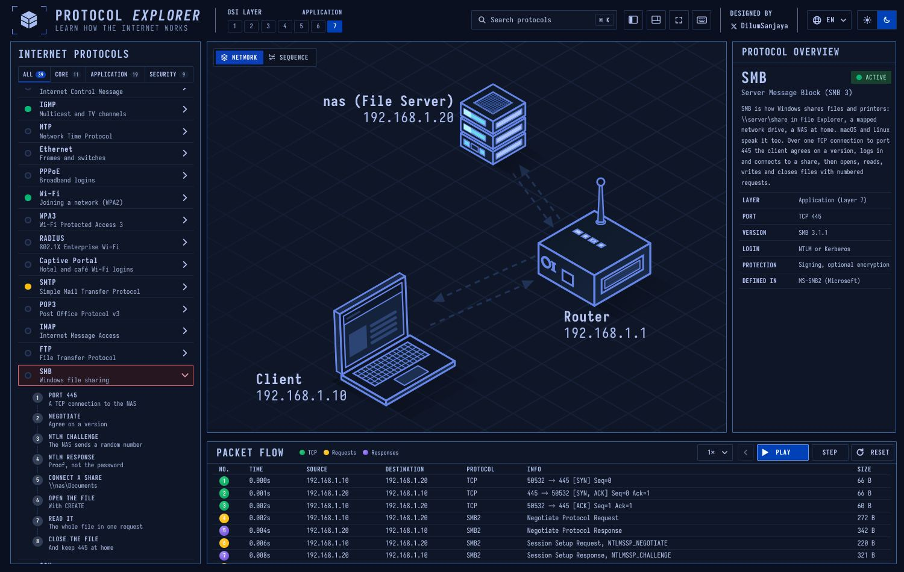
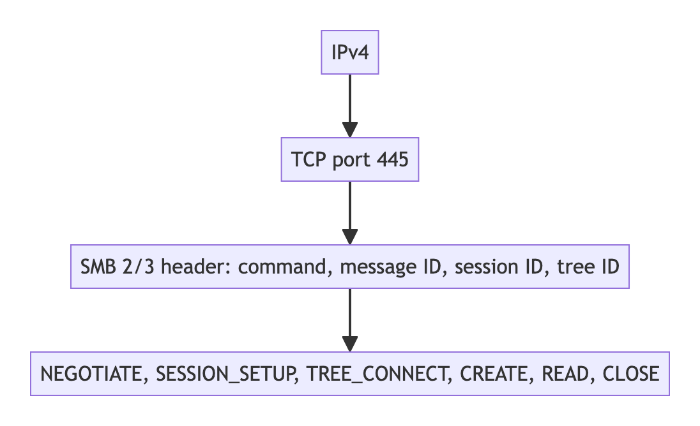
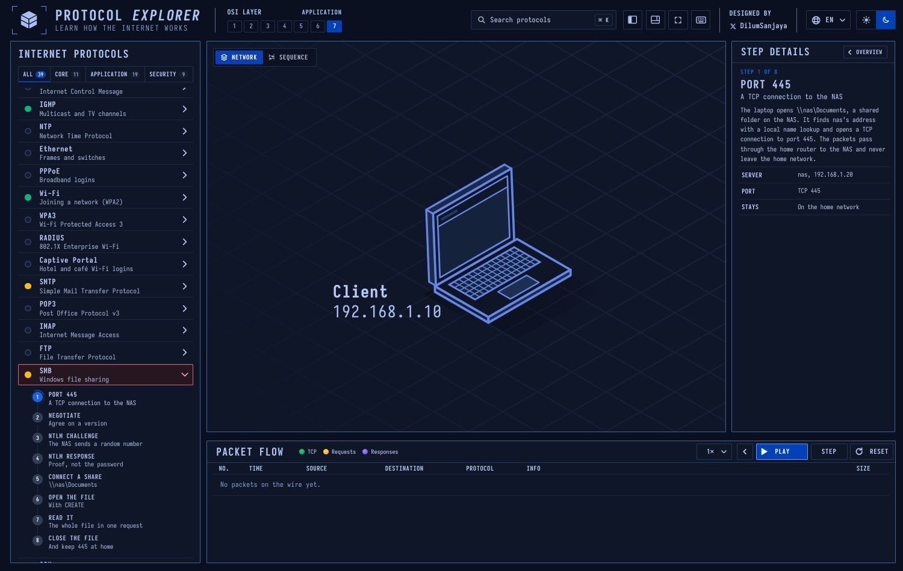
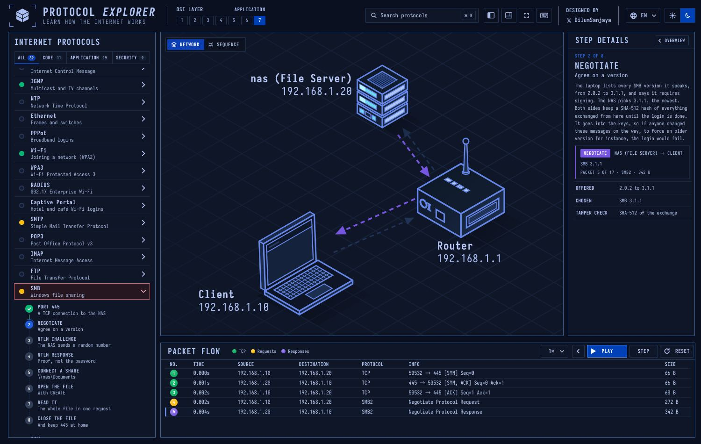
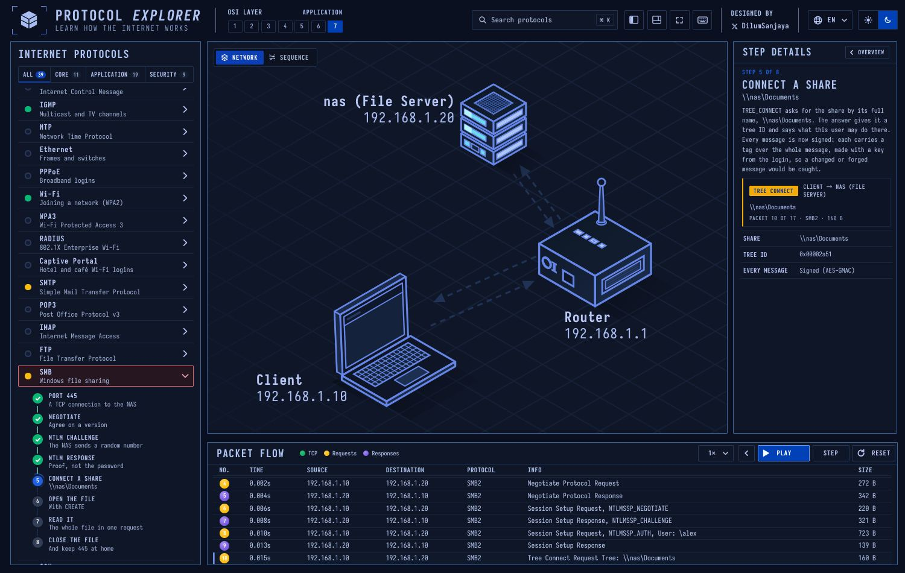
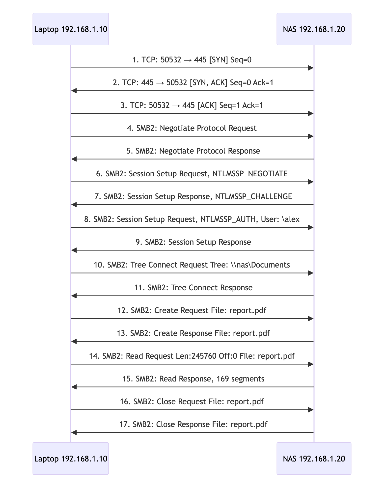
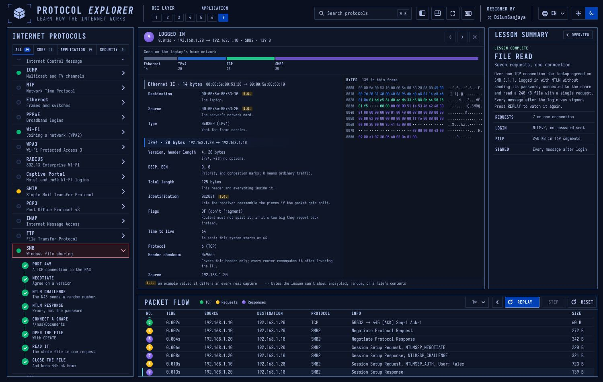
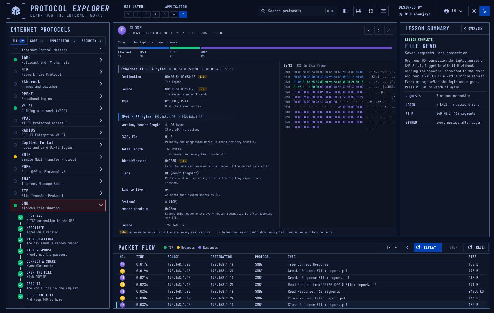

# SMB – Windows file sharing

<!-- nav -->
⬅ [30 FTP](30-ftp.md) · [Index](00_Protocols_Index.md) · [32 SSH](32-ssh.md) ➡
<!-- nav -->

*Source: Protocol Explorer – https://protocol-explorer-alpha.vercel.app/ (interactive lesson #31). Screenshots captured from the live lesson; packet decodes are the site's example capture (values marked **E.G.** differ in every real capture).*

## Overview

### How the layers fit together (outer to inner)

## In-depth explanation of the example (plain-language version)

### The big picture in one minute
On a home network, the laptop opens **`\\nas\Documents\report.pdf`** from a **NAS** (a network storage box, the same one found with ARP in the Ethernet lesson). The 17 packets (about 32 ms) show everything SMB does: **agree on a version**, **log in** using NTLM, **connect to a shared folder**, **open the file**, **read it** (245,760 bytes) and **close it**, all over **one TCP connection to port 445**.

**What SMB is.** *Server Message Block* is the protocol behind **Windows file sharing** (`\\server\share`, mapped drives, network printers). macOS and Linux (via Samba) speak it too. It is a **request/response** protocol: each request has a **command** and a **message number**, and once you're logged in, the messages also carry a **session ID** and a **share ID**.

Think of **a library**: you walk in and agree on the rules (negotiate), show your card (log in), pick a section (connect to a share), borrow a book (open), read it, and return it (close).

> **Words you'll see:** *Share* = a shared folder. *NTLM* = a password-based login method. *Signing* = adding a signature so tampering is detected. *Dialect* = a version of the protocol.

---

### Step 1 – Connect – packets 1 to 3
A TCP handshake to **port 445**. **Never expose port 445 to the internet.**

### Step 2 – Agree on a version – packets 4, 5
- The laptop lists every version it knows (**2.0.2, 2.1, 3.0, 3.0.2, 3.1.1**), says **signing is required**, and offers some security features.
- The NAS picks **3.1.1**, the newest both support.
- Both sides keep a **running fingerprint (a SHA-512 hash) of every message** until login finishes, and mix it into the keys. **If an attacker tampered with these messages, for instance to force an older, weaker version, the keys wouldn't match and the login would fail.** This protects against downgrade attacks.

### Step 3 – The login challenge – packets 6, 7
A home NAS has no Windows domain, so there's no Kerberos. The laptop uses **NTLM**:
- **Request (6):** "I'd like to log in with NTLM."
- **Response (7):** "More steps needed," plus a **random challenge** (8 random bytes) and a session ID.

### Step 4 – The login proof – packets 8, 9
The laptop sends its **username** and a **scrambled proof** made from the **password, the server's challenge, its own challenge and a timestamp**. The NAS knows the same password fingerprint, calculates the same value and compares. **The password never crosses the network.** Both sides also derive a **session key** used for signing. Result: **`STATUS_SUCCESS`**. (In a company domain you'd see Kerberos tickets here instead.)

### Step 5 – Connect to the share – packets 10, 11
The laptop asks to connect to **`\\nas\Documents`** and receives a **share ID** plus its **access rights**. From now on **every message is signed** with a short signature made using the session key, so tampering or forgery is detected. (SMB 3 can also **encrypt** each message; it isn't turned on here.)

### Step 6 – Open the file – packets 12, 13
The command is called **`CREATE`** (it can also create files). Here it **opens `report.pdf` for reading and fails if it doesn't exist.** The reply gives a **file handle** (used by later commands), the size **245,760 bytes**, and timestamps.

### Step 7 – Read – packets 14, 15
**One `READ` request for the entire file.** SMB controls the flow with **credits**: each request uses credits in proportion to its size (1 per 64 KB), and the server grants more in each reply. The answer arrives as **about 249 KB in 169 TCP segments.** For bigger files the client sends **several reads at once** within its credit limit.

### Step 8 – Close – packets 16, 17
**`CLOSE`** hands the file handle back. **The connection stays open for the next file.** Only **signing** protects these messages here, so **anyone on the network could read the file as it passed.** Turn on SMB encryption for sensitive data.

---

### The 17 packets at a glance
| Packets | What | Why |
|---|---|---|
| 1–3 | TCP handshake (port 445) | connect |
| 4–5 | Negotiate | pick version 3.1.1 |
| 6–9 | Session Setup (NTLM) | log in |
| 10–11 | Tree Connect | attach to the `Documents` share |
| 12–13 | Create | open the file |
| 14–15 | Read | get the data |
| 16–17 | Close | return the file |

### What to remember
- **Sequence:** `NEGOTIATE → SESSION_SETUP → TREE_CONNECT → CREATE → READ/WRITE → CLOSE → TREE_DISCONNECT → LOGOFF`.
- **IDs:** Message ID (per request), Session ID (the login), Tree ID (the share), File ID (the open file).
- **SMB1 is obsolete and dangerous.** The **WannaCry** worm (2017) spread through a flaw in it. Disable SMB1.
- **Security features:** protection against downgrade (3.1.1), message signing, **encryption** and **SMB over QUIC** (file access without a VPN).
- Keep **port 445 off the internet**. NTLM is weak, so prefer Kerberos in company networks.

## Under the hood – technical details

- **Message structure.** SMB 2/3 is a binary request/response protocol. Each header carries a **command code**, a **MessageID** (per request), a **SessionID** (set after login), a **TreeID** (the connected share) and, for opened files, a **FileID** in the command itself. Messages can be *signed* with a 16-byte signature.
- **Negotiation.** The client lists dialects (2.0.2, 2.1, 3.0, 3.0.2, 3.1.1). In 3.1.1 it also sends *negotiate contexts*: the pre-authentication integrity hash (SHA-512) and the encryption ciphers (AES-128/256-GCM or CCM).
- **Pre-authentication integrity.** Both sides keep a running SHA-512 hash of every message until login finishes and mix it into the session keys. If an attacker changed the early messages (for example to force an older dialect), the keys would differ and the login would fail.
- **NTLM login.** Inside `SESSION_SETUP` (wrapped in SPNEGO as NTLMSSP): `NEGOTIATE`, then the server's `CHALLENGE` (8 random bytes), then `AUTHENTICATE`. The NTLMv2 response is an `HMAC-MD5` over the server challenge, a client challenge, a timestamp and target information, keyed from the password's hash. The password never travels. In a company domain, **Kerberos** is used instead.
- **Signing and encryption.** After login, every message carries an AES-CMAC signature (SMB 3). SMB 3 can also encrypt every message with AES-GCM per share or per server. Without it, anyone on the path could read the file.
- **File operations.** `TREE_CONNECT` to `\\nas\Documents`, `CREATE` (open or create; here `FILE_OPEN` which fails if the file is missing) returning a FileID, `READ`/`WRITE`, `CLOSE`, `TREE_DISCONNECT`, `LOGOFF`.
- **Credits.** SMB 2/3 flow control: each request consumes credits in proportion to its size (about 1 per 64 KB) and each response grants more. A 245,760-byte read costs 4 credits. Large transfers pipeline several requests within the credit limit.
- **Why many segments.** A 245,760-byte reply is split by TCP into 169 segments of up to 1,460 bytes.
- **Port 445.** SMB directly over TCP (the old port 139 used NetBIOS). Never expose it to the internet.
- **SMB1.** Obsolete and dangerous. The 2017 **WannaCry** worm spread through an SMB1 flaw (EternalBlue). Disable it.
- **Newer features.** **SMB over QUIC** (UDP 443) gives secure file access without a VPN; *multichannel* and *SMB Direct* improve speed.

## Step-by-step walkthrough

### Step 1: PORT 445 – A TCP connection to the NAS

### Step 2: NEGOTIATE – Agree on a version

### Step 3: NTLM CHALLENGE – The NAS sends a random number

### Step 4: NTLM RESPONSE – Proof, not the password

### Step 5: CONNECT A SHARE – \\nas\Documents

### Step 6: OPEN THE FILE – With CREATE

### Step 7: READ IT – The whole file in one request

### Step 8: CLOSE THE FILE – And keep 445 at home

### Lesson summary

## Packet flow (whole lesson)

| No. | Time | Source | Destination | Protocol | Info | Size |
|---|---|---|---|---|---|---|
| 1 | 0.000s | 192.168.1.10 | 192.168.1.20 | TCP | 50532 → 445 [SYN] Seq=0 | 66 B |
| 2 | 0.001s | 192.168.1.20 | 192.168.1.10 | TCP | 445 → 50532 [SYN, ACK] Seq=0 Ack=1 | 66 B |
| 3 | 0.002s | 192.168.1.10 | 192.168.1.20 | TCP | 50532 → 445 [ACK] Seq=1 Ack=1 | 60 B |
| 4 | 0.002s | 192.168.1.10 | 192.168.1.20 | SMB2 | Negotiate Protocol Request | 272 B |
| 5 | 0.004s | 192.168.1.20 | 192.168.1.10 | SMB2 | Negotiate Protocol Response | 342 B |
| 6 | 0.006s | 192.168.1.10 | 192.168.1.20 | SMB2 | Session Setup Request, NTLMSSP_NEGOTIATE | 220 B |
| 7 | 0.008s | 192.168.1.20 | 192.168.1.10 | SMB2 | Session Setup Response, NTLMSSP_CHALLENGE | 321 B |
| 8 | 0.010s | 192.168.1.10 | 192.168.1.20 | SMB2 | Session Setup Request, NTLMSSP_AUTH, User: \alex | 723 B |
| 9 | 0.013s | 192.168.1.20 | 192.168.1.10 | SMB2 | Session Setup Response | 139 B |
| 10 | 0.015s | 192.168.1.10 | 192.168.1.20 | SMB2 | Tree Connect Request Tree: \\nas\Documents | 160 B |
| 11 | 0.017s | 192.168.1.20 | 192.168.1.10 | SMB2 | Tree Connect Response | 138 B |
| 12 | 0.019s | 192.168.1.10 | 192.168.1.20 | SMB2 | Create Request File: report.pdf | 198 B |
| 13 | 0.021s | 192.168.1.20 | 192.168.1.10 | SMB2 | Create Response File: report.pdf | 210 B |
| 14 | 0.023s | 192.168.1.10 | 192.168.1.20 | SMB2 | Read Request Len:245760 Off:0 File: report.pdf | 171 B |
| 15 | 0.025s | 192.168.1.20 | 192.168.1.10 | SMB2 | Read Response, 169 segments | 249.0 KB |
| 16 | 0.030s | 192.168.1.10 | 192.168.1.20 | SMB2 | Close Request File: report.pdf | 146 B |
| 17 | 0.032s | 192.168.1.20 | 192.168.1.10 | SMB2 | Close Response File: report.pdf | 182 B |

### Sequence diagram

*The lesson's own sequence diagram:*

## Packet decoder screenshots

The lesson's decoder view for the first, middle and last packet: headers, field values and the raw hex bytes.

### Packet 1: TCP – 50532 → 445 [SYN] Seq=0

*192.168.1.10 → 192.168.1.20 · 66 B · t = 0.000s*

### Packet 9: SMB2 – Session Setup Response

*192.168.1.20 → 192.168.1.10 · 139 B · t = 0.013s*

### Packet 17: SMB2 – Close Response File: report.pdf

*192.168.1.20 → 192.168.1.10 · 182 B · t = 0.032s*

---

<!-- nav -->
⬅ [30 FTP](30-ftp.md) · [Index](00_Protocols_Index.md) · [32 SSH](32-ssh.md) ➡
<!-- nav -->
