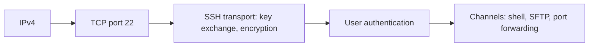
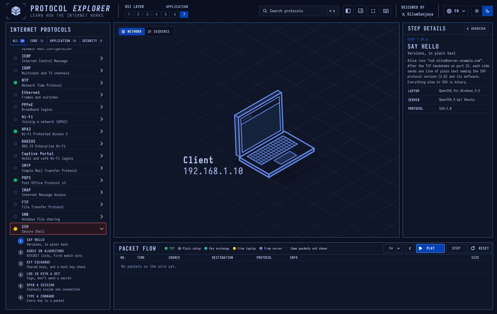
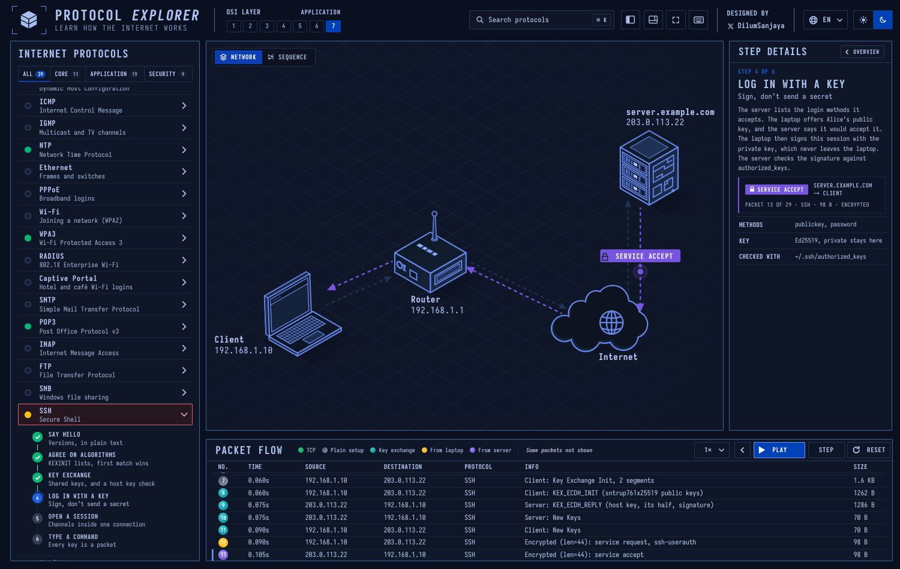
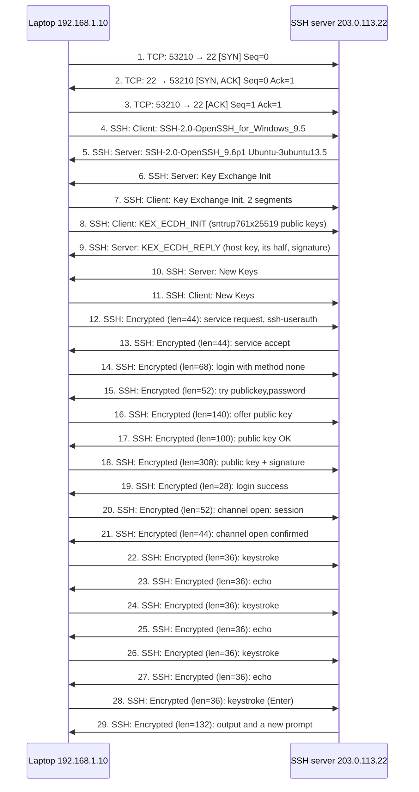
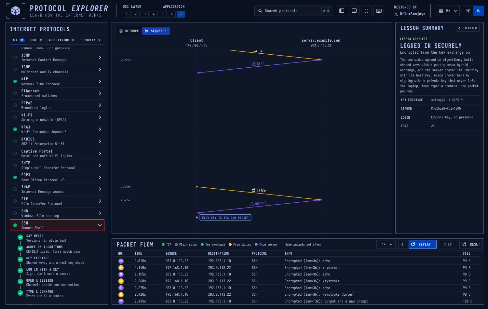
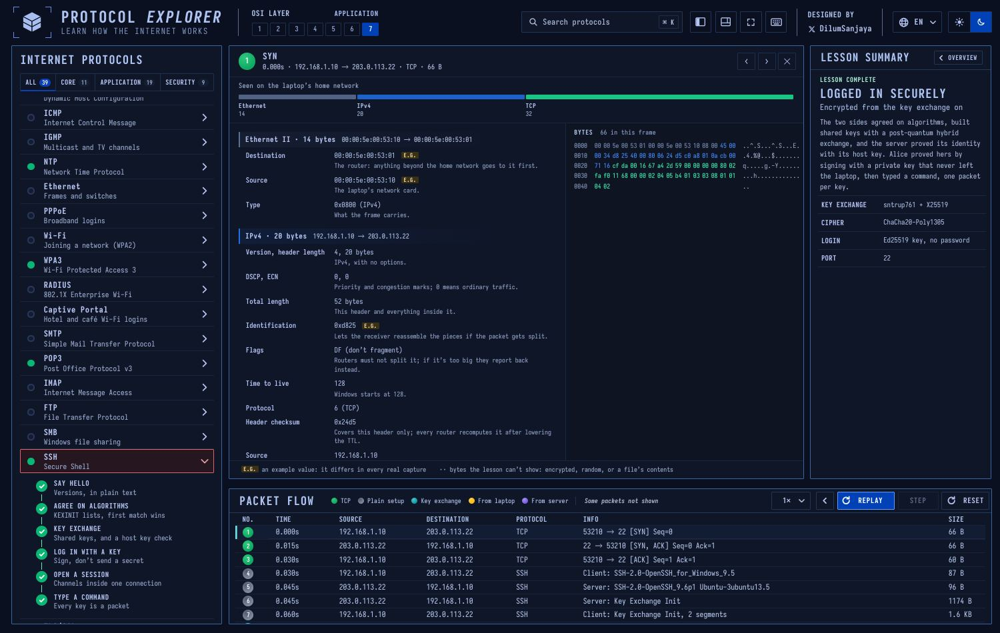

# SSH – Secure Shell

<!-- nav -->
⬅ [31 SMB](31-smb.md) · [Index](00_Protocols_Index.md) · [33 TLS/SSL](33-tls-ssl.md) ➡
<!-- nav -->

*Source: Protocol Explorer – https://protocol-explorer-alpha.vercel.app/ (interactive lesson #32). Screenshots captured from the live lesson; packet decodes are the site's example capture (values marked **E.G.** differ in every real capture).*

## Overview

### How the layers fit together (outer to inner)

## In-depth explanation of the example (plain-language version)

### The big picture in one minute
Alice, on a Windows laptop, connects to a Linux server on **port 22**, logs in using an **SSH key pair** (no password), opens a shell, and types `pwd` and Enter. **29 packets in 2.4 seconds:** greeting, agreeing on algorithms, creating keys, login, opening a session, and the keystrokes and replies.

**What SSH gives you:** an **encrypted, authenticated connection** to another computer, used for **remote command lines**, **file transfer (SFTP/scp)** and **tunnelling other traffic**. The server proves who it is with a **host key**, and the user proves who they are with a **key pair** (or a password). SSH has three layers: **transport** (encryption and server identity) → **user login** → **channels** (shells, file transfers, tunnels).

Think of **a private tunnel to another computer**: first you check you're really talking to the right computer, then you prove who you are, and then you type commands that nobody on the way can read.

> **Words you'll see:** *Host key* = the server's identity key. *Key pair* = a public key (shared) and a private key (secret). *Channel* = one independent stream inside the SSH connection. *known_hosts* = the file where your computer remembers servers it trusts.

---

### Step 1 – Connect and say hello – packets 1 to 5
After the TCP handshake, each side sends a readable greeting with its name and version: `SSH-2.0-OpenSSH_for_Windows_9.5` (client) and `SSH-2.0-OpenSSH_9.6p1 Ubuntu` (server). Both sides remember these lines and include them in the key calculation, so tampering would be detected.

### Step 2 – Agree on the algorithms – packets 6, 7
Each side sends a list, in order of preference, of the methods it supports for key agreement, the server's identity key, encryption, integrity checking and compression. **For each category, the first method on the client's list that the server also supports wins.** (Here: a quantum-resistant key exchange, an `ed25519` host key and the `chacha20-poly1305` cipher.) This list is still sent unencrypted.

### Step 3 – Create the keys and check the server – packets 8 to 11
- **Packet 8:** the client sends its half of a **key agreement** (a hybrid of a post-quantum method and X25519, protecting against "record now, decrypt later" attacks).
- **Packet 9:** the server returns **its half, its host public key, and a signature** that covers the whole conversation so far. Now both sides **calculate the same secret** (never sent) and derive the **session keys.**
- **Checking the server:** the client compares the host key with its **`known_hosts`** file. First time: "The authenticity of host … can't be established. Continue?" (you trust it on first use). If the key later **changes**, you get the famous **"WARNING: REMOTE HOST IDENTIFICATION HAS CHANGED"**, a sign of possible interception.
- **Packets 10–11 (NEWKEYS):** each side says "from now on everything uses the new keys." **Everything after this is encrypted.**

### Step 4 – Log in with a key – packets 12 to 19
- The client asks for the login service, and the server accepts (12–13).
- The client tries "no login" just to learn which methods are allowed; the server lists **`publickey, password`** (14–15).
- The client says "I'd like to use this key" **without proving it yet** (16), and the server checks its `authorized_keys` file and replies "that key is acceptable" (17).
- The client then sends a **signature made with its private key** over the session ID and the request (18). The server verifies it using the stored public key and says **"success"** (19).
**No secret is sent.** The private key never leaves the laptop, and the proof is tied to *this session*, so it can't be replayed. (A password login would send the password, but inside the encrypted channel.)

### Step 5 – Open a session – packets 20, 21
SSH carries many **channels** over the single encrypted connection: a shell, a command, file transfer, **forwarded ports**. The client asks to open a **session channel** and the server confirms. Then (not drawn) the client asks for a terminal and a shell, and the server sends the welcome text and a prompt.

### Step 6 – Typing a command – packets 22 to 29
**Each keystroke is its own small encrypted packet** (90 bytes on the wire for one letter). The server **sends each character back** (echo) so it appears on your screen. After Enter, the output and a new prompt come in one packet. Since OpenSSH 9.5, the client sends keystrokes on a **fixed 20 ms beat and adds decoy packets** to hide your typing rhythm, which can otherwise leak information such as typed passwords.

---

### The 29 packets at a glance
| Packets | What | Why |
|---|---|---|
| 1–5 | TCP + version greetings | connect |
| 6–7 | KEXINIT | agree on algorithms |
| 8–11 | key exchange, NEWKEYS | create keys, verify the server, start encryption |
| 12–19 | public-key login | prove who the user is |
| 20–21 | channel open | start a shell session |
| 22–29 | keystrokes and echoes | type `pwd`, see the output |

### What to remember
- **Layers:** transport (keys, encryption, server identity) → user authentication (`publickey`, `password`…) → channels.
- **Two key pairs:** the **host key** (the server's identity, remembered in `known_hosts`) and the **user key** (your identity, listed in `~/.ssh/authorized_keys`).
- **Keys beat passwords:** nothing guessable is sent. Protect the private key with a passphrase or a hardware key.
- Built on SSH: **SFTP**, **scp**, **port forwarding**, jump hosts, git over SSH.
- Hardening tips: turn off password login and root login, use `ed25519` keys, keep OpenSSH updated, and limit exposure of port 22.

## Under the hood – technical details

- **Three layers.** *Transport* (version exchange, algorithm negotiation, key exchange, encryption and integrity, server authentication), *user authentication*, and *connection* (multiplexed channels). Standardised in RFC 4251 to 4254.
- **Packet format.** Each packet has a length, padding length, payload, random padding and a MAC (or an AEAD tag). Message numbers include `20` KEXINIT, `21` NEWKEYS, `50` USERAUTH_REQUEST, `52` success, `90` CHANNEL_OPEN, `94` CHANNEL_DATA.
- **Version banners.** `SSH-2.0-OpenSSH_9.6p1 ...` are exchanged in plain text and later included in the key-exchange hash.
- **KEXINIT.** Each side lists, in preference order: key exchange, host key types, encryption (per direction), MAC, compression. **The first algorithm on the client's list that the server also supports wins** for each category.
- **Key exchange.** A hybrid of **Streamlined NTRU Prime (`sntrup761`)** and **X25519** (post-quantum safe against "record now, decrypt later"). The server returns its public value, its **host public key** and a signature over the *exchange hash*, which covers both version strings, both KEXINIT messages, the host key and both public values. Session keys, IVs and integrity keys for each direction are derived from the shared secret.
- **Host key verification.** The client compares the host key with its `known_hosts` file. The first time you are asked to trust it (*trust on first use*). A changed key produces the warning "REMOTE HOST IDENTIFICATION HAS CHANGED", a sign of possible interception.
- **Public-key login.** The client first offers the key without a signature. If the server's `authorized_keys` contains it, the server answers `PK_OK`. Then the client signs `(session ID + the authentication request)` with its **private key**, which never leaves the machine, and the server verifies the signature. Because the proof includes the session ID, it cannot be replayed.
- **Other methods.** `password` (sent inside the encrypted channel), `keyboard-interactive`, `hostbased`, and certificates; FIDO2 hardware keys (`ed25519-sk`).
- **Channels.** One connection carries many channels (shell, command, SFTP subsystem, forwarded TCP ports with `-L`, `-R`, `-D`, agent forwarding). Each channel has sender/recipient numbers and a *window size* for flow control.
- **Keystrokes.** Each key press is a separate small `CHANNEL_DATA` packet and the server echoes it. OpenSSH 9.5 sends keystrokes on a 20 ms beat with decoy packets to hide typing rhythm.
- **Hardening.** Disable password and root login, use `ed25519` keys with a passphrase or agent, keep OpenSSH updated, limit exposure of port 22 (fail2ban, firewall).

## Step-by-step walkthrough (screenshots from the lesson)

### Step 1: SAY HELLO – Versions, in plain text

### Step 2: AGREE ON ALGORITHMS – KEXINIT lists, first match wins

### Step 3: KEY EXCHANGE – Shared keys, and a host key check

### Step 4: LOG IN WITH A KEY – Sign, don’t send a secret

### Step 5: OPEN A SESSION – Channels inside one connection

### Step 6: TYPE A COMMAND – Every key is a packet

### Lesson summary

## Packet flow (whole lesson)

| No. | Time | Source | Destination | Protocol | Info | Size |
|---|---|---|---|---|---|---|
| 1 | 0.000s | 192.168.1.10 | 203.0.113.22 | TCP | 53210 → 22 [SYN] Seq=0 | 66 B |
| 2 | 0.015s | 203.0.113.22 | 192.168.1.10 | TCP | 22 → 53210 [SYN, ACK] Seq=0 Ack=1 | 66 B |
| 3 | 0.030s | 192.168.1.10 | 203.0.113.22 | TCP | 53210 → 22 [ACK] Seq=1 Ack=1 | 60 B |
| 4 | 0.030s | 192.168.1.10 | 203.0.113.22 | SSH | Client: SSH-2.0-OpenSSH_for_Windows_9.5 | 87 B |
| 5 | 0.045s | 203.0.113.22 | 192.168.1.10 | SSH | Server: SSH-2.0-OpenSSH_9.6p1 Ubuntu-3ubuntu13.5 | 96 B |
| 6 | 0.045s | 203.0.113.22 | 192.168.1.10 | SSH | Server: Key Exchange Init | 1174 B |
| 7 | 0.060s | 192.168.1.10 | 203.0.113.22 | SSH | Client: Key Exchange Init, 2 segments | 1.6 KB |
| 8 | 0.060s | 192.168.1.10 | 203.0.113.22 | SSH | Client: KEX_ECDH_INIT (sntrup761x25519 public keys) | 1262 B |
| 9 | 0.075s | 203.0.113.22 | 192.168.1.10 | SSH | Server: KEX_ECDH_REPLY (host key, its half, signature) | 1286 B |
| 10 | 0.075s | 203.0.113.22 | 192.168.1.10 | SSH | Server: New Keys | 70 B |
| 11 | 0.090s | 192.168.1.10 | 203.0.113.22 | SSH | Client: New Keys | 70 B |
| 12 | 0.090s | 192.168.1.10 | 203.0.113.22 | SSH | Encrypted (len=44): service request, ssh-userauth | 98 B |
| 13 | 0.105s | 203.0.113.22 | 192.168.1.10 | SSH | Encrypted (len=44): service accept | 98 B |
| 14 | 0.120s | 192.168.1.10 | 203.0.113.22 | SSH | Encrypted (len=68): login with method none | 122 B |
| 15 | 0.135s | 203.0.113.22 | 192.168.1.10 | SSH | Encrypted (len=52): try publickey,password | 106 B |
| 16 | 0.150s | 192.168.1.10 | 203.0.113.22 | SSH | Encrypted (len=140): offer public key | 194 B |
| 17 | 0.165s | 203.0.113.22 | 192.168.1.10 | SSH | Encrypted (len=100): public key OK | 154 B |
| 18 | 0.180s | 192.168.1.10 | 203.0.113.22 | SSH | Encrypted (len=308): public key + signature | 362 B |
| 19 | 0.195s | 203.0.113.22 | 192.168.1.10 | SSH | Encrypted (len=28): login success | 82 B |
| 20 | 0.210s | 192.168.1.10 | 203.0.113.22 | SSH | Encrypted (len=52): channel open: session | 106 B |
| 21 | 0.225s | 203.0.113.22 | 192.168.1.10 | SSH | Encrypted (len=44): channel open confirmed | 98 B |
| 22 | 2.000s | 192.168.1.10 | 203.0.113.22 | SSH | Encrypted (len=36): keystroke | 90 B |
| 23 | 2.015s | 203.0.113.22 | 192.168.1.10 | SSH | Encrypted (len=36): echo | 90 B |
| 24 | 2.140s | 192.168.1.10 | 203.0.113.22 | SSH | Encrypted (len=36): keystroke | 90 B |
| 25 | 2.155s | 203.0.113.22 | 192.168.1.10 | SSH | Encrypted (len=36): echo | 90 B |
| 26 | 2.260s | 192.168.1.10 | 203.0.113.22 | SSH | Encrypted (len=36): keystroke | 90 B |
| 27 | 2.275s | 203.0.113.22 | 192.168.1.10 | SSH | Encrypted (len=36): echo | 90 B |
| 28 | 2.420s | 192.168.1.10 | 203.0.113.22 | SSH | Encrypted (len=36): keystroke (Enter) | 90 B |
| 29 | 2.435s | 203.0.113.22 | 192.168.1.10 | SSH | Encrypted (len=132): output and a new prompt | 186 B |

### Sequence diagram

*The lesson's own sequence diagram:*

## Packet decoder screenshots

The lesson's decoder view for the first, middle and last packet: headers, field values and the raw hex bytes.

### Packet 1: TCP – 53210 → 22 [SYN] Seq=0

*192.168.1.10 → 203.0.113.22 · 66 B · t = 0.000s*

### Packet 15: SSH – Encrypted (len=52): try publickey,password

*203.0.113.22 → 192.168.1.10 · 106 B · t = 0.135s*

### Packet 29: SSH – Encrypted (len=132): output and a new prompt

*203.0.113.22 → 192.168.1.10 · 186 B · t = 2.435s*

---

<!-- nav -->
⬅ [31 SMB](31-smb.md) · [Index](00_Protocols_Index.md) · [33 TLS/SSL](33-tls-ssl.md) ➡
<!-- nav -->
