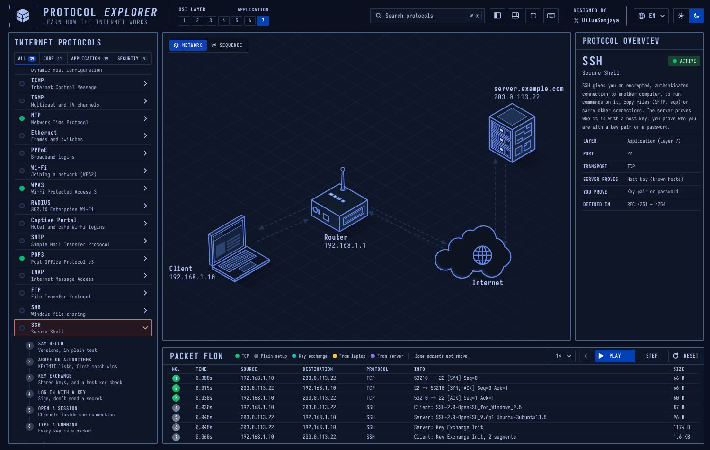
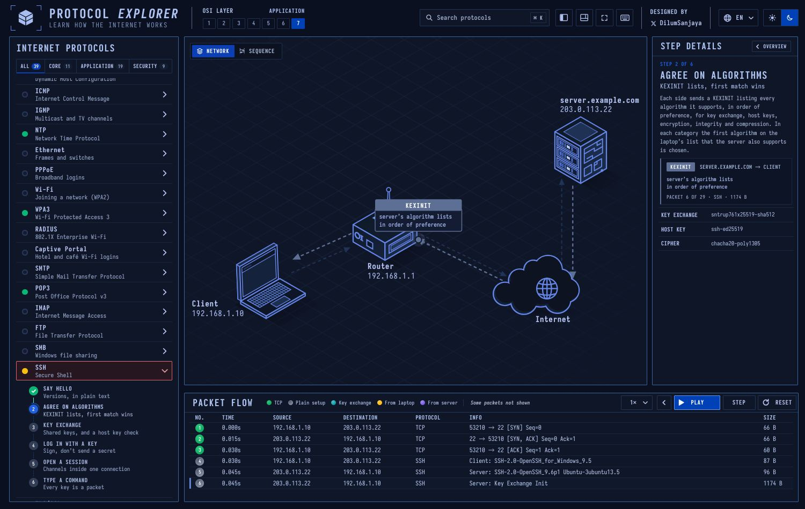
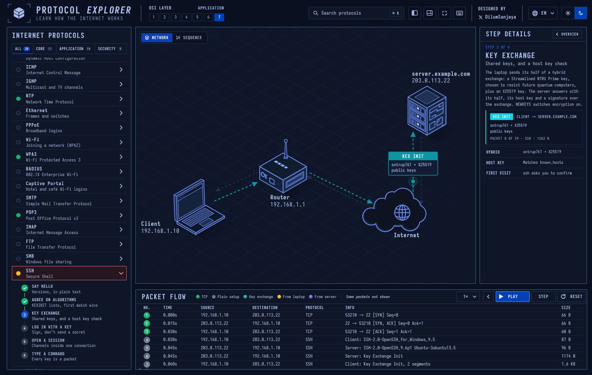
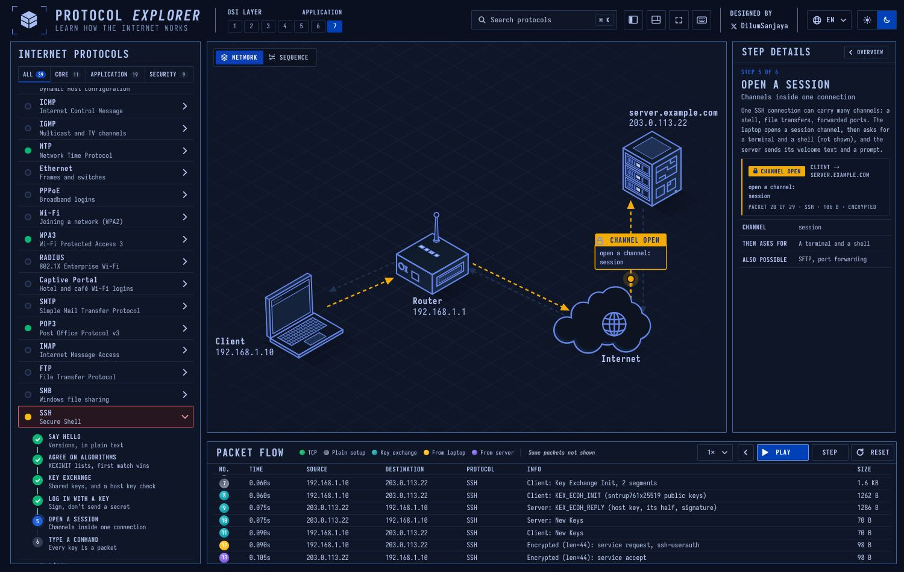
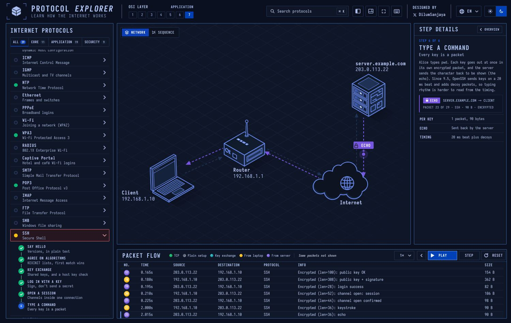
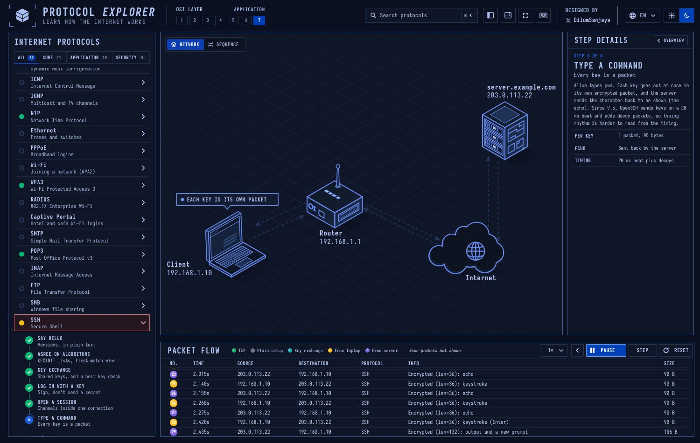
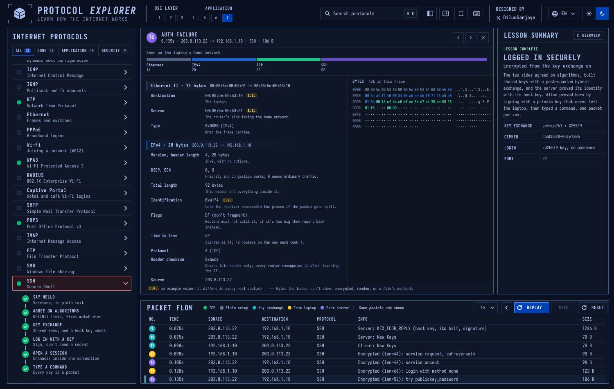
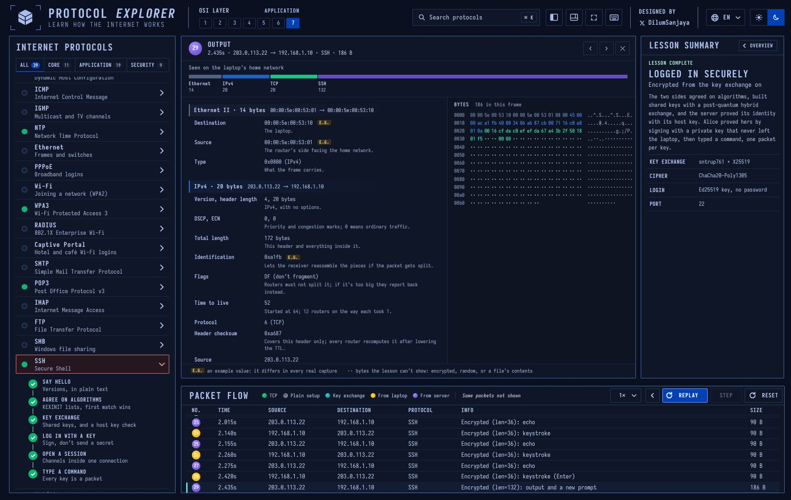

# SSH – Secure Shell

<!-- nav -->
⬅ [31 SMB](31-smb.md) · [Index](00_Protocols_Index.md) · [33 TLS/SSL](33-tls-ssl.md) ➡
<!-- nav -->

*Source: Protocol Explorer – https://protocol-explorer-alpha.vercel.app/ (interactive lesson #32). Screenshots captured from the live lesson; packet decodes are the site's example capture (values marked **E.G.** differ in every real capture).*

## Overview



> PROTOCOL OVERVIEW  
> SSH  
> ACTIVE  
> Secure Shell  
> SSH gives you an encrypted, authenticated connection to another computer, to run commands on it, copy files (SFTP, scp) or carry other connections. The server proves who it is with a host key; you prove who you are with a key pair or a password.  
> LAYER  
> Application (Layer 7)  
> PORT  
> 22  
> TRANSPORT  
> TCP  
> SERVER PROVES  
> Host key (known_hosts)  
> YOU PROVE  
> Key pair or password  
> DEFINED IN  
> RFC 4251 – 4254  

## In-depth explanation of the example (plain-language version)

### The big picture in one minute
Alice, on a Windows laptop, connects to a Linux server on **port 22**, logs in using an **SSH key pair** (no password), opens a shell, and types `pwd` and Enter. **29 packets in 2.4 seconds:** greeting, agreeing on algorithms, creating keys, login, opening a session, and the keystrokes and replies.

**What SSH gives you:** an **encrypted, authenticated connection** to another computer, used for **remote command lines**, **file transfer (SFTP/scp)** and **tunnelling other traffic**. The server proves who it is with a **host key**, and the user proves who they are with a **key pair** (or a password). SSH has three layers: **transport** (encryption and server identity) → **user login** → **channels** (shells, file transfers, tunnels).

Think of **a private tunnel to another computer**: first you check you're really talking to the right computer, then you prove who you are, and then you type commands that nobody on the way can read.

> **Words you'll see:** *Host key* = the server's identity key. *Key pair* = a public key (shared) and a private key (secret). *Channel* = one independent stream inside the SSH connection. *known_hosts* = the file where your computer remembers servers it trusts.

---

### Step 1 – Connect and say hello – packets 1 to 5
After the TCP handshake, each side sends a readable greeting with its name and version: `SSH-2.0-OpenSSH_for_Windows_9.5` (client) and `SSH-2.0-OpenSSH_9.6p1 Ubuntu` (server). Both sides remember these lines and include them in the key calculation, so tampering would be detected.

### Step 2 – Agree on the algorithms – packets 6, 7
Each side sends a list, in order of preference, of the methods it supports for key agreement, the server's identity key, encryption, integrity checking and compression. **For each category, the first method on the client's list that the server also supports wins.** (Here: a quantum-resistant key exchange, an `ed25519` host key and the `chacha20-poly1305` cipher.) This list is still sent unencrypted.

### Step 3 – Create the keys and check the server – packets 8 to 11
- **Packet 8:** the client sends its half of a **key agreement** (a hybrid of a post-quantum method and X25519, protecting against "record now, decrypt later" attacks).
- **Packet 9:** the server returns **its half, its host public key, and a signature** that covers the whole conversation so far. Now both sides **calculate the same secret** (never sent) and derive the **session keys.**
- **Checking the server:** the client compares the host key with its **`known_hosts`** file. First time: "The authenticity of host … can't be established. Continue?" (you trust it on first use). If the key later **changes**, you get the famous **"WARNING: REMOTE HOST IDENTIFICATION HAS CHANGED"**, a sign of possible interception.
- **Packets 10–11 (NEWKEYS):** each side says "from now on everything uses the new keys." **Everything after this is encrypted.**

### Step 4 – Log in with a key – packets 12 to 19
- The client asks for the login service, and the server accepts (12–13).
- The client tries "no login" just to learn which methods are allowed; the server lists **`publickey, password`** (14–15).
- The client says "I'd like to use this key" **without proving it yet** (16), and the server checks its `authorized_keys` file and replies "that key is acceptable" (17).
- The client then sends a **signature made with its private key** over the session ID and the request (18). The server verifies it using the stored public key and says **"success"** (19).
**No secret is sent.** The private key never leaves the laptop, and the proof is tied to *this session*, so it can't be replayed. (A password login would send the password, but inside the encrypted channel.)

### Step 5 – Open a session – packets 20, 21
SSH carries many **channels** over the single encrypted connection: a shell, a command, file transfer, **forwarded ports**. The client asks to open a **session channel** and the server confirms. Then (not drawn) the client asks for a terminal and a shell, and the server sends the welcome text and a prompt.

### Step 6 – Typing a command – packets 22 to 29
**Each keystroke is its own small encrypted packet** (90 bytes on the wire for one letter). The server **sends each character back** (echo) so it appears on your screen. After Enter, the output and a new prompt come in one packet. Since OpenSSH 9.5, the client sends keystrokes on a **fixed 20 ms beat and adds decoy packets** to hide your typing rhythm, which can otherwise leak information such as typed passwords.

---

### The 29 packets at a glance
| Packets | What | Why |
|---|---|---|
| 1–5 | TCP + version greetings | connect |
| 6–7 | KEXINIT | agree on algorithms |
| 8–11 | key exchange, NEWKEYS | create keys, verify the server, start encryption |
| 12–19 | public-key login | prove who the user is |
| 20–21 | channel open | start a shell session |
| 22–29 | keystrokes and echoes | type `pwd`, see the output |

### What to remember
- **Layers:** transport (keys, encryption, server identity) → user authentication (`publickey`, `password`…) → channels.
- **Two key pairs:** the **host key** (the server's identity, remembered in `known_hosts`) and the **user key** (your identity, listed in `~/.ssh/authorized_keys`).
- **Keys beat passwords:** nothing guessable is sent. Protect the private key with a passphrase or a hardware key.
- Built on SSH: **SFTP**, **scp**, **port forwarding**, jump hosts, git over SSH.
- Hardening tips: turn off password login and root login, use `ed25519` keys, keep OpenSSH updated, and limit exposure of port 22.

## Step-by-step walkthrough (screenshots from the lesson)

### Step 1: SAY HELLO – Versions, in plain text


> STEP 1 OF 6  
> SAY HELLO  
> Versions, in plain text  
> Alice runs “ssh alice@server.example.com”. After the TCP handshake on port 22, each side sends one line of plain text naming the SSH protocol version (2.0) and its software. Everything else in SSH is binary.  
> LAPTOP  
> OpenSSH_for_Windows_9.5  
> SERVER  
> OpenSSH_9.6p1 Ubuntu  
> PROTOCOL  
> SSH-2.0  

### Step 2: AGREE ON ALGORITHMS – KEXINIT lists, first match wins



> STEP 2 OF 6  
> AGREE ON ALGORITHMS  
> KEXINIT lists, first match wins  
> Each side sends a KEXINIT listing every algorithm it supports, in order of preference, for key exchange, host keys, encryption, integrity and compression. In each category the first algorithm on the laptop’s list that the server also supports is chosen.  
> KEXINIT  
> SERVER.EXAMPLE.COM → CLIENT  
> server’s algorithm lists  
> in order of preference  
> PACKET 6 OF 29 · SSH · 1174 B  
> KEY EXCHANGE  
> sntrup761x25519-sha512  
> HOST KEY  
> ssh-ed25519  
> CIPHER  
> chacha20-poly1305  

### Step 3: KEY EXCHANGE – Shared keys, and a host key check



> STEP 3 OF 6  
> KEY EXCHANGE  
> Shared keys, and a host key check  
> The laptop sends its half of a hybrid exchange: a Streamlined NTRU Prime key, chosen to resist future quantum computers, plus an X25519 key. The server answers with its half, its host key and a signature over the exchange. NEWKEYS switches encryption on.  
> KEX INIT  
> CLIENT → SERVER.EXAMPLE.COM  
> sntrup761 + X25519  
> public keys  
> PACKET 8 OF 29 · SSH · 1262 B  
> HYBRID  
> sntrup761 + X25519  
> HOST KEY  
> Matches known_hosts  
> FIRST VISIT  
> ssh asks you to confirm  

### Step 4: LOG IN WITH A KEY – Sign, don’t send a secret


> STEP 4 OF 6  
> LOG IN WITH A KEY  
> Sign, don’t send a secret  
> The server lists the login methods it accepts. The laptop offers Alice’s public key, and the server says it would accept it. The laptop then signs this session with the private key, which never leaves the laptop. The server checks the signature against authorized_keys.  
> SERVICE ACCEPT  
> SERVER.EXAMPLE.COM → CLIENT  
> PACKET 13 OF 29 · SSH · 98 B · ENCRYPTED  
> METHODS  
> publickey, password  
> KEY  
> Ed25519, private stays here  
> CHECKED WITH  
> ~/.ssh/authorized_keys  

### Step 5: OPEN A SESSION – Channels inside one connection



> STEP 5 OF 6  
> OPEN A SESSION  
> Channels inside one connection  
> One SSH connection can carry many channels: a shell, file transfers, forwarded ports. The laptop opens a session channel, then asks for a terminal and a shell (not shown), and the server sends its welcome text and a prompt.  
> CHANNEL OPEN  
> CLIENT → SERVER.EXAMPLE.COM  
> open a channel:  
> session  
> PACKET 20 OF 29 · SSH · 106 B · ENCRYPTED  
> CHANNEL  
> session  
> THEN ASKS FOR  
> A terminal and a shell  
> ALSO POSSIBLE  
> SFTP, port forwarding  

### Step 6: TYPE A COMMAND – Every key is a packet



> STEP 6 OF 6  
> TYPE A COMMAND  
> Every key is a packet  
> Alice types pwd. Each key goes out at once in its own encrypted packet, and the server sends the character back to be shown (the echo). Since 9.5, OpenSSH sends keys on a 20 ms beat and adds decoy packets, so typing rhythm is harder to read from the timing.  
> ECHO  
> SERVER.EXAMPLE.COM → CLIENT  
> PACKET 23 OF 29 · SSH · 90 B · ENCRYPTED  
> PER KEY  
> 1 packet, 90 bytes  
> ECHO  
> Sent back by the server  
> TIMING  
> 20 ms beat plus decoys  

### Lesson summary



> STEP 6 OF 6  
> TYPE A COMMAND  
> Every key is a packet  
> Alice types pwd. Each key goes out at once in its own encrypted packet, and the server sends the character back to be shown (the echo). Since 9.5, OpenSSH sends keys on a 20 ms beat and adds decoy packets, so typing rhythm is harder to read from the timing.  
> OUTPUT  
> SERVER.EXAMPLE.COM → CLIENT  
> /home/alice  
> alice@server:~$  
> PACKET 29 OF 29 · SSH · 186 B · ENCRYPTED  
> PER KEY  
> 1 packet, 90 bytes  
> ECHO  
> Sent back by the server  
> TIMING  
> 20 ms beat plus decoys  

## Packet flow (whole lesson)

| No. | Time | Source | Destination | Protocol | Info | Size |
|---|---|---|---|---|---|---|
| 1 | 0.000s | 192.168.1.10 | 203.0.113.22 | TCP | 53210 → 22 [SYN] Seq=0 | 66 B |
| 2 | 0.015s | 203.0.113.22 | 192.168.1.10 | TCP | 22 → 53210 [SYN, ACK] Seq=0 Ack=1 | 66 B |
| 3 | 0.030s | 192.168.1.10 | 203.0.113.22 | TCP | 53210 → 22 [ACK] Seq=1 Ack=1 | 60 B |
| 4 | 0.030s | 192.168.1.10 | 203.0.113.22 | SSH | Client: SSH-2.0-OpenSSH_for_Windows_9.5 | 87 B |
| 5 | 0.045s | 203.0.113.22 | 192.168.1.10 | SSH | Server: SSH-2.0-OpenSSH_9.6p1 Ubuntu-3ubuntu13.5 | 96 B |
| 6 | 0.045s | 203.0.113.22 | 192.168.1.10 | SSH | Server: Key Exchange Init | 1174 B |
| 7 | 0.060s | 192.168.1.10 | 203.0.113.22 | SSH | Client: Key Exchange Init, 2 segments | 1.6 KB |
| 8 | 0.060s | 192.168.1.10 | 203.0.113.22 | SSH | Client: KEX_ECDH_INIT (sntrup761x25519 public keys) | 1262 B |
| 9 | 0.075s | 203.0.113.22 | 192.168.1.10 | SSH | Server: KEX_ECDH_REPLY (host key, its half, signature) | 1286 B |
| 10 | 0.075s | 203.0.113.22 | 192.168.1.10 | SSH | Server: New Keys | 70 B |
| 11 | 0.090s | 192.168.1.10 | 203.0.113.22 | SSH | Client: New Keys | 70 B |
| 12 | 0.090s | 192.168.1.10 | 203.0.113.22 | SSH | Encrypted (len=44): service request, ssh-userauth | 98 B |
| 13 | 0.105s | 203.0.113.22 | 192.168.1.10 | SSH | Encrypted (len=44): service accept | 98 B |
| 14 | 0.120s | 192.168.1.10 | 203.0.113.22 | SSH | Encrypted (len=68): login with method none | 122 B |
| 15 | 0.135s | 203.0.113.22 | 192.168.1.10 | SSH | Encrypted (len=52): try publickey,password | 106 B |
| 16 | 0.150s | 192.168.1.10 | 203.0.113.22 | SSH | Encrypted (len=140): offer public key | 194 B |
| 17 | 0.165s | 203.0.113.22 | 192.168.1.10 | SSH | Encrypted (len=100): public key OK | 154 B |
| 18 | 0.180s | 192.168.1.10 | 203.0.113.22 | SSH | Encrypted (len=308): public key + signature | 362 B |
| 19 | 0.195s | 203.0.113.22 | 192.168.1.10 | SSH | Encrypted (len=28): login success | 82 B |
| 20 | 0.210s | 192.168.1.10 | 203.0.113.22 | SSH | Encrypted (len=52): channel open: session | 106 B |
| 21 | 0.225s | 203.0.113.22 | 192.168.1.10 | SSH | Encrypted (len=44): channel open confirmed | 98 B |
| 22 | 2.000s | 192.168.1.10 | 203.0.113.22 | SSH | Encrypted (len=36): keystroke | 90 B |
| 23 | 2.015s | 203.0.113.22 | 192.168.1.10 | SSH | Encrypted (len=36): echo | 90 B |
| 24 | 2.140s | 192.168.1.10 | 203.0.113.22 | SSH | Encrypted (len=36): keystroke | 90 B |
| 25 | 2.155s | 203.0.113.22 | 192.168.1.10 | SSH | Encrypted (len=36): echo | 90 B |
| 26 | 2.260s | 192.168.1.10 | 203.0.113.22 | SSH | Encrypted (len=36): keystroke | 90 B |
| 27 | 2.275s | 203.0.113.22 | 192.168.1.10 | SSH | Encrypted (len=36): echo | 90 B |
| 28 | 2.420s | 192.168.1.10 | 203.0.113.22 | SSH | Encrypted (len=36): keystroke (Enter) | 90 B |
| 29 | 2.435s | 203.0.113.22 | 192.168.1.10 | SSH | Encrypted (len=132): output and a new prompt | 186 B |

### Sequence diagram


## Packets decoded byte by byte

Each packet below is the lesson's own decode (headers, field values and the plain-English meaning of each field). Screenshots show the first, middle and last packet in the lesson's decoder view with the raw hex bytes.

### Packet 1: TCP – 53210 → 22 [SYN] Seq=0

*192.168.1.10 → 203.0.113.22 · 66 B · t = 0.000s*


<details><summary>Decoded fields</summary>

```text
1
SYN
0.000s · 192.168.1.10 → 203.0.113.22 · TCP · 66 B
Seen on the laptop’s home network
Ethernet
14
IPv4
20
TCP
32
Ethernet II · 14 bytes
00:00:5e:00:53:10 → 00:00:5e:00:53:01
Destination
00:00:5e:00:53:01 E.G.

The router: anything beyond the home network goes to it first.

Source
00:00:5e:00:53:10 E.G.

The laptop’s network card.

Type
0x0800 (IPv4)

What the frame carries.

IPv4 · 20 bytes
192.168.1.10 → 203.0.113.22
Version, header length
4, 20 bytes

IPv4, with no options.

DSCP, ECN
0, 0

Priority and congestion marks; 0 means ordinary traffic.

Total length
52 bytes

This header and everything inside it.

Identification
0xd825 E.G.

Lets the receiver reassemble the pieces if the packet gets split.

Flags
DF (don’t fragment)

Routers must not split it; if it’s too big they report back instead.

Time to live
128

Windows starts at 128.

Protocol
6 (TCP)
Header checksum
0x24d5

Covers this header only; every router recomputes it after lowering the TTL.

Source
192.168.1.10
Destination
203.0.113.22
TCP · 32 bytes
53210 → 22, SYN
Source port
53210

Picked by the laptop’s system for this connection.

Destination port
22
Sequence number
0 (relative)

This side’s starting number. Shown as 0; the real one is random.

Real sequence number
1738812761 E.G.
Acknowledgment
0 (not used yet)

A first SYN has nothing to acknowledge.

Header length
32 bytes

20 bytes, plus 12 of options.

Flags
0x002 (SYN)
Window
64240 E.G.

How much more data this side can take right now.

Checksum
0x1168

Covers the header, the data and the IP addresses, so damage is caught.

Urgent pointer
0
Options
12 bytes
Maximum segment size
1460 bytes

The most data this side wants in one segment.

No-op
1

Spacing, so the next option lines up.

Window scale
× 256

Window values are multiplied by this, so windows can be larger than 64 KB.

No-op
1

Spacing, so the next option lines up.

No-op
1

Spacing, so the next option lines up.

SACK permitted
yes

This side understands selective acknowledgements.

BYTES 66 in this frame
0000
00
00
5e
00
53
01
00
00
5e
00
53
10
08
00
45
00
.
.
^
.
S
.
.
.
^
.
S
.
.
.
E
.
0010
00
34
d8
25
40
00
80
06
24
d5
c0
a8
01
0a
cb
00
.
4
.
%
@
.
.
.
$
.
.
.
.
.
.
.
0020
71
16
cf
da
00
16
67
a4
2d
59
00
00
00
00
80
02
q
.
.
.
.
.
g
.
-
Y
.
.
.
.
.
.
0030
fa
f0
11
68
00
00
02
04
05
b4
01
03
03
08
01
01
.
.
.
h
.
.
.
.
.
.
.
.
.
.
.
.
0040
04
02
.
.
E.G. an example value: it differs in every real capture
·· bytes the lesson can’t show: encrypted, random, or a file’s contents
```

</details>

### Packet 2: TCP – 22 → 53210 [SYN, ACK] Seq=0 Ack=1

*203.0.113.22 → 192.168.1.10 · 66 B · t = 0.015s*

<details><summary>Decoded fields</summary>

```text
2
SYN-ACK
0.015s · 203.0.113.22 → 192.168.1.10 · TCP · 66 B
Seen on the laptop’s home network
Ethernet
14
IPv4
20
TCP
32
Ethernet II · 14 bytes
00:00:5e:00:53:01 → 00:00:5e:00:53:10
Destination
00:00:5e:00:53:10 E.G.

The laptop.

Source
00:00:5e:00:53:01 E.G.

The router’s side facing the home network.

Type
0x0800 (IPv4)

What the frame carries.

IPv4 · 20 bytes
203.0.113.22 → 192.168.1.10
Version, header length
4, 20 bytes

IPv4, with no options.

DSCP, ECN
0, 0

Priority and congestion marks; 0 means ordinary traffic.

Total length
52 bytes

This header and everything inside it.

Identification
0xa1ee E.G.

Lets the receiver reassemble the pieces if the packet gets split.

Flags
DF (don’t fragment)

Routers must not split it; if it’s too big they report back instead.

Time to live
52

Started at 64; 12 routers on the way each took 1.

Protocol
6 (TCP)
Header checksum
0xa70c

Covers this header only; every router recomputes it after lowering the TTL.

Source
203.0.113.22
Destination
192.168.1.10
TCP · 32 bytes
22 → 53210, SYN, ACK
Source port
22
Destination port
53210
Sequence number
0 (relative)

This side’s starting number. Shown as 0; the real one is random.

Real sequence number
3236947191 E.G.
Acknowledgment
1 (relative)

The next byte this side expects: everything before it has arrived.

Header length
32 bytes

20 bytes, plus 12 of options.

Flags
0x012 (SYN, ACK)
Window
64240 E.G.

How much more data this side can take right now.

Checksum
0x6b70

Covers the header, the data and the IP addresses, so damage is caught.

Urgent pointer
0
Options
12 bytes
Maximum segment size
1460 bytes

The most data this side wants in one segment.

No-op
1

Spacing, so the next option lines up.

No-op
1

Spacing, so the next option lines up.

SACK permitted
yes

This side understands selective acknowledgements.

No-op
1

Spacing, so the next option lines up.

Window scale
× 128

Window values are multiplied by this, so windows can be larger than 64 KB.

BYTES 66 in this frame
0000
00
00
5e
00
53
10
00
00
5e
00
53
01
08
00
45
00
.
.
^
.
S
.
.
.
^
.
S
.
.
.
E
.
0010
00
34
a1
ee
40
00
34
06
a7
0c
cb
00
71
16
c0
a8
.
4
.
.
@
.
4
.
.
.
.
.
q
.
.
.
0020
01
0a
00
16
cf
da
c0
ef
e4
f7
67
a4
2d
5a
80
12
.
.
.
.
.
.
.
.
.
.
g
.
-
Z
.
.
0030
fa
f0
6b
70
00
00
02
04
05
b4
01
01
04
02
01
03
.
.
k
p
.
.
.
.
.
.
.
.
.
.
.
.
0040
03
07
.
.
E.G. an example value: it differs in every real capture
·· bytes the lesson can’t show: encrypted, random, or a file’s contents
```

</details>

### Packet 3: TCP – 53210 → 22 [ACK] Seq=1 Ack=1

*192.168.1.10 → 203.0.113.22 · 60 B · t = 0.030s*

<details><summary>Decoded fields</summary>

```text
3
ACK
0.030s · 192.168.1.10 → 203.0.113.22 · TCP · 60 B
Seen on the laptop’s home network
Ethernet
14
IPv4
20
TCP
20
Padding
6
Ethernet II · 14 bytes
00:00:5e:00:53:10 → 00:00:5e:00:53:01
Destination
00:00:5e:00:53:01 E.G.

The router: anything beyond the home network goes to it first.

Source
00:00:5e:00:53:10 E.G.

The laptop’s network card.

Type
0x0800 (IPv4)

What the frame carries.

IPv4 · 20 bytes
192.168.1.10 → 203.0.113.22
Version, header length
4, 20 bytes

IPv4, with no options.

DSCP, ECN
0, 0

Priority and congestion marks; 0 means ordinary traffic.

Total length
40 bytes

This header and everything inside it.

Identification
0xd826 E.G.

Lets the receiver reassemble the pieces if the packet gets split.

Flags
DF (don’t fragment)

Routers must not split it; if it’s too big they report back instead.

Time to live
128

Windows starts at 128.

Protocol
6 (TCP)
Header checksum
0x24e0

Covers this header only; every router recomputes it after lowering the TTL.

Source
192.168.1.10
Destination
203.0.113.22
TCP · 20 bytes
53210 → 22, ACK
Source port
53210

Picked by the laptop’s system for this connection.

Destination port
22
Sequence number
1 (relative)

Position of this segment’s first byte, counted from this side’s SYN.

Real sequence number
1738812762 E.G.
Acknowledgment
1 (relative)

The next byte this side expects: everything before it has arrived.

Header length
20 bytes
Flags
0x010 (ACK)
Window
1026 (× 256 = 262,656 bytes) E.G.

How much more data this side can take right now.

Checksum
0xa331

Covers the header, the data and the IP addresses, so damage is caught.

Urgent pointer
0
Ethernet padding · 6 bytes
Padding
6 zero bytes

Ethernet frames are at least 60 bytes (64 with the checksum the card adds), so short ones are padded.

BYTES 60 in this frame
0000
00
00
5e
00
53
01
00
00
5e
00
53
10
08
00
45
00
.
.
^
.
S
.
.
.
^
.
S
.
.
.
E
.
0010
00
28
d8
26
40
00
80
06
24
e0
c0
a8
01
0a
cb
00
.
(
.
&
@
.
.
.
$
.
.
.
.
.
.
.
0020
71
16
cf
da
00
16
67
a4
2d
5a
c0
ef
e4
f8
50
10
q
.
.
.
.
.
g
.
-
Z
.
.
.
.
P
.
0030
04
02
a3
31
00
00
00
00
00
00
00
00
.
.
.
1
.
.
.
.
.
.
.
.
E.G. an example value: it differs in every real capture
·· bytes the lesson can’t show: encrypted, random, or a file’s contents
```

</details>

### Packet 4: SSH – Client: SSH-2.0-OpenSSH_for_Windows_9.5

*192.168.1.10 → 203.0.113.22 · 87 B · t = 0.030s*

<details><summary>Decoded fields</summary>

```text
4
VERSION
0.030s · 192.168.1.10 → 203.0.113.22 · SSH · 87 B
Seen on the laptop’s home network
Ethernet
14
IPv4
20
TCP
20
SSH
33
Ethernet II · 14 bytes
00:00:5e:00:53:10 → 00:00:5e:00:53:01
Destination
00:00:5e:00:53:01 E.G.

The router: anything beyond the home network goes to it first.

Source
00:00:5e:00:53:10 E.G.

The laptop’s network card.

Type
0x0800 (IPv4)

What the frame carries.

IPv4 · 20 bytes
192.168.1.10 → 203.0.113.22
Version, header length
4, 20 bytes

IPv4, with no options.

DSCP, ECN
0, 0

Priority and congestion marks; 0 means ordinary traffic.

Total length
73 bytes

This header and everything inside it.

Identification
0xd827 E.G.

Lets the receiver reassemble the pieces if the packet gets split.

Flags
DF (don’t fragment)

Routers must not split it; if it’s too big they report back instead.

Time to live
128

Windows starts at 128.

Protocol
6 (TCP)
Header checksum
0x24be

Covers this header only; every router recomputes it after lowering the TTL.

Source
192.168.1.10
Destination
203.0.113.22
TCP · 20 bytes
53210 → 22, PSH, ACK
Source port
53210

Picked by the laptop’s system for this connection.

Destination port
22
Sequence number
1 (relative)

Position of this segment’s first byte, counted from this side’s SYN.

Real sequence number
1738812762 E.G.
Acknowledgment
1 (relative)

The next byte this side expects: everything before it has arrived.

Header length
20 bytes
Flags
0x018 (PSH, ACK)
Window
1026 (× 256 = 262,656 bytes) E.G.

How much more data this side can take right now.

Checksum
0x5aec

Covers the header, the data and the IP addresses, so damage is caught.

Urgent pointer
0
SSH
Text
SSH-2.0-OpenSSH_for_Windows_9.5␍␊
BYTES 87 in this frame
0000
00
00
5e
00
53
01
00
00
5e
00
53
10
08
00
45
00
.
.
^
.
S
.
.
.
^
.
S
.
.
.
E
.
0010
00
49
d8
27
40
00
80
06
24
be
c0
a8
01
0a
cb
00
.
I
.
'
@
.
.
.
$
.
.
.
.
.
.
.
0020
71
16
cf
da
00
16
67
a4
2d
5a
c0
ef
e4
f8
50
18
q
.
.
.
.
.
g
.
-
Z
.
.
.
.
P
.
0030
04
02
5a
ec
00
00
53
53
48
2d
32
2e
30
2d
4f
70
.
.
Z
.
.
.
S
S
H
-
2
.
0
-
O
p
0040
65
6e
53
53
48
5f
66
6f
72
5f
57
69
6e
64
6f
77
e
n
S
S
H
_
f
o
r
_
W
i
n
d
o
w
0050
73
5f
39
2e
35
0d
0a
s
_
9
.
5
.
.
E.G. an example value: it differs in every real capture
·· bytes the lesson can’t show: encrypted, random, or a file’s contents
```

</details>

### Packet 5: SSH – Server: SSH-2.0-OpenSSH_9.6p1 Ubuntu-3ubuntu13.5

*203.0.113.22 → 192.168.1.10 · 96 B · t = 0.045s*

<details><summary>Decoded fields</summary>

```text
5
VERSION
0.045s · 203.0.113.22 → 192.168.1.10 · SSH · 96 B
Seen on the laptop’s home network
Ethernet
14
IPv4
20
TCP
20
SSH
42
Ethernet II · 14 bytes
00:00:5e:00:53:01 → 00:00:5e:00:53:10
Destination
00:00:5e:00:53:10 E.G.

The laptop.

Source
00:00:5e:00:53:01 E.G.

The router’s side facing the home network.

Type
0x0800 (IPv4)

What the frame carries.

IPv4 · 20 bytes
203.0.113.22 → 192.168.1.10
Version, header length
4, 20 bytes

IPv4, with no options.

DSCP, ECN
0, 0

Priority and congestion marks; 0 means ordinary traffic.

Total length
82 bytes

This header and everything inside it.

Identification
0xa1ef E.G.

Lets the receiver reassemble the pieces if the packet gets split.

Flags
DF (don’t fragment)

Routers must not split it; if it’s too big they report back instead.

Time to live
52

Started at 64; 12 routers on the way each took 1.

Protocol
6 (TCP)
Header checksum
0xa6ed

Covers this header only; every router recomputes it after lowering the TTL.

Source
203.0.113.22
Destination
192.168.1.10
TCP · 20 bytes
22 → 53210, PSH, ACK
Source port
22
Destination port
53210
Sequence number
1 (relative)

Position of this segment’s first byte, counted from this side’s SYN.

Real sequence number
3236947192 E.G.
Acknowledgment
34 (relative)

The next byte this side expects: everything before it has arrived.

Header length
20 bytes
Flags
0x018 (PSH, ACK)
Window
501 (× 128 = 64,128 bytes) E.G.

How much more data this side can take right now.

Checksum
0x7d8d

Covers the header, the data and the IP addresses, so damage is caught.

Urgent pointer
0
SSH
Text
SSH-2.0-OpenSSH_9.6p1 Ubuntu-3ubuntu13.5␍␊
BYTES 96 in this frame
0000
00
00
5e
00
53
10
00
00
5e
00
53
01
08
00
45
00
.
.
^
.
S
.
.
.
^
.
S
.
.
.
E
.
0010
00
52
a1
ef
40
00
34
06
a6
ed
cb
00
71
16
c0
a8
.
R
.
.
@
.
4
.
.
.
.
.
q
.
.
.
0020
01
0a
00
16
cf
da
c0
ef
e4
f8
67
a4
2d
7b
50
18
.
.
.
.
.
.
.
.
.
.
g
.
-
{
P
.
0030
01
f5
7d
8d
00
00
53
53
48
2d
32
2e
30
2d
4f
70
.
.
}
.
.
.
S
S
H
-
2
.
0
-
O
p
0040
65
6e
53
53
48
5f
39
2e
36
70
31
20
55
62
75
6e
e
n
S
S
H
_
9
.
6
p
1
U
b
u
n
0050
74
75
2d
33
75
62
75
6e
74
75
31
33
2e
35
0d
0a
t
u
-
3
u
b
u
n
t
u
1
3
.
5
.
.
E.G. an example value: it differs in every real capture
·· bytes the lesson can’t show: encrypted, random, or a file’s contents
```

</details>

### Packet 6: SSH – Server: Key Exchange Init

*203.0.113.22 → 192.168.1.10 · 1174 B · t = 0.045s*

<details><summary>Decoded fields</summary>

```text
6
KEXINIT
0.045s · 203.0.113.22 → 192.168.1.10 · SSH · 1174 B
Seen on the laptop’s home network
Ethernet
14
IPv4
20
TCP
20
SSH
1120
Ethernet II · 14 bytes
00:00:5e:00:53:01 → 00:00:5e:00:53:10
Destination
00:00:5e:00:53:10 E.G.

The laptop.

Source
00:00:5e:00:53:01 E.G.

The router’s side facing the home network.

Type
0x0800 (IPv4)

What the frame carries.

IPv4 · 20 bytes
203.0.113.22 → 192.168.1.10
Version, header length
4, 20 bytes

IPv4, with no options.

DSCP, ECN
0, 0

Priority and congestion marks; 0 means ordinary traffic.

Total length
1160 bytes

This header and everything inside it.

Identification
0xa1f0 E.G.

Lets the receiver reassemble the pieces if the packet gets split.

Flags
DF (don’t fragment)

Routers must not split it; if it’s too big they report back instead.

Time to live
52

Started at 64; 12 routers on the way each took 1.

Protocol
6 (TCP)
Header checksum
0xa2b6

Covers this header only; every router recomputes it after lowering the TTL.

Source
203.0.113.22
Destination
192.168.1.10
TCP · 20 bytes
22 → 53210, PSH, ACK
Source port
22
Destination port
53210
Sequence number
43 (relative)

Position of this segment’s first byte, counted from this side’s SYN.

Real sequence number
3236947234 E.G.
Acknowledgment
34 (relative)

The next byte this side expects: everything before it has arrived.

Header length
20 bytes
Flags
0x018 (PSH, ACK)
Window
501 (× 128 = 64,128 bytes) E.G.

How much more data this side can take right now.

Checksum
covers bytes not shown here

Covers the header, the data and the IP addresses, so damage is caught.

Urgent pointer
0
SSH
Packet length
1116

Bytes after this field.

Padding length
7

Random padding brings the packet to a multiple of 8 bytes.

Message
20 (KEXINIT)
Cookie
16 random bytes
Key exchange
sntrup761x25519-sha512@openssh.com,curve25519-sha256,curv…
Host keys
rsa-sha2-512,rsa-sha2-256,ecdsa-sha2-nistp256,ssh-ed25519
Ciphers, out
chacha20-poly1305@openssh.com,aes128-ctr,aes192-ctr,aes25…
Ciphers, in
chacha20-poly1305@openssh.com,aes128-ctr,aes192-ctr,aes25…
MACs, out
umac-64-etm@openssh.com,umac-128-etm@openssh.com,hmac-sha…
MACs, in
umac-64-etm@openssh.com,umac-128-etm@openssh.com,hmac-sha…
Compression, out
none,zlib@openssh.com
Compression, in
none,zlib@openssh.com
Languages, out
Languages, in
First packet follows
0
Reserved
0
Padding
7 random bytes
BYTES 1174 in this frame
0000
00
00
5e
00
53
10
00
00
5e
00
53
01
08
00
45
00
.
.
^
.
S
.
.
.
^
.
S
.
.
.
E
.
0010
04
88
a1
f0
40
00
34
06
a2
b6
cb
00
71
16
c0
a8
.
.
.
.
@
.
4
.
.
.
.
.
q
.
.
.
0020
01
0a
00
16
cf
da
c0
ef
e5
22
67
a4
2d
7b
50
18
.
.
.
.
.
.
.
.
.
"
g
.
-
{
P
.
0030
01
f5
··
··
00
00
00
00
04
5c
07
14
··
··
··
··
.
.
·
·
.
.
.
.
.
\
.
.
·
·
·
·
0040
··
··
··
··
··
··
··
··
··
··
··
··
00
00
01
31
·
·
·
·
·
·
·
·
·
·
·
·
.
.
.
1
0050
73
6e
74
72
75
70
37
36
31
78
32
35
35
31
39
2d
s
n
t
r
u
p
7
6
1
x
2
5
5
1
9
-
0060
73
68
61
35
31
32
40
6f
70
65
6e
73
73
68
2e
63
s
h
a
5
1
2
@
o
p
e
n
s
s
h
.
c
0070
6f
6d
2c
63
75
72
76
65
32
35
35
31
39
2d
73
68
o
m
,
c
u
r
v
e
2
5
5
1
9
-
s
h
0080
61
32
35
36
2c
63
75
72
76
65
32
35
35
31
39
2d
a
2
5
6
,
c
u
r
v
e
2
5
5
1
9
-
0090
73
68
61
32
35
36
40
6c
69
62
73
73
68
2e
6f
72
s
h
a
2
5
6
@
l
i
b
s
s
h
.
o
r
00a0
67
2c
65
63
64
68
2d
73
68
61
32
2d
6e
69
73
74
g
,
e
c
d
h
-
s
h
a
2
-
n
i
s
t
00b0
70
32
35
36
2c
65
63
64
68
2d
73
68
61
32
2d
6e
p
2
5
6
,
e
c
d
h
-
s
h
a
2
-
n
00c0
69
73
74
70
33
38
34
2c
65
63
64
68
2d
73
68
61
i
s
t
p
3
8
4
,
e
c
d
h
-
s
h
a
00d0
32
2d
6e
69
73
74
70
35
32
31
2c
64
69
66
66
69
2
-
n
i
s
t
p
5
2
1
,
d
i
f
f
i
00e0
65
2d
68
65
6c
6c
6d
61
6e
2d
67
72
6f
75
70
2d
e
-
h
e
l
l
m
a
n
-
g
r
o
u
p
-
00f0
65
78
63
68
61
6e
67
65
2d
73
68
61
32
35
36
2c
e
x
c
h
a
n
g
e
-
s
h
a
2
5
6
,
0100
64
69
66
66
69
65
2d
68
65
6c
6c
6d
61
6e
2d
67
d
i
f
f
i
e
-
h
e
l
l
m
a
n
-
g
0110
72
6f
75
70
31
36
2d
73
68
61
35
31
32
2c
64
69
r
o
u
p
1
6
-
s
h
a
5
1
2
,
d
i
0120
66
66
69
65
2d
68
65
6c
6c
6d
61
6e
2d
67
72
6f
f
f
i
e
-
h
e
l
l
m
a
n
-
g
r
o
0130
75
70
31
38
2d
73
68
61
35
31
32
2c
64
69
66
66
u
p
1
8
-
s
h
a
5
1
2
,
d
i
f
f
0140
69
65
2d
68
65
6c
6c
6d
61
6e
2d
67
72
6f
75
70
i
e
-
h
e
l
l
m
a
n
-
g
r
o
u
p
0150
31
34
2d
73
68
61
32
35
36
2c
65
78
74
2d
69
6e
1
4
-
s
h
a
2
5
6
,
e
x
t
-
i
n
0160
66
6f
2d
73
2c
6b
65
78
2d
73
74
72
69
63
74
2d
f
o
-
s
,
k
e
x
-
s
t
r
i
c
t
-
0170
73
2d
76
30
30
40
6f
70
65
6e
73
73
68
2e
63
6f
s
-
v
0
0
@
o
p
e
n
s
s
h
.
c
o
0180
6d
00
00
00
39
72
73
61
2d
73
68
61
32
2d
35
31
m
.
.
.
9
r
s
a
-
s
h
a
2
-
5
1
0190
32
2c
72
73
61
2d
73
68
61
32
2d
32
35
36
2c
65
2
,
r
s
a
-
s
h
a
2
-
2
5
6
,
e
01a0
63
64
73
61
2d
73
68
61
32
2d
6e
69
73
74
70
32
c
d
s
a
-
s
h
a
2
-
n
i
s
t
p
2
01b0
35
36
2c
73
73
68
2d
65
64
32
35
35
31
39
00
00
5
6
,
s
s
h
-
e
d
2
5
5
1
9
.
.
01c0
00
6c
63
68
61
63
68
61
32
30
2d
70
6f
6c
79
31
.
l
c
h
a
c
h
a
2
0
-
p
o
l
y
1
01d0
33
30
35
40
6f
70
65
6e
73
73
68
2e
63
6f
6d
2c
3
0
5
@
o
p
e
n
s
s
h
.
c
o
m
,
01e0
61
65
73
31
32
38
2d
63
74
72
2c
61
65
73
31
39
a
e
s
1
2
8
-
c
t
r
,
a
e
s
1
9
01f0
32
2d
63
74
72
2c
61
65
73
32
35
36
2d
63
74
72
2
-
c
t
r
,
a
e
s
2
5
6
-
c
t
r
0200
2c
61
65
73
31
32
38
2d
67
63
6d
40
6f
70
65
6e
,
a
e
s
1
2
8
-
g
c
m
@
o
p
e
n
0210
73
73
68
2e
63
6f
6d
2c
61
65
73
32
35
36
2d
67
s
s
h
.
c
o
m
,
a
e
s
2
5
6
-
g
0220
63
6d
40
6f
70
65
6e
73
73
68
2e
63
6f
6d
00
00
c
m
@
o
p
e
n
s
s
h
.
c
o
m
.
.
0230
00
6c
63
68
61
63
68
61
32
30
2d
70
6f
6c
79
31
.
l
c
h
a
c
h
a
2
0
-
p
o
l
y
1
0240
33
30
35
40
6f
70
65
6e
73
73
68
2e
63
6f
6d
2c
3
0
5
@
o
p
e
n
s
s
h
.
c
o
m
,
0250
61
65
73
31
32
38
2d
63
74
72
2c
61
65
73
31
39
a
e
s
1
2
8
-
c
t
r
,
a
e
s
1
9
0260
32
2d
63
74
72
2c
61
65
73
32
35
36
2d
63
74
72
2
-
c
t
r
,
a
e
s
2
5
6
-
c
t
r
0270
2c
61
65
73
31
32
38
2d
67
63
6d
40
6f
70
65
6e
,
a
e
s
1
2
8
-
g
c
m
@
o
p
e
n
0280
73
73
68
2e
63
6f
6d
2c
61
65
73
32
35
36
2d
67
s
s
h
.
c
o
m
,
a
e
s
2
5
6
-
g
0290
63
6d
40
6f
70
65
6e
73
73
68
2e
63
6f
6d
00
00
c
m
@
o
p
e
n
s
s
h
.
c
o
m
.
.
02a0
00
d5
75
6d
61
63
2d
36
34
2d
65
74
6d
40
6f
70
.
.
u
m
a
c
-
6
4
-
e
t
m
@
o
p
02b0
65
6e
73
73
68
2e
63
6f
6d
2c
75
6d
61
63
2d
31
e
n
s
s
h
.
c
o
m
,
u
m
a
c
-
1
02c0
32
38
2d
65
74
6d
40
6f
70
65
6e
73
73
68
2e
63
2
8
-
e
t
m
@
o
p
e
n
s
s
h
.
c
02d0
6f
6d
2c
68
6d
61
63
2d
73
68
61
32
2d
32
35
36
o
m
,
h
m
a
c
-
s
h
a
2
-
2
5
6
02e0
2d
65
74
6d
40
6f
70
65
6e
73
73
68
2e
63
6f
6d
-
e
t
m
@
o
p
e
n
s
s
h
.
c
o
m
02f0
2c
68
6d
61
63
2d
73
68
61
32
2d
35
31
32
2d
65
,
h
m
a
c
-
s
h
a
2
-
5
1
2
-
e
0300
74
6d
40
6f
70
65
6e
73
73
68
2e
63
6f
6d
2c
68
t
m
@
o
p
e
n
s
s
h
.
c
o
m
,
h
0310
6d
61
63
2d
73
68
61
31
2d
65
74
6d
40
6f
70
65
m
a
c
-
s
h
a
1
-
e
t
m
@
o
p
e
0320
6e
73
73
68
2e
63
6f
6d
2c
75
6d
61
63
2d
36
34
n
s
s
h
.
c
o
m
,
u
m
a
c
-
6
4
0330
40
6f
70
65
6e
73
73
68
2e
63
6f
6d
2c
75
6d
61
@
o
p
e
n
s
s
h
.
c
o
m
,
u
m
a
0340
63
2d
31
32
38
40
6f
70
65
6e
73
73
68
2e
63
6f
c
-
1
2
8
@
o
p
e
n
s
s
h
.
c
o
0350
6d
2c
68
6d
61
63
2d
73
68
61
32
2d
32
35
36
2c
m
,
h
m
a
c
-
s
h
a
2
-
2
5
6
,
0360
68
6d
61
63
2d
73
68
61
32
2d
35
31
32
2c
68
6d
h
m
a
c
-
s
h
a
2
-
5
1
2
,
h
m
0370
61
63
2d
73
68
61
31
00
00
00
d5
75
6d
61
63
2d
a
c
-
s
h
a
1
.
.
.
.
u
m
a
c
-
0380
36
34
2d
65
74
6d
40
6f
70
65
6e
73
73
68
2e
63
6
4
-
e
t
m
@
o
p
e
n
s
s
h
.
c
0390
6f
6d
2c
75
6d
61
63
2d
31
32
38
2d
65
74
6d
40
o
m
,
u
m
a
c
-
1
2
8
-
e
t
m
@
03a0
6f
70
65
6e
73
73
68
2e
63
6f
6d
2c
68
6d
61
63
o
p
e
n
s
s
h
.
c
o
m
,
h
m
a
c
03b0
2d
73
68
61
32
2d
32
35
36
2d
65
74
6d
40
6f
70
-
s
h
a
2
-
2
5
6
-
e
t
m
@
o
p
03c0
65
6e
73
73
68
2e
63
6f
6d
2c
68
6d
61
63
2d
73
e
n
s
s
h
.
c
o
m
,
h
m
a
c
-
s
03d0
68
61
32
2d
35
31
32
2d
65
74
6d
40
6f
70
65
6e
h
a
2
-
5
1
2
-
e
t
m
@
o
p
e
n
03e0
73
73
68
2e
63
6f
6d
2c
68
6d
61
63
2d
73
68
61
s
s
h
.
c
o
m
,
h
m
a
c
-
s
h
a
03f0
31
2d
65
74
6d
40
6f
70
65
6e
73
73
68
2e
63
6f
1
-
e
t
m
@
o
p
e
n
s
s
h
.
c
o
0400
6d
2c
75
6d
61
63
2d
36
34
40
6f
70
65
6e
73
73
m
,
u
m
a
c
-
6
4
@
o
p
e
n
s
s
0410
68
2e
63
6f
6d
2c
75
6d
61
63
2d
31
32
38
40
6f
h
.
c
o
m
,
u
m
a
c
-
1
2
8
@
o
0420
70
65
6e
73
73
68
2e
63
6f
6d
2c
68
6d
61
63
2d
p
e
n
s
s
h
.
c
o
m
,
h
m
a
c
-
0430
73
68
61
32
2d
32
35
36
2c
68
6d
61
63
2d
73
68
s
h
a
2
-
2
5
6
,
h
m
a
c
-
s
h
0440
61
32
2d
35
31
32
2c
68
6d
61
63
2d
73
68
61
31
a
2
-
5
1
2
,
h
m
a
c
-
s
h
a
1
0450
00
00
00
15
6e
6f
6e
65
2c
7a
6c
69
62
40
6f
70
.
.
.
.
n
o
n
e
,
z
l
i
b
@
o
p
0460
65
6e
73
73
68
2e
63
6f
6d
00
00
00
15
6e
6f
6e
e
n
s
s
h
.
c
o
m
.
.
.
.
n
o
n
0470
65
2c
7a
6c
69
62
40
6f
70
65
6e
73
73
68
2e
63
e
,
z
l
i
b
@
o
p
e
n
s
s
h
.
c
0480
6f
6d
00
00
00
00
00
00
00
00
00
00
00
00
00
··
o
m
.
.
.
.
.
.
.
.
.
.
.
.
.
·
0490
··
··
··
··
··
··
·
·
·
·
·
·
E.G. an example value: it differs in every real capture
·· bytes the lesson can’t show: encrypted, random, or a file’s contents
```

</details>

### Packet 7: SSH – Client: Key Exchange Init, 2 segments

*192.168.1.10 → 203.0.113.22 · 1.6 KB · t = 0.060s*

<details><summary>Decoded fields</summary>

```text
7
KEXINIT
0.060s · 192.168.1.10 → 203.0.113.22 · SSH · 1.6 KB
Seen on the laptop’s home network · This row stands for 2 TCP segments carrying a 1,528-byte message; the first segment is shown
Ethernet
14
IPv4
20
TCP
20
SSH
1460
Ethernet II · 14 bytes
00:00:5e:00:53:10 → 00:00:5e:00:53:01
Destination
00:00:5e:00:53:01 E.G.

The router: anything beyond the home network goes to it first.

Source
00:00:5e:00:53:10 E.G.

The laptop’s network card.

Type
0x0800 (IPv4)

What the frame carries.

IPv4 · 20 bytes
192.168.1.10 → 203.0.113.22
Version, header length
4, 20 bytes

IPv4, with no options.

DSCP, ECN
0, 0

Priority and congestion marks; 0 means ordinary traffic.

Total length
1500 bytes

This header and everything inside it.

Identification
0xd828 E.G.

Lets the receiver reassemble the pieces if the packet gets split.

Flags
DF (don’t fragment)

Routers must not split it; if it’s too big they report back instead.

Time to live
128

Windows starts at 128.

Protocol
6 (TCP)
Header checksum
0x1f2a

Covers this header only; every router recomputes it after lowering the TTL.

Source
192.168.1.10
Destination
203.0.113.22
TCP · 20 bytes
53210 → 22, PSH, ACK
Source port
53210

Picked by the laptop’s system for this connection.

Destination port
22
Sequence number
34 (relative)

Position of this segment’s first byte, counted from this side’s SYN.

Real sequence number
1738812795 E.G.
Acknowledgment
1163 (relative)

The next byte this side expects: everything before it has arrived.

Header length
20 bytes
Flags
0x018 (PSH, ACK)
Window
1026 (× 256 = 262,656 bytes) E.G.

How much more data this side can take right now.

Checksum
covers bytes not shown here

Covers the header, the data and the IP addresses, so damage is caught.

Urgent pointer
0
SSH
Packet length
1524

Bytes after this field.

Padding length
9

Random padding brings the packet to a multiple of 8 bytes.

Message
20 (KEXINIT)
Cookie
16 random bytes
Key exchange
sntrup761x25519-sha512@openssh.com,curve25519-sha256,curv…
Host keys
ssh-ed25519-cert-v01@openssh.com,ecdsa-sha2-nistp256-cert…
Ciphers, out
chacha20-poly1305@openssh.com,aes128-ctr,aes192-ctr,aes25…
Ciphers, in
chacha20-poly1305@openssh.com,aes128-ctr,aes192-ctr,aes25…
MACs, out
umac-64-etm@openssh.com,umac-128-etm@openssh.com,hmac-sha…
MACs, in
umac-64-etm@openssh.com,umac-128-etm@openssh.com,hmac-sha…
Compression, out
none,zlib@openssh.com
Compression, in
none,zlib@openssh.com
Languages, out
Languages, in
First packet follows
0
Reserved
0
Padding
9 random bytes
BYTES 1514 in this frame
0000
00
00
5e
00
53
01
00
00
5e
00
53
10
08
00
45
00
.
.
^
.
S
.
.
.
^
.
S
.
.
.
E
.
0010
05
dc
d8
28
40
00
80
06
1f
2a
c0
a8
01
0a
cb
00
.
.
.
(
@
.
.
.
.
*
.
.
.
.
.
.
0020
71
16
cf
da
00
16
67
a4
2d
7b
c0
ef
e9
82
50
18
q
.
.
.
.
.
g
.
-
{
.
.
.
.
P
.
0030
04
02
··
··
00
00
00
00
05
f4
09
14
··
··
··
··
.
.
·
·
.
.
.
.
.
.
.
.
·
·
·
·
0040
··
··
··
··
··
··
··
··
··
··
··
··
00
00
01
31
·
·
·
·
·
·
·
·
·
·
·
·
.
.
.
1
0050
73
6e
74
72
75
70
37
36
31
78
32
35
35
31
39
2d
s
n
t
r
u
p
7
6
1
x
2
5
5
1
9
-
0060
73
68
61
35
31
32
40
6f
70
65
6e
73
73
68
2e
63
s
h
a
5
1
2
@
o
p
e
n
s
s
h
.
c
0070
6f
6d
2c
63
75
72
76
65
32
35
35
31
39
2d
73
68
o
m
,
c
u
r
v
e
2
5
5
1
9
-
s
h
0080
61
32
35
36
2c
63
75
72
76
65
32
35
35
31
39
2d
a
2
5
6
,
c
u
r
v
e
2
5
5
1
9
-
0090
73
68
61
32
35
36
40
6c
69
62
73
73
68
2e
6f
72
s
h
a
2
5
6
@
l
i
b
s
s
h
.
o
r
00a0
67
2c
65
63
64
68
2d
73
68
61
32
2d
6e
69
73
74
g
,
e
c
d
h
-
s
h
a
2
-
n
i
s
t
00b0
70
32
35
36
2c
65
63
64
68
2d
73
68
61
32
2d
6e
p
2
5
6
,
e
c
d
h
-
s
h
a
2
-
n
00c0
69
73
74
70
33
38
34
2c
65
63
64
68
2d
73
68
61
i
s
t
p
3
8
4
,
e
c
d
h
-
s
h
a
00d0
32
2d
6e
69
73
74
70
35
32
31
2c
64
69
66
66
69
2
-
n
i
s
t
p
5
2
1
,
d
i
f
f
i
00e0
65
2d
68
65
6c
6c
6d
61
6e
2d
67
72
6f
75
70
2d
e
-
h
e
l
l
m
a
n
-
g
r
o
u
p
-
00f0
65
78
63
68
61
6e
67
65
2d
73
68
61
32
35
36
2c
e
x
c
h
a
n
g
e
-
s
h
a
2
5
6
,
0100
64
69
66
66
69
65
2d
68
65
6c
6c
6d
61
6e
2d
67
d
i
f
f
i
e
-
h
e
l
l
m
a
n
-
g
0110
72
6f
75
70
31
36
2d
73
68
61
35
31
32
2c
64
69
r
o
u
p
1
6
-
s
h
a
5
1
2
,
d
i
0120
66
66
69
65
2d
68
65
6c
6c
6d
61
6e
2d
67
72
6f
f
f
i
e
-
h
e
l
l
m
a
n
-
g
r
o
0130
75
70
31
38
2d
73
68
61
35
31
32
2c
64
69
66
66
u
p
1
8
-
s
h
a
5
1
2
,
d
i
f
f
0140
69
65
2d
68
65
6c
6c
6d
61
6e
2d
67
72
6f
75
70
i
e
-
h
e
l
l
m
a
n
-
g
r
o
u
p
0150
31
34
2d
73
68
61
32
35
36
2c
65
78
74
2d
69
6e
1
4
-
s
h
a
2
5
6
,
e
x
t
-
i
n
0160
66
6f
2d
63
2c
6b
65
78
2d
73
74
72
69
63
74
2d
f
o
-
c
,
k
e
x
-
s
t
r
i
c
t
-
0170
63
2d
76
30
30
40
6f
70
65
6e
73
73
68
2e
63
6f
c
-
v
0
0
@
o
p
e
n
s
s
h
.
c
o
0180
6d
00
00
01
cf
73
73
68
2d
65
64
32
35
35
31
39
m
.
.
.
.
s
s
h
-
e
d
2
5
5
1
9
0190
2d
63
65
72
74
2d
76
30
31
40
6f
70
65
6e
73
73
-
c
e
r
t
-
v
0
1
@
o
p
e
n
s
s
01a0
68
2e
63
6f
6d
2c
65
63
64
73
61
2d
73
68
61
32
h
.
c
o
m
,
e
c
d
s
a
-
s
h
a
2
01b0
2d
6e
69
73
74
70
32
35
36
2d
63
65
72
74
2d
76
-
n
i
s
t
p
2
5
6
-
c
e
r
t
-
v
01c0
30
31
40
6f
70
65
6e
73
73
68
2e
63
6f
6d
2c
65
0
1
@
o
p
e
n
s
s
h
.
c
o
m
,
e
01d0
63
64
73
61
2d
73
68
61
32
2d
6e
69
73
74
70
33
c
d
s
a
-
s
h
a
2
-
n
i
s
t
p
3
01e0
38
34
2d
63
65
72
74
2d
76
30
31
40
6f
70
65
6e
8
4
-
c
e
r
t
-
v
0
1
@
o
p
e
n
01f0
73
73
68
2e
63
6f
6d
2c
65
63
64
73
61
2d
73
68
s
s
h
.
c
o
m
,
e
c
d
s
a
-
s
h
0200
61
32
2d
6e
69
73
74
70
35
32
31
2d
63
65
72
74
a
2
-
n
i
s
t
p
5
2
1
-
c
e
r
t
0210
2d
76
30
31
40
6f
70
65
6e
73
73
68
2e
63
6f
6d
-
v
0
1
@
o
p
e
n
s
s
h
.
c
o
m
0220
2c
73
6b
2d
73
73
68
2d
65
64
32
35
35
31
39
2d
,
s
k
-
s
s
h
-
e
d
2
5
5
1
9
-
0230
63
65
72
74
2d
76
30
31
40
6f
70
65
6e
73
73
68
c
e
r
t
-
v
0
1
@
o
p
e
n
s
s
h
0240
2e
63
6f
6d
2c
73
6b
2d
65
63
64
73
61
2d
73
68
.
c
o
m
,
s
k
-
e
c
d
s
a
-
s
h
0250
61
32
2d
6e
69
73
74
70
32
35
36
2d
63
65
72
74
a
2
-
n
i
s
t
p
2
5
6
-
c
e
r
t
0260
2d
76
30
31
40
6f
70
65
6e
73
73
68
2e
63
6f
6d
-
v
0
1
@
o
p
e
n
s
s
h
.
c
o
m
0270
2c
72
73
61
2d
73
68
61
32
2d
35
31
32
2d
63
65
,
r
s
a
-
s
h
a
2
-
5
1
2
-
c
e
0280
72
74
2d
76
30
31
40
6f
70
65
6e
73
73
68
2e
63
r
t
-
v
0
1
@
o
p
e
n
s
s
h
.
c
0290
6f
6d
2c
72
73
61
2d
73
68
61
32
2d
32
35
36
2d
o
m
,
r
s
a
-
s
h
a
2
-
2
5
6
-
02a0
63
65
72
74
2d
76
30
31
40
6f
70
65
6e
73
73
68
c
e
r
t
-
v
0
1
@
o
p
e
n
s
s
h
02b0
2e
63
6f
6d
2c
73
73
68
2d
65
64
32
35
35
31
39
.
c
o
m
,
s
s
h
-
e
d
2
5
5
1
9
02c0
2c
65
63
64
73
61
2d
73
68
61
32
2d
6e
69
73
74
,
e
c
d
s
a
-
s
h
a
2
-
n
i
s
t
02d0
70
32
35
36
2c
65
63
64
73
61
2d
73
68
61
32
2d
p
2
5
6
,
e
c
d
s
a
-
s
h
a
2
-
02e0
6e
69
73
74
70
33
38
34
2c
65
63
64
73
61
2d
73
n
i
s
t
p
3
8
4
,
e
c
d
s
a
-
s
02f0
68
61
32
2d
6e
69
73
74
70
35
32
31
2c
73
6b
2d
h
a
2
-
n
i
s
t
p
5
2
1
,
s
k
-
0300
73
73
68
2d
65
64
32
35
35
31
39
40
6f
70
65
6e
s
s
h
-
e
d
2
5
5
1
9
@
o
p
e
n
0310
73
73
68
2e
63
6f
6d
2c
73
6b
2d
65
63
64
73
61
s
s
h
.
c
o
m
,
s
k
-
e
c
d
s
a
0320
2d
73
68
61
32
2d
6e
69
73
74
70
32
35
36
40
6f
-
s
h
a
2
-
n
i
s
t
p
2
5
6
@
o
0330
70
65
6e
73
73
68
2e
63
6f
6d
2c
72
73
61
2d
73
p
e
n
s
s
h
.
c
o
m
,
r
s
a
-
s
0340
68
61
32
2d
35
31
32
2c
72
73
61
2d
73
68
61
32
h
a
2
-
5
1
2
,
r
s
a
-
s
h
a
2
0350
2d
32
35
36
00
00
00
6c
63
68
61
63
68
61
32
30
-
2
5
6
.
.
.
l
c
h
a
c
h
a
2
0
0360
2d
70
6f
6c
79
31
33
30
35
40
6f
70
65
6e
73
73
-
p
o
l
y
1
3
0
5
@
o
p
e
n
s
s
0370
68
2e
63
6f
6d
2c
61
65
73
31
32
38
2d
63
74
72
h
.
c
o
m
,
a
e
s
1
2
8
-
c
t
r
0380
2c
61
65
73
31
39
32
2d
63
74
72
2c
61
65
73
32
,
a
e
s
1
9
2
-
c
t
r
,
a
e
s
2
0390
35
36
2d
63
74
72
2c
61
65
73
31
32
38
2d
67
63
5
6
-
c
t
r
,
a
e
s
1
2
8
-
g
c
03a0
6d
40
6f
70
65
6e
73
73
68
2e
63
6f
6d
2c
61
65
m
@
o
p
e
n
s
s
h
.
c
o
m
,
a
e
03b0
73
32
35
36
2d
67
63
6d
40
6f
70
65
6e
73
73
68
s
2
5
6
-
g
c
m
@
o
p
e
n
s
s
h
03c0
2e
63
6f
6d
00
00
00
6c
63
68
61
63
68
61
32
30
.
c
o
m
.
.
.
l
c
h
a
c
h
a
2
0
03d0
2d
70
6f
6c
79
31
33
30
35
40
6f
70
65
6e
73
73
-
p
o
l
y
1
3
0
5
@
o
p
e
n
s
s
03e0
68
2e
63
6f
6d
2c
61
65
73
31
32
38
2d
63
74
72
h
.
c
o
m
,
a
e
s
1
2
8
-
c
t
r
03f0
2c
61
65
73
31
39
32
2d
63
74
72
2c
61
65
73
32
,
a
e
s
1
9
2
-
c
t
r
,
a
e
s
2
0400
35
36
2d
63
74
72
2c
61
65
73
31
32
38
2d
67
63
5
6
-
c
t
r
,
a
e
s
1
2
8
-
g
c
0410
6d
40
6f
70
65
6e
73
73
68
2e
63
6f
6d
2c
61
65
m
@
o
p
e
n
s
s
h
.
c
o
m
,
a
e
0420
73
32
35
36
2d
67
63
6d
40
6f
70
65
6e
73
73
68
s
2
5
6
-
g
c
m
@
o
p
e
n
s
s
h
0430
2e
63
6f
6d
00
00
00
d5
75
6d
61
63
2d
36
34
2d
.
c
o
m
.
.
.
.
u
m
a
c
-
6
4
-
0440
65
74
6d
40
6f
70
65
6e
73
73
68
2e
63
6f
6d
2c
e
t
m
@
o
p
e
n
s
s
h
.
c
o
m
,
0450
75
6d
61
63
2d
31
32
38
2d
65
74
6d
40
6f
70
65
u
m
a
c
-
1
2
8
-
e
t
m
@
o
p
e
0460
6e
73
73
68
2e
63
6f
6d
2c
68
6d
61
63
2d
73
68
n
s
s
h
.
c
o
m
,
h
m
a
c
-
s
h
0470
61
32
2d
32
35
36
2d
65
74
6d
40
6f
70
65
6e
73
a
2
-
2
5
6
-
e
t
m
@
o
p
e
n
s
0480
73
68
2e
63
6f
6d
2c
68
6d
61
63
2d
73
68
61
32
s
h
.
c
o
m
,
h
m
a
c
-
s
h
a
2
0490
2d
35
31
32
2d
65
74
6d
40
6f
70
65
6e
73
73
68
-
5
1
2
-
e
t
m
@
o
p
e
n
s
s
h
04a0
2e
63
6f
6d
2c
68
6d
61
63
2d
73
68
61
31
2d
65
.
c
o
m
,
h
m
a
c
-
s
h
a
1
-
e
04b0
74
6d
40
6f
70
65
6e
73
73
68
2e
63
6f
6d
2c
75
t
m
@
o
p
e
n
s
s
h
.
c
o
m
,
u
04c0
6d
61
63
2d
36
34
40
6f
70
65
6e
73
73
68
2e
63
m
a
c
-
6
4
@
o
p
e
n
s
s
h
.
c
04d0
6f
6d
2c
75
6d
61
63
2d
31
32
38
40
6f
70
65
6e
o
m
,
u
m
a
c
-
1
2
8
@
o
p
e
n
04e0
73
73
68
2e
63
6f
6d
2c
68
6d
61
63
2d
73
68
61
s
s
h
.
c
o
m
,
h
m
a
c
-
s
h
a
04f0
32
2d
32
35
36
2c
68
6d
61
63
2d
73
68
61
32
2d
2
-
2
5
6
,
h
m
a
c
-
s
h
a
2
-
0500
35
31
32
2c
68
6d
61
63
2d
73
68
61
31
00
00
00
5
1
2
,
h
m
a
c
-
s
h
a
1
.
.
.
0510
d5
75
6d
61
63
2d
36
34
2d
65
74
6d
40
6f
70
65
.
u
m
a
c
-
6
4
-
e
t
m
@
o
p
e
0520
6e
73
73
68
2e
63
6f
6d
2c
75
6d
61
63
2d
31
32
n
s
s
h
.
c
o
m
,
u
m
a
c
-
1
2
0530
38
2d
65
74
6d
40
6f
70
65
6e
73
73
68
2e
63
6f
8
-
e
t
m
@
o
p
e
n
s
s
h
.
c
o
0540
6d
2c
68
6d
61
63
2d
73
68
61
32
2d
32
35
36
2d
m
,
h
m
a
c
-
s
h
a
2
-
2
5
6
-
0550
65
74
6d
40
6f
70
65
6e
73
73
68
2e
63
6f
6d
2c
e
t
m
@
o
p
e
n
s
s
h
.
c
o
m
,
0560
68
6d
61
63
2d
73
68
61
32
2d
35
31
32
2d
65
74
h
m
a
c
-
s
h
a
2
-
5
1
2
-
e
t
0570
6d
40
6f
70
65
6e
73
73
68
2e
63
6f
6d
2c
68
6d
m
@
o
p
e
n
s
s
h
.
c
o
m
,
h
m
0580
61
63
2d
73
68
61
31
2d
65
74
6d
40
6f
70
65
6e
a
c
-
s
h
a
1
-
e
t
m
@
o
p
e
n
0590
73
73
68
2e
63
6f
6d
2c
75
6d
61
63
2d
36
34
40
s
s
h
.
c
o
m
,
u
m
a
c
-
6
4
@
05a0
6f
70
65
6e
73
73
68
2e
63
6f
6d
2c
75
6d
61
63
o
p
e
n
s
s
h
.
c
o
m
,
u
m
a
c
05b0
2d
31
32
38
40
6f
70
65
6e
73
73
68
2e
63
6f
6d
-
1
2
8
@
o
p
e
n
s
s
h
.
c
o
m
05c0
2c
68
6d
61
63
2d
73
68
61
32
2d
32
35
36
2c
68
,
h
m
a
c
-
s
h
a
2
-
2
5
6
,
h
05d0
6d
61
63
2d
73
68
61
32
2d
35
31
32
2c
68
6d
61
m
a
c
-
s
h
a
2
-
5
1
2
,
h
m
a
05e0
63
2d
73
68
61
31
00
00
00
15
c
-
s
h
a
1
.
.
.
.
E.G. an example value: it differs in every real capture
·· bytes the lesson can’t show: encrypted, random, or a file’s contents
```

</details>

### Packet 8: SSH – Client: KEX_ECDH_INIT (sntrup761x25519 public keys)

*192.168.1.10 → 203.0.113.22 · 1262 B · t = 0.060s*

<details><summary>Decoded fields</summary>

```text
8
KEX INIT
0.060s · 192.168.1.10 → 203.0.113.22 · SSH · 1262 B
Seen on the laptop’s home network
Ethernet
14
IPv4
20
TCP
20
SSH
1208
Ethernet II · 14 bytes
00:00:5e:00:53:10 → 00:00:5e:00:53:01
Destination
00:00:5e:00:53:01 E.G.

The router: anything beyond the home network goes to it first.

Source
00:00:5e:00:53:10 E.G.

The laptop’s network card.

Type
0x0800 (IPv4)

What the frame carries.

IPv4 · 20 bytes
192.168.1.10 → 203.0.113.22
Version, header length
4, 20 bytes

IPv4, with no options.

DSCP, ECN
0, 0

Priority and congestion marks; 0 means ordinary traffic.

Total length
1248 bytes

This header and everything inside it.

Identification
0xd829 E.G.

Lets the receiver reassemble the pieces if the packet gets split.

Flags
DF (don’t fragment)

Routers must not split it; if it’s too big they report back instead.

Time to live
128

Windows starts at 128.

Protocol
6 (TCP)
Header checksum
0x2025

Covers this header only; every router recomputes it after lowering the TTL.

Source
192.168.1.10
Destination
203.0.113.22
TCP · 20 bytes
53210 → 22, PSH, ACK
Source port
53210

Picked by the laptop’s system for this connection.

Destination port
22
Sequence number
1562 (relative)

Position of this segment’s first byte, counted from this side’s SYN.

Real sequence number
1738814323 E.G.
Acknowledgment
1163 (relative)

The next byte this side expects: everything before it has arrived.

Header length
20 bytes
Flags
0x018 (PSH, ACK)
Window
1026 (× 256 = 262,656 bytes) E.G.

How much more data this side can take right now.

Checksum
covers bytes not shown here

Covers the header, the data and the IP addresses, so damage is caught.

Urgent pointer
0
SSH
Packet length
1204

Bytes after this field.

Padding length
8

Random padding brings the packet to a multiple of 8 bytes.

Message
30 (KEX_ECDH_INIT)
Public keys
1190 bytes (sntrup761 1,158 + X25519 32)
Padding
8 random bytes
BYTES 1262 in this frame
0000
00
00
5e
00
53
01
00
00
5e
00
53
10
08
00
45
00
.
.
^
.
S
.
.
.
^
.
S
.
.
.
E
.
0010
04
e0
d8
29
40
00
80
06
20
25
c0
a8
01
0a
cb
00
.
.
.
)
@
.
.
.
%
.
.
.
.
.
.
0020
71
16
cf
da
00
16
67
a4
33
73
c0
ef
e9
82
50
18
q
.
.
.
.
.
g
.
3
s
.
.
.
.
P
.
0030
04
02
··
··
00
00
00
00
04
b4
08
1e
00
00
04
a6
.
.
·
·
.
.
.
.
.
.
.
.
.
.
.
.
0040
··
··
··
··
··
··
··
··
··
··
··
··
··
··
··
··
·
·
·
·
·
·
·
·
·
·
·
·
·
·
·
·
0050
··
··
··
··
··
··
··
··
··
··
··
··
··
··
··
··
·
·
·
·
·
·
·
·
·
·
·
·
·
·
·
·
0060
··
··
··
··
··
··
··
··
··
··
··
··
··
··
··
··
·
·
·
·
·
·
·
·
·
·
·
·
·
·
·
·
0070
··
··
··
··
··
··
··
··
··
··
··
··
··
··
··
··
·
·
·
·
·
·
·
·
·
·
·
·
·
·
·
·
0080
··
··
··
··
··
··
··
··
··
··
··
··
··
··
··
··
·
·
·
·
·
·
·
·
·
·
·
·
·
·
·
·
0090
··
··
··
··
··
··
··
··
··
··
··
··
··
··
··
··
·
·
·
·
·
·
·
·
·
·
·
·
·
·
·
·
00a0
··
··
··
··
··
··
··
··
··
··
··
··
··
··
··
··
·
·
·
·
·
·
·
·
·
·
·
·
·
·
·
·
00b0
··
··
··
··
··
··
··
··
··
··
··
··
··
··
··
··
·
·
·
·
·
·
·
·
·
·
·
·
·
·
·
·
00c0
··
··
··
··
··
··
··
··
··
··
··
··
··
··
··
··
·
·
·
·
·
·
·
·
·
·
·
·
·
·
·
·
00d0
··
··
··
··
··
··
··
··
··
··
··
··
··
··
··
··
·
·
·
·
·
·
·
·
·
·
·
·
·
·
·
·
00e0
··
··
··
··
··
··
··
··
··
··
··
··
··
··
··
··
·
·
·
·
·
·
·
·
·
·
·
·
·
·
·
·
00f0
··
··
··
··
··
··
··
··
··
··
··
··
··
··
··
··
·
·
·
·
·
·
·
·
·
·
·
·
·
·
·
·
0100
··
··
··
··
··
··
··
··
··
··
··
··
··
··
··
··
·
·
·
·
·
·
·
·
·
·
·
·
·
·
·
·
0110
··
··
··
··
··
··
··
··
··
··
··
··
··
··
··
··
·
·
·
·
·
·
·
·
·
·
·
·
·
·
·
·
0120
··
··
··
··
··
··
··
··
··
··
··
··
··
··
··
··
·
·
·
·
·
·
·
·
·
·
·
·
·
·
·
·
0130
··
··
··
··
··
··
··
··
··
··
··
··
··
··
··
··
·
·
·
·
·
·
·
·
·
·
·
·
·
·
·
·
0140
··
··
··
··
··
··
··
··
··
··
··
··
··
··
··
··
·
·
·
·
·
·
·
·
·
·
·
·
·
·
·
·
0150
··
··
··
··
··
··
··
··
··
··
··
··
··
··
··
··
·
·
·
·
·
·
·
·
·
·
·
·
·
·
·
·
0160
··
··
··
··
··
··
··
··
··
··
··
··
··
··
··
··
·
·
·
·
·
·
·
·
·
·
·
·
·
·
·
·
0170
··
··
··
··
··
··
··
··
··
··
··
··
··
··
··
··
·
·
·
·
·
·
·
·
·
·
·
·
·
·
·
·
0180
··
··
··
··
··
··
··
··
··
··
··
··
··
··
··
··
·
·
·
·
·
·
·
·
·
·
·
·
·
·
·
·
0190
··
··
··
··
··
··
··
··
··
··
··
··
··
··
··
··
·
·
·
·
·
·
·
·
·
·
·
·
·
·
·
·
01a0
··
··
··
··
··
··
··
··
··
··
··
··
··
··
··
··
·
·
·
·
·
·
·
·
·
·
·
·
·
·
·
·
01b0
··
··
··
··
··
··
··
··
··
··
··
··
··
··
··
··
·
·
·
·
·
·
·
·
·
·
·
·
·
·
·
·
01c0
··
··
··
··
··
··
··
··
··
··
··
··
··
··
··
··
·
·
·
·
·
·
·
·
·
·
·
·
·
·
·
·
01d0
··
··
··
··
··
··
··
··
··
··
··
··
··
··
··
··
·
·
·
·
·
·
·
·
·
·
·
·
·
·
·
·
01e0
··
··
··
··
··
··
··
··
··
··
··
··
··
··
··
··
·
·
·
·
·
·
·
·
·
·
·
·
·
·
·
·
01f0
··
··
··
··
··
··
··
··
··
··
··
··
··
··
··
··
·
·
·
·
·
·
·
·
·
·
·
·
·
·
·
·
0200
··
··
··
··
··
··
··
··
··
··
··
··
··
··
··
··
·
·
·
·
·
·
·
·
·
·
·
·
·
·
·
·
0210
··
··
··
··
··
··
··
··
··
··
··
··
··
··
··
··
·
·
·
·
·
·
·
·
·
·
·
·
·
·
·
·
0220
··
··
··
··
··
··
··
··
··
··
··
··
··
··
··
··
·
·
·
·
·
·
·
·
·
·
·
·
·
·
·
·
0230
··
··
··
··
··
··
··
··
··
··
··
··
··
··
··
··
·
·
·
·
·
·
·
·
·
·
·
·
·
·
·
·
0240
··
··
··
··
··
··
··
··
··
··
··
··
··
··
··
··
·
·
·
·
·
·
·
·
·
·
·
·
·
·
·
·
0250
··
··
··
··
··
··
··
··
··
··
··
··
··
··
··
··
·
·
·
·
·
·
·
·
·
·
·
·
·
·
·
·
0260
··
··
··
··
··
··
··
··
··
··
··
··
··
··
··
··
·
·
·
·
·
·
·
·
·
·
·
·
·
·
·
·
0270
··
··
··
··
··
··
··
··
··
··
··
··
··
··
··
··
·
·
·
·
·
·
·
·
·
·
·
·
·
·
·
·
0280
··
··
··
··
··
··
··
··
··
··
··
··
··
··
··
··
·
·
·
·
·
·
·
·
·
·
·
·
·
·
·
·
0290
··
··
··
··
··
··
··
··
··
··
··
··
··
··
··
··
·
·
·
·
·
·
·
·
·
·
·
·
·
·
·
·
02a0
··
··
··
··
··
··
··
··
··
··
··
··
··
··
··
··
·
·
·
·
·
·
·
·
·
·
·
·
·
·
·
·
02b0
··
··
··
··
··
··
··
··
··
··
··
··
··
··
··
··
·
·
·
·
·
·
·
·
·
·
·
·
·
·
·
·
02c0
··
··
··
··
··
··
··
··
··
··
··
··
··
··
··
··
·
·
·
·
·
·
·
·
·
·
·
·
·
·
·
·
02d0
··
··
··
··
··
··
··
··
··
··
··
··
··
··
··
··
·
·
·
·
·
·
·
·
·
·
·
·
·
·
·
·
02e0
··
··
··
··
··
··
··
··
··
··
··
··
··
··
··
··
·
·
·
·
·
·
·
·
·
·
·
·
·
·
·
·
02f0
··
··
··
··
··
··
··
··
··
··
··
··
··
··
··
··
·
·
·
·
·
·
·
·
·
·
·
·
·
·
·
·
0300
··
··
··
··
··
··
··
··
··
··
··
··
··
··
··
··
·
·
·
·
·
·
·
·
·
·
·
·
·
·
·
·
0310
··
··
··
··
··
··
··
··
··
··
··
··
··
··
··
··
·
·
·
·
·
·
·
·
·
·
·
·
·
·
·
·
0320
··
··
··
··
··
··
··
··
··
··
··
··
··
··
··
··
·
·
·
·
·
·
·
·
·
·
·
·
·
·
·
·
0330
··
··
··
··
··
··
··
··
··
··
··
··
··
··
··
··
·
·
·
·
·
·
·
·
·
·
·
·
·
·
·
·
0340
··
··
··
··
··
··
··
··
··
··
··
··
··
··
··
··
·
·
·
·
·
·
·
·
·
·
·
·
·
·
·
·
0350
··
··
··
··
··
··
··
··
··
··
··
··
··
··
··
··
·
·
·
·
·
·
·
·
·
·
·
·
·
·
·
·
0360
··
··
··
··
··
··
··
··
··
··
··
··
··
··
··
··
·
·
·
·
·
·
·
·
·
·
·
·
·
·
·
·
0370
··
··
··
··
··
··
··
··
··
··
··
··
··
··
··
··
·
·
·
·
·
·
·
·
·
·
·
·
·
·
·
·
0380
··
··
··
··
··
··
··
··
··
··
··
··
··
··
··
··
·
·
·
·
·
·
·
·
·
·
·
·
·
·
·
·
0390
··
··
··
··
··
··
··
··
··
··
··
··
··
··
··
··
·
·
·
·
·
·
·
·
·
·
·
·
·
·
·
·
03a0
··
··
··
··
··
··
··
··
··
··
··
··
··
··
··
··
·
·
·
·
·
·
·
·
·
·
·
·
·
·
·
·
03b0
··
··
··
··
··
··
··
··
··
··
··
··
··
··
··
··
·
·
·
·
·
·
·
·
·
·
·
·
·
·
·
·
03c0
··
··
··
··
··
··
··
··
··
··
··
··
··
··
··
··
·
·
·
·
·
·
·
·
·
·
·
·
·
·
·
·
03d0
··
··
··
··
··
··
··
··
··
··
··
··
··
··
··
··
·
·
·
·
·
·
·
·
·
·
·
·
·
·
·
·
03e0
··
··
··
··
··
··
··
··
··
··
··
··
··
··
··
··
·
·
·
·
·
·
·
·
·
·
·
·
·
·
·
·
03f0
··
··
··
··
··
··
··
··
··
··
··
··
··
··
··
··
·
·
·
·
·
·
·
·
·
·
·
·
·
·
·
·
0400
··
··
··
··
··
··
··
··
··
··
··
··
··
··
··
··
·
·
·
·
·
·
·
·
·
·
·
·
·
·
·
·
0410
··
··
··
··
··
··
··
··
··
··
··
··
··
··
··
··
·
·
·
·
·
·
·
·
·
·
·
·
·
·
·
·
0420
··
··
··
··
··
··
··
··
··
··
··
··
··
··
··
··
·
·
·
·
·
·
·
·
·
·
·
·
·
·
·
·
0430
··
··
··
··
··
··
··
··
··
··
··
··
··
··
··
··
·
·
·
·
·
·
·
·
·
·
·
·
·
·
·
·
0440
··
··
··
··
··
··
··
··
··
··
··
··
··
··
··
··
·
·
·
·
·
·
·
·
·
·
·
·
·
·
·
·
0450
··
··
··
··
··
··
··
··
··
··
··
··
··
··
··
··
·
·
·
·
·
·
·
·
·
·
·
·
·
·
·
·
0460
··
··
··
··
··
··
··
··
··
··
··
··
··
··
··
··
·
·
·
·
·
·
·
·
·
·
·
·
·
·
·
·
0470
··
··
··
··
··
··
··
··
··
··
··
··
··
··
··
··
·
·
·
·
·
·
·
·
·
·
·
·
·
·
·
·
0480
··
··
··
··
··
··
··
··
··
··
··
··
··
··
··
··
·
·
·
·
·
·
·
·
·
·
·
·
·
·
·
·
0490
··
··
··
··
··
··
··
··
··
··
··
··
··
··
··
··
·
·
·
·
·
·
·
·
·
·
·
·
·
·
·
·
04a0
··
··
··
··
··
··
··
··
··
··
··
··
··
··
··
··
·
·
·
·
·
·
·
·
·
·
·
·
·
·
·
·
04b0
··
··
··
··
··
··
··
··
··
··
··
··
··
··
··
··
·
·
·
·
·
·
·
·
·
·
·
·
·
·
·
·
04c0
··
··
··
··
··
··
··
··
··
··
··
··
··
··
··
··
·
·
·
·
·
·
·
·
·
·
·
·
·
·
·
·
04d0
··
··
··
··
··
··
··
··
··
··
··
··
··
··
··
··
·
·
·
·
·
·
·
·
·
·
·
·
·
·
·
·
04e0
··
··
··
··
··
··
··
··
··
··
··
··
··
··
·
·
·
·
·
·
·
·
·
·
·
·
·
·
E.G. an example value: it differs in every real capture
·· bytes the lesson can’t show: encrypted, random, or a file’s contents
```

</details>

### Packet 9: SSH – Server: KEX_ECDH_REPLY (host key, its half, signature)

*203.0.113.22 → 192.168.1.10 · 1286 B · t = 0.075s*

<details><summary>Decoded fields</summary>

```text
9
KEX REPLY
0.075s · 203.0.113.22 → 192.168.1.10 · SSH · 1286 B
Seen on the laptop’s home network
Ethernet
14
IPv4
20
TCP
20
SSH
1232
Ethernet II · 14 bytes
00:00:5e:00:53:01 → 00:00:5e:00:53:10
Destination
00:00:5e:00:53:10 E.G.

The laptop.

Source
00:00:5e:00:53:01 E.G.

The router’s side facing the home network.

Type
0x0800 (IPv4)

What the frame carries.

IPv4 · 20 bytes
203.0.113.22 → 192.168.1.10
Version, header length
4, 20 bytes

IPv4, with no options.

DSCP, ECN
0, 0

Priority and congestion marks; 0 means ordinary traffic.

Total length
1272 bytes

This header and everything inside it.

Identification
0xa1f1 E.G.

Lets the receiver reassemble the pieces if the packet gets split.

Flags
DF (don’t fragment)

Routers must not split it; if it’s too big they report back instead.

Time to live
52

Started at 64; 12 routers on the way each took 1.

Protocol
6 (TCP)
Header checksum
0xa245

Covers this header only; every router recomputes it after lowering the TTL.

Source
203.0.113.22
Destination
192.168.1.10
TCP · 20 bytes
22 → 53210, PSH, ACK
Source port
22
Destination port
53210
Sequence number
1163 (relative)

Position of this segment’s first byte, counted from this side’s SYN.

Real sequence number
3236948354 E.G.
Acknowledgment
2770 (relative)

The next byte this side expects: everything before it has arrived.

Header length
20 bytes
Flags
0x018 (PSH, ACK)
Window
501 (× 128 = 64,128 bytes) E.G.

How much more data this side can take right now.

Checksum
covers bytes not shown here

Covers the header, the data and the IP addresses, so damage is caught.

Urgent pointer
0
SSH
Packet length
1228

Bytes after this field.

Padding length
9

Random padding brings the packet to a multiple of 8 bytes.

Message
31 (KEX_ECDH_REPLY)
Host key
51 bytes: ssh-ed25519 public key
Server’s half
1071 bytes (sntrup761 ciphertext 1,039 + X25519 32)
Signature
83 bytes: ssh-ed25519 signature over the exchange
Padding
9 random bytes
BYTES 1286 in this frame
0000
00
00
5e
00
53
10
00
00
5e
00
53
01
08
00
45
00
.
.
^
.
S
.
.
.
^
.
S
.
.
.
E
.
0010
04
f8
a1
f1
40
00
34
06
a2
45
cb
00
71
16
c0
a8
.
.
.
.
@
.
4
.
.
E
.
.
q
.
.
.
0020
01
0a
00
16
cf
da
c0
ef
e9
82
67
a4
38
2b
50
18
.
.
.
.
.
.
.
.
.
.
g
.
8
+
P
.
0030
01
f5
··
··
00
00
00
00
04
cc
09
1f
00
00
00
33
.
.
·
·
.
.
.
.
.
.
.
.
.
.
.
3
0040
··
··
··
··
··
··
··
··
··
··
··
··
··
··
··
··
·
·
·
·
·
·
·
·
·
·
·
·
·
·
·
·
0050
··
··
··
··
··
··
··
··
··
··
··
··
··
··
··
··
·
·
·
·
·
·
·
·
·
·
·
·
·
·
·
·
0060
··
··
··
··
··
··
··
··
··
··
··
··
··
··
··
··
·
·
·
·
·
·
·
·
·
·
·
·
·
·
·
·
0070
··
··
··
00
00
04
2f
··
··
··
··
··
··
··
··
··
·
·
·
.
.
.
/
·
·
·
·
·
·
·
·
·
0080
··
··
··
··
··
··
··
··
··
··
··
··
··
··
··
··
·
·
·
·
·
·
·
·
·
·
·
·
·
·
·
·
0090
··
··
··
··
··
··
··
··
··
··
··
··
··
··
··
··
·
·
·
·
·
·
·
·
·
·
·
·
·
·
·
·
00a0
··
··
··
··
··
··
··
··
··
··
··
··
··
··
··
··
·
·
·
·
·
·
·
·
·
·
·
·
·
·
·
·
00b0
··
··
··
··
··
··
··
··
··
··
··
··
··
··
··
··
·
·
·
·
·
·
·
·
·
·
·
·
·
·
·
·
00c0
··
··
··
··
··
··
··
··
··
··
··
··
··
··
··
··
·
·
·
·
·
·
·
·
·
·
·
·
·
·
·
·
00d0
··
··
··
··
··
··
··
··
··
··
··
··
··
··
··
··
·
·
·
·
·
·
·
·
·
·
·
·
·
·
·
·
00e0
··
··
··
··
··
··
··
··
··
··
··
··
··
··
··
··
·
·
·
·
·
·
·
·
·
·
·
·
·
·
·
·
00f0
··
··
··
··
··
··
··
··
··
··
··
··
··
··
··
··
·
·
·
·
·
·
·
·
·
·
·
·
·
·
·
·
0100
··
··
··
··
··
··
··
··
··
··
··
··
··
··
··
··
·
·
·
·
·
·
·
·
·
·
·
·
·
·
·
·
0110
··
··
··
··
··
··
··
··
··
··
··
··
··
··
··
··
·
·
·
·
·
·
·
·
·
·
·
·
·
·
·
·
0120
··
··
··
··
··
··
··
··
··
··
··
··
··
··
··
··
·
·
·
·
·
·
·
·
·
·
·
·
·
·
·
·
0130
··
··
··
··
··
··
··
··
··
··
··
··
··
··
··
··
·
·
·
·
·
·
·
·
·
·
·
·
·
·
·
·
0140
··
··
··
··
··
··
··
··
··
··
··
··
··
··
··
··
·
·
·
·
·
·
·
·
·
·
·
·
·
·
·
·
0150
··
··
··
··
··
··
··
··
··
··
··
··
··
··
··
··
·
·
·
·
·
·
·
·
·
·
·
·
·
·
·
·
0160
··
··
··
··
··
··
··
··
··
··
··
··
··
··
··
··
·
·
·
·
·
·
·
·
·
·
·
·
·
·
·
·
0170
··
··
··
··
··
··
··
··
··
··
··
··
··
··
··
··
·
·
·
·
·
·
·
·
·
·
·
·
·
·
·
·
0180
··
··
··
··
··
··
··
··
··
··
··
··
··
··
··
··
·
·
·
·
·
·
·
·
·
·
·
·
·
·
·
·
0190
··
··
··
··
··
··
··
··
··
··
··
··
··
··
··
··
·
·
·
·
·
·
·
·
·
·
·
·
·
·
·
·
01a0
··
··
··
··
··
··
··
··
··
··
··
··
··
··
··
··
·
·
·
·
·
·
·
·
·
·
·
·
·
·
·
·
01b0
··
··
··
··
··
··
··
··
··
··
··
··
··
··
··
··
·
·
·
·
·
·
·
·
·
·
·
·
·
·
·
·
01c0
··
··
··
··
··
··
··
··
··
··
··
··
··
··
··
··
·
·
·
·
·
·
·
·
·
·
·
·
·
·
·
·
01d0
··
··
··
··
··
··
··
··
··
··
··
··
··
··
··
··
·
·
·
·
·
·
·
·
·
·
·
·
·
·
·
·
01e0
··
··
··
··
··
··
··
··
··
··
··
··
··
··
··
··
·
·
·
·
·
·
·
·
·
·
·
·
·
·
·
·
01f0
··
··
··
··
··
··
··
··
··
··
··
··
··
··
··
··
·
·
·
·
·
·
·
·
·
·
·
·
·
·
·
·
0200
··
··
··
··
··
··
··
··
··
··
··
··
··
··
··
··
·
·
·
·
·
·
·
·
·
·
·
·
·
·
·
·
0210
··
··
··
··
··
··
··
··
··
··
··
··
··
··
··
··
·
·
·
·
·
·
·
·
·
·
·
·
·
·
·
·
0220
··
··
··
··
··
··
··
··
··
··
··
··
··
··
··
··
·
·
·
·
·
·
·
·
·
·
·
·
·
·
·
·
0230
··
··
··
··
··
··
··
··
··
··
··
··
··
··
··
··
·
·
·
·
·
·
·
·
·
·
·
·
·
·
·
·
0240
··
··
··
··
··
··
··
··
··
··
··
··
··
··
··
··
·
·
·
·
·
·
·
·
·
·
·
·
·
·
·
·
0250
··
··
··
··
··
··
··
··
··
··
··
··
··
··
··
··
·
·
·
·
·
·
·
·
·
·
·
·
·
·
·
·
0260
··
··
··
··
··
··
··
··
··
··
··
··
··
··
··
··
·
·
·
·
·
·
·
·
·
·
·
·
·
·
·
·
0270
··
··
··
··
··
··
··
··
··
··
··
··
··
··
··
··
·
·
·
·
·
·
·
·
·
·
·
·
·
·
·
·
0280
··
··
··
··
··
··
··
··
··
··
··
··
··
··
··
··
·
·
·
·
·
·
·
·
·
·
·
·
·
·
·
·
0290
··
··
··
··
··
··
··
··
··
··
··
··
··
··
··
··
·
·
·
·
·
·
·
·
·
·
·
·
·
·
·
·
02a0
··
··
··
··
··
··
··
··
··
··
··
··
··
··
··
··
·
·
·
·
·
·
·
·
·
·
·
·
·
·
·
·
02b0
··
··
··
··
··
··
··
··
··
··
··
··
··
··
··
··
·
·
·
·
·
·
·
·
·
·
·
·
·
·
·
·
02c0
··
··
··
··
··
··
··
··
··
··
··
··
··
··
··
··
·
·
·
·
·
·
·
·
·
·
·
·
·
·
·
·
02d0
··
··
··
··
··
··
··
··
··
··
··
··
··
··
··
··
·
·
·
·
·
·
·
·
·
·
·
·
·
·
·
·
02e0
··
··
··
··
··
··
··
··
··
··
··
··
··
··
··
··
·
·
·
·
·
·
·
·
·
·
·
·
·
·
·
·
02f0
··
··
··
··
··
··
··
··
··
··
··
··
··
··
··
··
·
·
·
·
·
·
·
·
·
·
·
·
·
·
·
·
0300
··
··
··
··
··
··
··
··
··
··
··
··
··
··
··
··
·
·
·
·
·
·
·
·
·
·
·
·
·
·
·
·
0310
··
··
··
··
··
··
··
··
··
··
··
··
··
··
··
··
·
·
·
·
·
·
·
·
·
·
·
·
·
·
·
·
0320
··
··
··
··
··
··
··
··
··
··
··
··
··
··
··
··
·
·
·
·
·
·
·
·
·
·
·
·
·
·
·
·
0330
··
··
··
··
··
··
··
··
··
··
··
··
··
··
··
··
·
·
·
·
·
·
·
·
·
·
·
·
·
·
·
·
0340
··
··
··
··
··
··
··
··
··
··
··
··
··
··
··
··
·
·
·
·
·
·
·
·
·
·
·
·
·
·
·
·
0350
··
··
··
··
··
··
··
··
··
··
··
··
··
··
··
··
·
·
·
·
·
·
·
·
·
·
·
·
·
·
·
·
0360
··
··
··
··
··
··
··
··
··
··
··
··
··
··
··
··
·
·
·
·
·
·
·
·
·
·
·
·
·
·
·
·
0370
··
··
··
··
··
··
··
··
··
··
··
··
··
··
··
··
·
·
·
·
·
·
·
·
·
·
·
·
·
·
·
·
0380
··
··
··
··
··
··
··
··
··
··
··
··
··
··
··
··
·
·
·
·
·
·
·
·
·
·
·
·
·
·
·
·
0390
··
··
··
··
··
··
··
··
··
··
··
··
··
··
··
··
·
·
·
·
·
·
·
·
·
·
·
·
·
·
·
·
03a0
··
··
··
··
··
··
··
··
··
··
··
··
··
··
··
··
·
·
·
·
·
·
·
·
·
·
·
·
·
·
·
·
03b0
··
··
··
··
··
··
··
··
··
··
··
··
··
··
··
··
·
·
·
·
·
·
·
·
·
·
·
·
·
·
·
·
03c0
··
··
··
··
··
··
··
··
··
··
··
··
··
··
··
··
·
·
·
·
·
·
·
·
·
·
·
·
·
·
·
·
03d0
··
··
··
··
··
··
··
··
··
··
··
··
··
··
··
··
·
·
·
·
·
·
·
·
·
·
·
·
·
·
·
·
03e0
··
··
··
··
··
··
··
··
··
··
··
··
··
··
··
··
·
·
·
·
·
·
·
·
·
·
·
·
·
·
·
·
03f0
··
··
··
··
··
··
··
··
··
··
··
··
··
··
··
··
·
·
·
·
·
·
·
·
·
·
·
·
·
·
·
·
0400
··
··
··
··
··
··
··
··
··
··
··
··
··
··
··
··
·
·
·
·
·
·
·
·
·
·
·
·
·
·
·
·
0410
··
··
··
··
··
··
··
··
··
··
··
··
··
··
··
··
·
·
·
·
·
·
·
·
·
·
·
·
·
·
·
·
0420
··
··
··
··
··
··
··
··
··
··
··
··
··
··
··
··
·
·
·
·
·
·
·
·
·
·
·
·
·
·
·
·
0430
··
··
··
··
··
··
··
··
··
··
··
··
··
··
··
··
·
·
·
·
·
·
·
·
·
·
·
·
·
·
·
·
0440
··
··
··
··
··
··
··
··
··
··
··
··
··
··
··
··
·
·
·
·
·
·
·
·
·
·
·
·
·
·
·
·
0450
··
··
··
··
··
··
··
··
··
··
··
··
··
··
··
··
·
·
·
·
·
·
·
·
·
·
·
·
·
·
·
·
0460
··
··
··
··
··
··
··
··
··
··
··
··
··
··
··
··
·
·
·
·
·
·
·
·
·
·
·
·
·
·
·
·
0470
··
··
··
··
··
··
··
··
··
··
··
··
··
··
··
··
·
·
·
·
·
·
·
·
·
·
·
·
·
·
·
·
0480
··
··
··
··
··
··
··
··
··
··
··
··
··
··
··
··
·
·
·
·
·
·
·
·
·
·
·
·
·
·
·
·
0490
··
··
··
··
··
··
··
··
··
··
··
··
··
··
··
··
·
·
·
·
·
·
·
·
·
·
·
·
·
·
·
·
04a0
··
··
··
··
··
··
00
00
00
53
··
··
··
··
··
··
·
·
·
·
·
·
.
.
.
S
·
·
·
·
·
·
04b0
··
··
··
··
··
··
··
··
··
··
··
··
··
··
··
··
·
·
·
·
·
·
·
·
·
·
·
·
·
·
·
·
04c0
··
··
··
··
··
··
··
··
··
··
··
··
··
··
··
··
·
·
·
·
·
·
·
·
·
·
·
·
·
·
·
·
04d0
··
··
··
··
··
··
··
··
··
··
··
··
··
··
··
··
·
·
·
·
·
·
·
·
·
·
·
·
·
·
·
·
04e0
··
··
··
··
··
··
··
··
··
··
··
··
··
··
··
··
·
·
·
·
·
·
·
·
·
·
·
·
·
·
·
·
04f0
··
··
··
··
··
··
··
··
··
··
··
··
··
··
··
··
·
·
·
·
·
·
·
·
·
·
·
·
·
·
·
·
0500
··
··
··
··
··
··
·
·
·
·
·
·
E.G. an example value: it differs in every real capture
·· bytes the lesson can’t show: encrypted, random, or a file’s contents
```

</details>

### Packet 10: SSH – Server: New Keys

*203.0.113.22 → 192.168.1.10 · 70 B · t = 0.075s*

<details><summary>Decoded fields</summary>

```text
10
NEWKEYS
0.075s · 203.0.113.22 → 192.168.1.10 · SSH · 70 B
Seen on the laptop’s home network
Ethernet
14
IPv4
20
TCP
20
SSH
16
Ethernet II · 14 bytes
00:00:5e:00:53:01 → 00:00:5e:00:53:10
Destination
00:00:5e:00:53:10 E.G.

The laptop.

Source
00:00:5e:00:53:01 E.G.

The router’s side facing the home network.

Type
0x0800 (IPv4)

What the frame carries.

IPv4 · 20 bytes
203.0.113.22 → 192.168.1.10
Version, header length
4, 20 bytes

IPv4, with no options.

DSCP, ECN
0, 0

Priority and congestion marks; 0 means ordinary traffic.

Total length
56 bytes

This header and everything inside it.

Identification
0xa1f2 E.G.

Lets the receiver reassemble the pieces if the packet gets split.

Flags
DF (don’t fragment)

Routers must not split it; if it’s too big they report back instead.

Time to live
52

Started at 64; 12 routers on the way each took 1.

Protocol
6 (TCP)
Header checksum
0xa704

Covers this header only; every router recomputes it after lowering the TTL.

Source
203.0.113.22
Destination
192.168.1.10
TCP · 20 bytes
22 → 53210, PSH, ACK
Source port
22
Destination port
53210
Sequence number
2395 (relative)

Position of this segment’s first byte, counted from this side’s SYN.

Real sequence number
3236949586 E.G.
Acknowledgment
2770 (relative)

The next byte this side expects: everything before it has arrived.

Header length
20 bytes
Flags
0x018 (PSH, ACK)
Window
501 (× 128 = 64,128 bytes) E.G.

How much more data this side can take right now.

Checksum
covers bytes not shown here

Covers the header, the data and the IP addresses, so damage is caught.

Urgent pointer
0
SSH
Packet length
12

Bytes after this field.

Padding length
10

Random padding brings the packet to a multiple of 8 bytes.

Message
21 (NEWKEYS)

From the next packet on, this side encrypts.

Padding
10 random bytes
BYTES 70 in this frame
0000
00
00
5e
00
53
10
00
00
5e
00
53
01
08
00
45
00
.
.
^
.
S
.
.
.
^
.
S
.
.
.
E
.
0010
00
38
a1
f2
40
00
34
06
a7
04
cb
00
71
16
c0
a8
.
8
.
.
@
.
4
.
.
.
.
.
q
.
.
.
0020
01
0a
00
16
cf
da
c0
ef
ee
52
67
a4
38
2b
50
18
.
.
.
.
.
.
.
.
.
R
g
.
8
+
P
.
0030
01
f5
··
··
00
00
00
00
00
0c
0a
15
··
··
··
··
.
.
·
·
.
.
.
.
.
.
.
.
·
·
·
·
0040
··
··
··
··
··
··
·
·
·
·
·
·
E.G. an example value: it differs in every real capture
·· bytes the lesson can’t show: encrypted, random, or a file’s contents
```

</details>

### Packet 11: SSH – Client: New Keys

*192.168.1.10 → 203.0.113.22 · 70 B · t = 0.090s*

<details><summary>Decoded fields</summary>

```text
11
NEWKEYS
0.090s · 192.168.1.10 → 203.0.113.22 · SSH · 70 B
Seen on the laptop’s home network
Ethernet
14
IPv4
20
TCP
20
SSH
16
Ethernet II · 14 bytes
00:00:5e:00:53:10 → 00:00:5e:00:53:01
Destination
00:00:5e:00:53:01 E.G.

The router: anything beyond the home network goes to it first.

Source
00:00:5e:00:53:10 E.G.

The laptop’s network card.

Type
0x0800 (IPv4)

What the frame carries.

IPv4 · 20 bytes
192.168.1.10 → 203.0.113.22
Version, header length
4, 20 bytes

IPv4, with no options.

DSCP, ECN
0, 0

Priority and congestion marks; 0 means ordinary traffic.

Total length
56 bytes

This header and everything inside it.

Identification
0xd82a E.G.

Lets the receiver reassemble the pieces if the packet gets split.

Flags
DF (don’t fragment)

Routers must not split it; if it’s too big they report back instead.

Time to live
128

Windows starts at 128.

Protocol
6 (TCP)
Header checksum
0x24cc

Covers this header only; every router recomputes it after lowering the TTL.

Source
192.168.1.10
Destination
203.0.113.22
TCP · 20 bytes
53210 → 22, PSH, ACK
Source port
53210

Picked by the laptop’s system for this connection.

Destination port
22
Sequence number
2770 (relative)

Position of this segment’s first byte, counted from this side’s SYN.

Real sequence number
1738815531 E.G.
Acknowledgment
2411 (relative)

The next byte this side expects: everything before it has arrived.

Header length
20 bytes
Flags
0x018 (PSH, ACK)
Window
1026 (× 256 = 262,656 bytes) E.G.

How much more data this side can take right now.

Checksum
covers bytes not shown here

Covers the header, the data and the IP addresses, so damage is caught.

Urgent pointer
0
SSH
Packet length
12

Bytes after this field.

Padding length
10

Random padding brings the packet to a multiple of 8 bytes.

Message
21 (NEWKEYS)

From the next packet on, this side encrypts.

Padding
10 random bytes
BYTES 70 in this frame
0000
00
00
5e
00
53
01
00
00
5e
00
53
10
08
00
45
00
.
.
^
.
S
.
.
.
^
.
S
.
.
.
E
.
0010
00
38
d8
2a
40
00
80
06
24
cc
c0
a8
01
0a
cb
00
.
8
.
*
@
.
.
.
$
.
.
.
.
.
.
.
0020
71
16
cf
da
00
16
67
a4
38
2b
c0
ef
ee
62
50
18
q
.
.
.
.
.
g
.
8
+
.
.
.
b
P
.
0030
04
02
··
··
00
00
00
00
00
0c
0a
15
··
··
··
··
.
.
·
·
.
.
.
.
.
.
.
.
·
·
·
·
0040
··
··
··
··
··
··
·
·
·
·
·
·
E.G. an example value: it differs in every real capture
·· bytes the lesson can’t show: encrypted, random, or a file’s contents
```

</details>

### Packet 12: SSH – Encrypted (len=44): service request, ssh-userauth

*192.168.1.10 → 203.0.113.22 · 98 B · t = 0.090s*

<details><summary>Decoded fields</summary>

```text
12
SERVICE REQUEST
0.090s · 192.168.1.10 → 203.0.113.22 · SSH · 98 B
Seen on the laptop’s home network
Ethernet
14
IPv4
20
TCP
20
SSH
44
Ethernet II · 14 bytes
00:00:5e:00:53:10 → 00:00:5e:00:53:01
Destination
00:00:5e:00:53:01 E.G.

The router: anything beyond the home network goes to it first.

Source
00:00:5e:00:53:10 E.G.

The laptop’s network card.

Type
0x0800 (IPv4)

What the frame carries.

IPv4 · 20 bytes
192.168.1.10 → 203.0.113.22
Version, header length
4, 20 bytes

IPv4, with no options.

DSCP, ECN
0, 0

Priority and congestion marks; 0 means ordinary traffic.

Total length
84 bytes

This header and everything inside it.

Identification
0xd82b E.G.

Lets the receiver reassemble the pieces if the packet gets split.

Flags
DF (don’t fragment)

Routers must not split it; if it’s too big they report back instead.

Time to live
128

Windows starts at 128.

Protocol
6 (TCP)
Header checksum
0x24af

Covers this header only; every router recomputes it after lowering the TTL.

Source
192.168.1.10
Destination
203.0.113.22
TCP · 20 bytes
53210 → 22, PSH, ACK
Source port
53210

Picked by the laptop’s system for this connection.

Destination port
22
Sequence number
2786 (relative)

Position of this segment’s first byte, counted from this side’s SYN.

Real sequence number
1738815547 E.G.
Acknowledgment
2411 (relative)

The next byte this side expects: everything before it has arrived.

Header length
20 bytes
Flags
0x018 (PSH, ACK)
Window
1026 (× 256 = 262,656 bytes) E.G.

How much more data this side can take right now.

Checksum
covers bytes not shown here

Covers the header, the data and the IP addresses, so damage is caught.

Urgent pointer
0
SSH · encrypted packet
Encrypted packet
44 bytes

With chacha20-poly1305 even the length is encrypted; a 16-byte tag at the end shows any change.

Inside
SSH_MSG_SERVICE_REQUEST (5): “ssh-userauth”
BYTES 98 in this frame
0000
00
00
5e
00
53
01
00
00
5e
00
53
10
08
00
45
00
.
.
^
.
S
.
.
.
^
.
S
.
.
.
E
.
0010
00
54
d8
2b
40
00
80
06
24
af
c0
a8
01
0a
cb
00
.
T
.
+
@
.
.
.
$
.
.
.
.
.
.
.
0020
71
16
cf
da
00
16
67
a4
38
3b
c0
ef
ee
62
50
18
q
.
.
.
.
.
g
.
8
;
.
.
.
b
P
.
0030
04
02
··
··
00
00
··
··
··
··
··
··
··
··
··
··
.
.
·
·
.
.
·
·
·
·
·
·
·
·
·
·
0040
··
··
··
··
··
··
··
··
··
··
··
··
··
··
··
··
·
·
·
·
·
·
·
·
·
·
·
·
·
·
·
·
0050
··
··
··
··
··
··
··
··
··
··
··
··
··
··
··
··
·
·
·
·
·
·
·
·
·
·
·
·
·
·
·
·
0060
··
··
·
·
E.G. an example value: it differs in every real capture
·· bytes the lesson can’t show: encrypted, random, or a file’s contents
```

</details>

### Packet 13: SSH – Encrypted (len=44): service accept

*203.0.113.22 → 192.168.1.10 · 98 B · t = 0.105s*

<details><summary>Decoded fields</summary>

```text
13
SERVICE ACCEPT
0.105s · 203.0.113.22 → 192.168.1.10 · SSH · 98 B
Seen on the laptop’s home network
Ethernet
14
IPv4
20
TCP
20
SSH
44
Ethernet II · 14 bytes
00:00:5e:00:53:01 → 00:00:5e:00:53:10
Destination
00:00:5e:00:53:10 E.G.

The laptop.

Source
00:00:5e:00:53:01 E.G.

The router’s side facing the home network.

Type
0x0800 (IPv4)

What the frame carries.

IPv4 · 20 bytes
203.0.113.22 → 192.168.1.10
Version, header length
4, 20 bytes

IPv4, with no options.

DSCP, ECN
0, 0

Priority and congestion marks; 0 means ordinary traffic.

Total length
84 bytes

This header and everything inside it.

Identification
0xa1f3 E.G.

Lets the receiver reassemble the pieces if the packet gets split.

Flags
DF (don’t fragment)

Routers must not split it; if it’s too big they report back instead.

Time to live
52

Started at 64; 12 routers on the way each took 1.

Protocol
6 (TCP)
Header checksum
0xa6e7

Covers this header only; every router recomputes it after lowering the TTL.

Source
203.0.113.22
Destination
192.168.1.10
TCP · 20 bytes
22 → 53210, PSH, ACK
Source port
22
Destination port
53210
Sequence number
2411 (relative)

Position of this segment’s first byte, counted from this side’s SYN.

Real sequence number
3236949602 E.G.
Acknowledgment
2830 (relative)

The next byte this side expects: everything before it has arrived.

Header length
20 bytes
Flags
0x018 (PSH, ACK)
Window
501 (× 128 = 64,128 bytes) E.G.

How much more data this side can take right now.

Checksum
covers bytes not shown here

Covers the header, the data and the IP addresses, so damage is caught.

Urgent pointer
0
SSH · encrypted packet
Encrypted packet
44 bytes

With chacha20-poly1305 even the length is encrypted; a 16-byte tag at the end shows any change.

Inside
SSH_MSG_SERVICE_ACCEPT (6): “ssh-userauth”
BYTES 98 in this frame
0000
00
00
5e
00
53
10
00
00
5e
00
53
01
08
00
45
00
.
.
^
.
S
.
.
.
^
.
S
.
.
.
E
.
0010
00
54
a1
f3
40
00
34
06
a6
e7
cb
00
71
16
c0
a8
.
T
.
.
@
.
4
.
.
.
.
.
q
.
.
.
0020
01
0a
00
16
cf
da
c0
ef
ee
62
67
a4
38
67
50
18
.
.
.
.
.
.
.
.
.
b
g
.
8
g
P
.
0030
01
f5
··
··
00
00
··
··
··
··
··
··
··
··
··
··
.
.
·
·
.
.
·
·
·
·
·
·
·
·
·
·
0040
··
··
··
··
··
··
··
··
··
··
··
··
··
··
··
··
·
·
·
·
·
·
·
·
·
·
·
·
·
·
·
·
0050
··
··
··
··
··
··
··
··
··
··
··
··
··
··
··
··
·
·
·
·
·
·
·
·
·
·
·
·
·
·
·
·
0060
··
··
·
·
E.G. an example value: it differs in every real capture
·· bytes the lesson can’t show: encrypted, random, or a file’s contents
```

</details>

### Packet 14: SSH – Encrypted (len=68): login with method none

*192.168.1.10 → 203.0.113.22 · 122 B · t = 0.120s*

<details><summary>Decoded fields</summary>

```text
14
AUTH: NONE
0.120s · 192.168.1.10 → 203.0.113.22 · SSH · 122 B
Seen on the laptop’s home network
Ethernet
14
IPv4
20
TCP
20
SSH
68
Ethernet II · 14 bytes
00:00:5e:00:53:10 → 00:00:5e:00:53:01
Destination
00:00:5e:00:53:01 E.G.

The router: anything beyond the home network goes to it first.

Source
00:00:5e:00:53:10 E.G.

The laptop’s network card.

Type
0x0800 (IPv4)

What the frame carries.

IPv4 · 20 bytes
192.168.1.10 → 203.0.113.22
Version, header length
4, 20 bytes

IPv4, with no options.

DSCP, ECN
0, 0

Priority and congestion marks; 0 means ordinary traffic.

Total length
108 bytes

This header and everything inside it.

Identification
0xd82c E.G.

Lets the receiver reassemble the pieces if the packet gets split.

Flags
DF (don’t fragment)

Routers must not split it; if it’s too big they report back instead.

Time to live
128

Windows starts at 128.

Protocol
6 (TCP)
Header checksum
0x2496

Covers this header only; every router recomputes it after lowering the TTL.

Source
192.168.1.10
Destination
203.0.113.22
TCP · 20 bytes
53210 → 22, PSH, ACK
Source port
53210

Picked by the laptop’s system for this connection.

Destination port
22
Sequence number
2830 (relative)

Position of this segment’s first byte, counted from this side’s SYN.

Real sequence number
1738815591 E.G.
Acknowledgment
2455 (relative)

The next byte this side expects: everything before it has arrived.

Header length
20 bytes
Flags
0x018 (PSH, ACK)
Window
1026 (× 256 = 262,656 bytes) E.G.

How much more data this side can take right now.

Checksum
covers bytes not shown here

Covers the header, the data and the IP addresses, so damage is caught.

Urgent pointer
0
SSH · encrypted packet
Encrypted packet
68 bytes

With chacha20-poly1305 even the length is encrypted; a 16-byte tag at the end shows any change.

Inside
SSH_MSG_USERAUTH_REQUEST (50): user “alice”, service “ssh-connection”, method “none”
BYTES 122 in this frame
0000
00
00
5e
00
53
01
00
00
5e
00
53
10
08
00
45
00
.
.
^
.
S
.
.
.
^
.
S
.
.
.
E
.
0010
00
6c
d8
2c
40
00
80
06
24
96
c0
a8
01
0a
cb
00
.
l
.
,
@
.
.
.
$
.
.
.
.
.
.
.
0020
71
16
cf
da
00
16
67
a4
38
67
c0
ef
ee
8e
50
18
q
.
.
.
.
.
g
.
8
g
.
.
.
.
P
.
0030
04
02
··
··
00
00
··
··
··
··
··
··
··
··
··
··
.
.
·
·
.
.
·
·
·
·
·
·
·
·
·
·
0040
··
··
··
··
··
··
··
··
··
··
··
··
··
··
··
··
·
·
·
·
·
·
·
·
·
·
·
·
·
·
·
·
0050
··
··
··
··
··
··
··
··
··
··
··
··
··
··
··
··
·
·
·
·
·
·
·
·
·
·
·
·
·
·
·
·
0060
··
··
··
··
··
··
··
··
··
··
··
··
··
··
··
··
·
·
·
·
·
·
·
·
·
·
·
·
·
·
·
·
0070
··
··
··
··
··
··
··
··
··
··
·
·
·
·
·
·
·
·
·
·
E.G. an example value: it differs in every real capture
·· bytes the lesson can’t show: encrypted, random, or a file’s contents
```

</details>

### Packet 15: SSH – Encrypted (len=52): try publickey,password

*203.0.113.22 → 192.168.1.10 · 106 B · t = 0.135s*



<details><summary>Decoded fields</summary>

```text
15
AUTH FAILURE
0.135s · 203.0.113.22 → 192.168.1.10 · SSH · 106 B
Seen on the laptop’s home network
Ethernet
14
IPv4
20
TCP
20
SSH
52
Ethernet II · 14 bytes
00:00:5e:00:53:01 → 00:00:5e:00:53:10
Destination
00:00:5e:00:53:10 E.G.

The laptop.

Source
00:00:5e:00:53:01 E.G.

The router’s side facing the home network.

Type
0x0800 (IPv4)

What the frame carries.

IPv4 · 20 bytes
203.0.113.22 → 192.168.1.10
Version, header length
4, 20 bytes

IPv4, with no options.

DSCP, ECN
0, 0

Priority and congestion marks; 0 means ordinary traffic.

Total length
92 bytes

This header and everything inside it.

Identification
0xa1f4 E.G.

Lets the receiver reassemble the pieces if the packet gets split.

Flags
DF (don’t fragment)

Routers must not split it; if it’s too big they report back instead.

Time to live
52

Started at 64; 12 routers on the way each took 1.

Protocol
6 (TCP)
Header checksum
0xa6de

Covers this header only; every router recomputes it after lowering the TTL.

Source
203.0.113.22
Destination
192.168.1.10
TCP · 20 bytes
22 → 53210, PSH, ACK
Source port
22
Destination port
53210
Sequence number
2455 (relative)

Position of this segment’s first byte, counted from this side’s SYN.

Real sequence number
3236949646 E.G.
Acknowledgment
2898 (relative)

The next byte this side expects: everything before it has arrived.

Header length
20 bytes
Flags
0x018 (PSH, ACK)
Window
501 (× 128 = 64,128 bytes) E.G.

How much more data this side can take right now.

Checksum
covers bytes not shown here

Covers the header, the data and the IP addresses, so damage is caught.

Urgent pointer
0
SSH · encrypted packet
Encrypted packet
52 bytes

With chacha20-poly1305 even the length is encrypted; a 16-byte tag at the end shows any change.

Inside
SSH_MSG_USERAUTH_FAILURE (51): methods that can continue: “publickey,password”
BYTES 106 in this frame
0000
00
00
5e
00
53
10
00
00
5e
00
53
01
08
00
45
00
.
.
^
.
S
.
.
.
^
.
S
.
.
.
E
.
0010
00
5c
a1
f4
40
00
34
06
a6
de
cb
00
71
16
c0
a8
.
\
.
.
@
.
4
.
.
.
.
.
q
.
.
.
0020
01
0a
00
16
cf
da
c0
ef
ee
8e
67
a4
38
ab
50
18
.
.
.
.
.
.
.
.
.
.
g
.
8
.
P
.
0030
01
f5
··
··
00
00
··
··
··
··
··
··
··
··
··
··
.
.
·
·
.
.
·
·
·
·
·
·
·
·
·
·
0040
··
··
··
··
··
··
··
··
··
··
··
··
··
··
··
··
·
·
·
·
·
·
·
·
·
·
·
·
·
·
·
·
0050
··
··
··
··
··
··
··
··
··
··
··
··
··
··
··
··
·
·
·
·
·
·
·
·
·
·
·
·
·
·
·
·
0060
··
··
··
··
··
··
··
··
··
··
·
·
·
·
·
·
·
·
·
·
E.G. an example value: it differs in every real capture
·· bytes the lesson can’t show: encrypted, random, or a file’s contents
```

</details>

### Packet 16: SSH – Encrypted (len=140): offer public key

*192.168.1.10 → 203.0.113.22 · 194 B · t = 0.150s*

<details><summary>Decoded fields</summary>

```text
16
OFFER KEY
0.150s · 192.168.1.10 → 203.0.113.22 · SSH · 194 B
Seen on the laptop’s home network
Ethernet
14
IPv4
20
TCP
20
SSH
140
Ethernet II · 14 bytes
00:00:5e:00:53:10 → 00:00:5e:00:53:01
Destination
00:00:5e:00:53:01 E.G.

The router: anything beyond the home network goes to it first.

Source
00:00:5e:00:53:10 E.G.

The laptop’s network card.

Type
0x0800 (IPv4)

What the frame carries.

IPv4 · 20 bytes
192.168.1.10 → 203.0.113.22
Version, header length
4, 20 bytes

IPv4, with no options.

DSCP, ECN
0, 0

Priority and congestion marks; 0 means ordinary traffic.

Total length
180 bytes

This header and everything inside it.

Identification
0xd82d E.G.

Lets the receiver reassemble the pieces if the packet gets split.

Flags
DF (don’t fragment)

Routers must not split it; if it’s too big they report back instead.

Time to live
128

Windows starts at 128.

Protocol
6 (TCP)
Header checksum
0x244d

Covers this header only; every router recomputes it after lowering the TTL.

Source
192.168.1.10
Destination
203.0.113.22
TCP · 20 bytes
53210 → 22, PSH, ACK
Source port
53210

Picked by the laptop’s system for this connection.

Destination port
22
Sequence number
2898 (relative)

Position of this segment’s first byte, counted from this side’s SYN.

Real sequence number
1738815659 E.G.
Acknowledgment
2507 (relative)

The next byte this side expects: everything before it has arrived.

Header length
20 bytes
Flags
0x018 (PSH, ACK)
Window
1026 (× 256 = 262,656 bytes) E.G.

How much more data this side can take right now.

Checksum
covers bytes not shown here

Covers the header, the data and the IP addresses, so damage is caught.

Urgent pointer
0
SSH · encrypted packet
Encrypted packet
140 bytes

With chacha20-poly1305 even the length is encrypted; a 16-byte tag at the end shows any change.

Inside
SSH_MSG_USERAUTH_REQUEST (50): method “publickey”, no signature, the ssh-ed25519 public key
BYTES 194 in this frame
0000
00
00
5e
00
53
01
00
00
5e
00
53
10
08
00
45
00
.
.
^
.
S
.
.
.
^
.
S
.
.
.
E
.
0010
00
b4
d8
2d
40
00
80
06
24
4d
c0
a8
01
0a
cb
00
.
.
.
-
@
.
.
.
$
M
.
.
.
.
.
.
0020
71
16
cf
da
00
16
67
a4
38
ab
c0
ef
ee
c2
50
18
q
.
.
.
.
.
g
.
8
.
.
.
.
.
P
.
0030
04
02
··
··
00
00
··
··
··
··
··
··
··
··
··
··
.
.
·
·
.
.
·
·
·
·
·
·
·
·
·
·
0040
··
··
··
··
··
··
··
··
··
··
··
··
··
··
··
··
·
·
·
·
·
·
·
·
·
·
·
·
·
·
·
·
0050
··
··
··
··
··
··
··
··
··
··
··
··
··
··
··
··
·
·
·
·
·
·
·
·
·
·
·
·
·
·
·
·
0060
··
··
··
··
··
··
··
··
··
··
··
··
··
··
··
··
·
·
·
·
·
·
·
·
·
·
·
·
·
·
·
·
0070
··
··
··
··
··
··
··
··
··
··
··
··
··
··
··
··
·
·
·
·
·
·
·
·
·
·
·
·
·
·
·
·
0080
··
··
··
··
··
··
··
··
··
··
··
··
··
··
··
··
·
·
·
·
·
·
·
·
·
·
·
·
·
·
·
·
0090
··
··
··
··
··
··
··
··
··
··
··
··
··
··
··
··
·
·
·
·
·
·
·
·
·
·
·
·
·
·
·
·
00a0
··
··
··
··
··
··
··
··
··
··
··
··
··
··
··
··
·
·
·
·
·
·
·
·
·
·
·
·
·
·
·
·
00b0
··
··
··
··
··
··
··
··
··
··
··
··
··
··
··
··
·
·
·
·
·
·
·
·
·
·
·
·
·
·
·
·
00c0
··
··
·
·
E.G. an example value: it differs in every real capture
·· bytes the lesson can’t show: encrypted, random, or a file’s contents
```

</details>

### Packet 17: SSH – Encrypted (len=100): public key OK

*203.0.113.22 → 192.168.1.10 · 154 B · t = 0.165s*

<details><summary>Decoded fields</summary>

```text
17
PK OK
0.165s · 203.0.113.22 → 192.168.1.10 · SSH · 154 B
Seen on the laptop’s home network
Ethernet
14
IPv4
20
TCP
20
SSH
100
Ethernet II · 14 bytes
00:00:5e:00:53:01 → 00:00:5e:00:53:10
Destination
00:00:5e:00:53:10 E.G.

The laptop.

Source
00:00:5e:00:53:01 E.G.

The router’s side facing the home network.

Type
0x0800 (IPv4)

What the frame carries.

IPv4 · 20 bytes
203.0.113.22 → 192.168.1.10
Version, header length
4, 20 bytes

IPv4, with no options.

DSCP, ECN
0, 0

Priority and congestion marks; 0 means ordinary traffic.

Total length
140 bytes

This header and everything inside it.

Identification
0xa1f5 E.G.

Lets the receiver reassemble the pieces if the packet gets split.

Flags
DF (don’t fragment)

Routers must not split it; if it’s too big they report back instead.

Time to live
52

Started at 64; 12 routers on the way each took 1.

Protocol
6 (TCP)
Header checksum
0xa6ad

Covers this header only; every router recomputes it after lowering the TTL.

Source
203.0.113.22
Destination
192.168.1.10
TCP · 20 bytes
22 → 53210, PSH, ACK
Source port
22
Destination port
53210
Sequence number
2507 (relative)

Position of this segment’s first byte, counted from this side’s SYN.

Real sequence number
3236949698 E.G.
Acknowledgment
3038 (relative)

The next byte this side expects: everything before it has arrived.

Header length
20 bytes
Flags
0x018 (PSH, ACK)
Window
501 (× 128 = 64,128 bytes) E.G.

How much more data this side can take right now.

Checksum
covers bytes not shown here

Covers the header, the data and the IP addresses, so damage is caught.

Urgent pointer
0
SSH · encrypted packet
Encrypted packet
100 bytes

With chacha20-poly1305 even the length is encrypted; a 16-byte tag at the end shows any change.

Inside
SSH_MSG_USERAUTH_PK_OK (60): the same ssh-ed25519 key
BYTES 154 in this frame
0000
00
00
5e
00
53
10
00
00
5e
00
53
01
08
00
45
00
.
.
^
.
S
.
.
.
^
.
S
.
.
.
E
.
0010
00
8c
a1
f5
40
00
34
06
a6
ad
cb
00
71
16
c0
a8
.
.
.
.
@
.
4
.
.
.
.
.
q
.
.
.
0020
01
0a
00
16
cf
da
c0
ef
ee
c2
67
a4
39
37
50
18
.
.
.
.
.
.
.
.
.
.
g
.
9
7
P
.
0030
01
f5
··
··
00
00
··
··
··
··
··
··
··
··
··
··
.
.
·
·
.
.
·
·
·
·
·
·
·
·
·
·
0040
··
··
··
··
··
··
··
··
··
··
··
··
··
··
··
··
·
·
·
·
·
·
·
·
·
·
·
·
·
·
·
·
0050
··
··
··
··
··
··
··
··
··
··
··
··
··
··
··
··
·
·
·
·
·
·
·
·
·
·
·
·
·
·
·
·
0060
··
··
··
··
··
··
··
··
··
··
··
··
··
··
··
··
·
·
·
·
·
·
·
·
·
·
·
·
·
·
·
·
0070
··
··
··
··
··
··
··
··
··
··
··
··
··
··
··
··
·
·
·
·
·
·
·
·
·
·
·
·
·
·
·
·
0080
··
··
··
··
··
··
··
··
··
··
··
··
··
··
··
··
·
·
·
·
·
·
·
·
·
·
·
·
·
·
·
·
0090
··
··
··
··
··
··
··
··
··
··
·
·
·
·
·
·
·
·
·
·
E.G. an example value: it differs in every real capture
·· bytes the lesson can’t show: encrypted, random, or a file’s contents
```

</details>

### Packet 18: SSH – Encrypted (len=308): public key + signature

*192.168.1.10 → 203.0.113.22 · 362 B · t = 0.180s*

<details><summary>Decoded fields</summary>

```text
18
SIGNED
0.180s · 192.168.1.10 → 203.0.113.22 · SSH · 362 B
Seen on the laptop’s home network
Ethernet
14
IPv4
20
TCP
20
SSH
308
Ethernet II · 14 bytes
00:00:5e:00:53:10 → 00:00:5e:00:53:01
Destination
00:00:5e:00:53:01 E.G.

The router: anything beyond the home network goes to it first.

Source
00:00:5e:00:53:10 E.G.

The laptop’s network card.

Type
0x0800 (IPv4)

What the frame carries.

IPv4 · 20 bytes
192.168.1.10 → 203.0.113.22
Version, header length
4, 20 bytes

IPv4, with no options.

DSCP, ECN
0, 0

Priority and congestion marks; 0 means ordinary traffic.

Total length
348 bytes

This header and everything inside it.

Identification
0xd82e E.G.

Lets the receiver reassemble the pieces if the packet gets split.

Flags
DF (don’t fragment)

Routers must not split it; if it’s too big they report back instead.

Time to live
128

Windows starts at 128.

Protocol
6 (TCP)
Header checksum
0x23a4

Covers this header only; every router recomputes it after lowering the TTL.

Source
192.168.1.10
Destination
203.0.113.22
TCP · 20 bytes
53210 → 22, PSH, ACK
Source port
53210

Picked by the laptop’s system for this connection.

Destination port
22
Sequence number
3038 (relative)

Position of this segment’s first byte, counted from this side’s SYN.

Real sequence number
1738815799 E.G.
Acknowledgment
2607 (relative)

The next byte this side expects: everything before it has arrived.

Header length
20 bytes
Flags
0x018 (PSH, ACK)
Window
1026 (× 256 = 262,656 bytes) E.G.

How much more data this side can take right now.

Checksum
covers bytes not shown here

Covers the header, the data and the IP addresses, so damage is caught.

Urgent pointer
0
SSH · encrypted packet
Encrypted packet
308 bytes

With chacha20-poly1305 even the length is encrypted; a 16-byte tag at the end shows any change.

Inside
SSH_MSG_USERAUTH_REQUEST (50): method “publickey-hostbound-v00@openssh.com”, the key, the server’s host key and a signature
BYTES 362 in this frame
0000
00
00
5e
00
53
01
00
00
5e
00
53
10
08
00
45
00
.
.
^
.
S
.
.
.
^
.
S
.
.
.
E
.
0010
01
5c
d8
2e
40
00
80
06
23
a4
c0
a8
01
0a
cb
00
.
\
.
.
@
.
.
.
#
.
.
.
.
.
.
.
0020
71
16
cf
da
00
16
67
a4
39
37
c0
ef
ef
26
50
18
q
.
.
.
.
.
g
.
9
7
.
.
.
&
P
.
0030
04
02
··
··
00
00
··
··
··
··
··
··
··
··
··
··
.
.
·
·
.
.
·
·
·
·
·
·
·
·
·
·
0040
··
··
··
··
··
··
··
··
··
··
··
··
··
··
··
··
·
·
·
·
·
·
·
·
·
·
·
·
·
·
·
·
0050
··
··
··
··
··
··
··
··
··
··
··
··
··
··
··
··
·
·
·
·
·
·
·
·
·
·
·
·
·
·
·
·
0060
··
··
··
··
··
··
··
··
··
··
··
··
··
··
··
··
·
·
·
·
·
·
·
·
·
·
·
·
·
·
·
·
0070
··
··
··
··
··
··
··
··
··
··
··
··
··
··
··
··
·
·
·
·
·
·
·
·
·
·
·
·
·
·
·
·
0080
··
··
··
··
··
··
··
··
··
··
··
··
··
··
··
··
·
·
·
·
·
·
·
·
·
·
·
·
·
·
·
·
0090
··
··
··
··
··
··
··
··
··
··
··
··
··
··
··
··
·
·
·
·
·
·
·
·
·
·
·
·
·
·
·
·
00a0
··
··
··
··
··
··
··
··
··
··
··
··
··
··
··
··
·
·
·
·
·
·
·
·
·
·
·
·
·
·
·
·
00b0
··
··
··
··
··
··
··
··
··
··
··
··
··
··
··
··
·
·
·
·
·
·
·
·
·
·
·
·
·
·
·
·
00c0
··
··
··
··
··
··
··
··
··
··
··
··
··
··
··
··
·
·
·
·
·
·
·
·
·
·
·
·
·
·
·
·
00d0
··
··
··
··
··
··
··
··
··
··
··
··
··
··
··
··
·
·
·
·
·
·
·
·
·
·
·
·
·
·
·
·
00e0
··
··
··
··
··
··
··
··
··
··
··
··
··
··
··
··
·
·
·
·
·
·
·
·
·
·
·
·
·
·
·
·
00f0
··
··
··
··
··
··
··
··
··
··
··
··
··
··
··
··
·
·
·
·
·
·
·
·
·
·
·
·
·
·
·
·
0100
··
··
··
··
··
··
··
··
··
··
··
··
··
··
··
··
·
·
·
·
·
·
·
·
·
·
·
·
·
·
·
·
0110
··
··
··
··
··
··
··
··
··
··
··
··
··
··
··
··
·
·
·
·
·
·
·
·
·
·
·
·
·
·
·
·
0120
··
··
··
··
··
··
··
··
··
··
··
··
··
··
··
··
·
·
·
·
·
·
·
·
·
·
·
·
·
·
·
·
0130
··
··
··
··
··
··
··
··
··
··
··
··
··
··
··
··
·
·
·
·
·
·
·
·
·
·
·
·
·
·
·
·
0140
··
··
··
··
··
··
··
··
··
··
··
··
··
··
··
··
·
·
·
·
·
·
·
·
·
·
·
·
·
·
·
·
0150
··
··
··
··
··
··
··
··
··
··
··
··
··
··
··
··
·
·
·
·
·
·
·
·
·
·
·
·
·
·
·
·
0160
··
··
··
··
··
··
··
··
··
··
·
·
·
·
·
·
·
·
·
·
E.G. an example value: it differs in every real capture
·· bytes the lesson can’t show: encrypted, random, or a file’s contents
```

</details>

### Packet 19: SSH – Encrypted (len=28): login success

*203.0.113.22 → 192.168.1.10 · 82 B · t = 0.195s*

<details><summary>Decoded fields</summary>

```text
19
SUCCESS
0.195s · 203.0.113.22 → 192.168.1.10 · SSH · 82 B
Seen on the laptop’s home network
Ethernet
14
IPv4
20
TCP
20
SSH
28
Ethernet II · 14 bytes
00:00:5e:00:53:01 → 00:00:5e:00:53:10
Destination
00:00:5e:00:53:10 E.G.

The laptop.

Source
00:00:5e:00:53:01 E.G.

The router’s side facing the home network.

Type
0x0800 (IPv4)

What the frame carries.

IPv4 · 20 bytes
203.0.113.22 → 192.168.1.10
Version, header length
4, 20 bytes

IPv4, with no options.

DSCP, ECN
0, 0

Priority and congestion marks; 0 means ordinary traffic.

Total length
68 bytes

This header and everything inside it.

Identification
0xa1f6 E.G.

Lets the receiver reassemble the pieces if the packet gets split.

Flags
DF (don’t fragment)

Routers must not split it; if it’s too big they report back instead.

Time to live
52

Started at 64; 12 routers on the way each took 1.

Protocol
6 (TCP)
Header checksum
0xa6f4

Covers this header only; every router recomputes it after lowering the TTL.

Source
203.0.113.22
Destination
192.168.1.10
TCP · 20 bytes
22 → 53210, PSH, ACK
Source port
22
Destination port
53210
Sequence number
2607 (relative)

Position of this segment’s first byte, counted from this side’s SYN.

Real sequence number
3236949798 E.G.
Acknowledgment
3346 (relative)

The next byte this side expects: everything before it has arrived.

Header length
20 bytes
Flags
0x018 (PSH, ACK)
Window
501 (× 128 = 64,128 bytes) E.G.

How much more data this side can take right now.

Checksum
covers bytes not shown here

Covers the header, the data and the IP addresses, so damage is caught.

Urgent pointer
0
SSH · encrypted packet
Encrypted packet
28 bytes

With chacha20-poly1305 even the length is encrypted; a 16-byte tag at the end shows any change.

Inside
SSH_MSG_USERAUTH_SUCCESS (52)
BYTES 82 in this frame
0000
00
00
5e
00
53
10
00
00
5e
00
53
01
08
00
45
00
.
.
^
.
S
.
.
.
^
.
S
.
.
.
E
.
0010
00
44
a1
f6
40
00
34
06
a6
f4
cb
00
71
16
c0
a8
.
D
.
.
@
.
4
.
.
.
.
.
q
.
.
.
0020
01
0a
00
16
cf
da
c0
ef
ef
26
67
a4
3a
6b
50
18
.
.
.
.
.
.
.
.
.
&
g
.
:
k
P
.
0030
01
f5
··
··
00
00
··
··
··
··
··
··
··
··
··
··
.
.
·
·
.
.
·
·
·
·
·
·
·
·
·
·
0040
··
··
··
··
··
··
··
··
··
··
··
··
··
··
··
··
·
·
·
·
·
·
·
·
·
·
·
·
·
·
·
·
0050
··
··
·
·
E.G. an example value: it differs in every real capture
·· bytes the lesson can’t show: encrypted, random, or a file’s contents
```

</details>

### Packet 20: SSH – Encrypted (len=52): channel open: session

*192.168.1.10 → 203.0.113.22 · 106 B · t = 0.210s*

<details><summary>Decoded fields</summary>

```text
20
CHANNEL OPEN
0.210s · 192.168.1.10 → 203.0.113.22 · SSH · 106 B
Seen on the laptop’s home network
Ethernet
14
IPv4
20
TCP
20
SSH
52
Ethernet II · 14 bytes
00:00:5e:00:53:10 → 00:00:5e:00:53:01
Destination
00:00:5e:00:53:01 E.G.

The router: anything beyond the home network goes to it first.

Source
00:00:5e:00:53:10 E.G.

The laptop’s network card.

Type
0x0800 (IPv4)

What the frame carries.

IPv4 · 20 bytes
192.168.1.10 → 203.0.113.22
Version, header length
4, 20 bytes

IPv4, with no options.

DSCP, ECN
0, 0

Priority and congestion marks; 0 means ordinary traffic.

Total length
92 bytes

This header and everything inside it.

Identification
0xd82f E.G.

Lets the receiver reassemble the pieces if the packet gets split.

Flags
DF (don’t fragment)

Routers must not split it; if it’s too big they report back instead.

Time to live
128

Windows starts at 128.

Protocol
6 (TCP)
Header checksum
0x24a3

Covers this header only; every router recomputes it after lowering the TTL.

Source
192.168.1.10
Destination
203.0.113.22
TCP · 20 bytes
53210 → 22, PSH, ACK
Source port
53210

Picked by the laptop’s system for this connection.

Destination port
22
Sequence number
3346 (relative)

Position of this segment’s first byte, counted from this side’s SYN.

Real sequence number
1738816107 E.G.
Acknowledgment
2635 (relative)

The next byte this side expects: everything before it has arrived.

Header length
20 bytes
Flags
0x018 (PSH, ACK)
Window
1026 (× 256 = 262,656 bytes) E.G.

How much more data this side can take right now.

Checksum
covers bytes not shown here

Covers the header, the data and the IP addresses, so damage is caught.

Urgent pointer
0
SSH · encrypted packet
Encrypted packet
52 bytes

With chacha20-poly1305 even the length is encrypted; a 16-byte tag at the end shows any change.

Inside
SSH_MSG_CHANNEL_OPEN (90): “session”, channel 0, window 2 MB, packets up to 32 KB
BYTES 106 in this frame
0000
00
00
5e
00
53
01
00
00
5e
00
53
10
08
00
45
00
.
.
^
.
S
.
.
.
^
.
S
.
.
.
E
.
0010
00
5c
d8
2f
40
00
80
06
24
a3
c0
a8
01
0a
cb
00
.
\
.
/
@
.
.
.
$
.
.
.
.
.
.
.
0020
71
16
cf
da
00
16
67
a4
3a
6b
c0
ef
ef
42
50
18
q
.
.
.
.
.
g
.
:
k
.
.
.
B
P
.
0030
04
02
··
··
00
00
··
··
··
··
··
··
··
··
··
··
.
.
·
·
.
.
·
·
·
·
·
·
·
·
·
·
0040
··
··
··
··
··
··
··
··
··
··
··
··
··
··
··
··
·
·
·
·
·
·
·
·
·
·
·
·
·
·
·
·
0050
··
··
··
··
··
··
··
··
··
··
··
··
··
··
··
··
·
·
·
·
·
·
·
·
·
·
·
·
·
·
·
·
0060
··
··
··
··
··
··
··
··
··
··
·
·
·
·
·
·
·
·
·
·
E.G. an example value: it differs in every real capture
·· bytes the lesson can’t show: encrypted, random, or a file’s contents
```

</details>

### Packet 21: SSH – Encrypted (len=44): channel open confirmed

*203.0.113.22 → 192.168.1.10 · 98 B · t = 0.225s*

<details><summary>Decoded fields</summary>

```text
21
CONFIRMED
0.225s · 203.0.113.22 → 192.168.1.10 · SSH · 98 B
Seen on the laptop’s home network
Ethernet
14
IPv4
20
TCP
20
SSH
44
Ethernet II · 14 bytes
00:00:5e:00:53:01 → 00:00:5e:00:53:10
Destination
00:00:5e:00:53:10 E.G.

The laptop.

Source
00:00:5e:00:53:01 E.G.

The router’s side facing the home network.

Type
0x0800 (IPv4)

What the frame carries.

IPv4 · 20 bytes
203.0.113.22 → 192.168.1.10
Version, header length
4, 20 bytes

IPv4, with no options.

DSCP, ECN
0, 0

Priority and congestion marks; 0 means ordinary traffic.

Total length
84 bytes

This header and everything inside it.

Identification
0xa1f7 E.G.

Lets the receiver reassemble the pieces if the packet gets split.

Flags
DF (don’t fragment)

Routers must not split it; if it’s too big they report back instead.

Time to live
52

Started at 64; 12 routers on the way each took 1.

Protocol
6 (TCP)
Header checksum
0xa6e3

Covers this header only; every router recomputes it after lowering the TTL.

Source
203.0.113.22
Destination
192.168.1.10
TCP · 20 bytes
22 → 53210, PSH, ACK
Source port
22
Destination port
53210
Sequence number
2635 (relative)

Position of this segment’s first byte, counted from this side’s SYN.

Real sequence number
3236949826 E.G.
Acknowledgment
3398 (relative)

The next byte this side expects: everything before it has arrived.

Header length
20 bytes
Flags
0x018 (PSH, ACK)
Window
501 (× 128 = 64,128 bytes) E.G.

How much more data this side can take right now.

Checksum
covers bytes not shown here

Covers the header, the data and the IP addresses, so damage is caught.

Urgent pointer
0
SSH · encrypted packet
Encrypted packet
44 bytes

With chacha20-poly1305 even the length is encrypted; a 16-byte tag at the end shows any change.

Inside
SSH_MSG_CHANNEL_OPEN_CONFIRMATION (91): channel 0 is open
BYTES 98 in this frame
0000
00
00
5e
00
53
10
00
00
5e
00
53
01
08
00
45
00
.
.
^
.
S
.
.
.
^
.
S
.
.
.
E
.
0010
00
54
a1
f7
40
00
34
06
a6
e3
cb
00
71
16
c0
a8
.
T
.
.
@
.
4
.
.
.
.
.
q
.
.
.
0020
01
0a
00
16
cf
da
c0
ef
ef
42
67
a4
3a
9f
50
18
.
.
.
.
.
.
.
.
.
B
g
.
:
.
P
.
0030
01
f5
··
··
00
00
··
··
··
··
··
··
··
··
··
··
.
.
·
·
.
.
·
·
·
·
·
·
·
·
·
·
0040
··
··
··
··
··
··
··
··
··
··
··
··
··
··
··
··
·
·
·
·
·
·
·
·
·
·
·
·
·
·
·
·
0050
··
··
··
··
··
··
··
··
··
··
··
··
··
··
··
··
·
·
·
·
·
·
·
·
·
·
·
·
·
·
·
·
0060
··
··
·
·
E.G. an example value: it differs in every real capture
·· bytes the lesson can’t show: encrypted, random, or a file’s contents
```

</details>

### Packet 22: SSH – Encrypted (len=36): keystroke

*192.168.1.10 → 203.0.113.22 · 90 B · t = 2.000s*

<details><summary>Decoded fields</summary>

```text
22
“p”
2.000s · 192.168.1.10 → 203.0.113.22 · SSH · 90 B
Seen on the laptop’s home network
Ethernet
14
IPv4
20
TCP
20
SSH
36
Ethernet II · 14 bytes
00:00:5e:00:53:10 → 00:00:5e:00:53:01
Destination
00:00:5e:00:53:01 E.G.

The router: anything beyond the home network goes to it first.

Source
00:00:5e:00:53:10 E.G.

The laptop’s network card.

Type
0x0800 (IPv4)

What the frame carries.

IPv4 · 20 bytes
192.168.1.10 → 203.0.113.22
Version, header length
4, 20 bytes

IPv4, with no options.

DSCP, ECN
0, 0

Priority and congestion marks; 0 means ordinary traffic.

Total length
76 bytes

This header and everything inside it.

Identification
0xd830 E.G.

Lets the receiver reassemble the pieces if the packet gets split.

Flags
DF (don’t fragment)

Routers must not split it; if it’s too big they report back instead.

Time to live
128

Windows starts at 128.

Protocol
6 (TCP)
Header checksum
0x24b2

Covers this header only; every router recomputes it after lowering the TTL.

Source
192.168.1.10
Destination
203.0.113.22
TCP · 20 bytes
53210 → 22, PSH, ACK
Source port
53210

Picked by the laptop’s system for this connection.

Destination port
22
Sequence number
3398 (relative)

Position of this segment’s first byte, counted from this side’s SYN.

Real sequence number
1738816159 E.G.
Acknowledgment
2679 (relative)

The next byte this side expects: everything before it has arrived.

Header length
20 bytes
Flags
0x018 (PSH, ACK)
Window
1026 (× 256 = 262,656 bytes) E.G.

How much more data this side can take right now.

Checksum
covers bytes not shown here

Covers the header, the data and the IP addresses, so damage is caught.

Urgent pointer
0
SSH · encrypted packet
Encrypted packet
36 bytes

With chacha20-poly1305 even the length is encrypted; a 16-byte tag at the end shows any change.

Inside
SSH_MSG_CHANNEL_DATA (94), channel 0: 1 byte, “p”
BYTES 90 in this frame
0000
00
00
5e
00
53
01
00
00
5e
00
53
10
08
00
45
00
.
.
^
.
S
.
.
.
^
.
S
.
.
.
E
.
0010
00
4c
d8
30
40
00
80
06
24
b2
c0
a8
01
0a
cb
00
.
L
.
0
@
.
.
.
$
.
.
.
.
.
.
.
0020
71
16
cf
da
00
16
67
a4
3a
9f
c0
ef
ef
6e
50
18
q
.
.
.
.
.
g
.
:
.
.
.
.
n
P
.
0030
04
02
··
··
00
00
··
··
··
··
··
··
··
··
··
··
.
.
·
·
.
.
·
·
·
·
·
·
·
·
·
·
0040
··
··
··
··
··
··
··
··
··
··
··
··
··
··
··
··
·
·
·
·
·
·
·
·
·
·
·
·
·
·
·
·
0050
··
··
··
··
··
··
··
··
··
··
·
·
·
·
·
·
·
·
·
·
E.G. an example value: it differs in every real capture
·· bytes the lesson can’t show: encrypted, random, or a file’s contents
```

</details>

### Packet 23: SSH – Encrypted (len=36): echo

*203.0.113.22 → 192.168.1.10 · 90 B · t = 2.015s*

<details><summary>Decoded fields</summary>

```text
23
ECHO
2.015s · 203.0.113.22 → 192.168.1.10 · SSH · 90 B
Seen on the laptop’s home network
Ethernet
14
IPv4
20
TCP
20
SSH
36
Ethernet II · 14 bytes
00:00:5e:00:53:01 → 00:00:5e:00:53:10
Destination
00:00:5e:00:53:10 E.G.

The laptop.

Source
00:00:5e:00:53:01 E.G.

The router’s side facing the home network.

Type
0x0800 (IPv4)

What the frame carries.

IPv4 · 20 bytes
203.0.113.22 → 192.168.1.10
Version, header length
4, 20 bytes

IPv4, with no options.

DSCP, ECN
0, 0

Priority and congestion marks; 0 means ordinary traffic.

Total length
76 bytes

This header and everything inside it.

Identification
0xa1f8 E.G.

Lets the receiver reassemble the pieces if the packet gets split.

Flags
DF (don’t fragment)

Routers must not split it; if it’s too big they report back instead.

Time to live
52

Started at 64; 12 routers on the way each took 1.

Protocol
6 (TCP)
Header checksum
0xa6ea

Covers this header only; every router recomputes it after lowering the TTL.

Source
203.0.113.22
Destination
192.168.1.10
TCP · 20 bytes
22 → 53210, PSH, ACK
Source port
22
Destination port
53210
Sequence number
2679 (relative)

Position of this segment’s first byte, counted from this side’s SYN.

Real sequence number
3236949870 E.G.
Acknowledgment
3434 (relative)

The next byte this side expects: everything before it has arrived.

Header length
20 bytes
Flags
0x018 (PSH, ACK)
Window
501 (× 128 = 64,128 bytes) E.G.

How much more data this side can take right now.

Checksum
covers bytes not shown here

Covers the header, the data and the IP addresses, so damage is caught.

Urgent pointer
0
SSH · encrypted packet
Encrypted packet
36 bytes

With chacha20-poly1305 even the length is encrypted; a 16-byte tag at the end shows any change.

Inside
SSH_MSG_CHANNEL_DATA (94), channel 0: 1 byte, “p”, sent back to be shown
BYTES 90 in this frame
0000
00
00
5e
00
53
10
00
00
5e
00
53
01
08
00
45
00
.
.
^
.
S
.
.
.
^
.
S
.
.
.
E
.
0010
00
4c
a1
f8
40
00
34
06
a6
ea
cb
00
71
16
c0
a8
.
L
.
.
@
.
4
.
.
.
.
.
q
.
.
.
0020
01
0a
00
16
cf
da
c0
ef
ef
6e
67
a4
3a
c3
50
18
.
.
.
.
.
.
.
.
.
n
g
.
:
.
P
.
0030
01
f5
··
··
00
00
··
··
··
··
··
··
··
··
··
··
.
.
·
·
.
.
·
·
·
·
·
·
·
·
·
·
0040
··
··
··
··
··
··
··
··
··
··
··
··
··
··
··
··
·
·
·
·
·
·
·
·
·
·
·
·
·
·
·
·
0050
··
··
··
··
··
··
··
··
··
··
·
·
·
·
·
·
·
·
·
·
E.G. an example value: it differs in every real capture
·· bytes the lesson can’t show: encrypted, random, or a file’s contents
```

</details>

### Packet 24: SSH – Encrypted (len=36): keystroke

*192.168.1.10 → 203.0.113.22 · 90 B · t = 2.140s*

<details><summary>Decoded fields</summary>

```text
24
“w”
2.140s · 192.168.1.10 → 203.0.113.22 · SSH · 90 B
Seen on the laptop’s home network
Ethernet
14
IPv4
20
TCP
20
SSH
36
Ethernet II · 14 bytes
00:00:5e:00:53:10 → 00:00:5e:00:53:01
Destination
00:00:5e:00:53:01 E.G.

The router: anything beyond the home network goes to it first.

Source
00:00:5e:00:53:10 E.G.

The laptop’s network card.

Type
0x0800 (IPv4)

What the frame carries.

IPv4 · 20 bytes
192.168.1.10 → 203.0.113.22
Version, header length
4, 20 bytes

IPv4, with no options.

DSCP, ECN
0, 0

Priority and congestion marks; 0 means ordinary traffic.

Total length
76 bytes

This header and everything inside it.

Identification
0xd831 E.G.

Lets the receiver reassemble the pieces if the packet gets split.

Flags
DF (don’t fragment)

Routers must not split it; if it’s too big they report back instead.

Time to live
128

Windows starts at 128.

Protocol
6 (TCP)
Header checksum
0x24b1

Covers this header only; every router recomputes it after lowering the TTL.

Source
192.168.1.10
Destination
203.0.113.22
TCP · 20 bytes
53210 → 22, PSH, ACK
Source port
53210

Picked by the laptop’s system for this connection.

Destination port
22
Sequence number
3434 (relative)

Position of this segment’s first byte, counted from this side’s SYN.

Real sequence number
1738816195 E.G.
Acknowledgment
2715 (relative)

The next byte this side expects: everything before it has arrived.

Header length
20 bytes
Flags
0x018 (PSH, ACK)
Window
1026 (× 256 = 262,656 bytes) E.G.

How much more data this side can take right now.

Checksum
covers bytes not shown here

Covers the header, the data and the IP addresses, so damage is caught.

Urgent pointer
0
SSH · encrypted packet
Encrypted packet
36 bytes

With chacha20-poly1305 even the length is encrypted; a 16-byte tag at the end shows any change.

Inside
SSH_MSG_CHANNEL_DATA (94), channel 0: 1 byte, “w”
BYTES 90 in this frame
0000
00
00
5e
00
53
01
00
00
5e
00
53
10
08
00
45
00
.
.
^
.
S
.
.
.
^
.
S
.
.
.
E
.
0010
00
4c
d8
31
40
00
80
06
24
b1
c0
a8
01
0a
cb
00
.
L
.
1
@
.
.
.
$
.
.
.
.
.
.
.
0020
71
16
cf
da
00
16
67
a4
3a
c3
c0
ef
ef
92
50
18
q
.
.
.
.
.
g
.
:
.
.
.
.
.
P
.
0030
04
02
··
··
00
00
··
··
··
··
··
··
··
··
··
··
.
.
·
·
.
.
·
·
·
·
·
·
·
·
·
·
0040
··
··
··
··
··
··
··
··
··
··
··
··
··
··
··
··
·
·
·
·
·
·
·
·
·
·
·
·
·
·
·
·
0050
··
··
··
··
··
··
··
··
··
··
·
·
·
·
·
·
·
·
·
·
E.G. an example value: it differs in every real capture
·· bytes the lesson can’t show: encrypted, random, or a file’s contents
```

</details>

### Packet 25: SSH – Encrypted (len=36): echo

*203.0.113.22 → 192.168.1.10 · 90 B · t = 2.155s*

<details><summary>Decoded fields</summary>

```text
25
ECHO
2.155s · 203.0.113.22 → 192.168.1.10 · SSH · 90 B
Seen on the laptop’s home network
Ethernet
14
IPv4
20
TCP
20
SSH
36
Ethernet II · 14 bytes
00:00:5e:00:53:01 → 00:00:5e:00:53:10
Destination
00:00:5e:00:53:10 E.G.

The laptop.

Source
00:00:5e:00:53:01 E.G.

The router’s side facing the home network.

Type
0x0800 (IPv4)

What the frame carries.

IPv4 · 20 bytes
203.0.113.22 → 192.168.1.10
Version, header length
4, 20 bytes

IPv4, with no options.

DSCP, ECN
0, 0

Priority and congestion marks; 0 means ordinary traffic.

Total length
76 bytes

This header and everything inside it.

Identification
0xa1f9 E.G.

Lets the receiver reassemble the pieces if the packet gets split.

Flags
DF (don’t fragment)

Routers must not split it; if it’s too big they report back instead.

Time to live
52

Started at 64; 12 routers on the way each took 1.

Protocol
6 (TCP)
Header checksum
0xa6e9

Covers this header only; every router recomputes it after lowering the TTL.

Source
203.0.113.22
Destination
192.168.1.10
TCP · 20 bytes
22 → 53210, PSH, ACK
Source port
22
Destination port
53210
Sequence number
2715 (relative)

Position of this segment’s first byte, counted from this side’s SYN.

Real sequence number
3236949906 E.G.
Acknowledgment
3470 (relative)

The next byte this side expects: everything before it has arrived.

Header length
20 bytes
Flags
0x018 (PSH, ACK)
Window
501 (× 128 = 64,128 bytes) E.G.

How much more data this side can take right now.

Checksum
covers bytes not shown here

Covers the header, the data and the IP addresses, so damage is caught.

Urgent pointer
0
SSH · encrypted packet
Encrypted packet
36 bytes

With chacha20-poly1305 even the length is encrypted; a 16-byte tag at the end shows any change.

Inside
SSH_MSG_CHANNEL_DATA (94), channel 0: 1 byte, “w”, sent back to be shown
BYTES 90 in this frame
0000
00
00
5e
00
53
10
00
00
5e
00
53
01
08
00
45
00
.
.
^
.
S
.
.
.
^
.
S
.
.
.
E
.
0010
00
4c
a1
f9
40
00
34
06
a6
e9
cb
00
71
16
c0
a8
.
L
.
.
@
.
4
.
.
.
.
.
q
.
.
.
0020
01
0a
00
16
cf
da
c0
ef
ef
92
67
a4
3a
e7
50
18
.
.
.
.
.
.
.
.
.
.
g
.
:
.
P
.
0030
01
f5
··
··
00
00
··
··
··
··
··
··
··
··
··
··
.
.
·
·
.
.
·
·
·
·
·
·
·
·
·
·
0040
··
··
··
··
··
··
··
··
··
··
··
··
··
··
··
··
·
·
·
·
·
·
·
·
·
·
·
·
·
·
·
·
0050
··
··
··
··
··
··
··
··
··
··
·
·
·
·
·
·
·
·
·
·
E.G. an example value: it differs in every real capture
·· bytes the lesson can’t show: encrypted, random, or a file’s contents
```

</details>

### Packet 26: SSH – Encrypted (len=36): keystroke

*192.168.1.10 → 203.0.113.22 · 90 B · t = 2.260s*

<details><summary>Decoded fields</summary>

```text
26
“d”
2.260s · 192.168.1.10 → 203.0.113.22 · SSH · 90 B
Seen on the laptop’s home network
Ethernet
14
IPv4
20
TCP
20
SSH
36
Ethernet II · 14 bytes
00:00:5e:00:53:10 → 00:00:5e:00:53:01
Destination
00:00:5e:00:53:01 E.G.

The router: anything beyond the home network goes to it first.

Source
00:00:5e:00:53:10 E.G.

The laptop’s network card.

Type
0x0800 (IPv4)

What the frame carries.

IPv4 · 20 bytes
192.168.1.10 → 203.0.113.22
Version, header length
4, 20 bytes

IPv4, with no options.

DSCP, ECN
0, 0

Priority and congestion marks; 0 means ordinary traffic.

Total length
76 bytes

This header and everything inside it.

Identification
0xd832 E.G.

Lets the receiver reassemble the pieces if the packet gets split.

Flags
DF (don’t fragment)

Routers must not split it; if it’s too big they report back instead.

Time to live
128

Windows starts at 128.

Protocol
6 (TCP)
Header checksum
0x24b0

Covers this header only; every router recomputes it after lowering the TTL.

Source
192.168.1.10
Destination
203.0.113.22
TCP · 20 bytes
53210 → 22, PSH, ACK
Source port
53210

Picked by the laptop’s system for this connection.

Destination port
22
Sequence number
3470 (relative)

Position of this segment’s first byte, counted from this side’s SYN.

Real sequence number
1738816231 E.G.
Acknowledgment
2751 (relative)

The next byte this side expects: everything before it has arrived.

Header length
20 bytes
Flags
0x018 (PSH, ACK)
Window
1026 (× 256 = 262,656 bytes) E.G.

How much more data this side can take right now.

Checksum
covers bytes not shown here

Covers the header, the data and the IP addresses, so damage is caught.

Urgent pointer
0
SSH · encrypted packet
Encrypted packet
36 bytes

With chacha20-poly1305 even the length is encrypted; a 16-byte tag at the end shows any change.

Inside
SSH_MSG_CHANNEL_DATA (94), channel 0: 1 byte, “d”
BYTES 90 in this frame
0000
00
00
5e
00
53
01
00
00
5e
00
53
10
08
00
45
00
.
.
^
.
S
.
.
.
^
.
S
.
.
.
E
.
0010
00
4c
d8
32
40
00
80
06
24
b0
c0
a8
01
0a
cb
00
.
L
.
2
@
.
.
.
$
.
.
.
.
.
.
.
0020
71
16
cf
da
00
16
67
a4
3a
e7
c0
ef
ef
b6
50
18
q
.
.
.
.
.
g
.
:
.
.
.
.
.
P
.
0030
04
02
··
··
00
00
··
··
··
··
··
··
··
··
··
··
.
.
·
·
.
.
·
·
·
·
·
·
·
·
·
·
0040
··
··
··
··
··
··
··
··
··
··
··
··
··
··
··
··
·
·
·
·
·
·
·
·
·
·
·
·
·
·
·
·
0050
··
··
··
··
··
··
··
··
··
··
·
·
·
·
·
·
·
·
·
·
E.G. an example value: it differs in every real capture
·· bytes the lesson can’t show: encrypted, random, or a file’s contents
```

</details>

### Packet 27: SSH – Encrypted (len=36): echo

*203.0.113.22 → 192.168.1.10 · 90 B · t = 2.275s*

<details><summary>Decoded fields</summary>

```text
27
ECHO
2.275s · 203.0.113.22 → 192.168.1.10 · SSH · 90 B
Seen on the laptop’s home network
Ethernet
14
IPv4
20
TCP
20
SSH
36
Ethernet II · 14 bytes
00:00:5e:00:53:01 → 00:00:5e:00:53:10
Destination
00:00:5e:00:53:10 E.G.

The laptop.

Source
00:00:5e:00:53:01 E.G.

The router’s side facing the home network.

Type
0x0800 (IPv4)

What the frame carries.

IPv4 · 20 bytes
203.0.113.22 → 192.168.1.10
Version, header length
4, 20 bytes

IPv4, with no options.

DSCP, ECN
0, 0

Priority and congestion marks; 0 means ordinary traffic.

Total length
76 bytes

This header and everything inside it.

Identification
0xa1fa E.G.

Lets the receiver reassemble the pieces if the packet gets split.

Flags
DF (don’t fragment)

Routers must not split it; if it’s too big they report back instead.

Time to live
52

Started at 64; 12 routers on the way each took 1.

Protocol
6 (TCP)
Header checksum
0xa6e8

Covers this header only; every router recomputes it after lowering the TTL.

Source
203.0.113.22
Destination
192.168.1.10
TCP · 20 bytes
22 → 53210, PSH, ACK
Source port
22
Destination port
53210
Sequence number
2751 (relative)

Position of this segment’s first byte, counted from this side’s SYN.

Real sequence number
3236949942 E.G.
Acknowledgment
3506 (relative)

The next byte this side expects: everything before it has arrived.

Header length
20 bytes
Flags
0x018 (PSH, ACK)
Window
501 (× 128 = 64,128 bytes) E.G.

How much more data this side can take right now.

Checksum
covers bytes not shown here

Covers the header, the data and the IP addresses, so damage is caught.

Urgent pointer
0
SSH · encrypted packet
Encrypted packet
36 bytes

With chacha20-poly1305 even the length is encrypted; a 16-byte tag at the end shows any change.

Inside
SSH_MSG_CHANNEL_DATA (94), channel 0: 1 byte, “d”, sent back to be shown
BYTES 90 in this frame
0000
00
00
5e
00
53
10
00
00
5e
00
53
01
08
00
45
00
.
.
^
.
S
.
.
.
^
.
S
.
.
.
E
.
0010
00
4c
a1
fa
40
00
34
06
a6
e8
cb
00
71
16
c0
a8
.
L
.
.
@
.
4
.
.
.
.
.
q
.
.
.
0020
01
0a
00
16
cf
da
c0
ef
ef
b6
67
a4
3b
0b
50
18
.
.
.
.
.
.
.
.
.
.
g
.
;
.
P
.
0030
01
f5
··
··
00
00
··
··
··
··
··
··
··
··
··
··
.
.
·
·
.
.
·
·
·
·
·
·
·
·
·
·
0040
··
··
··
··
··
··
··
··
··
··
··
··
··
··
··
··
·
·
·
·
·
·
·
·
·
·
·
·
·
·
·
·
0050
··
··
··
··
··
··
··
··
··
··
·
·
·
·
·
·
·
·
·
·
E.G. an example value: it differs in every real capture
·· bytes the lesson can’t show: encrypted, random, or a file’s contents
```

</details>

### Packet 28: SSH – Encrypted (len=36): keystroke (Enter)

*192.168.1.10 → 203.0.113.22 · 90 B · t = 2.420s*

<details><summary>Decoded fields</summary>

```text
28
ENTER
2.420s · 192.168.1.10 → 203.0.113.22 · SSH · 90 B
Seen on the laptop’s home network
Ethernet
14
IPv4
20
TCP
20
SSH
36
Ethernet II · 14 bytes
00:00:5e:00:53:10 → 00:00:5e:00:53:01
Destination
00:00:5e:00:53:01 E.G.

The router: anything beyond the home network goes to it first.

Source
00:00:5e:00:53:10 E.G.

The laptop’s network card.

Type
0x0800 (IPv4)

What the frame carries.

IPv4 · 20 bytes
192.168.1.10 → 203.0.113.22
Version, header length
4, 20 bytes

IPv4, with no options.

DSCP, ECN
0, 0

Priority and congestion marks; 0 means ordinary traffic.

Total length
76 bytes

This header and everything inside it.

Identification
0xd833 E.G.

Lets the receiver reassemble the pieces if the packet gets split.

Flags
DF (don’t fragment)

Routers must not split it; if it’s too big they report back instead.

Time to live
128

Windows starts at 128.

Protocol
6 (TCP)
Header checksum
0x24af

Covers this header only; every router recomputes it after lowering the TTL.

Source
192.168.1.10
Destination
203.0.113.22
TCP · 20 bytes
53210 → 22, PSH, ACK
Source port
53210

Picked by the laptop’s system for this connection.

Destination port
22
Sequence number
3506 (relative)

Position of this segment’s first byte, counted from this side’s SYN.

Real sequence number
1738816267 E.G.
Acknowledgment
2787 (relative)

The next byte this side expects: everything before it has arrived.

Header length
20 bytes
Flags
0x018 (PSH, ACK)
Window
1026 (× 256 = 262,656 bytes) E.G.

How much more data this side can take right now.

Checksum
covers bytes not shown here

Covers the header, the data and the IP addresses, so damage is caught.

Urgent pointer
0
SSH · encrypted packet
Encrypted packet
36 bytes

With chacha20-poly1305 even the length is encrypted; a 16-byte tag at the end shows any change.

Inside
SSH_MSG_CHANNEL_DATA (94), channel 0: 1 byte, a carriage return (Enter)
BYTES 90 in this frame
0000
00
00
5e
00
53
01
00
00
5e
00
53
10
08
00
45
00
.
.
^
.
S
.
.
.
^
.
S
.
.
.
E
.
0010
00
4c
d8
33
40
00
80
06
24
af
c0
a8
01
0a
cb
00
.
L
.
3
@
.
.
.
$
.
.
.
.
.
.
.
0020
71
16
cf
da
00
16
67
a4
3b
0b
c0
ef
ef
da
50
18
q
.
.
.
.
.
g
.
;
.
.
.
.
.
P
.
0030
04
02
··
··
00
00
··
··
··
··
··
··
··
··
··
··
.
.
·
·
.
.
·
·
·
·
·
·
·
·
·
·
0040
··
··
··
··
··
··
··
··
··
··
··
··
··
··
··
··
·
·
·
·
·
·
·
·
·
·
·
·
·
·
·
·
0050
··
··
··
··
··
··
··
··
··
··
·
·
·
·
·
·
·
·
·
·
E.G. an example value: it differs in every real capture
·· bytes the lesson can’t show: encrypted, random, or a file’s contents
```

</details>

### Packet 29: SSH – Encrypted (len=132): output and a new prompt

*203.0.113.22 → 192.168.1.10 · 186 B · t = 2.435s*



<details><summary>Decoded fields</summary>

```text
29
OUTPUT
2.435s · 203.0.113.22 → 192.168.1.10 · SSH · 186 B
Seen on the laptop’s home network
Ethernet
14
IPv4
20
TCP
20
SSH
132
Ethernet II · 14 bytes
00:00:5e:00:53:01 → 00:00:5e:00:53:10
Destination
00:00:5e:00:53:10 E.G.

The laptop.

Source
00:00:5e:00:53:01 E.G.

The router’s side facing the home network.

Type
0x0800 (IPv4)

What the frame carries.

IPv4 · 20 bytes
203.0.113.22 → 192.168.1.10
Version, header length
4, 20 bytes

IPv4, with no options.

DSCP, ECN
0, 0

Priority and congestion marks; 0 means ordinary traffic.

Total length
172 bytes

This header and everything inside it.

Identification
0xa1fb E.G.

Lets the receiver reassemble the pieces if the packet gets split.

Flags
DF (don’t fragment)

Routers must not split it; if it’s too big they report back instead.

Time to live
52

Started at 64; 12 routers on the way each took 1.

Protocol
6 (TCP)
Header checksum
0xa687

Covers this header only; every router recomputes it after lowering the TTL.

Source
203.0.113.22
Destination
192.168.1.10
TCP · 20 bytes
22 → 53210, PSH, ACK
Source port
22
Destination port
53210
Sequence number
2787 (relative)

Position of this segment’s first byte, counted from this side’s SYN.

Real sequence number
3236949978 E.G.
Acknowledgment
3542 (relative)

The next byte this side expects: everything before it has arrived.

Header length
20 bytes
Flags
0x018 (PSH, ACK)
Window
501 (× 128 = 64,128 bytes) E.G.

How much more data this side can take right now.

Checksum
covers bytes not shown here

Covers the header, the data and the IP addresses, so damage is caught.

Urgent pointer
0
SSH · encrypted packet
Encrypted packet
132 bytes

With chacha20-poly1305 even the length is encrypted; a 16-byte tag at the end shows any change.

Inside
SSH_MSG_CHANNEL_DATA (94), channel 0: 94 bytes: a new line, the shell’s terminal codes, “/home/alice”, and the coloured prompt
BYTES 186 in this frame
0000
00
00
5e
00
53
10
00
00
5e
00
53
01
08
00
45
00
.
.
^
.
S
.
.
.
^
.
S
.
.
.
E
.
0010
00
ac
a1
fb
40
00
34
06
a6
87
cb
00
71
16
c0
a8
.
.
.
.
@
.
4
.
.
.
.
.
q
.
.
.
0020
01
0a
00
16
cf
da
c0
ef
ef
da
67
a4
3b
2f
50
18
.
.
.
.
.
.
.
.
.
.
g
.
;
/
P
.
0030
01
f5
··
··
00
00
··
··
··
··
··
··
··
··
··
··
.
.
·
·
.
.
·
·
·
·
·
·
·
·
·
·
0040
··
··
··
··
··
··
··
··
··
··
··
··
··
··
··
··
·
·
·
·
·
·
·
·
·
·
·
·
·
·
·
·
0050
··
··
··
··
··
··
··
··
··
··
··
··
··
··
··
··
·
·
·
·
·
·
·
·
·
·
·
·
·
·
·
·
0060
··
··
··
··
··
··
··
··
··
··
··
··
··
··
··
··
·
·
·
·
·
·
·
·
·
·
·
·
·
·
·
·
0070
··
··
··
··
··
··
··
··
··
··
··
··
··
··
··
··
·
·
·
·
·
·
·
·
·
·
·
·
·
·
·
·
0080
··
··
··
··
··
··
··
··
··
··
··
··
··
··
··
··
·
·
·
·
·
·
·
·
·
·
·
·
·
·
·
·
0090
··
··
··
··
··
··
··
··
··
··
··
··
··
··
··
··
·
·
·
·
·
·
·
·
·
·
·
·
·
·
·
·
00a0
··
··
··
··
··
··
··
··
··
··
··
··
··
··
··
··
·
·
·
·
·
·
·
·
·
·
·
·
·
·
·
·
00b0
··
··
··
··
··
··
··
··
··
··
·
·
·
·
·
·
·
·
·
·
E.G. an example value: it differs in every real capture
·· bytes the lesson can’t show: encrypted, random, or a file’s contents
```

</details>

---

<!-- nav -->
⬅ [31 SMB](31-smb.md) · [Index](00_Protocols_Index.md) · [33 TLS/SSL](33-tls-ssl.md) ➡
<!-- nav -->
