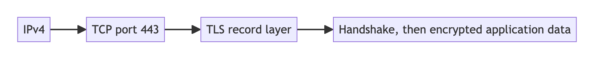
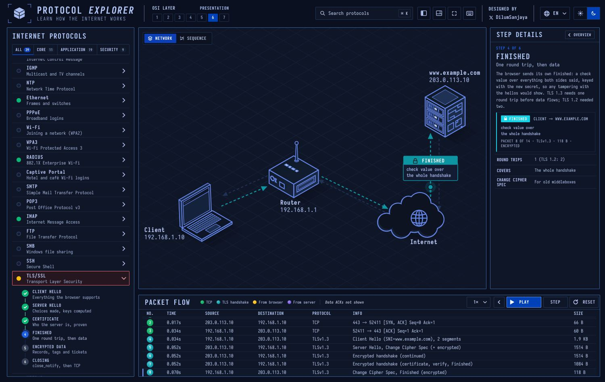
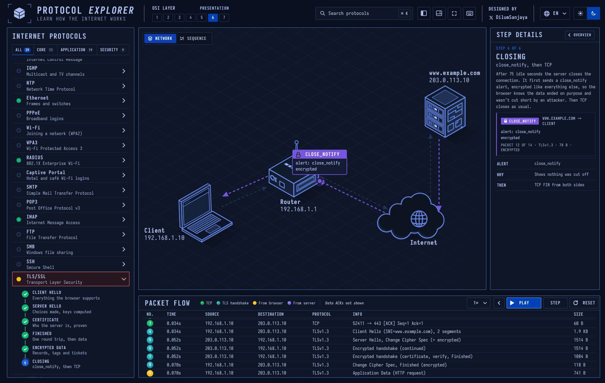
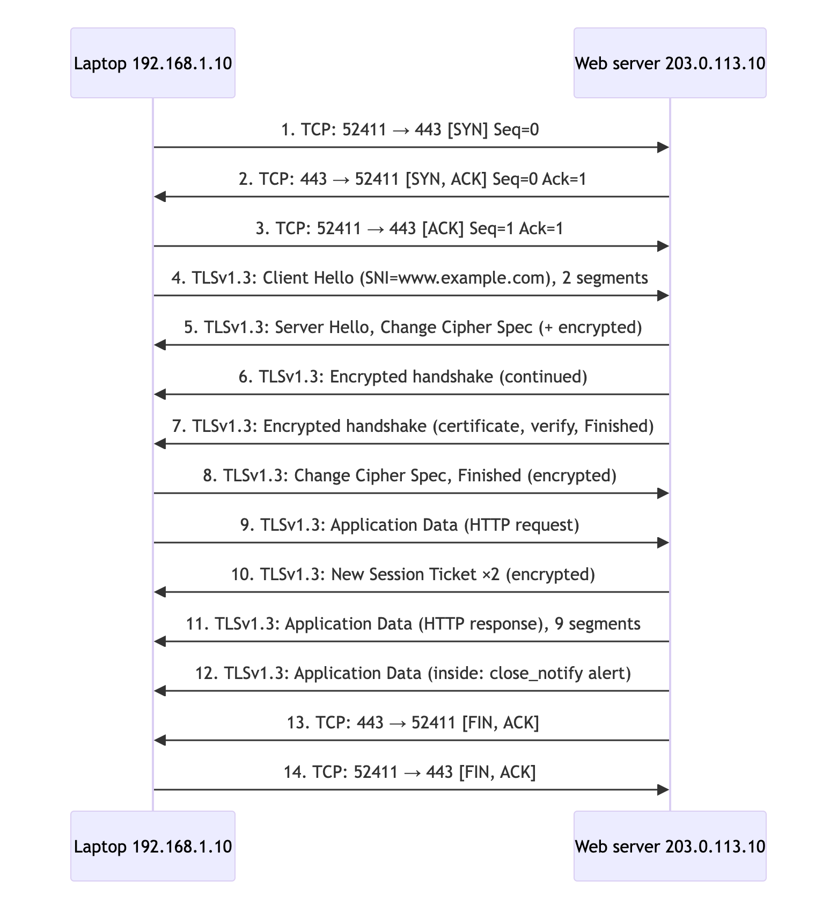
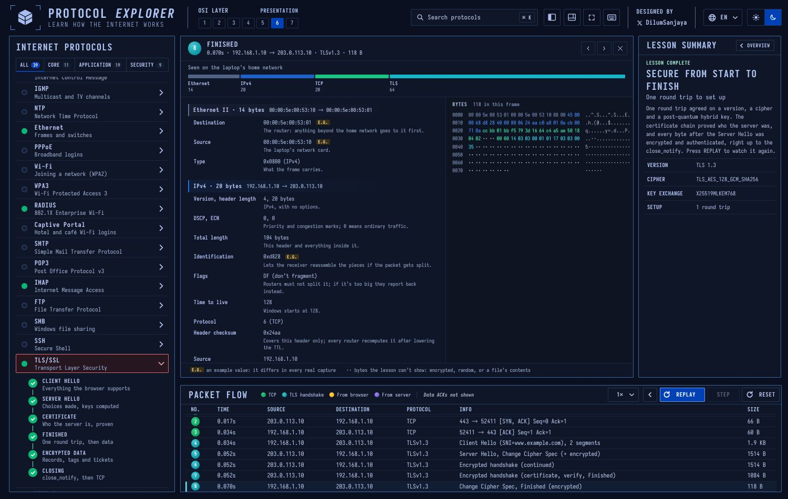

# TLS/SSL – Transport Layer Security

<!-- nav -->
⬅ [32 SSH](32-ssh.md) · [Index](00_Protocols_Index.md) · [34 HTTP Proxy](34-http-proxy.md) ➡
<!-- nav -->

*Source: Protocol Explorer – https://protocol-explorer-alpha.vercel.app/ (interactive lesson #33). Screenshots captured from the live lesson; packet decodes are the site's example capture (values marked **E.G.** differ in every real capture).*

## Overview

### How the layers fit together (outer to inner)

## In-depth explanation of the example (plain-language version)

### The big picture in one minute
The laptop connects to `www.example.com` on port 443. This lesson isolates **TLS 1.3 itself** (the HTTPS note showed it inside a web request): the TCP handshake, the TLS handshake, one encrypted request and reply, a long quiet period, and a clean **close** after 75 seconds. **14 packets.**

**What TLS does.** *Transport Layer Security* (the successor to **SSL**) sits **between TCP and the application.** It gives you:
- **identity**: proof the server is who it claims to be (using a certificate),
- **privacy**: encryption,
- **tamper detection**: any change is noticed.
HTTPS, secure email, secure DNS and many other protocols run inside it.

Think of **a secure phone line**: first you check the ID of the person you've called, then you agree on a secret code, and everything after that is scrambled.

> **Words you'll see:** *Certificate* = the server's ID card. *Key share* = a half of a key agreement, sent in the open. *Cipher suite* = the chosen scrambling method. *Handshake* = the opening negotiation.

---

### Step 1 – Client Hello – packets 1 to 4
After the TCP handshake (1–3), the browser sends its **Client Hello** (packet 4):
- **Versions:** "I can speak TLS 1.3 or 1.2."
- A **random number** and a list of **cipher suites** (e.g. AES-GCM, ChaCha20).
- The **website name (SNI)**, sent in plain view so a server hosting many sites knows which certificate to use.
- **Key shares:** the browser guesses and sends its half of the key agreement **right away.** This is **why TLS 1.3 needs only one round trip.**
- Which web language to use afterwards (`h2` or `http/1.1`).

### Step 2 – Server Hello – packet 5
The server picks TLS 1.3 and a cipher suite and sends **its own key-share half.** With the two halves, both sides **calculate the same shared secret, which never travels over the wire.** From it they derive the handshake keys. **From here on everything is encrypted.**

### Step 3 – The certificate – packets 6, 7
Still in the same flight, now encrypted, the server sends:
- **Extra settings** (e.g. the chosen web language),
- its **Certificate chain** (the site's certificate and the authority that signed it),
- a **Certificate Verify**: a signature made with the certificate's private key over the whole handshake, which proves the server **really owns** the certificate (a stolen certificate alone is useless),
- a **Finished** message, a checksum over the whole conversation.
The browser then checks: Is it signed by a trusted authority? Does the **name match**? Is it **in date**? Is it **not revoked**? (In older TLS 1.2 the certificate was sent in the clear. TLS 1.3 hides it.)

### Step 4 – Finished – packet 8
The browser sends its own **Finished**, a checksum over everything both sides said. **If anyone had tampered with the greetings (for example to force weaker settings), this check would fail.** **One round trip, then data flows.** (TLS 1.2 needed two. A returning visitor can even send data in the first flight, with some replay risk.)

### Step 5 – Encrypted data and tickets – packets 9 to 11
- Data travels in **TLS records**: a small header, the **scrambled data**, and a **16-byte authentication tag** that exposes any modification. Overhead is about 22 bytes per record. The real type of each record is hidden inside the encryption.
- The server hands over **two session tickets**. On a later visit, the browser can show one to **resume** the session and **skip the certificate exchange.**

### Step 6 – Closing – packets 12 to 14
After 75 quiet seconds the server sends an encrypted **`close_notify`** alert so the browser knows the data ended **on purpose**, and not because an attacker injected a fake TCP close (a *truncation attack*). Then TCP closes normally.

---

### The 14 packets at a glance
| Packets | What | Why |
|---|---|---|
| 1–3 | TCP handshake | open the connection |
| 4 | Client Hello (+ key share) | start TLS |
| 5 | Server Hello (+ key share) | agree on keys, start encryption |
| 6–7 | encrypted certificate, signature, Finished | the server proves its identity |
| 8 | client Finished | complete the handshake |
| 9–11 | encrypted data, session tickets | the actual traffic |
| 12–14 | `close_notify`, TCP close | clean ending |

### What to remember
- **TLS 1.3 handshake in one line:** ClientHello(+key share) → ServerHello(+key share) → {certificate, signature, Finished} → Finished → data.
- **What you get:** server identity (certificates), **forward secrecy** (a later key leak can't decrypt old recordings), tamper detection and downgrade protection.
- **Still visible:** IP addresses, the **website name (SNI)** (unless ECH is used), packet sizes and timing. **Hidden:** the URL, headers, content and the certificate.
- **SSL 2/3 and TLS 1.0/1.1 are obsolete and insecure.** Modern setups allow TLS 1.2 and 1.3 only.
- Variants: **mTLS** (the client also shows a certificate), **DTLS** (over UDP, used in WebRTC), and **QUIC** (which has TLS 1.3 built in).

## Under the hood – technical details

- **Layers.** TLS sits between TCP and the application. The *record layer* wraps data in records; the *handshake* messages negotiate keys; alerts report problems (`close_notify`, `handshake_failure`).
- **Record format.** 5-byte header (content type `22` handshake, `23` application data, `21` alert; version `0x0303`; length), then the ciphertext and a **16-byte AEAD tag** (AES-GCM or ChaCha20-Poly1305). In TLS 1.3 the real content type is hidden inside the encrypted data, which is why every encrypted record appears as "Application Data". Overhead is about 22 bytes per record.
- **Handshake in order.** `ClientHello` (versions, random, cipher suites, SNI, key shares, ALPN) -> `ServerHello` (chosen version, suite, key share) -> `EncryptedExtensions` -> `Certificate` -> `CertificateVerify` -> `Finished` -> client `Finished`.
- **Key derivation.** The shared secret from the ephemeral key exchange goes through **HKDF** with a hash of the transcript to produce handshake keys, then application traffic keys for each direction.
- **Certificate checks.** Chain to a trusted root, name matches the *Subject Alternative Name*, within the validity dates, not revoked (OCSP stapling, CRLite), Certificate Transparency timestamps. `CertificateVerify` proves ownership of the private key.
- **Downgrade protection.** The server's random contains a special marker if it was forced down to an older version, and `Finished` covers the whole handshake, so tampering fails.
- **Resumption and 0-RTT.** `NewSessionTicket` messages carry an encrypted PSK. A returning client can resume without a certificate exchange and may send *0-RTT early data*, which an attacker can replay, so it should carry only safe requests.
- **Forward secrecy.** Keys come from ephemeral values that are discarded, so a later leak of the server's key can't decrypt recorded sessions.
- **Clean close.** `close_notify` tells the peer the data ended on purpose. Without it, an attacker injecting a TCP `FIN` or `RST` could truncate data (a *truncation attack*).
- **What an observer sees.** IP addresses, the SNI name (unless ECH), packet sizes and timing, and the TLS version. **Hidden:** URL, headers, content and (in 1.3) the certificate.
- **Removed in 1.3.** RSA key exchange, static Diffie-Hellman, CBC and RC4 ciphers, compression and renegotiation. SSL 2/3 and TLS 1.0/1.1 are obsolete.
- **Variants.** **mTLS** (client certificates too), **DTLS** (over UDP, used in WebRTC), and **QUIC** (TLS 1.3 built in).

## Step-by-step walkthrough

### Step 1: CLIENT HELLO – Everything the browser supports

### Step 2: SERVER HELLO – Choices made, keys computed

### Step 3: CERTIFICATE – Who the server is, proven

### Step 4: FINISHED – One round trip, then data

### Step 5: ENCRYPTED DATA – Records, tags and tickets

### Step 6: CLOSING – close_notify, then TCP

### Lesson summary

## Packet flow (whole lesson)

| No. | Time | Source | Destination | Protocol | Info | Size |
|---|---|---|---|---|---|---|
| 1 | 0.000s | 192.168.1.10 | 203.0.113.10 | TCP | 52411 → 443 [SYN] Seq=0 | 66 B |
| 2 | 0.017s | 203.0.113.10 | 192.168.1.10 | TCP | 443 → 52411 [SYN, ACK] Seq=0 Ack=1 | 66 B |
| 3 | 0.034s | 192.168.1.10 | 203.0.113.10 | TCP | 52411 → 443 [ACK] Seq=1 Ack=1 | 60 B |
| 4 | 0.034s | 192.168.1.10 | 203.0.113.10 | TLSv1.3 | Client Hello (SNI=www.example.com), 2 segments | 1.9 KB |
| 5 | 0.052s | 203.0.113.10 | 192.168.1.10 | TLSv1.3 | Server Hello, Change Cipher Spec (+ encrypted) | 1514 B |
| 6 | 0.052s | 203.0.113.10 | 192.168.1.10 | TLSv1.3 | Encrypted handshake (continued) | 1514 B |
| 7 | 0.052s | 203.0.113.10 | 192.168.1.10 | TLSv1.3 | Encrypted handshake (certificate, verify, Finished) | 1084 B |
| 8 | 0.070s | 192.168.1.10 | 203.0.113.10 | TLSv1.3 | Change Cipher Spec, Finished (encrypted) | 118 B |
| 9 | 0.070s | 192.168.1.10 | 203.0.113.10 | TLSv1.3 | Application Data (HTTP request) | 741 B |
| 10 | 0.087s | 203.0.113.10 | 192.168.1.10 | TLSv1.3 | New Session Ticket ×2 (encrypted) | 532 B |
| 11 | 0.088s | 203.0.113.10 | 192.168.1.10 | TLSv1.3 | Application Data (HTTP response), 9 segments | 12.9 KB |
| 12 | 75.088s | 203.0.113.10 | 192.168.1.10 | TLSv1.3 | Application Data (inside: close_notify alert) | 78 B |
| 13 | 75.088s | 203.0.113.10 | 192.168.1.10 | TCP | 443 → 52411 [FIN, ACK] | 60 B |
| 14 | 75.105s | 192.168.1.10 | 203.0.113.10 | TCP | 52411 → 443 [FIN, ACK] | 60 B |

### Sequence diagram

*The lesson's own sequence diagram:*

## Packet decoder screenshots

The lesson's decoder view for the first, middle and last packet: headers, field values and the raw hex bytes.

### Packet 1: TCP – 52411 → 443 [SYN] Seq=0

*192.168.1.10 → 203.0.113.10 · 66 B · t = 0.000s*

### Packet 8: TLSv1.3 – Change Cipher Spec, Finished (encrypted)

*192.168.1.10 → 203.0.113.10 · 118 B · t = 0.070s*

### Packet 14: TCP – 52411 → 443 [FIN, ACK]

*192.168.1.10 → 203.0.113.10 · 60 B · t = 75.105s*

---

<!-- nav -->
⬅ [32 SSH](32-ssh.md) · [Index](00_Protocols_Index.md) · [34 HTTP Proxy](34-http-proxy.md) ➡
<!-- nav -->
