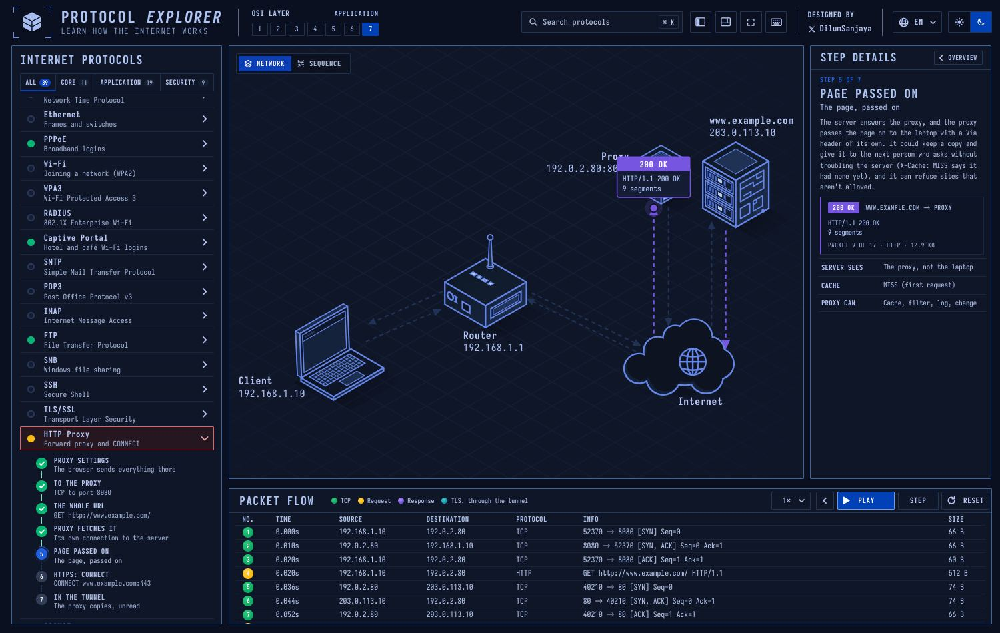
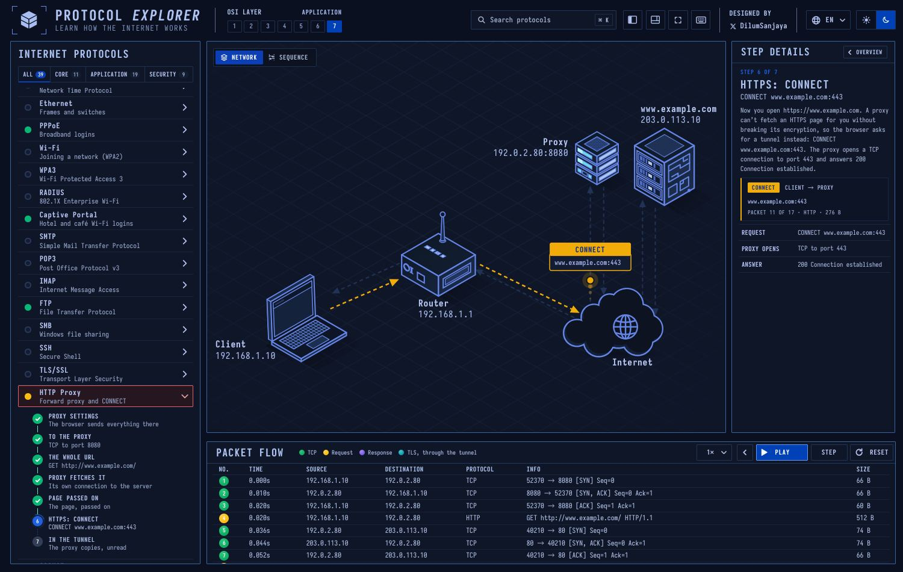
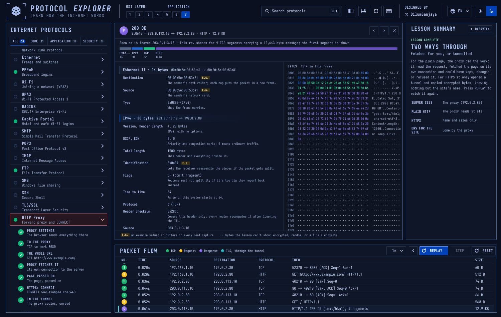

# HTTP Proxy – Forward proxy and CONNECT

<!-- nav -->
⬅ [33 TLS/SSL](33-tls-ssl.md) · [Index](00_Protocols_Index.md) · [35 SOCKS5](35-socks5.md) ➡
<!-- nav -->

*Source: Protocol Explorer – https://protocol-explorer-alpha.vercel.app/ (interactive lesson #34). Screenshots captured from the live lesson; packet decodes are the site's example capture (values marked **E.G.** differ in every real capture).*

## Overview


> PROTOCOL OVERVIEW  
> HTTP Proxy  
> ACTIVE  
> Forward proxy, and CONNECT for HTTPS  
> A forward proxy fetches web pages on your behalf. Companies and schools use one to filter sites, keep copies of popular pages and log what goes out; the sites you visit see the proxy, not you. Plain HTTP passes through it in the clear. For HTTPS the browser asks the proxy for a tunnel, and the encrypted connection runs through it unread.  
> LAYER  
> Application (Layer 7)  
> COMMON PORTS  
> 8080, 3128  
> HTTP:// PAGES  
> Fetched by the proxy  
> HTTPS:// PAGES  
> Tunnelled with CONNECT  
> USED FOR  
> Filtering, caching, logging  
> DEFINED IN  
> RFC 9110 (CONNECT: §9.3.6)  

## In-depth explanation of the example (plain-language version)

### The big picture in one minute
A laptop is set up to use a company or school **forward proxy** at `192.0.2.80:8080`. Two things happen (**17 packets**):
1. **Plain HTTP** (packets 1–10): the laptop asks for `http://www.example.com/` *through* the proxy.
2. **HTTPS** (packets 11–17): the laptop opens `https://www.example.com` and asks the proxy to build a **tunnel** using a command called **`CONNECT`**.

**What a forward proxy is.** A middleman that the **client** is configured to use. It fetches things **on the client's behalf**, so the website sees the **proxy's** address, not the client's. Organisations use proxies to **filter sites, cache popular pages, require logins and keep logs.** (The *Reverse Proxy* note covers the opposite: a middleman in front of servers.)

Think of **sending your assistant to the shop**: the shop only ever deals with the assistant, and the assistant can also keep a copy of popular items, refuse to buy certain things, and write everything down.

> **Words you'll see:** *Proxy* = the middleman. *Tunnel* = a pipe of bytes the proxy passes along without reading. *Cache* = a saved copy of a page. *Header* = a labelled line of extra information in a request or reply.

---

### Step 1 – Connect to the proxy, not the website – packets 1 to 3
The browser opens a connection **to the proxy's port 8080**, never to `www.example.com` itself. (The proxy setting comes from the system settings or an automatic configuration script.)

### Step 2 – The full address in the request – packet 4
A request to a proxy carries the **whole URL**: **`GET http://www.example.com/ HTTP/1.1`** (normally it would only say `/`). That's how the proxy knows where to go. If the proxy requires a login, it replies **`407 Proxy Authentication Required`**, and the client tries again with its credentials.

### Step 3 – The proxy fetches the page – packets 5 to 9
The proxy looks up the website, opens **its own connection** to `203.0.113.10` port 80, and sends a normal request, adding:
- **`Via: 1.1 proxy.example.net`**: "this went through a proxy";
- **`X-Forwarded-For: <client address>`**: who the request really came from.
The server replies `200 OK` with the page **to the proxy**. The server only ever talks to `192.0.2.80`.

### Step 4 – The page is passed on – packet 10
The proxy gives the page to the laptop, with its own `Via` label and `X-Cache: MISS` ("I didn't have it saved"). It **could keep a copy** and serve the next person directly (`HIT`). It can also **block** sites, scan content and log everything. **With plain HTTP, the proxy can read everything.**

### Step 5 – HTTPS: the `CONNECT` tunnel – packets 11 to 17
A proxy can't fetch an HTTPS page for you without breaking the encryption, so the browser asks for a **tunnel**:
- **`CONNECT www.example.com:443`** (packet 11).
- The proxy checks its rules ("is this host and port allowed?"), **opens a connection to `203.0.113.10:443`** (packets 12–14), and replies **`200 Connection established`** (packet 15).
- From now on the proxy is a **blind pipe of bytes.** The browser's TLS Client Hello (packet 16) goes in and comes out **unchanged** on the other side (packet 17). The secure handshake and everything after it happen **directly between browser and server.** The proxy learns **which host you connected to and the traffic sizes and timing, but never the pages, URLs or cookies.**

### Step 6 – In the tunnel
The proxy copies bytes both ways until one side closes. (Some company proxies do **TLS inspection**: they open the encryption using a certificate from a **company authority installed on every laptop**, read the traffic, and re-encrypt it. This breaks end-to-end privacy, which is why you should be careful about installing unknown root certificates.)

---

### The 17 packets at a glance
| Packets | What | Why |
|---|---|---|
| 1–3 | TCP handshake to the proxy | connect |
| 4 | `GET http://…` | ask the proxy for a page |
| 5–9 | proxy's own connection and request | fetch it |
| 10 | page returned | deliver it |
| 11 | `CONNECT host:443` | ask for a tunnel |
| 12–15 | proxy connects, `200 Connection established` | tunnel ready |
| 16–17 | Client Hello through the tunnel | HTTPS begins end to end |

### What to remember
- **Plain HTTP via a proxy:** the request has the full URL; the proxy rewrites it, adds **`Via`** and **`X-Forwarded-For`**, and may **cache, filter and log.**
- **HTTPS via a proxy:** **`CONNECT host:443`** → `200 Connection established` → an opaque tunnel.
- Proxy-specific reply: **`407`** (login needed for the proxy).
- The **server sees the proxy's IP**, not the client's, which is useful for hiding clients and controlling outgoing traffic.
- Related: **SOCKS5** (a general-purpose proxy; next note), **reverse proxy**, and **transparent proxy** (intercepts without any client setting).

## Step-by-step walkthrough (screenshots from the lesson)

### Step 1: PROXY SETTINGS – The browser sends everything there


> STEP 1 OF 7  
> PROXY SETTINGS  
> The browser sends everything there  
> The browser is set to send everything through a proxy at 192.0.2.80, port 8080, as many companies and schools require. You open http://www.example.com. The browser doesn’t look up www.example.com itself: it connects to the proxy and leaves the rest to it.  
> PROXY  
> 192.0.2.80:8080  
> DNS FOR THE SITE  
> Left to the proxy  
> URL  
> http://www.example.com/  

### Step 2: TO THE PROXY – TCP to port 8080


> STEP 2 OF 7  
> TO THE PROXY  
> TCP to port 8080  
> The laptop opens an ordinary TCP connection, not to the website, but to the proxy’s port 8080.  
> SYN  
> CLIENT → PROXY  
> PACKET 1 OF 17 · TCP · 66 B  
> TO  
> 192.0.2.80, port 8080  
> NOT TO  
> www.example.com  
> HANDSHAKE  
> SYN → SYN-ACK → ACK  

### Step 3: THE WHOLE URL – GET http://www.example.com/


> STEP 3 OF 7  
> THE WHOLE URL  
> GET http://www.example.com/  
> Sent to a proxy, the request line carries the whole address, not just the path: GET http://www.example.com/ HTTP/1.1. That is how the proxy knows where to go. Chrome adds Proxy-Connection: keep-alive, a header only proxies read.  
> GET  
> CLIENT → PROXY  
> GET http://www.example.com/  
> to the proxy  
> PACKET 4 OF 17 · HTTP · 512 B  
> REQUEST LINE  
> GET http://www.example.com/  
> TO A SERVER  
> GET /  
> READABLE BY  
> The proxy (plain HTTP)  

### Step 4: PROXY FETCHES IT – Its own connection to the server


> STEP 4 OF 7  
> PROXY FETCHES IT  
> Its own connection to the server  
> The proxy looks up www.example.com itself (not shown) and opens its own connection to the server. Its request is the ordinary kind, GET /, with headers of its own: Via names the proxy, and X-Forwarded-For gives the address the request came from (the home router’s public address, since the laptop is behind NAT).  
> SYN  
> PROXY → WWW.EXAMPLE.COM  
> PACKET 5 OF 17 · TCP · 74 B  
> CONNECTION  
> The proxy’s own  
> VIA  
> 1.1 proxy.example.net  
> FORWARDED FOR  
> 198.51.100.7  

### Step 5: PAGE PASSED ON – The page, passed on



> STEP 5 OF 7  
> PAGE PASSED ON  
> The page, passed on  
> The server answers the proxy, and the proxy passes the page on to the laptop with a Via header of its own. It could keep a copy and give it to the next person who asks without troubling the server (X-Cache: MISS says it had none yet), and it can refuse sites that aren’t allowed.  
> 200 OK  
> WWW.EXAMPLE.COM → PROXY  
> HTTP/1.1 200 OK  
> 9 segments  
> PACKET 9 OF 17 · HTTP · 12.9 KB  
> SERVER SEES  
> The proxy, not the laptop  
> CACHE  
> MISS (first request)  
> PROXY CAN  
> Cache, filter, log, change  

### Step 6: HTTPS: CONNECT – CONNECT www.example.com:443



> STEP 6 OF 7  
> HTTPS: CONNECT  
> CONNECT www.example.com:443  
> Now you open https://www.example.com. A proxy can’t fetch an HTTPS page for you without breaking its encryption, so the browser asks for a tunnel instead: CONNECT www.example.com:443. The proxy opens a TCP connection to port 443 and answers 200 Connection established.  
> CONNECT  
> CLIENT → PROXY  
> www.example.com:443  
> PACKET 11 OF 17 · HTTP · 276 B  
> REQUEST  
> CONNECT www.example.com:443  
> PROXY OPENS  
> TCP to port 443  
> ANSWER  
> 200 Connection established  

### Step 7: IN THE TUNNEL – The proxy copies, unread


> STEP 7 OF 7  
> IN THE TUNNEL  
> The proxy copies, unread  
> From now on the proxy copies bytes both ways without reading them. The browser’s TLS Client Hello goes in on the laptop’s connection and comes out, byte for byte the same, on the proxy’s connection to the server. TLS runs from end to end, so the proxy learns the site’s name and the sizes, never the pages. (Some company proxies do open HTTPS, using a certificate authority installed on every company laptop; then they see everything.)  
> CLIENT HELLO  
> CLIENT → PROXY  
> SNI www.example.com  
> PACKET 16 OF 17 · TLSv1.3 · 571 B  
> PROXY SEES  
> Site name, sizes, timing  
> HIDDEN FROM IT  
> Pages, passwords, cookies  
> ENCRYPTION  
> TLS, laptop to server  

### Lesson summary


> LESSON SUMMARY  
> LESSON COMPLETE  
> TWO WAYS THROUGH  
> Fetched for you, or tunnelled  
> For the plain page, the proxy did the work: it read the request, fetched the page on its own connection and could have kept, changed or refused it. For HTTPS it only opened a tunnel and copied encrypted bytes, knowing nothing but the site’s name. Press REPLAY to watch it again.  
> CLIENT HELLO  
> PROXY → WWW.EXAMPLE.COM  
> the same bytes  
> PACKET 17 OF 17 · TLSv1.3 · 583 B  
> SERVER SEES  
> The proxy (192.0.2.80)  
> PLAIN HTTP  
> The proxy reads it all  
> HTTPS  
> Name and sizes only  
> DNS FOR THE SITE  
> Done by the proxy  

## Packet flow (whole lesson)

| No. | Time | Source | Destination | Protocol | Info | Size |
|---|---|---|---|---|---|---|
| 1 | 0.000s | 192.168.1.10 | 192.0.2.80 | TCP | 52370 → 8080 [SYN] Seq=0 | 66 B |
| 2 | 0.010s | 192.0.2.80 | 192.168.1.10 | TCP | 8080 → 52370 [SYN, ACK] Seq=0 Ack=1 | 66 B |
| 3 | 0.020s | 192.168.1.10 | 192.0.2.80 | TCP | 52370 → 8080 [ACK] Seq=1 Ack=1 | 60 B |
| 4 | 0.020s | 192.168.1.10 | 192.0.2.80 | HTTP | GET http://www.example.com/ HTTP/1.1 | 512 B |
| 5 | 0.036s | 192.0.2.80 | 203.0.113.10 | TCP | 40210 → 80 [SYN] Seq=0 | 74 B |
| 6 | 0.044s | 203.0.113.10 | 192.0.2.80 | TCP | 80 → 40210 [SYN, ACK] Seq=0 Ack=1 | 74 B |
| 7 | 0.052s | 192.0.2.80 | 203.0.113.10 | TCP | 40210 → 80 [ACK] Seq=1 Ack=1 | 66 B |
| 8 | 0.052s | 192.0.2.80 | 203.0.113.10 | HTTP | GET / HTTP/1.1 | 568 B |
| 9 | 0.061s | 203.0.113.10 | 192.0.2.80 | HTTP | HTTP/1.1 200 OK (text/html), 9 segments | 12.9 KB |
| 10 | 0.071s | 192.0.2.80 | 192.168.1.10 | HTTP | HTTP/1.1 200 OK (text/html), 9 segments | 12.9 KB |
| 11 | 3.000s | 192.168.1.10 | 192.0.2.80 | HTTP | CONNECT www.example.com:443 HTTP/1.1 | 276 B |
| 12 | 3.011s | 192.0.2.80 | 203.0.113.10 | TCP | 40214 → 443 [SYN] Seq=0 | 74 B |
| 13 | 3.019s | 203.0.113.10 | 192.0.2.80 | TCP | 443 → 40214 [SYN, ACK] Seq=0 Ack=1 | 74 B |
| 14 | 3.027s | 192.0.2.80 | 203.0.113.10 | TCP | 40214 → 443 [ACK] Seq=1 Ack=1 | 66 B |
| 15 | 3.027s | 192.0.2.80 | 192.168.1.10 | HTTP | HTTP/1.1 200 Connection established | 93 B |
| 16 | 3.037s | 192.168.1.10 | 192.0.2.80 | TLSv1.3 | Client Hello (SNI=www.example.com) | 571 B |
| 17 | 3.047s | 192.0.2.80 | 203.0.113.10 | TLSv1.3 | Client Hello (SNI=www.example.com) | 583 B |

### Sequence diagram


## Packets decoded byte by byte

Each packet below is the lesson's own decode (headers, field values and the plain-English meaning of each field). Screenshots show the first, middle and last packet in the lesson's decoder view with the raw hex bytes.

### Packet 1: TCP – 52370 → 8080 [SYN] Seq=0

*192.168.1.10 → 192.0.2.80 · 66 B · t = 0.000s*


<details><summary>Decoded fields</summary>

```text
1
SYN
0.000s · 192.168.1.10 → 192.0.2.80 · TCP · 66 B
Seen on the laptop’s home network
Ethernet
14
IPv4
20
TCP
32
Ethernet II · 14 bytes
00:00:5e:00:53:10 → 00:00:5e:00:53:01
Destination
00:00:5e:00:53:01 E.G.

The router: anything beyond the home network goes to it first.

Source
00:00:5e:00:53:10 E.G.

The laptop’s network card.

Type
0x0800 (IPv4)

What the frame carries.

IPv4 · 20 bytes
192.168.1.10 → 192.0.2.80
Version, header length
4, 20 bytes

IPv4, with no options.

DSCP, ECN
0, 0

Priority and congestion marks; 0 means ordinary traffic.

Total length
52 bytes

This header and everything inside it.

Identification
0xd825 E.G.

Lets the receiver reassemble the pieces if the packet gets split.

Flags
DF (don’t fragment)

Routers must not split it; if it’s too big they report back instead.

Time to live
128

Windows starts at 128.

Protocol
6 (TCP)
Header checksum
0x9e9b

Covers this header only; every router recomputes it after lowering the TTL.

Source
192.168.1.10
Destination
192.0.2.80
TCP · 32 bytes
52370 → 8080, SYN
Source port
52370

Picked by the laptop’s system for this connection.

Destination port
8080
Sequence number
0 (relative)

This side’s starting number. Shown as 0; the real one is random.

Real sequence number
3095548407 E.G.
Acknowledgment
0 (not used yet)

A first SYN has nothing to acknowledge.

Header length
32 bytes

20 bytes, plus 12 of options.

Flags
0x002 (SYN)
Window
64240 E.G.

How much more data this side can take right now.

Checksum
0xf97f

Covers the header, the data and the IP addresses, so damage is caught.

Urgent pointer
0
Options
12 bytes
Maximum segment size
1460 bytes

The most data this side wants in one segment.

No-op
1

Spacing, so the next option lines up.

Window scale
× 256

Window values are multiplied by this, so windows can be larger than 64 KB.

No-op
1

Spacing, so the next option lines up.

No-op
1

Spacing, so the next option lines up.

SACK permitted
yes

This side understands selective acknowledgements.

BYTES 66 in this frame
0000
00
00
5e
00
53
01
00
00
5e
00
53
10
08
00
45
00
.
.
^
.
S
.
.
.
^
.
S
.
.
.
E
.
0010
00
34
d8
25
40
00
80
06
9e
9b
c0
a8
01
0a
c0
00
.
4
.
%
@
.
.
.
.
.
.
.
.
.
.
.
0020
02
50
cc
92
1f
90
b8
82
51
f7
00
00
00
00
80
02
.
P
.
.
.
.
.
.
Q
.
.
.
.
.
.
.
0030
fa
f0
f9
7f
00
00
02
04
05
b4
01
03
03
08
01
01
.
.
.
.
.
.
.
.
.
.
.
.
.
.
.
.
0040
04
02
.
.
E.G. an example value: it differs in every real capture
·· bytes the lesson can’t show: encrypted, random, or a file’s contents
```

</details>

### Packet 2: TCP – 8080 → 52370 [SYN, ACK] Seq=0 Ack=1

*192.0.2.80 → 192.168.1.10 · 66 B · t = 0.010s*

<details><summary>Decoded fields</summary>

```text
2
SYN-ACK
0.010s · 192.0.2.80 → 192.168.1.10 · TCP · 66 B
Seen on the laptop’s home network
Ethernet
14
IPv4
20
TCP
32
Ethernet II · 14 bytes
00:00:5e:00:53:01 → 00:00:5e:00:53:10
Destination
00:00:5e:00:53:10 E.G.

The laptop.

Source
00:00:5e:00:53:01 E.G.

The router’s side facing the home network.

Type
0x0800 (IPv4)

What the frame carries.

IPv4 · 20 bytes
192.0.2.80 → 192.168.1.10
Version, header length
4, 20 bytes

IPv4, with no options.

DSCP, ECN
0, 0

Priority and congestion marks; 0 means ordinary traffic.

Total length
52 bytes

This header and everything inside it.

Identification
0xaf04 E.G.

Lets the receiver reassemble the pieces if the packet gets split.

Flags
DF (don’t fragment)

Routers must not split it; if it’s too big they report back instead.

Time to live
52

Started at 64; 12 routers on the way each took 1.

Protocol
6 (TCP)
Header checksum
0x13bd

Covers this header only; every router recomputes it after lowering the TTL.

Source
192.0.2.80
Destination
192.168.1.10
TCP · 32 bytes
8080 → 52370, SYN, ACK
Source port
8080
Destination port
52370
Sequence number
0 (relative)

This side’s starting number. Shown as 0; the real one is random.

Real sequence number
320103699 E.G.
Acknowledgment
1 (relative)

The next byte this side expects: everything before it has arrived.

Header length
32 bytes

20 bytes, plus 12 of options.

Flags
0x012 (SYN, ACK)
Window
64240 E.G.

How much more data this side can take right now.

Checksum
0x8148

Covers the header, the data and the IP addresses, so damage is caught.

Urgent pointer
0
Options
12 bytes
Maximum segment size
1460 bytes

The most data this side wants in one segment.

No-op
1

Spacing, so the next option lines up.

No-op
1

Spacing, so the next option lines up.

SACK permitted
yes

This side understands selective acknowledgements.

No-op
1

Spacing, so the next option lines up.

Window scale
× 128

Window values are multiplied by this, so windows can be larger than 64 KB.

BYTES 66 in this frame
0000
00
00
5e
00
53
10
00
00
5e
00
53
01
08
00
45
00
.
.
^
.
S
.
.
.
^
.
S
.
.
.
E
.
0010
00
34
af
04
40
00
34
06
13
bd
c0
00
02
50
c0
a8
.
4
.
.
@
.
4
.
.
.
.
.
.
P
.
.
0020
01
0a
1f
90
cc
92
13
14
65
13
b8
82
51
f8
80
12
.
.
.
.
.
.
.
.
e
.
.
.
Q
.
.
.
0030
fa
f0
81
48
00
00
02
04
05
b4
01
01
04
02
01
03
.
.
.
H
.
.
.
.
.
.
.
.
.
.
.
.
0040
03
07
.
.
E.G. an example value: it differs in every real capture
·· bytes the lesson can’t show: encrypted, random, or a file’s contents
```

</details>

### Packet 3: TCP – 52370 → 8080 [ACK] Seq=1 Ack=1

*192.168.1.10 → 192.0.2.80 · 60 B · t = 0.020s*

<details><summary>Decoded fields</summary>

```text
3
ACK
0.020s · 192.168.1.10 → 192.0.2.80 · TCP · 60 B
Seen on the laptop’s home network
Ethernet
14
IPv4
20
TCP
20
Padding
6
Ethernet II · 14 bytes
00:00:5e:00:53:10 → 00:00:5e:00:53:01
Destination
00:00:5e:00:53:01 E.G.

The router: anything beyond the home network goes to it first.

Source
00:00:5e:00:53:10 E.G.

The laptop’s network card.

Type
0x0800 (IPv4)

What the frame carries.

IPv4 · 20 bytes
192.168.1.10 → 192.0.2.80
Version, header length
4, 20 bytes

IPv4, with no options.

DSCP, ECN
0, 0

Priority and congestion marks; 0 means ordinary traffic.

Total length
40 bytes

This header and everything inside it.

Identification
0xd826 E.G.

Lets the receiver reassemble the pieces if the packet gets split.

Flags
DF (don’t fragment)

Routers must not split it; if it’s too big they report back instead.

Time to live
128

Windows starts at 128.

Protocol
6 (TCP)
Header checksum
0x9ea6

Covers this header only; every router recomputes it after lowering the TTL.

Source
192.168.1.10
Destination
192.0.2.80
TCP · 20 bytes
52370 → 8080, ACK
Source port
52370

Picked by the laptop’s system for this connection.

Destination port
8080
Sequence number
1 (relative)

Position of this segment’s first byte, counted from this side’s SYN.

Real sequence number
3095548408 E.G.
Acknowledgment
1 (relative)

The next byte this side expects: everything before it has arrived.

Header length
20 bytes
Flags
0x010 (ACK)
Window
1026 (× 256 = 262,656 bytes) E.G.

How much more data this side can take right now.

Checksum
0xb909

Covers the header, the data and the IP addresses, so damage is caught.

Urgent pointer
0
Ethernet padding · 6 bytes
Padding
6 zero bytes

Ethernet frames are at least 60 bytes (64 with the checksum the card adds), so short ones are padded.

BYTES 60 in this frame
0000
00
00
5e
00
53
01
00
00
5e
00
53
10
08
00
45
00
.
.
^
.
S
.
.
.
^
.
S
.
.
.
E
.
0010
00
28
d8
26
40
00
80
06
9e
a6
c0
a8
01
0a
c0
00
.
(
.
&
@
.
.
.
.
.
.
.
.
.
.
.
0020
02
50
cc
92
1f
90
b8
82
51
f8
13
14
65
14
50
10
.
P
.
.
.
.
.
.
Q
.
.
.
e
.
P
.
0030
04
02
b9
09
00
00
00
00
00
00
00
00
.
.
.
.
.
.
.
.
.
.
.
.
E.G. an example value: it differs in every real capture
·· bytes the lesson can’t show: encrypted, random, or a file’s contents
```

</details>

### Packet 4: HTTP – GET http://www.example.com/ HTTP/1.1

*192.168.1.10 → 192.0.2.80 · 512 B · t = 0.020s*

<details><summary>Decoded fields</summary>

```text
4
GET
0.020s · 192.168.1.10 → 192.0.2.80 · HTTP · 512 B
Seen on the laptop’s home network
Ethernet
14
IPv4
20
TCP
20
HTTP
458
Ethernet II · 14 bytes
00:00:5e:00:53:10 → 00:00:5e:00:53:01
Destination
00:00:5e:00:53:01 E.G.

The router: anything beyond the home network goes to it first.

Source
00:00:5e:00:53:10 E.G.

The laptop’s network card.

Type
0x0800 (IPv4)

What the frame carries.

IPv4 · 20 bytes
192.168.1.10 → 192.0.2.80
Version, header length
4, 20 bytes

IPv4, with no options.

DSCP, ECN
0, 0

Priority and congestion marks; 0 means ordinary traffic.

Total length
498 bytes

This header and everything inside it.

Identification
0xd827 E.G.

Lets the receiver reassemble the pieces if the packet gets split.

Flags
DF (don’t fragment)

Routers must not split it; if it’s too big they report back instead.

Time to live
128

Windows starts at 128.

Protocol
6 (TCP)
Header checksum
0x9cdb

Covers this header only; every router recomputes it after lowering the TTL.

Source
192.168.1.10
Destination
192.0.2.80
TCP · 20 bytes
52370 → 8080, PSH, ACK
Source port
52370

Picked by the laptop’s system for this connection.

Destination port
8080
Sequence number
1 (relative)

Position of this segment’s first byte, counted from this side’s SYN.

Real sequence number
3095548408 E.G.
Acknowledgment
1 (relative)

The next byte this side expects: everything before it has arrived.

Header length
20 bytes
Flags
0x018 (PSH, ACK)
Window
1026 (× 256 = 262,656 bytes) E.G.

How much more data this side can take right now.

Checksum
0x8e24

Covers the header, the data and the IP addresses, so damage is caught.

Urgent pointer
0
HTTP
Text
GET http://www.example.com/ HTTP/1.1␍␊
Host: www.example.com␍␊
Proxy-Connection: keep-alive␍␊
Upgrade-Insecure-Requests: 1␍␊
User-Agent: Mozilla/5.0 (Windows NT 10.0; Win64; x64) AppleWebKit/537.36 (KHTML, like Gecko) Chrome/142.0.0.0 Safari/537.36␍␊
Accept: text/html,application/xhtml+xml,application/xml;q=0.9,image/avif,image/webp,image/apng,*/*;q=0.8,application/signed-exchange;v=b3;q=0.7␍␊
Accept-Encoding: gzip, deflate␍␊
Accept-Language: en-US,en;q=0.9␍␊
␍␊
BYTES 512 in this frame
0000
00
00
5e
00
53
01
00
00
5e
00
53
10
08
00
45
00
.
.
^
.
S
.
.
.
^
.
S
.
.
.
E
.
0010
01
f2
d8
27
40
00
80
06
9c
db
c0
a8
01
0a
c0
00
.
.
.
'
@
.
.
.
.
.
.
.
.
.
.
.
0020
02
50
cc
92
1f
90
b8
82
51
f8
13
14
65
14
50
18
.
P
.
.
.
.
.
.
Q
.
.
.
e
.
P
.
0030
04
02
8e
24
00
00
47
45
54
20
68
74
74
70
3a
2f
.
.
.
$
.
.
G
E
T
h
t
t
p
:
/
0040
2f
77
77
77
2e
65
78
61
6d
70
6c
65
2e
63
6f
6d
/
w
w
w
.
e
x
a
m
p
l
e
.
c
o
m
0050
2f
20
48
54
54
50
2f
31
2e
31
0d
0a
48
6f
73
74
/
H
T
T
P
/
1
.
1
.
.
H
o
s
t
0060
3a
20
77
77
77
2e
65
78
61
6d
70
6c
65
2e
63
6f
:
w
w
w
.
e
x
a
m
p
l
e
.
c
o
0070
6d
0d
0a
50
72
6f
78
79
2d
43
6f
6e
6e
65
63
74
m
.
.
P
r
o
x
y
-
C
o
n
n
e
c
t
0080
69
6f
6e
3a
20
6b
65
65
70
2d
61
6c
69
76
65
0d
i
o
n
:
k
e
e
p
-
a
l
i
v
e
.
0090
0a
55
70
67
72
61
64
65
2d
49
6e
73
65
63
75
72
.
U
p
g
r
a
d
e
-
I
n
s
e
c
u
r
00a0
65
2d
52
65
71
75
65
73
74
73
3a
20
31
0d
0a
55
e
-
R
e
q
u
e
s
t
s
:
1
.
.
U
00b0
73
65
72
2d
41
67
65
6e
74
3a
20
4d
6f
7a
69
6c
s
e
r
-
A
g
e
n
t
:
M
o
z
i
l
00c0
6c
61
2f
35
2e
30
20
28
57
69
6e
64
6f
77
73
20
l
a
/
5
.
0
(
W
i
n
d
o
w
s
00d0
4e
54
20
31
30
2e
30
3b
20
57
69
6e
36
34
3b
20
N
T
1
0
.
0
;
W
i
n
6
4
;
00e0
78
36
34
29
20
41
70
70
6c
65
57
65
62
4b
69
74
x
6
4
)
A
p
p
l
e
W
e
b
K
i
t
00f0
2f
35
33
37
2e
33
36
20
28
4b
48
54
4d
4c
2c
20
/
5
3
7
.
3
6
(
K
H
T
M
L
,
0100
6c
69
6b
65
20
47
65
63
6b
6f
29
20
43
68
72
6f
l
i
k
e
G
e
c
k
o
)
C
h
r
o
0110
6d
65
2f
31
34
32
2e
30
2e
30
2e
30
20
53
61
66
m
e
/
1
4
2
.
0
.
0
.
0
S
a
f
0120
61
72
69
2f
35
33
37
2e
33
36
0d
0a
41
63
63
65
a
r
i
/
5
3
7
.
3
6
.
.
A
c
c
e
0130
70
74
3a
20
74
65
78
74
2f
68
74
6d
6c
2c
61
70
p
t
:
t
e
x
t
/
h
t
m
l
,
a
p
0140
70
6c
69
63
61
74
69
6f
6e
2f
78
68
74
6d
6c
2b
p
l
i
c
a
t
i
o
n
/
x
h
t
m
l
+
0150
78
6d
6c
2c
61
70
70
6c
69
63
61
74
69
6f
6e
2f
x
m
l
,
a
p
p
l
i
c
a
t
i
o
n
/
0160
78
6d
6c
3b
71
3d
30
2e
39
2c
69
6d
61
67
65
2f
x
m
l
;
q
=
0
.
9
,
i
m
a
g
e
/
0170
61
76
69
66
2c
69
6d
61
67
65
2f
77
65
62
70
2c
a
v
i
f
,
i
m
a
g
e
/
w
e
b
p
,
0180
69
6d
61
67
65
2f
61
70
6e
67
2c
2a
2f
2a
3b
71
i
m
a
g
e
/
a
p
n
g
,
*
/
*
;
q
0190
3d
30
2e
38
2c
61
70
70
6c
69
63
61
74
69
6f
6e
=
0
.
8
,
a
p
p
l
i
c
a
t
i
o
n
01a0
2f
73
69
67
6e
65
64
2d
65
78
63
68
61
6e
67
65
/
s
i
g
n
e
d
-
e
x
c
h
a
n
g
e
01b0
3b
76
3d
62
33
3b
71
3d
30
2e
37
0d
0a
41
63
63
;
v
=
b
3
;
q
=
0
.
7
.
.
A
c
c
01c0
65
70
74
2d
45
6e
63
6f
64
69
6e
67
3a
20
67
7a
e
p
t
-
E
n
c
o
d
i
n
g
:
g
z
01d0
69
70
2c
20
64
65
66
6c
61
74
65
0d
0a
41
63
63
i
p
,
d
e
f
l
a
t
e
.
.
A
c
c
01e0
65
70
74
2d
4c
61
6e
67
75
61
67
65
3a
20
65
6e
e
p
t
-
L
a
n
g
u
a
g
e
:
e
n
01f0
2d
55
53
2c
65
6e
3b
71
3d
30
2e
39
0d
0a
0d
0a
-
U
S
,
e
n
;
q
=
0
.
9
.
.
.
.
E.G. an example value: it differs in every real capture
·· bytes the lesson can’t show: encrypted, random, or a file’s contents
```

</details>

### Packet 5: TCP – 40210 → 80 [SYN] Seq=0

*192.0.2.80 → 203.0.113.10 · 74 B · t = 0.036s*

<details><summary>Decoded fields</summary>

```text
5
SYN
0.036s · 192.0.2.80 → 203.0.113.10 · TCP · 74 B
Seen as it leaves 192.0.2.80
Ethernet
14
IPv4
20
TCP
40
Ethernet II · 14 bytes
00:00:5e:00:53:40 → 00:00:5e:00:53:80
Destination
00:00:5e:00:53:80 E.G.

The sender’s next router; each hop puts the packet in a new frame.

Source
00:00:5e:00:53:40 E.G.

The sender’s network card.

Type
0x0800 (IPv4)

What the frame carries.

IPv4 · 20 bytes
192.0.2.80 → 203.0.113.10
Version, header length
4, 20 bytes

IPv4, with no options.

DSCP, ECN
0, 0

Priority and congestion marks; 0 means ordinary traffic.

Total length
60 bytes

This header and everything inside it.

Identification
0xaf05 E.G.

Lets the receiver reassemble the pieces if the packet gets split.

Flags
DF (don’t fragment)

Routers must not split it; if it’s too big they report back instead.

Time to live
64

As sent: this system starts at 64.

Protocol
6 (TCP)
Header checksum
0x8d5b

Covers this header only; every router recomputes it after lowering the TTL.

Source
192.0.2.80
Destination
203.0.113.10
TCP · 40 bytes
40210 → 80, SYN
Source port
40210
Destination port
80
Sequence number
0 (relative)

This side’s starting number. Shown as 0; the real one is random.

Real sequence number
2203170674 E.G.
Acknowledgment
0 (not used yet)

A first SYN has nothing to acknowledge.

Header length
40 bytes

20 bytes, plus 20 of options.

Flags
0x002 (SYN)
Window
64240 E.G.

How much more data this side can take right now.

Checksum
0x3dc5

Covers the header, the data and the IP addresses, so damage is caught.

Urgent pointer
0
Options
20 bytes
Maximum segment size
1460 bytes

The most data this side wants in one segment.

SACK permitted
yes

This side understands selective acknowledgements.

Timestamps
value 1354164241, echo 0 E.G.

Used to measure round trips; both sides offered them.

No-op
1

Spacing, so the next option lines up.

Window scale
× 128

Window values are multiplied by this, so windows can be larger than 64 KB.

BYTES 74 in this frame
0000
00
00
5e
00
53
80
00
00
5e
00
53
40
08
00
45
00
.
.
^
.
S
.
.
.
^
.
S
@
.
.
E
.
0010
00
3c
af
05
40
00
40
06
8d
5b
c0
00
02
50
cb
00
.
<
.
.
@
.
@
.
.
[
.
.
.
P
.
.
0020
71
0a
9d
12
00
50
83
51
b7
72
00
00
00
00
a0
02
q
.
.
.
.
P
.
Q
.
r
.
.
.
.
.
.
0030
fa
f0
3d
c5
00
00
02
04
05
b4
04
02
08
0a
50
b6
.
.
=
.
.
.
.
.
.
.
.
.
.
.
P
.
0040
e8
11
00
00
00
00
01
03
03
07
.
.
.
.
.
.
.
.
.
.
E.G. an example value: it differs in every real capture
·· bytes the lesson can’t show: encrypted, random, or a file’s contents
```

</details>

### Packet 6: TCP – 80 → 40210 [SYN, ACK] Seq=0 Ack=1

*203.0.113.10 → 192.0.2.80 · 74 B · t = 0.044s*

<details><summary>Decoded fields</summary>

```text
6
SYN-ACK
0.044s · 203.0.113.10 → 192.0.2.80 · TCP · 74 B
Seen as it leaves 203.0.113.10
Ethernet
14
IPv4
20
TCP
40
Ethernet II · 14 bytes
00:00:5e:00:53:41 → 00:00:5e:00:53:81
Destination
00:00:5e:00:53:81 E.G.

The sender’s next router; each hop puts the packet in a new frame.

Source
00:00:5e:00:53:41 E.G.

The sender’s network card.

Type
0x0800 (IPv4)

What the frame carries.

IPv4 · 20 bytes
203.0.113.10 → 192.0.2.80
Version, header length
4, 20 bytes

IPv4, with no options.

DSCP, ECN
0, 0

Priority and congestion marks; 0 means ordinary traffic.

Total length
60 bytes

This header and everything inside it.

Identification
0x0e03 E.G.

Lets the receiver reassemble the pieces if the packet gets split.

Flags
DF (don’t fragment)

Routers must not split it; if it’s too big they report back instead.

Time to live
64

As sent: this system starts at 64.

Protocol
6 (TCP)
Header checksum
0x2e5e

Covers this header only; every router recomputes it after lowering the TTL.

Source
203.0.113.10
Destination
192.0.2.80
TCP · 40 bytes
80 → 40210, SYN, ACK
Source port
80
Destination port
40210
Sequence number
0 (relative)

This side’s starting number. Shown as 0; the real one is random.

Real sequence number
2110529774 E.G.
Acknowledgment
1 (relative)

The next byte this side expects: everything before it has arrived.

Header length
40 bytes

20 bytes, plus 20 of options.

Flags
0x012 (SYN, ACK)
Window
65160 E.G.

How much more data this side can take right now.

Checksum
0x1fa3

Covers the header, the data and the IP addresses, so damage is caught.

Urgent pointer
0
Options
20 bytes
Maximum segment size
1460 bytes

The most data this side wants in one segment.

SACK permitted
yes

This side understands selective acknowledgements.

Timestamps
value 3092693863, echo 1354164241 E.G.

Used to measure round trips; both sides offered them.

No-op
1

Spacing, so the next option lines up.

Window scale
× 128

Window values are multiplied by this, so windows can be larger than 64 KB.

BYTES 74 in this frame
0000
00
00
5e
00
53
81
00
00
5e
00
53
41
08
00
45
00
.
.
^
.
S
.
.
.
^
.
S
A
.
.
E
.
0010
00
3c
0e
03
40
00
40
06
2e
5e
cb
00
71
0a
c0
00
.
<
.
.
@
.
@
.
.
^
.
.
q
.
.
.
0020
02
50
00
50
9d
12
7d
cc
20
ee
83
51
b7
73
a0
12
.
P
.
P
.
.
}
.
.
.
Q
.
s
.
.
0030
fe
88
1f
a3
00
00
02
04
05
b4
04
02
08
0a
b8
56
.
.
.
.
.
.
.
.
.
.
.
.
.
.
.
V
0040
c3
67
50
b6
e8
11
01
03
03
07
.
g
P
.
.
.
.
.
.
.
E.G. an example value: it differs in every real capture
·· bytes the lesson can’t show: encrypted, random, or a file’s contents
```

</details>

### Packet 7: TCP – 40210 → 80 [ACK] Seq=1 Ack=1

*192.0.2.80 → 203.0.113.10 · 66 B · t = 0.052s*

<details><summary>Decoded fields</summary>

```text
7
ACK
0.052s · 192.0.2.80 → 203.0.113.10 · TCP · 66 B
Seen as it leaves 192.0.2.80
Ethernet
14
IPv4
20
TCP
32
Ethernet II · 14 bytes
00:00:5e:00:53:40 → 00:00:5e:00:53:80
Destination
00:00:5e:00:53:80 E.G.

The sender’s next router; each hop puts the packet in a new frame.

Source
00:00:5e:00:53:40 E.G.

The sender’s network card.

Type
0x0800 (IPv4)

What the frame carries.

IPv4 · 20 bytes
192.0.2.80 → 203.0.113.10
Version, header length
4, 20 bytes

IPv4, with no options.

DSCP, ECN
0, 0

Priority and congestion marks; 0 means ordinary traffic.

Total length
52 bytes

This header and everything inside it.

Identification
0xaf06 E.G.

Lets the receiver reassemble the pieces if the packet gets split.

Flags
DF (don’t fragment)

Routers must not split it; if it’s too big they report back instead.

Time to live
64

As sent: this system starts at 64.

Protocol
6 (TCP)
Header checksum
0x8d62

Covers this header only; every router recomputes it after lowering the TTL.

Source
192.0.2.80
Destination
203.0.113.10
TCP · 32 bytes
40210 → 80, ACK
Source port
40210
Destination port
80
Sequence number
1 (relative)

Position of this segment’s first byte, counted from this side’s SYN.

Real sequence number
2203170675 E.G.
Acknowledgment
1 (relative)

The next byte this side expects: everything before it has arrived.

Header length
32 bytes

20 bytes, plus 12 of options.

Flags
0x010 (ACK)
Window
501 (× 128 = 64,128 bytes) E.G.

How much more data this side can take right now.

Checksum
0x4af3

Covers the header, the data and the IP addresses, so damage is caught.

Urgent pointer
0
Options
12 bytes
No-op
1

Spacing, so the next option lines up.

No-op
1

Spacing, so the next option lines up.

Timestamps
value 1354164257, echo 3092693863 E.G.

Used to measure round trips; both sides offered them.

BYTES 66 in this frame
0000
00
00
5e
00
53
80
00
00
5e
00
53
40
08
00
45
00
.
.
^
.
S
.
.
.
^
.
S
@
.
.
E
.
0010
00
34
af
06
40
00
40
06
8d
62
c0
00
02
50
cb
00
.
4
.
.
@
.
@
.
.
b
.
.
.
P
.
.
0020
71
0a
9d
12
00
50
83
51
b7
73
7d
cc
20
ef
80
10
q
.
.
.
.
P
.
Q
.
s
}
.
.
.
.
0030
01
f5
4a
f3
00
00
01
01
08
0a
50
b6
e8
21
b8
56
.
.
J
.
.
.
.
.
.
.
P
.
.
!
.
V
0040
c3
67
.
g
E.G. an example value: it differs in every real capture
·· bytes the lesson can’t show: encrypted, random, or a file’s contents
```

</details>

### Packet 8: HTTP – GET / HTTP/1.1

*192.0.2.80 → 203.0.113.10 · 568 B · t = 0.052s*

<details><summary>Decoded fields</summary>

```text
8
GET
0.052s · 192.0.2.80 → 203.0.113.10 · HTTP · 568 B
Seen as it leaves 192.0.2.80
Ethernet
14
IPv4
20
TCP
32
HTTP
502
Ethernet II · 14 bytes
00:00:5e:00:53:40 → 00:00:5e:00:53:80
Destination
00:00:5e:00:53:80 E.G.

The sender’s next router; each hop puts the packet in a new frame.

Source
00:00:5e:00:53:40 E.G.

The sender’s network card.

Type
0x0800 (IPv4)

What the frame carries.

IPv4 · 20 bytes
192.0.2.80 → 203.0.113.10
Version, header length
4, 20 bytes

IPv4, with no options.

DSCP, ECN
0, 0

Priority and congestion marks; 0 means ordinary traffic.

Total length
554 bytes

This header and everything inside it.

Identification
0xaf07 E.G.

Lets the receiver reassemble the pieces if the packet gets split.

Flags
DF (don’t fragment)

Routers must not split it; if it’s too big they report back instead.

Time to live
64

As sent: this system starts at 64.

Protocol
6 (TCP)
Header checksum
0x8b6b

Covers this header only; every router recomputes it after lowering the TTL.

Source
192.0.2.80
Destination
203.0.113.10
TCP · 32 bytes
40210 → 80, PSH, ACK
Source port
40210
Destination port
80
Sequence number
1 (relative)

Position of this segment’s first byte, counted from this side’s SYN.

Real sequence number
2203170675 E.G.
Acknowledgment
1 (relative)

The next byte this side expects: everything before it has arrived.

Header length
32 bytes

20 bytes, plus 12 of options.

Flags
0x018 (PSH, ACK)
Window
501 (× 128 = 64,128 bytes) E.G.

How much more data this side can take right now.

Checksum
0x119a

Covers the header, the data and the IP addresses, so damage is caught.

Urgent pointer
0
Options
12 bytes
No-op
1

Spacing, so the next option lines up.

No-op
1

Spacing, so the next option lines up.

Timestamps
value 1354164257, echo 3092693863 E.G.

Used to measure round trips; both sides offered them.

HTTP
Text
GET / HTTP/1.1␍␊
Host: www.example.com␍␊
Upgrade-Insecure-Requests: 1␍␊
User-Agent: Mozilla/5.0 (Windows NT 10.0; Win64; x64) AppleWebKit/537.36 (KHTML, like Gecko) Chrome/142.0.0.0 Safari/537.36␍␊
Accept: text/html,application/xhtml+xml,application/xml;q=0.9,image/avif,image/webp,image/apng,*/*;q=0.8,application/signed-exchange;v=b3;q=0.7␍␊
Accept-Encoding: gzip, deflate␍␊
Accept-Language: en-US,en;q=0.9␍␊
Via: 1.1 proxy.example.net (squid/6.10)␍␊
X-Forwarded-For: 198.51.100.7␍␊
Connection: keep-alive␍␊
␍␊
BYTES 568 in this frame
0000
00
00
5e
00
53
80
00
00
5e
00
53
40
08
00
45
00
.
.
^
.
S
.
.
.
^
.
S
@
.
.
E
.
0010
02
2a
af
07
40
00
40
06
8b
6b
c0
00
02
50
cb
00
.
*
.
.
@
.
@
.
.
k
.
.
.
P
.
.
0020
71
0a
9d
12
00
50
83
51
b7
73
7d
cc
20
ef
80
18
q
.
.
.
.
P
.
Q
.
s
}
.
.
.
.
0030
01
f5
11
9a
00
00
01
01
08
0a
50
b6
e8
21
b8
56
.
.
.
.
.
.
.
.
.
.
P
.
.
!
.
V
0040
c3
67
47
45
54
20
2f
20
48
54
54
50
2f
31
2e
31
.
g
G
E
T
/
H
T
T
P
/
1
.
1
0050
0d
0a
48
6f
73
74
3a
20
77
77
77
2e
65
78
61
6d
.
.
H
o
s
t
:
w
w
w
.
e
x
a
m
0060
70
6c
65
2e
63
6f
6d
0d
0a
55
70
67
72
61
64
65
p
l
e
.
c
o
m
.
.
U
p
g
r
a
d
e
0070
2d
49
6e
73
65
63
75
72
65
2d
52
65
71
75
65
73
-
I
n
s
e
c
u
r
e
-
R
e
q
u
e
s
0080
74
73
3a
20
31
0d
0a
55
73
65
72
2d
41
67
65
6e
t
s
:
1
.
.
U
s
e
r
-
A
g
e
n
0090
74
3a
20
4d
6f
7a
69
6c
6c
61
2f
35
2e
30
20
28
t
:
M
o
z
i
l
l
a
/
5
.
0
(
00a0
57
69
6e
64
6f
77
73
20
4e
54
20
31
30
2e
30
3b
W
i
n
d
o
w
s
N
T
1
0
.
0
;
00b0
20
57
69
6e
36
34
3b
20
78
36
34
29
20
41
70
70
W
i
n
6
4
;
x
6
4
)
A
p
p
00c0
6c
65
57
65
62
4b
69
74
2f
35
33
37
2e
33
36
20
l
e
W
e
b
K
i
t
/
5
3
7
.
3
6
00d0
28
4b
48
54
4d
4c
2c
20
6c
69
6b
65
20
47
65
63
(
K
H
T
M
L
,
l
i
k
e
G
e
c
00e0
6b
6f
29
20
43
68
72
6f
6d
65
2f
31
34
32
2e
30
k
o
)
C
h
r
o
m
e
/
1
4
2
.
0
00f0
2e
30
2e
30
20
53
61
66
61
72
69
2f
35
33
37
2e
.
0
.
0
S
a
f
a
r
i
/
5
3
7
.
0100
33
36
0d
0a
41
63
63
65
70
74
3a
20
74
65
78
74
3
6
.
.
A
c
c
e
p
t
:
t
e
x
t
0110
2f
68
74
6d
6c
2c
61
70
70
6c
69
63
61
74
69
6f
/
h
t
m
l
,
a
p
p
l
i
c
a
t
i
o
0120
6e
2f
78
68
74
6d
6c
2b
78
6d
6c
2c
61
70
70
6c
n
/
x
h
t
m
l
+
x
m
l
,
a
p
p
l
0130
69
63
61
74
69
6f
6e
2f
78
6d
6c
3b
71
3d
30
2e
i
c
a
t
i
o
n
/
x
m
l
;
q
=
0
.
0140
39
2c
69
6d
61
67
65
2f
61
76
69
66
2c
69
6d
61
9
,
i
m
a
g
e
/
a
v
i
f
,
i
m
a
0150
67
65
2f
77
65
62
70
2c
69
6d
61
67
65
2f
61
70
g
e
/
w
e
b
p
,
i
m
a
g
e
/
a
p
0160
6e
67
2c
2a
2f
2a
3b
71
3d
30
2e
38
2c
61
70
70
n
g
,
*
/
*
;
q
=
0
.
8
,
a
p
p
0170
6c
69
63
61
74
69
6f
6e
2f
73
69
67
6e
65
64
2d
l
i
c
a
t
i
o
n
/
s
i
g
n
e
d
-
0180
65
78
63
68
61
6e
67
65
3b
76
3d
62
33
3b
71
3d
e
x
c
h
a
n
g
e
;
v
=
b
3
;
q
=
0190
30
2e
37
0d
0a
41
63
63
65
70
74
2d
45
6e
63
6f
0
.
7
.
.
A
c
c
e
p
t
-
E
n
c
o
01a0
64
69
6e
67
3a
20
67
7a
69
70
2c
20
64
65
66
6c
d
i
n
g
:
g
z
i
p
,
d
e
f
l
01b0
61
74
65
0d
0a
41
63
63
65
70
74
2d
4c
61
6e
67
a
t
e
.
.
A
c
c
e
p
t
-
L
a
n
g
01c0
75
61
67
65
3a
20
65
6e
2d
55
53
2c
65
6e
3b
71
u
a
g
e
:
e
n
-
U
S
,
e
n
;
q
01d0
3d
30
2e
39
0d
0a
56
69
61
3a
20
31
2e
31
20
70
=
0
.
9
.
.
V
i
a
:
1
.
1
p
01e0
72
6f
78
79
2e
65
78
61
6d
70
6c
65
2e
6e
65
74
r
o
x
y
.
e
x
a
m
p
l
e
.
n
e
t
01f0
20
28
73
71
75
69
64
2f
36
2e
31
30
29
0d
0a
58
(
s
q
u
i
d
/
6
.
1
0
)
.
.
X
0200
2d
46
6f
72
77
61
72
64
65
64
2d
46
6f
72
3a
20
-
F
o
r
w
a
r
d
e
d
-
F
o
r
:
0210
31
39
38
2e
35
31
2e
31
30
30
2e
37
0d
0a
43
6f
1
9
8
.
5
1
.
1
0
0
.
7
.
.
C
o
0220
6e
6e
65
63
74
69
6f
6e
3a
20
6b
65
65
70
2d
61
n
n
e
c
t
i
o
n
:
k
e
e
p
-
a
0230
6c
69
76
65
0d
0a
0d
0a
l
i
v
e
.
.
.
.
E.G. an example value: it differs in every real capture
·· bytes the lesson can’t show: encrypted, random, or a file’s contents
```

</details>

### Packet 9: HTTP – HTTP/1.1 200 OK (text/html), 9 segments

*203.0.113.10 → 192.0.2.80 · 12.9 KB · t = 0.061s*



<details><summary>Decoded fields</summary>

```text
9
200 OK
0.061s · 203.0.113.10 → 192.0.2.80 · HTTP · 12.9 KB
Seen as it leaves 203.0.113.10 · This row stands for 9 TCP segments carrying a 12,643-byte message; the first segment is shown
Ethernet
14
IPv4
20
TCP
32
HTTP
1448
Ethernet II · 14 bytes
00:00:5e:00:53:41 → 00:00:5e:00:53:81
Destination
00:00:5e:00:53:81 E.G.

The sender’s next router; each hop puts the packet in a new frame.

Source
00:00:5e:00:53:41 E.G.

The sender’s network card.

Type
0x0800 (IPv4)

What the frame carries.

IPv4 · 20 bytes
203.0.113.10 → 192.0.2.80
Version, header length
4, 20 bytes

IPv4, with no options.

DSCP, ECN
0, 0

Priority and congestion marks; 0 means ordinary traffic.

Total length
1500 bytes

This header and everything inside it.

Identification
0x0e04 E.G.

Lets the receiver reassemble the pieces if the packet gets split.

Flags
DF (don’t fragment)

Routers must not split it; if it’s too big they report back instead.

Time to live
64

As sent: this system starts at 64.

Protocol
6 (TCP)
Header checksum
0x28bd

Covers this header only; every router recomputes it after lowering the TTL.

Source
203.0.113.10
Destination
192.0.2.80
TCP · 32 bytes
80 → 40210, PSH, ACK
Source port
80
Destination port
40210
Sequence number
1 (relative)

Position of this segment’s first byte, counted from this side’s SYN.

Real sequence number
2110529775 E.G.
Acknowledgment
503 (relative)

The next byte this side expects: everything before it has arrived.

Header length
32 bytes

20 bytes, plus 12 of options.

Flags
0x018 (PSH, ACK)
Window
501 (× 128 = 64,128 bytes) E.G.

How much more data this side can take right now.

Checksum
covers bytes not shown here

Covers the header, the data and the IP addresses, so damage is caught.

Urgent pointer
0
Options
12 bytes
No-op
1

Spacing, so the next option lines up.

No-op
1

Spacing, so the next option lines up.

Timestamps
value 3092693880, echo 1354164257 E.G.

Used to measure round trips; both sides offered them.

HTTP
Text
HTTP/1.1 200 OK␍␊
Date: Sat, 31 Oct 2026 09:41:00 GMT␍␊
Content-Type: text/html; charset=utf-8␍␊
Content-Length: 12500␍␊
Connection: keep-alive␍␊
␍␊
Body
12,500 bytes: the HTML page

The page itself; its contents are not part of the lesson.

BYTES 1514 in this frame
0000
00
00
5e
00
53
81
00
00
5e
00
53
41
08
00
45
00
.
.
^
.
S
.
.
.
^
.
S
A
.
.
E
.
0010
05
dc
0e
04
40
00
40
06
28
bd
cb
00
71
0a
c0
00
.
.
.
.
@
.
@
.
(
.
.
.
q
.
.
.
0020
02
50
00
50
9d
12
7d
cc
20
ef
83
51
b9
69
80
18
.
P
.
P
.
.
}
.
.
.
Q
.
i
.
.
0030
01
f5
··
··
00
00
01
01
08
0a
b8
56
c3
78
50
b6
.
.
·
·
.
.
.
.
.
.
.
V
.
x
P
.
0040
e8
21
48
54
54
50
2f
31
2e
31
20
32
30
30
20
4f
.
!
H
T
T
P
/
1
.
1
2
0
0
O
0050
4b
0d
0a
44
61
74
65
3a
20
53
61
74
2c
20
33
31
K
.
.
D
a
t
e
:
S
a
t
,
3
1
0060
20
4f
63
74
20
32
30
32
36
20
30
39
3a
34
31
3a
O
c
t
2
0
2
6
0
9
:
4
1
:
0070
30
30
20
47
4d
54
0d
0a
43
6f
6e
74
65
6e
74
2d
0
0
G
M
T
.
.
C
o
n
t
e
n
t
-
0080
54
79
70
65
3a
20
74
65
78
74
2f
68
74
6d
6c
3b
T
y
p
e
:
t
e
x
t
/
h
t
m
l
;
0090
20
63
68
61
72
73
65
74
3d
75
74
66
2d
38
0d
0a
c
h
a
r
s
e
t
=
u
t
f
-
8
.
.
00a0
43
6f
6e
74
65
6e
74
2d
4c
65
6e
67
74
68
3a
20
C
o
n
t
e
n
t
-
L
e
n
g
t
h
:
00b0
31
32
35
30
30
0d
0a
43
6f
6e
6e
65
63
74
69
6f
1
2
5
0
0
.
.
C
o
n
n
e
c
t
i
o
00c0
6e
3a
20
6b
65
65
70
2d
61
6c
69
76
65
0d
0a
0d
n
:
k
e
e
p
-
a
l
i
v
e
.
.
.
00d0
0a
··
··
··
··
··
··
··
··
··
··
··
··
··
··
··
.
·
·
·
·
·
·
·
·
·
·
·
·
·
·
·
00e0
··
··
··
··
··
··
··
··
··
··
··
··
··
··
··
··
·
·
·
·
·
·
·
·
·
·
·
·
·
·
·
·
00f0
··
··
··
··
··
··
··
··
··
··
··
··
··
··
··
··
·
·
·
·
·
·
·
·
·
·
·
·
·
·
·
·
0100
··
··
··
··
··
··
··
··
··
··
··
··
··
··
··
··
·
·
·
·
·
·
·
·
·
·
·
·
·
·
·
·
0110
··
··
··
··
··
··
··
··
··
··
··
··
··
··
··
··
·
·
·
·
·
·
·
·
·
·
·
·
·
·
·
·
0120
··
··
··
··
··
··
··
··
··
··
··
··
··
··
··
··
·
·
·
·
·
·
·
·
·
·
·
·
·
·
·
·
0130
··
··
··
··
··
··
··
··
··
··
··
··
··
··
··
··
·
·
·
·
·
·
·
·
·
·
·
·
·
·
·
·
0140
··
··
··
··
··
··
··
··
··
··
··
··
··
··
··
··
·
·
·
·
·
·
·
·
·
·
·
·
·
·
·
·
0150
··
··
··
··
··
··
··
··
··
··
··
··
··
··
··
··
·
·
·
·
·
·
·
·
·
·
·
·
·
·
·
·
0160
··
··
··
··
··
··
··
··
··
··
··
··
··
··
··
··
·
·
·
·
·
·
·
·
·
·
·
·
·
·
·
·
0170
··
··
··
··
··
··
··
··
··
··
··
··
··
··
··
··
·
·
·
·
·
·
·
·
·
·
·
·
·
·
·
·
0180
··
··
··
··
··
··
··
··
··
··
··
··
··
··
··
··
·
·
·
·
·
·
·
·
·
·
·
·
·
·
·
·
0190
··
··
··
··
··
··
··
··
··
··
··
··
··
··
··
··
·
·
·
·
·
·
·
·
·
·
·
·
·
·
·
·
01a0
··
··
··
··
··
··
··
··
··
··
··
··
··
··
··
··
·
·
·
·
·
·
·
·
·
·
·
·
·
·
·
·
01b0
··
··
··
··
··
··
··
··
··
··
··
··
··
··
··
··
·
·
·
·
·
·
·
·
·
·
·
·
·
·
·
·
01c0
··
··
··
··
··
··
··
··
··
··
··
··
··
··
··
··
·
·
·
·
·
·
·
·
·
·
·
·
·
·
·
·
01d0
··
··
··
··
··
··
··
··
··
··
··
··
··
··
··
··
·
·
·
·
·
·
·
·
·
·
·
·
·
·
·
·
01e0
··
··
··
··
··
··
··
··
··
··
··
··
··
··
··
··
·
·
·
·
·
·
·
·
·
·
·
·
·
·
·
·
01f0
··
··
··
··
··
··
··
··
··
··
··
··
··
··
··
··
·
·
·
·
·
·
·
·
·
·
·
·
·
·
·
·
0200
··
··
··
··
··
··
··
··
··
··
··
··
··
··
··
··
·
·
·
·
·
·
·
·
·
·
·
·
·
·
·
·
0210
··
··
··
··
··
··
··
··
··
··
··
··
··
··
··
··
·
·
·
·
·
·
·
·
·
·
·
·
·
·
·
·
0220
··
··
··
··
··
··
··
··
··
··
··
··
··
··
··
··
·
·
·
·
·
·
·
·
·
·
·
·
·
·
·
·
0230
··
··
··
··
··
··
··
··
··
··
··
··
··
··
··
··
·
·
·
·
·
·
·
·
·
·
·
·
·
·
·
·
0240
··
··
··
··
··
··
··
··
··
··
··
··
··
··
··
··
·
·
·
·
·
·
·
·
·
·
·
·
·
·
·
·
0250
··
··
··
··
··
··
··
··
··
··
··
··
··
··
··
··
·
·
·
·
·
·
·
·
·
·
·
·
·
·
·
·
0260
··
··
··
··
··
··
··
··
··
··
··
··
··
··
··
··
·
·
·
·
·
·
·
·
·
·
·
·
·
·
·
·
0270
··
··
··
··
··
··
··
··
··
··
··
··
··
··
··
··
·
·
·
·
·
·
·
·
·
·
·
·
·
·
·
·
0280
··
··
··
··
··
··
··
··
··
··
··
··
··
··
··
··
·
·
·
·
·
·
·
·
·
·
·
·
·
·
·
·
0290
··
··
··
··
··
··
··
··
··
··
··
··
··
··
··
··
·
·
·
·
·
·
·
·
·
·
·
·
·
·
·
·
02a0
··
··
··
··
··
··
··
··
··
··
··
··
··
··
··
··
·
·
·
·
·
·
·
·
·
·
·
·
·
·
·
·
02b0
··
··
··
··
··
··
··
··
··
··
··
··
··
··
··
··
·
·
·
·
·
·
·
·
·
·
·
·
·
·
·
·
02c0
··
··
··
··
··
··
··
··
··
··
··
··
··
··
··
··
·
·
·
·
·
·
·
·
·
·
·
·
·
·
·
·
02d0
··
··
··
··
··
··
··
··
··
··
··
··
··
··
··
··
·
·
·
·
·
·
·
·
·
·
·
·
·
·
·
·
02e0
··
··
··
··
··
··
··
··
··
··
··
··
··
··
··
··
·
·
·
·
·
·
·
·
·
·
·
·
·
·
·
·
02f0
··
··
··
··
··
··
··
··
··
··
··
··
··
··
··
··
·
·
·
·
·
·
·
·
·
·
·
·
·
·
·
·
0300
··
··
··
··
··
··
··
··
··
··
··
··
··
··
··
··
·
·
·
·
·
·
·
·
·
·
·
·
·
·
·
·
0310
··
··
··
··
··
··
··
··
··
··
··
··
··
··
··
··
·
·
·
·
·
·
·
·
·
·
·
·
·
·
·
·
0320
··
··
··
··
··
··
··
··
··
··
··
··
··
··
··
··
·
·
·
·
·
·
·
·
·
·
·
·
·
·
·
·
0330
··
··
··
··
··
··
··
··
··
··
··
··
··
··
··
··
·
·
·
·
·
·
·
·
·
·
·
·
·
·
·
·
0340
··
··
··
··
··
··
··
··
··
··
··
··
··
··
··
··
·
·
·
·
·
·
·
·
·
·
·
·
·
·
·
·
0350
··
··
··
··
··
··
··
··
··
··
··
··
··
··
··
··
·
·
·
·
·
·
·
·
·
·
·
·
·
·
·
·
0360
··
··
··
··
··
··
··
··
··
··
··
··
··
··
··
··
·
·
·
·
·
·
·
·
·
·
·
·
·
·
·
·
0370
··
··
··
··
··
··
··
··
··
··
··
··
··
··
··
··
·
·
·
·
·
·
·
·
·
·
·
·
·
·
·
·
0380
··
··
··
··
··
··
··
··
··
··
··
··
··
··
··
··
·
·
·
·
·
·
·
·
·
·
·
·
·
·
·
·
0390
··
··
··
··
··
··
··
··
··
··
··
··
··
··
··
··
·
·
·
·
·
·
·
·
·
·
·
·
·
·
·
·
03a0
··
··
··
··
··
··
··
··
··
··
··
··
··
··
··
··
·
·
·
·
·
·
·
·
·
·
·
·
·
·
·
·
03b0
··
··
··
··
··
··
··
··
··
··
··
··
··
··
··
··
·
·
·
·
·
·
·
·
·
·
·
·
·
·
·
·
03c0
··
··
··
··
··
··
··
··
··
··
··
··
··
··
··
··
·
·
·
·
·
·
·
·
·
·
·
·
·
·
·
·
03d0
··
··
··
··
··
··
··
··
··
··
··
··
··
··
··
··
·
·
·
·
·
·
·
·
·
·
·
·
·
·
·
·
03e0
··
··
··
··
··
··
··
··
··
··
··
··
··
··
··
··
·
·
·
·
·
·
·
·
·
·
·
·
·
·
·
·
03f0
··
··
··
··
··
··
··
··
··
··
··
··
··
··
··
··
·
·
·
·
·
·
·
·
·
·
·
·
·
·
·
·
0400
··
··
··
··
··
··
··
··
··
··
··
··
··
··
··
··
·
·
·
·
·
·
·
·
·
·
·
·
·
·
·
·
0410
··
··
··
··
··
··
··
··
··
··
··
··
··
··
··
··
·
·
·
·
·
·
·
·
·
·
·
·
·
·
·
·
0420
··
··
··
··
··
··
··
··
··
··
··
··
··
··
··
··
·
·
·
·
·
·
·
·
·
·
·
·
·
·
·
·
0430
··
··
··
··
··
··
··
··
··
··
··
··
··
··
··
··
·
·
·
·
·
·
·
·
·
·
·
·
·
·
·
·
0440
··
··
··
··
··
··
··
··
··
··
··
··
··
··
··
··
·
·
·
·
·
·
·
·
·
·
·
·
·
·
·
·
0450
··
··
··
··
··
··
··
··
··
··
··
··
··
··
··
··
·
·
·
·
·
·
·
·
·
·
·
·
·
·
·
·
0460
··
··
··
··
··
··
··
··
··
··
··
··
··
··
··
··
·
·
·
·
·
·
·
·
·
·
·
·
·
·
·
·
0470
··
··
··
··
··
··
··
··
··
··
··
··
··
··
··
··
·
·
·
·
·
·
·
·
·
·
·
·
·
·
·
·
0480
··
··
··
··
··
··
··
··
··
··
··
··
··
··
··
··
·
·
·
·
·
·
·
·
·
·
·
·
·
·
·
·
0490
··
··
··
··
··
··
··
··
··
··
··
··
··
··
··
··
·
·
·
·
·
·
·
·
·
·
·
·
·
·
·
·
04a0
··
··
··
··
··
··
··
··
··
··
··
··
··
··
··
··
·
·
·
·
·
·
·
·
·
·
·
·
·
·
·
·
04b0
··
··
··
··
··
··
··
··
··
··
··
··
··
··
··
··
·
·
·
·
·
·
·
·
·
·
·
·
·
·
·
·
04c0
··
··
··
··
··
··
··
··
··
··
··
··
··
··
··
··
·
·
·
·
·
·
·
·
·
·
·
·
·
·
·
·
04d0
··
··
··
··
··
··
··
··
··
··
··
··
··
··
··
··
·
·
·
·
·
·
·
·
·
·
·
·
·
·
·
·
04e0
··
··
··
··
··
··
··
··
··
··
··
··
··
··
··
··
·
·
·
·
·
·
·
·
·
·
·
·
·
·
·
·
04f0
··
··
··
··
··
··
··
··
··
··
··
··
··
··
··
··
·
·
·
·
·
·
·
·
·
·
·
·
·
·
·
·
0500
··
··
··
··
··
··
··
··
··
··
··
··
··
··
··
··
·
·
·
·
·
·
·
·
·
·
·
·
·
·
·
·
0510
··
··
··
··
··
··
··
··
··
··
··
··
··
··
··
··
·
·
·
·
·
·
·
·
·
·
·
·
·
·
·
·
0520
··
··
··
··
··
··
··
··
··
··
··
··
··
··
··
··
·
·
·
·
·
·
·
·
·
·
·
·
·
·
·
·
0530
··
··
··
··
··
··
··
··
··
··
··
··
··
··
··
··
·
·
·
·
·
·
·
·
·
·
·
·
·
·
·
·
0540
··
··
··
··
··
··
··
··
··
··
··
··
··
··
··
··
·
·
·
·
·
·
·
·
·
·
·
·
·
·
·
·
0550
··
··
··
··
··
··
··
··
··
··
··
··
··
··
··
··
·
·
·
·
·
·
·
·
·
·
·
·
·
·
·
·
0560
··
··
··
··
··
··
··
··
··
··
··
··
··
··
··
··
·
·
·
·
·
·
·
·
·
·
·
·
·
·
·
·
0570
··
··
··
··
··
··
··
··
··
··
··
··
··
··
··
··
·
·
·
·
·
·
·
·
·
·
·
·
·
·
·
·
0580
··
··
··
··
··
··
··
··
··
··
··
··
··
··
··
··
·
·
·
·
·
·
·
·
·
·
·
·
·
·
·
·
0590
··
··
··
··
··
··
··
··
··
··
··
··
··
··
··
··
·
·
·
·
·
·
·
·
·
·
·
·
·
·
·
·
05a0
··
··
··
··
··
··
··
··
··
··
··
··
··
··
··
··
·
·
·
·
·
·
·
·
·
·
·
·
·
·
·
·
05b0
··
··
··
··
··
··
··
··
··
··
··
··
··
··
··
··
·
·
·
·
·
·
·
·
·
·
·
·
·
·
·
·
05c0
··
··
··
··
··
··
··
··
··
··
··
··
··
··
··
··
·
·
·
·
·
·
·
·
·
·
·
·
·
·
·
·
05d0
··
··
··
··
··
··
··
··
··
··
··
··
··
··
··
··
·
·
·
·
·
·
·
·
·
·
·
·
·
·
·
·
05e0
··
··
··
··
··
··
··
··
··
··
·
·
·
·
·
·
·
·
·
·
E.G. an example value: it differs in every real capture
·· bytes the lesson can’t show: encrypted, random, or a file’s contents
```

</details>

### Packet 10: HTTP – HTTP/1.1 200 OK (text/html), 9 segments

*192.0.2.80 → 192.168.1.10 · 12.9 KB · t = 0.071s*

<details><summary>Decoded fields</summary>

```text
10
200 OK
0.071s · 192.0.2.80 → 192.168.1.10 · HTTP · 12.9 KB
Seen on the laptop’s home network · This row stands for 9 TCP segments carrying a 12,722-byte message; the first segment is shown
Ethernet
14
IPv4
20
TCP
20
HTTP
1460
Ethernet II · 14 bytes
00:00:5e:00:53:01 → 00:00:5e:00:53:10
Destination
00:00:5e:00:53:10 E.G.

The laptop.

Source
00:00:5e:00:53:01 E.G.

The router’s side facing the home network.

Type
0x0800 (IPv4)

What the frame carries.

IPv4 · 20 bytes
192.0.2.80 → 192.168.1.10
Version, header length
4, 20 bytes

IPv4, with no options.

DSCP, ECN
0, 0

Priority and congestion marks; 0 means ordinary traffic.

Total length
1500 bytes

This header and everything inside it.

Identification
0xaf08 E.G.

Lets the receiver reassemble the pieces if the packet gets split.

Flags
DF (don’t fragment)

Routers must not split it; if it’s too big they report back instead.

Time to live
52

Started at 64; 12 routers on the way each took 1.

Protocol
6 (TCP)
Header checksum
0x0e11

Covers this header only; every router recomputes it after lowering the TTL.

Source
192.0.2.80
Destination
192.168.1.10
TCP · 20 bytes
8080 → 52370, PSH, ACK
Source port
8080
Destination port
52370
Sequence number
1 (relative)

Position of this segment’s first byte, counted from this side’s SYN.

Real sequence number
320103700 E.G.
Acknowledgment
459 (relative)

The next byte this side expects: everything before it has arrived.

Header length
20 bytes
Flags
0x018 (PSH, ACK)
Window
501 (× 128 = 64,128 bytes) E.G.

How much more data this side can take right now.

Checksum
covers bytes not shown here

Covers the header, the data and the IP addresses, so damage is caught.

Urgent pointer
0
HTTP
Text
HTTP/1.1 200 OK␍␊
Date: Sat, 31 Oct 2026 09:41:00 GMT␍␊
Content-Type: text/html; charset=utf-8␍␊
Content-Length: 12500␍␊
X-Cache: MISS from proxy.example.net␍␊
Via: 1.1 proxy.example.net (squid/6.10)␍␊
Connection: keep-alive␍␊
␍␊
Body
12,500 bytes: the HTML page

The page itself; its contents are not part of the lesson.

BYTES 1514 in this frame
0000
00
00
5e
00
53
10
00
00
5e
00
53
01
08
00
45
00
.
.
^
.
S
.
.
.
^
.
S
.
.
.
E
.
0010
05
dc
af
08
40
00
34
06
0e
11
c0
00
02
50
c0
a8
.
.
.
.
@
.
4
.
.
.
.
.
.
P
.
.
0020
01
0a
1f
90
cc
92
13
14
65
14
b8
82
53
c2
50
18
.
.
.
.
.
.
.
.
e
.
.
.
S
.
P
.
0030
01
f5
··
··
00
00
48
54
54
50
2f
31
2e
31
20
32
.
.
·
·
.
.
H
T
T
P
/
1
.
1
2
0040
30
30
20
4f
4b
0d
0a
44
61
74
65
3a
20
53
61
74
0
0
O
K
.
.
D
a
t
e
:
S
a
t
0050
2c
20
33
31
20
4f
63
74
20
32
30
32
36
20
30
39
,
3
1
O
c
t
2
0
2
6
0
9
0060
3a
34
31
3a
30
30
20
47
4d
54
0d
0a
43
6f
6e
74
:
4
1
:
0
0
G
M
T
.
.
C
o
n
t
0070
65
6e
74
2d
54
79
70
65
3a
20
74
65
78
74
2f
68
e
n
t
-
T
y
p
e
:
t
e
x
t
/
h
0080
74
6d
6c
3b
20
63
68
61
72
73
65
74
3d
75
74
66
t
m
l
;
c
h
a
r
s
e
t
=
u
t
f
0090
2d
38
0d
0a
43
6f
6e
74
65
6e
74
2d
4c
65
6e
67
-
8
.
.
C
o
n
t
e
n
t
-
L
e
n
g
00a0
74
68
3a
20
31
32
35
30
30
0d
0a
58
2d
43
61
63
t
h
:
1
2
5
0
0
.
.
X
-
C
a
c
00b0
68
65
3a
20
4d
49
53
53
20
66
72
6f
6d
20
70
72
h
e
:
M
I
S
S
f
r
o
m
p
r
00c0
6f
78
79
2e
65
78
61
6d
70
6c
65
2e
6e
65
74
0d
o
x
y
.
e
x
a
m
p
l
e
.
n
e
t
.
00d0
0a
56
69
61
3a
20
31
2e
31
20
70
72
6f
78
79
2e
.
V
i
a
:
1
.
1
p
r
o
x
y
.
00e0
65
78
61
6d
70
6c
65
2e
6e
65
74
20
28
73
71
75
e
x
a
m
p
l
e
.
n
e
t
(
s
q
u
00f0
69
64
2f
36
2e
31
30
29
0d
0a
43
6f
6e
6e
65
63
i
d
/
6
.
1
0
)
.
.
C
o
n
n
e
c
0100
74
69
6f
6e
3a
20
6b
65
65
70
2d
61
6c
69
76
65
t
i
o
n
:
k
e
e
p
-
a
l
i
v
e
0110
0d
0a
0d
0a
··
··
··
··
··
··
··
··
··
··
··
··
.
.
.
.
·
·
·
·
·
·
·
·
·
·
·
·
0120
··
··
··
··
··
··
··
··
··
··
··
··
··
··
··
··
·
·
·
·
·
·
·
·
·
·
·
·
·
·
·
·
0130
··
··
··
··
··
··
··
··
··
··
··
··
··
··
··
··
·
·
·
·
·
·
·
·
·
·
·
·
·
·
·
·
0140
··
··
··
··
··
··
··
··
··
··
··
··
··
··
··
··
·
·
·
·
·
·
·
·
·
·
·
·
·
·
·
·
0150
··
··
··
··
··
··
··
··
··
··
··
··
··
··
··
··
·
·
·
·
·
·
·
·
·
·
·
·
·
·
·
·
0160
··
··
··
··
··
··
··
··
··
··
··
··
··
··
··
··
·
·
·
·
·
·
·
·
·
·
·
·
·
·
·
·
0170
··
··
··
··
··
··
··
··
··
··
··
··
··
··
··
··
·
·
·
·
·
·
·
·
·
·
·
·
·
·
·
·
0180
··
··
··
··
··
··
··
··
··
··
··
··
··
··
··
··
·
·
·
·
·
·
·
·
·
·
·
·
·
·
·
·
0190
··
··
··
··
··
··
··
··
··
··
··
··
··
··
··
··
·
·
·
·
·
·
·
·
·
·
·
·
·
·
·
·
01a0
··
··
··
··
··
··
··
··
··
··
··
··
··
··
··
··
·
·
·
·
·
·
·
·
·
·
·
·
·
·
·
·
01b0
··
··
··
··
··
··
··
··
··
··
··
··
··
··
··
··
·
·
·
·
·
·
·
·
·
·
·
·
·
·
·
·
01c0
··
··
··
··
··
··
··
··
··
··
··
··
··
··
··
··
·
·
·
·
·
·
·
·
·
·
·
·
·
·
·
·
01d0
··
··
··
··
··
··
··
··
··
··
··
··
··
··
··
··
·
·
·
·
·
·
·
·
·
·
·
·
·
·
·
·
01e0
··
··
··
··
··
··
··
··
··
··
··
··
··
··
··
··
·
·
·
·
·
·
·
·
·
·
·
·
·
·
·
·
01f0
··
··
··
··
··
··
··
··
··
··
··
··
··
··
··
··
·
·
·
·
·
·
·
·
·
·
·
·
·
·
·
·
0200
··
··
··
··
··
··
··
··
··
··
··
··
··
··
··
··
·
·
·
·
·
·
·
·
·
·
·
·
·
·
·
·
0210
··
··
··
··
··
··
··
··
··
··
··
··
··
··
··
··
·
·
·
·
·
·
·
·
·
·
·
·
·
·
·
·
0220
··
··
··
··
··
··
··
··
··
··
··
··
··
··
··
··
·
·
·
·
·
·
·
·
·
·
·
·
·
·
·
·
0230
··
··
··
··
··
··
··
··
··
··
··
··
··
··
··
··
·
·
·
·
·
·
·
·
·
·
·
·
·
·
·
·
0240
··
··
··
··
··
··
··
··
··
··
··
··
··
··
··
··
·
·
·
·
·
·
·
·
·
·
·
·
·
·
·
·
0250
··
··
··
··
··
··
··
··
··
··
··
··
··
··
··
··
·
·
·
·
·
·
·
·
·
·
·
·
·
·
·
·
0260
··
··
··
··
··
··
··
··
··
··
··
··
··
··
··
··
·
·
·
·
·
·
·
·
·
·
·
·
·
·
·
·
0270
··
··
··
··
··
··
··
··
··
··
··
··
··
··
··
··
·
·
·
·
·
·
·
·
·
·
·
·
·
·
·
·
0280
··
··
··
··
··
··
··
··
··
··
··
··
··
··
··
··
·
·
·
·
·
·
·
·
·
·
·
·
·
·
·
·
0290
··
··
··
··
··
··
··
··
··
··
··
··
··
··
··
··
·
·
·
·
·
·
·
·
·
·
·
·
·
·
·
·
02a0
··
··
··
··
··
··
··
··
··
··
··
··
··
··
··
··
·
·
·
·
·
·
·
·
·
·
·
·
·
·
·
·
02b0
··
··
··
··
··
··
··
··
··
··
··
··
··
··
··
··
·
·
·
·
·
·
·
·
·
·
·
·
·
·
·
·
02c0
··
··
··
··
··
··
··
··
··
··
··
··
··
··
··
··
·
·
·
·
·
·
·
·
·
·
·
·
·
·
·
·
02d0
··
··
··
··
··
··
··
··
··
··
··
··
··
··
··
··
·
·
·
·
·
·
·
·
·
·
·
·
·
·
·
·
02e0
··
··
··
··
··
··
··
··
··
··
··
··
··
··
··
··
·
·
·
·
·
·
·
·
·
·
·
·
·
·
·
·
02f0
··
··
··
··
··
··
··
··
··
··
··
··
··
··
··
··
·
·
·
·
·
·
·
·
·
·
·
·
·
·
·
·
0300
··
··
··
··
··
··
··
··
··
··
··
··
··
··
··
··
·
·
·
·
·
·
·
·
·
·
·
·
·
·
·
·
0310
··
··
··
··
··
··
··
··
··
··
··
··
··
··
··
··
·
·
·
·
·
·
·
·
·
·
·
·
·
·
·
·
0320
··
··
··
··
··
··
··
··
··
··
··
··
··
··
··
··
·
·
·
·
·
·
·
·
·
·
·
·
·
·
·
·
0330
··
··
··
··
··
··
··
··
··
··
··
··
··
··
··
··
·
·
·
·
·
·
·
·
·
·
·
·
·
·
·
·
0340
··
··
··
··
··
··
··
··
··
··
··
··
··
··
··
··
·
·
·
·
·
·
·
·
·
·
·
·
·
·
·
·
0350
··
··
··
··
··
··
··
··
··
··
··
··
··
··
··
··
·
·
·
·
·
·
·
·
·
·
·
·
·
·
·
·
0360
··
··
··
··
··
··
··
··
··
··
··
··
··
··
··
··
·
·
·
·
·
·
·
·
·
·
·
·
·
·
·
·
0370
··
··
··
··
··
··
··
··
··
··
··
··
··
··
··
··
·
·
·
·
·
·
·
·
·
·
·
·
·
·
·
·
0380
··
··
··
··
··
··
··
··
··
··
··
··
··
··
··
··
·
·
·
·
·
·
·
·
·
·
·
·
·
·
·
·
0390
··
··
··
··
··
··
··
··
··
··
··
··
··
··
··
··
·
·
·
·
·
·
·
·
·
·
·
·
·
·
·
·
03a0
··
··
··
··
··
··
··
··
··
··
··
··
··
··
··
··
·
·
·
·
·
·
·
·
·
·
·
·
·
·
·
·
03b0
··
··
··
··
··
··
··
··
··
··
··
··
··
··
··
··
·
·
·
·
·
·
·
·
·
·
·
·
·
·
·
·
03c0
··
··
··
··
··
··
··
··
··
··
··
··
··
··
··
··
·
·
·
·
·
·
·
·
·
·
·
·
·
·
·
·
03d0
··
··
··
··
··
··
··
··
··
··
··
··
··
··
··
··
·
·
·
·
·
·
·
·
·
·
·
·
·
·
·
·
03e0
··
··
··
··
··
··
··
··
··
··
··
··
··
··
··
··
·
·
·
·
·
·
·
·
·
·
·
·
·
·
·
·
03f0
··
··
··
··
··
··
··
··
··
··
··
··
··
··
··
··
·
·
·
·
·
·
·
·
·
·
·
·
·
·
·
·
0400
··
··
··
··
··
··
··
··
··
··
··
··
··
··
··
··
·
·
·
·
·
·
·
·
·
·
·
·
·
·
·
·
0410
··
··
··
··
··
··
··
··
··
··
··
··
··
··
··
··
·
·
·
·
·
·
·
·
·
·
·
·
·
·
·
·
0420
··
··
··
··
··
··
··
··
··
··
··
··
··
··
··
··
·
·
·
·
·
·
·
·
·
·
·
·
·
·
·
·
0430
··
··
··
··
··
··
··
··
··
··
··
··
··
··
··
··
·
·
·
·
·
·
·
·
·
·
·
·
·
·
·
·
0440
··
··
··
··
··
··
··
··
··
··
··
··
··
··
··
··
·
·
·
·
·
·
·
·
·
·
·
·
·
·
·
·
0450
··
··
··
··
··
··
··
··
··
··
··
··
··
··
··
··
·
·
·
·
·
·
·
·
·
·
·
·
·
·
·
·
0460
··
··
··
··
··
··
··
··
··
··
··
··
··
··
··
··
·
·
·
·
·
·
·
·
·
·
·
·
·
·
·
·
0470
··
··
··
··
··
··
··
··
··
··
··
··
··
··
··
··
·
·
·
·
·
·
·
·
·
·
·
·
·
·
·
·
0480
··
··
··
··
··
··
··
··
··
··
··
··
··
··
··
··
·
·
·
·
·
·
·
·
·
·
·
·
·
·
·
·
0490
··
··
··
··
··
··
··
··
··
··
··
··
··
··
··
··
·
·
·
·
·
·
·
·
·
·
·
·
·
·
·
·
04a0
··
··
··
··
··
··
··
··
··
··
··
··
··
··
··
··
·
·
·
·
·
·
·
·
·
·
·
·
·
·
·
·
04b0
··
··
··
··
··
··
··
··
··
··
··
··
··
··
··
··
·
·
·
·
·
·
·
·
·
·
·
·
·
·
·
·
04c0
··
··
··
··
··
··
··
··
··
··
··
··
··
··
··
··
·
·
·
·
·
·
·
·
·
·
·
·
·
·
·
·
04d0
··
··
··
··
··
··
··
··
··
··
··
··
··
··
··
··
·
·
·
·
·
·
·
·
·
·
·
·
·
·
·
·
04e0
··
··
··
··
··
··
··
··
··
··
··
··
··
··
··
··
·
·
·
·
·
·
·
·
·
·
·
·
·
·
·
·
04f0
··
··
··
··
··
··
··
··
··
··
··
··
··
··
··
··
·
·
·
·
·
·
·
·
·
·
·
·
·
·
·
·
0500
··
··
··
··
··
··
··
··
··
··
··
··
··
··
··
··
·
·
·
·
·
·
·
·
·
·
·
·
·
·
·
·
0510
··
··
··
··
··
··
··
··
··
··
··
··
··
··
··
··
·
·
·
·
·
·
·
·
·
·
·
·
·
·
·
·
0520
··
··
··
··
··
··
··
··
··
··
··
··
··
··
··
··
·
·
·
·
·
·
·
·
·
·
·
·
·
·
·
·
0530
··
··
··
··
··
··
··
··
··
··
··
··
··
··
··
··
·
·
·
·
·
·
·
·
·
·
·
·
·
·
·
·
0540
··
··
··
··
··
··
··
··
··
··
··
··
··
··
··
··
·
·
·
·
·
·
·
·
·
·
·
·
·
·
·
·
0550
··
··
··
··
··
··
··
··
··
··
··
··
··
··
··
··
·
·
·
·
·
·
·
·
·
·
·
·
·
·
·
·
0560
··
··
··
··
··
··
··
··
··
··
··
··
··
··
··
··
·
·
·
·
·
·
·
·
·
·
·
·
·
·
·
·
0570
··
··
··
··
··
··
··
··
··
··
··
··
··
··
··
··
·
·
·
·
·
·
·
·
·
·
·
·
·
·
·
·
0580
··
··
··
··
··
··
··
··
··
··
··
··
··
··
··
··
·
·
·
·
·
·
·
·
·
·
·
·
·
·
·
·
0590
··
··
··
··
··
··
··
··
··
··
··
··
··
··
··
··
·
·
·
·
·
·
·
·
·
·
·
·
·
·
·
·
05a0
··
··
··
··
··
··
··
··
··
··
··
··
··
··
··
··
·
·
·
·
·
·
·
·
·
·
·
·
·
·
·
·
05b0
··
··
··
··
··
··
··
··
··
··
··
··
··
··
··
··
·
·
·
·
·
·
·
·
·
·
·
·
·
·
·
·
05c0
··
··
··
··
··
··
··
··
··
··
··
··
··
··
··
··
·
·
·
·
·
·
·
·
·
·
·
·
·
·
·
·
05d0
··
··
··
··
··
··
··
··
··
··
··
··
··
··
··
··
·
·
·
·
·
·
·
·
·
·
·
·
·
·
·
·
05e0
··
··
··
··
··
··
··
··
··
··
·
·
·
·
·
·
·
·
·
·
E.G. an example value: it differs in every real capture
·· bytes the lesson can’t show: encrypted, random, or a file’s contents
```

</details>

### Packet 11: HTTP – CONNECT www.example.com:443 HTTP/1.1

*192.168.1.10 → 192.0.2.80 · 276 B · t = 3.000s*

<details><summary>Decoded fields</summary>

```text
11
CONNECT
3.000s · 192.168.1.10 → 192.0.2.80 · HTTP · 276 B
Seen on the laptop’s home network
Ethernet
14
IPv4
20
TCP
20
HTTP
222
Ethernet II · 14 bytes
00:00:5e:00:53:10 → 00:00:5e:00:53:01
Destination
00:00:5e:00:53:01 E.G.

The router: anything beyond the home network goes to it first.

Source
00:00:5e:00:53:10 E.G.

The laptop’s network card.

Type
0x0800 (IPv4)

What the frame carries.

IPv4 · 20 bytes
192.168.1.10 → 192.0.2.80
Version, header length
4, 20 bytes

IPv4, with no options.

DSCP, ECN
0, 0

Priority and congestion marks; 0 means ordinary traffic.

Total length
262 bytes

This header and everything inside it.

Identification
0xd828 E.G.

Lets the receiver reassemble the pieces if the packet gets split.

Flags
DF (don’t fragment)

Routers must not split it; if it’s too big they report back instead.

Time to live
128

Windows starts at 128.

Protocol
6 (TCP)
Header checksum
0x9dc6

Covers this header only; every router recomputes it after lowering the TTL.

Source
192.168.1.10
Destination
192.0.2.80
TCP · 20 bytes
52370 → 8080, PSH, ACK
Source port
52370

Picked by the laptop’s system for this connection.

Destination port
8080
Sequence number
459 (relative)

Position of this segment’s first byte, counted from this side’s SYN.

Real sequence number
3095548866 E.G.
Acknowledgment
12723 (relative)

The next byte this side expects: everything before it has arrived.

Header length
20 bytes
Flags
0x018 (PSH, ACK)
Window
1026 (× 256 = 262,656 bytes) E.G.

How much more data this side can take right now.

Checksum
0x8dcc

Covers the header, the data and the IP addresses, so damage is caught.

Urgent pointer
0
HTTP
Text
CONNECT www.example.com:443 HTTP/1.1␍␊
Host: www.example.com:443␍␊
Proxy-Connection: keep-alive␍␊
User-Agent: Mozilla/5.0 (Windows NT 10.0; Win64; x64) AppleWebKit/537.36 (KHTML, like Gecko) Chrome/142.0.0.0 Safari/537.36␍␊
␍␊
BYTES 276 in this frame
0000
00
00
5e
00
53
01
00
00
5e
00
53
10
08
00
45
00
.
.
^
.
S
.
.
.
^
.
S
.
.
.
E
.
0010
01
06
d8
28
40
00
80
06
9d
c6
c0
a8
01
0a
c0
00
.
.
.
(
@
.
.
.
.
.
.
.
.
.
.
.
0020
02
50
cc
92
1f
90
b8
82
53
c2
13
14
96
c6
50
18
.
P
.
.
.
.
.
.
S
.
.
.
.
.
P
.
0030
04
02
8d
cc
00
00
43
4f
4e
4e
45
43
54
20
77
77
.
.
.
.
.
.
C
O
N
N
E
C
T
w
w
0040
77
2e
65
78
61
6d
70
6c
65
2e
63
6f
6d
3a
34
34
w
.
e
x
a
m
p
l
e
.
c
o
m
:
4
4
0050
33
20
48
54
54
50
2f
31
2e
31
0d
0a
48
6f
73
74
3
H
T
T
P
/
1
.
1
.
.
H
o
s
t
0060
3a
20
77
77
77
2e
65
78
61
6d
70
6c
65
2e
63
6f
:
w
w
w
.
e
x
a
m
p
l
e
.
c
o
0070
6d
3a
34
34
33
0d
0a
50
72
6f
78
79
2d
43
6f
6e
m
:
4
4
3
.
.
P
r
o
x
y
-
C
o
n
0080
6e
65
63
74
69
6f
6e
3a
20
6b
65
65
70
2d
61
6c
n
e
c
t
i
o
n
:
k
e
e
p
-
a
l
0090
69
76
65
0d
0a
55
73
65
72
2d
41
67
65
6e
74
3a
i
v
e
.
.
U
s
e
r
-
A
g
e
n
t
:
00a0
20
4d
6f
7a
69
6c
6c
61
2f
35
2e
30
20
28
57
69
M
o
z
i
l
l
a
/
5
.
0
(
W
i
00b0
6e
64
6f
77
73
20
4e
54
20
31
30
2e
30
3b
20
57
n
d
o
w
s
N
T
1
0
.
0
;
W
00c0
69
6e
36
34
3b
20
78
36
34
29
20
41
70
70
6c
65
i
n
6
4
;
x
6
4
)
A
p
p
l
e
00d0
57
65
62
4b
69
74
2f
35
33
37
2e
33
36
20
28
4b
W
e
b
K
i
t
/
5
3
7
.
3
6
(
K
00e0
48
54
4d
4c
2c
20
6c
69
6b
65
20
47
65
63
6b
6f
H
T
M
L
,
l
i
k
e
G
e
c
k
o
00f0
29
20
43
68
72
6f
6d
65
2f
31
34
32
2e
30
2e
30
)
C
h
r
o
m
e
/
1
4
2
.
0
.
0
0100
2e
30
20
53
61
66
61
72
69
2f
35
33
37
2e
33
36
.
0
S
a
f
a
r
i
/
5
3
7
.
3
6
0110
0d
0a
0d
0a
.
.
.
.
E.G. an example value: it differs in every real capture
·· bytes the lesson can’t show: encrypted, random, or a file’s contents
```

</details>

### Packet 12: TCP – 40214 → 443 [SYN] Seq=0

*192.0.2.80 → 203.0.113.10 · 74 B · t = 3.011s*

<details><summary>Decoded fields</summary>

```text
12
SYN
3.011s · 192.0.2.80 → 203.0.113.10 · TCP · 74 B
Seen as it leaves 192.0.2.80
Ethernet
14
IPv4
20
TCP
40
Ethernet II · 14 bytes
00:00:5e:00:53:40 → 00:00:5e:00:53:80
Destination
00:00:5e:00:53:80 E.G.

The sender’s next router; each hop puts the packet in a new frame.

Source
00:00:5e:00:53:40 E.G.

The sender’s network card.

Type
0x0800 (IPv4)

What the frame carries.

IPv4 · 20 bytes
192.0.2.80 → 203.0.113.10
Version, header length
4, 20 bytes

IPv4, with no options.

DSCP, ECN
0, 0

Priority and congestion marks; 0 means ordinary traffic.

Total length
60 bytes

This header and everything inside it.

Identification
0xaf09 E.G.

Lets the receiver reassemble the pieces if the packet gets split.

Flags
DF (don’t fragment)

Routers must not split it; if it’s too big they report back instead.

Time to live
64

As sent: this system starts at 64.

Protocol
6 (TCP)
Header checksum
0x8d57

Covers this header only; every router recomputes it after lowering the TTL.

Source
192.0.2.80
Destination
203.0.113.10
TCP · 40 bytes
40214 → 443, SYN
Source port
40214
Destination port
443
Sequence number
0 (relative)

This side’s starting number. Shown as 0; the real one is random.

Real sequence number
1706132231 E.G.
Acknowledgment
0 (not used yet)

A first SYN has nothing to acknowledge.

Header length
40 bytes

20 bytes, plus 20 of options.

Flags
0x002 (SYN)
Window
64240 E.G.

How much more data this side can take right now.

Checksum
0x8d0e

Covers the header, the data and the IP addresses, so damage is caught.

Urgent pointer
0
Options
20 bytes
Maximum segment size
1460 bytes

The most data this side wants in one segment.

SACK permitted
yes

This side understands selective acknowledgements.

Timestamps
value 1287056740, echo 0 E.G.

Used to measure round trips; both sides offered them.

No-op
1

Spacing, so the next option lines up.

Window scale
× 128

Window values are multiplied by this, so windows can be larger than 64 KB.

BYTES 74 in this frame
0000
00
00
5e
00
53
80
00
00
5e
00
53
40
08
00
45
00
.
.
^
.
S
.
.
.
^
.
S
@
.
.
E
.
0010
00
3c
af
09
40
00
40
06
8d
57
c0
00
02
50
cb
00
.
<
.
.
@
.
@
.
.
W
.
.
.
P
.
.
0020
71
0a
9d
16
01
bb
65
b1
83
07
00
00
00
00
a0
02
q
.
.
.
.
.
e
.
.
.
.
.
.
.
.
.
0030
fa
f0
8d
0e
00
00
02
04
05
b4
04
02
08
0a
4c
b6
.
.
.
.
.
.
.
.
.
.
.
.
.
.
L
.
0040
ed
64
00
00
00
00
01
03
03
07
.
d
.
.
.
.
.
.
.
.
E.G. an example value: it differs in every real capture
·· bytes the lesson can’t show: encrypted, random, or a file’s contents
```

</details>

### Packet 13: TCP – 443 → 40214 [SYN, ACK] Seq=0 Ack=1

*203.0.113.10 → 192.0.2.80 · 74 B · t = 3.019s*

<details><summary>Decoded fields</summary>

```text
13
SYN-ACK
3.019s · 203.0.113.10 → 192.0.2.80 · TCP · 74 B
Seen as it leaves 203.0.113.10
Ethernet
14
IPv4
20
TCP
40
Ethernet II · 14 bytes
00:00:5e:00:53:41 → 00:00:5e:00:53:81
Destination
00:00:5e:00:53:81 E.G.

The sender’s next router; each hop puts the packet in a new frame.

Source
00:00:5e:00:53:41 E.G.

The sender’s network card.

Type
0x0800 (IPv4)

What the frame carries.

IPv4 · 20 bytes
203.0.113.10 → 192.0.2.80
Version, header length
4, 20 bytes

IPv4, with no options.

DSCP, ECN
0, 0

Priority and congestion marks; 0 means ordinary traffic.

Total length
60 bytes

This header and everything inside it.

Identification
0x0e05 E.G.

Lets the receiver reassemble the pieces if the packet gets split.

Flags
DF (don’t fragment)

Routers must not split it; if it’s too big they report back instead.

Time to live
64

As sent: this system starts at 64.

Protocol
6 (TCP)
Header checksum
0x2e5c

Covers this header only; every router recomputes it after lowering the TTL.

Source
203.0.113.10
Destination
192.0.2.80
TCP · 40 bytes
443 → 40214, SYN, ACK
Source port
443
Destination port
40214
Sequence number
0 (relative)

This side’s starting number. Shown as 0; the real one is random.

Real sequence number
2695085178 E.G.
Acknowledgment
1 (relative)

The next byte this side expects: everything before it has arrived.

Header length
40 bytes

20 bytes, plus 20 of options.

Flags
0x012 (SYN, ACK)
Window
65160 E.G.

How much more data this side can take right now.

Checksum
0x7fc6

Covers the header, the data and the IP addresses, so damage is caught.

Urgent pointer
0
Options
20 bytes
Maximum segment size
1460 bytes

The most data this side wants in one segment.

SACK permitted
yes

This side understands selective acknowledgements.

Timestamps
value 1388140995, echo 1287056740 E.G.

Used to measure round trips; both sides offered them.

No-op
1

Spacing, so the next option lines up.

Window scale
× 128

Window values are multiplied by this, so windows can be larger than 64 KB.

BYTES 74 in this frame
0000
00
00
5e
00
53
81
00
00
5e
00
53
41
08
00
45
00
.
.
^
.
S
.
.
.
^
.
S
A
.
.
E
.
0010
00
3c
0e
05
40
00
40
06
2e
5c
cb
00
71
0a
c0
00
.
<
.
.
@
.
@
.
.
\
.
.
q
.
.
.
0020
02
50
01
bb
9d
16
a0
a3
bc
7a
65
b1
83
08
a0
12
.
P
.
.
.
.
.
.
.
z
e
.
.
.
.
.
0030
fe
88
7f
c6
00
00
02
04
05
b4
04
02
08
0a
52
bd
.
.
.
.
.
.
.
.
.
.
.
.
.
.
R
.
0040
59
c3
4c
b6
ed
64
01
03
03
07
Y
.
L
.
.
d
.
.
.
.
E.G. an example value: it differs in every real capture
·· bytes the lesson can’t show: encrypted, random, or a file’s contents
```

</details>

### Packet 14: TCP – 40214 → 443 [ACK] Seq=1 Ack=1

*192.0.2.80 → 203.0.113.10 · 66 B · t = 3.027s*

<details><summary>Decoded fields</summary>

```text
14
ACK
3.027s · 192.0.2.80 → 203.0.113.10 · TCP · 66 B
Seen as it leaves 192.0.2.80
Ethernet
14
IPv4
20
TCP
32
Ethernet II · 14 bytes
00:00:5e:00:53:40 → 00:00:5e:00:53:80
Destination
00:00:5e:00:53:80 E.G.

The sender’s next router; each hop puts the packet in a new frame.

Source
00:00:5e:00:53:40 E.G.

The sender’s network card.

Type
0x0800 (IPv4)

What the frame carries.

IPv4 · 20 bytes
192.0.2.80 → 203.0.113.10
Version, header length
4, 20 bytes

IPv4, with no options.

DSCP, ECN
0, 0

Priority and congestion marks; 0 means ordinary traffic.

Total length
52 bytes

This header and everything inside it.

Identification
0xaf0a E.G.

Lets the receiver reassemble the pieces if the packet gets split.

Flags
DF (don’t fragment)

Routers must not split it; if it’s too big they report back instead.

Time to live
64

As sent: this system starts at 64.

Protocol
6 (TCP)
Header checksum
0x8d5e

Covers this header only; every router recomputes it after lowering the TTL.

Source
192.0.2.80
Destination
203.0.113.10
TCP · 32 bytes
40214 → 443, ACK
Source port
40214
Destination port
443
Sequence number
1 (relative)

Position of this segment’s first byte, counted from this side’s SYN.

Real sequence number
1706132232 E.G.
Acknowledgment
1 (relative)

The next byte this side expects: everything before it has arrived.

Header length
32 bytes

20 bytes, plus 12 of options.

Flags
0x010 (ACK)
Window
501 (× 128 = 64,128 bytes) E.G.

How much more data this side can take right now.

Checksum
0xab16

Covers the header, the data and the IP addresses, so damage is caught.

Urgent pointer
0
Options
12 bytes
No-op
1

Spacing, so the next option lines up.

No-op
1

Spacing, so the next option lines up.

Timestamps
value 1287056756, echo 1388140995 E.G.

Used to measure round trips; both sides offered them.

BYTES 66 in this frame
0000
00
00
5e
00
53
80
00
00
5e
00
53
40
08
00
45
00
.
.
^
.
S
.
.
.
^
.
S
@
.
.
E
.
0010
00
34
af
0a
40
00
40
06
8d
5e
c0
00
02
50
cb
00
.
4
.
.
@
.
@
.
.
^
.
.
.
P
.
.
0020
71
0a
9d
16
01
bb
65
b1
83
08
a0
a3
bc
7b
80
10
q
.
.
.
.
.
e
.
.
.
.
.
.
{
.
.
0030
01
f5
ab
16
00
00
01
01
08
0a
4c
b6
ed
74
52
bd
.
.
.
.
.
.
.
.
.
.
L
.
.
t
R
.
0040
59
c3
Y
.
E.G. an example value: it differs in every real capture
·· bytes the lesson can’t show: encrypted, random, or a file’s contents
```

</details>

### Packet 15: HTTP – HTTP/1.1 200 Connection established

*192.0.2.80 → 192.168.1.10 · 93 B · t = 3.027s*

<details><summary>Decoded fields</summary>

```text
15
200
3.027s · 192.0.2.80 → 192.168.1.10 · HTTP · 93 B
Seen on the laptop’s home network
Ethernet
14
IPv4
20
TCP
20
HTTP
39
Ethernet II · 14 bytes
00:00:5e:00:53:01 → 00:00:5e:00:53:10
Destination
00:00:5e:00:53:10 E.G.

The laptop.

Source
00:00:5e:00:53:01 E.G.

The router’s side facing the home network.

Type
0x0800 (IPv4)

What the frame carries.

IPv4 · 20 bytes
192.0.2.80 → 192.168.1.10
Version, header length
4, 20 bytes

IPv4, with no options.

DSCP, ECN
0, 0

Priority and congestion marks; 0 means ordinary traffic.

Total length
79 bytes

This header and everything inside it.

Identification
0xaf0b E.G.

Lets the receiver reassemble the pieces if the packet gets split.

Flags
DF (don’t fragment)

Routers must not split it; if it’s too big they report back instead.

Time to live
52

Started at 64; 12 routers on the way each took 1.

Protocol
6 (TCP)
Header checksum
0x139b

Covers this header only; every router recomputes it after lowering the TTL.

Source
192.0.2.80
Destination
192.168.1.10
TCP · 20 bytes
8080 → 52370, PSH, ACK
Source port
8080
Destination port
52370
Sequence number
12723 (relative)

Position of this segment’s first byte, counted from this side’s SYN.

Real sequence number
320116422 E.G.
Acknowledgment
681 (relative)

The next byte this side expects: everything before it has arrived.

Header length
20 bytes
Flags
0x018 (PSH, ACK)
Window
501 (× 128 = 64,128 bytes) E.G.

How much more data this side can take right now.

Checksum
0x7cd4

Covers the header, the data and the IP addresses, so damage is caught.

Urgent pointer
0
HTTP
Text
HTTP/1.1 200 Connection established␍␊
␍␊
BYTES 93 in this frame
0000
00
00
5e
00
53
10
00
00
5e
00
53
01
08
00
45
00
.
.
^
.
S
.
.
.
^
.
S
.
.
.
E
.
0010
00
4f
af
0b
40
00
34
06
13
9b
c0
00
02
50
c0
a8
.
O
.
.
@
.
4
.
.
.
.
.
.
P
.
.
0020
01
0a
1f
90
cc
92
13
14
96
c6
b8
82
54
a0
50
18
.
.
.
.
.
.
.
.
.
.
.
.
T
.
P
.
0030
01
f5
7c
d4
00
00
48
54
54
50
2f
31
2e
31
20
32
.
.
|
.
.
.
H
T
T
P
/
1
.
1
2
0040
30
30
20
43
6f
6e
6e
65
63
74
69
6f
6e
20
65
73
0
0
C
o
n
n
e
c
t
i
o
n
e
s
0050
74
61
62
6c
69
73
68
65
64
0d
0a
0d
0a
t
a
b
l
i
s
h
e
d
.
.
.
.
E.G. an example value: it differs in every real capture
·· bytes the lesson can’t show: encrypted, random, or a file’s contents
```

</details>

### Packet 16: TLSv1.3 – Client Hello (SNI=www.example.com)

*192.168.1.10 → 192.0.2.80 · 571 B · t = 3.037s*

<details><summary>Decoded fields</summary>

```text
16
CLIENT HELLO
3.037s · 192.168.1.10 → 192.0.2.80 · TLSv1.3 · 571 B
Seen on the laptop’s home network
Ethernet
14
IPv4
20
TCP
20
TLS
517
Ethernet II · 14 bytes
00:00:5e:00:53:10 → 00:00:5e:00:53:01
Destination
00:00:5e:00:53:01 E.G.

The router: anything beyond the home network goes to it first.

Source
00:00:5e:00:53:10 E.G.

The laptop’s network card.

Type
0x0800 (IPv4)

What the frame carries.

IPv4 · 20 bytes
192.168.1.10 → 192.0.2.80
Version, header length
4, 20 bytes

IPv4, with no options.

DSCP, ECN
0, 0

Priority and congestion marks; 0 means ordinary traffic.

Total length
557 bytes

This header and everything inside it.

Identification
0xd829 E.G.

Lets the receiver reassemble the pieces if the packet gets split.

Flags
DF (don’t fragment)

Routers must not split it; if it’s too big they report back instead.

Time to live
128

Windows starts at 128.

Protocol
6 (TCP)
Header checksum
0x9c9e

Covers this header only; every router recomputes it after lowering the TTL.

Source
192.168.1.10
Destination
192.0.2.80
TCP · 20 bytes
52370 → 8080, PSH, ACK
Source port
52370

Picked by the laptop’s system for this connection.

Destination port
8080
Sequence number
681 (relative)

Position of this segment’s first byte, counted from this side’s SYN.

Real sequence number
3095549088 E.G.
Acknowledgment
12762 (relative)

The next byte this side expects: everything before it has arrived.

Header length
20 bytes
Flags
0x018 (PSH, ACK)
Window
1026 (× 256 = 262,656 bytes) E.G.

How much more data this side can take right now.

Checksum
covers bytes not shown here

Covers the header, the data and the IP addresses, so damage is caught.

Urgent pointer
0
TLS 1.3 · 1 record
Record
Handshake, 512 bytes
Content type
22 (Handshake)
Version
0x0301 (TLS 1.0)

A Client Hello’s record says TLS 1.0 so old middleboxes let it through; the real versions are offered inside.

Length
512
Handshake type
1 (Client Hello)
Length
508
Contents
508 bytes

What this client supports. Its exact contents vary from client to client; this is an example.

Server name (SNI)
www.example.com
Versions offered
TLS 1.3, TLS 1.2
Key share
X25519
Padding
up to 512 bytes
BYTES 571 in this frame
0000
00
00
5e
00
53
01
00
00
5e
00
53
10
08
00
45
00
.
.
^
.
S
.
.
.
^
.
S
.
.
.
E
.
0010
02
2d
d8
29
40
00
80
06
9c
9e
c0
a8
01
0a
c0
00
.
-
.
)
@
.
.
.
.
.
.
.
.
.
.
.
0020
02
50
cc
92
1f
90
b8
82
54
a0
13
14
96
ed
50
18
.
P
.
.
.
.
.
.
T
.
.
.
.
.
P
.
0030
04
02
··
··
00
00
16
03
01
02
00
01
00
01
fc
··
.
.
·
·
.
.
.
.
.
.
.
.
.
.
.
·
0040
··
··
··
··
··
··
··
··
··
··
··
··
··
··
··
··
·
·
·
·
·
·
·
·
·
·
·
·
·
·
·
·
0050
··
··
··
··
··
··
··
··
··
··
··
··
··
··
··
··
·
·
·
·
·
·
·
·
·
·
·
·
·
·
·
·
0060
··
··
··
··
··
··
··
··
··
··
··
··
··
··
··
··
·
·
·
·
·
·
·
·
·
·
·
·
·
·
·
·
0070
··
··
··
··
··
··
··
··
··
··
··
··
··
··
··
··
·
·
·
·
·
·
·
·
·
·
·
·
·
·
·
·
0080
··
··
··
··
··
··
··
··
··
··
··
··
··
··
··
··
·
·
·
·
·
·
·
·
·
·
·
·
·
·
·
·
0090
··
··
··
··
··
··
··
··
··
··
··
··
··
··
··
··
·
·
·
·
·
·
·
·
·
·
·
·
·
·
·
·
00a0
··
··
··
··
··
··
··
··
··
··
··
··
··
··
··
··
·
·
·
·
·
·
·
·
·
·
·
·
·
·
·
·
00b0
··
··
··
··
··
··
··
··
··
··
··
··
··
··
··
··
·
·
·
·
·
·
·
·
·
·
·
·
·
·
·
·
00c0
··
··
··
··
··
··
··
··
··
··
··
··
··
··
··
··
·
·
·
·
·
·
·
·
·
·
·
·
·
·
·
·
00d0
··
··
··
··
··
··
··
··
··
··
··
··
··
··
··
··
·
·
·
·
·
·
·
·
·
·
·
·
·
·
·
·
00e0
··
··
··
··
··
··
··
··
··
··
··
··
··
··
··
··
·
·
·
·
·
·
·
·
·
·
·
·
·
·
·
·
00f0
··
··
··
··
··
··
··
··
··
··
··
··
··
··
··
··
·
·
·
·
·
·
·
·
·
·
·
·
·
·
·
·
0100
··
··
··
··
··
··
··
··
··
··
··
··
··
··
··
··
·
·
·
·
·
·
·
·
·
·
·
·
·
·
·
·
0110
··
··
··
··
··
··
··
··
··
··
··
··
··
··
··
··
·
·
·
·
·
·
·
·
·
·
·
·
·
·
·
·
0120
··
··
··
··
··
··
··
··
··
··
··
··
··
··
··
··
·
·
·
·
·
·
·
·
·
·
·
·
·
·
·
·
0130
··
··
··
··
··
··
··
··
··
··
··
··
··
··
··
··
·
·
·
·
·
·
·
·
·
·
·
·
·
·
·
·
0140
··
··
··
··
··
··
··
··
··
··
··
··
··
··
··
··
·
·
·
·
·
·
·
·
·
·
·
·
·
·
·
·
0150
··
··
··
··
··
··
··
··
··
··
··
··
··
··
··
··
·
·
·
·
·
·
·
·
·
·
·
·
·
·
·
·
0160
··
··
··
··
··
··
··
··
··
··
··
··
··
··
··
··
·
·
·
·
·
·
·
·
·
·
·
·
·
·
·
·
0170
··
··
··
··
··
··
··
··
··
··
··
··
··
··
··
··
·
·
·
·
·
·
·
·
·
·
·
·
·
·
·
·
0180
··
··
··
··
··
··
··
··
··
··
··
··
··
··
··
··
·
·
·
·
·
·
·
·
·
·
·
·
·
·
·
·
0190
··
··
··
··
··
··
··
··
··
··
··
··
··
··
··
··
·
·
·
·
·
·
·
·
·
·
·
·
·
·
·
·
01a0
··
··
··
··
··
··
··
··
··
··
··
··
··
··
··
··
·
·
·
·
·
·
·
·
·
·
·
·
·
·
·
·
01b0
··
··
··
··
··
··
··
··
··
··
··
··
··
··
··
··
·
·
·
·
·
·
·
·
·
·
·
·
·
·
·
·
01c0
··
··
··
··
··
··
··
··
··
··
··
··
··
··
··
··
·
·
·
·
·
·
·
·
·
·
·
·
·
·
·
·
01d0
··
··
··
··
··
··
··
··
··
··
··
··
··
··
··
··
·
·
·
·
·
·
·
·
·
·
·
·
·
·
·
·
01e0
··
··
··
··
··
··
··
··
··
··
··
··
··
··
··
··
·
·
·
·
·
·
·
·
·
·
·
·
·
·
·
·
01f0
··
··
··
··
··
··
··
··
··
··
··
··
··
··
··
··
·
·
·
·
·
·
·
·
·
·
·
·
·
·
·
·
0200
··
··
··
··
··
··
··
··
··
··
··
··
··
··
··
··
·
·
·
·
·
·
·
·
·
·
·
·
·
·
·
·
0210
··
··
··
··
··
··
··
··
··
··
··
··
··
··
··
··
·
·
·
·
·
·
·
·
·
·
·
·
·
·
·
·
0220
··
··
··
··
··
··
··
··
··
··
··
··
··
··
··
··
·
·
·
·
·
·
·
·
·
·
·
·
·
·
·
·
0230
··
··
··
··
··
··
··
··
··
··
··
·
·
·
·
·
·
·
·
·
·
·
E.G. an example value: it differs in every real capture
·· bytes the lesson can’t show: encrypted, random, or a file’s contents
```

</details>

### Packet 17: TLSv1.3 – Client Hello (SNI=www.example.com)

*192.0.2.80 → 203.0.113.10 · 583 B · t = 3.047s*


<details><summary>Decoded fields</summary>

```text
17
CLIENT HELLO
3.047s · 192.0.2.80 → 203.0.113.10 · TLSv1.3 · 583 B
Seen as it leaves 192.0.2.80
Ethernet
14
IPv4
20
TCP
32
TLS
517
Ethernet II · 14 bytes
00:00:5e:00:53:40 → 00:00:5e:00:53:80
Destination
00:00:5e:00:53:80 E.G.

The sender’s next router; each hop puts the packet in a new frame.

Source
00:00:5e:00:53:40 E.G.

The sender’s network card.

Type
0x0800 (IPv4)

What the frame carries.

IPv4 · 20 bytes
192.0.2.80 → 203.0.113.10
Version, header length
4, 20 bytes

IPv4, with no options.

DSCP, ECN
0, 0

Priority and congestion marks; 0 means ordinary traffic.

Total length
569 bytes

This header and everything inside it.

Identification
0xaf0c E.G.

Lets the receiver reassemble the pieces if the packet gets split.

Flags
DF (don’t fragment)

Routers must not split it; if it’s too big they report back instead.

Time to live
64

As sent: this system starts at 64.

Protocol
6 (TCP)
Header checksum
0x8b57

Covers this header only; every router recomputes it after lowering the TTL.

Source
192.0.2.80
Destination
203.0.113.10
TCP · 32 bytes
40214 → 443, PSH, ACK
Source port
40214
Destination port
443
Sequence number
1 (relative)

Position of this segment’s first byte, counted from this side’s SYN.

Real sequence number
1706132232 E.G.
Acknowledgment
1 (relative)

The next byte this side expects: everything before it has arrived.

Header length
32 bytes

20 bytes, plus 12 of options.

Flags
0x018 (PSH, ACK)
Window
501 (× 128 = 64,128 bytes) E.G.

How much more data this side can take right now.

Checksum
covers bytes not shown here

Covers the header, the data and the IP addresses, so damage is caught.

Urgent pointer
0
Options
12 bytes
No-op
1

Spacing, so the next option lines up.

No-op
1

Spacing, so the next option lines up.

Timestamps
value 1287056776, echo 1388140995 E.G.

Used to measure round trips; both sides offered them.

TLS 1.3 · 1 record
Record
Handshake, 512 bytes
Content type
22 (Handshake)
Version
0x0301 (TLS 1.0)

A Client Hello’s record says TLS 1.0 so old middleboxes let it through; the real versions are offered inside.

Length
512
Handshake type
1 (Client Hello)
Length
508
Contents
508 bytes

What this client supports. Its exact contents vary from client to client; this is an example.

Server name (SNI)
www.example.com
Versions offered
TLS 1.3, TLS 1.2
Key share
X25519
Padding
up to 512 bytes
BYTES 583 in this frame
0000
00
00
5e
00
53
80
00
00
5e
00
53
40
08
00
45
00
.
.
^
.
S
.
.
.
^
.
S
@
.
.
E
.
0010
02
39
af
0c
40
00
40
06
8b
57
c0
00
02
50
cb
00
.
9
.
.
@
.
@
.
.
W
.
.
.
P
.
.
0020
71
0a
9d
16
01
bb
65
b1
83
08
a0
a3
bc
7b
80
18
q
.
.
.
.
.
e
.
.
.
.
.
.
{
.
.
0030
01
f5
··
··
00
00
01
01
08
0a
4c
b6
ed
88
52
bd
.
.
·
·
.
.
.
.
.
.
L
.
.
.
R
.
0040
59
c3
16
03
01
02
00
01
00
01
fc
··
··
··
··
··
Y
.
.
.
.
.
.
.
.
.
.
·
·
·
·
·
0050
··
··
··
··
··
··
··
··
··
··
··
··
··
··
··
··
·
·
·
·
·
·
·
·
·
·
·
·
·
·
·
·
0060
··
··
··
··
··
··
··
··
··
··
··
··
··
··
··
··
·
·
·
·
·
·
·
·
·
·
·
·
·
·
·
·
0070
··
··
··
··
··
··
··
··
··
··
··
··
··
··
··
··
·
·
·
·
·
·
·
·
·
·
·
·
·
·
·
·
0080
··
··
··
··
··
··
··
··
··
··
··
··
··
··
··
··
·
·
·
·
·
·
·
·
·
·
·
·
·
·
·
·
0090
··
··
··
··
··
··
··
··
··
··
··
··
··
··
··
··
·
·
·
·
·
·
·
·
·
·
·
·
·
·
·
·
00a0
··
··
··
··
··
··
··
··
··
··
··
··
··
··
··
··
·
·
·
·
·
·
·
·
·
·
·
·
·
·
·
·
00b0
··
··
··
··
··
··
··
··
··
··
··
··
··
··
··
··
·
·
·
·
·
·
·
·
·
·
·
·
·
·
·
·
00c0
··
··
··
··
··
··
··
··
··
··
··
··
··
··
··
··
·
·
·
·
·
·
·
·
·
·
·
·
·
·
·
·
00d0
··
··
··
··
··
··
··
··
··
··
··
··
··
··
··
··
·
·
·
·
·
·
·
·
·
·
·
·
·
·
·
·
00e0
··
··
··
··
··
··
··
··
··
··
··
··
··
··
··
··
·
·
·
·
·
·
·
·
·
·
·
·
·
·
·
·
00f0
··
··
··
··
··
··
··
··
··
··
··
··
··
··
··
··
·
·
·
·
·
·
·
·
·
·
·
·
·
·
·
·
0100
··
··
··
··
··
··
··
··
··
··
··
··
··
··
··
··
·
·
·
·
·
·
·
·
·
·
·
·
·
·
·
·
0110
··
··
··
··
··
··
··
··
··
··
··
··
··
··
··
··
·
·
·
·
·
·
·
·
·
·
·
·
·
·
·
·
0120
··
··
··
··
··
··
··
··
··
··
··
··
··
··
··
··
·
·
·
·
·
·
·
·
·
·
·
·
·
·
·
·
0130
··
··
··
··
··
··
··
··
··
··
··
··
··
··
··
··
·
·
·
·
·
·
·
·
·
·
·
·
·
·
·
·
0140
··
··
··
··
··
··
··
··
··
··
··
··
··
··
··
··
·
·
·
·
·
·
·
·
·
·
·
·
·
·
·
·
0150
··
··
··
··
··
··
··
··
··
··
··
··
··
··
··
··
·
·
·
·
·
·
·
·
·
·
·
·
·
·
·
·
0160
··
··
··
··
··
··
··
··
··
··
··
··
··
··
··
··
·
·
·
·
·
·
·
·
·
·
·
·
·
·
·
·
0170
··
··
··
··
··
··
··
··
··
··
··
··
··
··
··
··
·
·
·
·
·
·
·
·
·
·
·
·
·
·
·
·
0180
··
··
··
··
··
··
··
··
··
··
··
··
··
··
··
··
·
·
·
·
·
·
·
·
·
·
·
·
·
·
·
·
0190
··
··
··
··
··
··
··
··
··
··
··
··
··
··
··
··
·
·
·
·
·
·
·
·
·
·
·
·
·
·
·
·
01a0
··
··
··
··
··
··
··
··
··
··
··
··
··
··
··
··
·
·
·
·
·
·
·
·
·
·
·
·
·
·
·
·
01b0
··
··
··
··
··
··
··
··
··
··
··
··
··
··
··
··
·
·
·
·
·
·
·
·
·
·
·
·
·
·
·
·
01c0
··
··
··
··
··
··
··
··
··
··
··
··
··
··
··
··
·
·
·
·
·
·
·
·
·
·
·
·
·
·
·
·
01d0
··
··
··
··
··
··
··
··
··
··
··
··
··
··
··
··
·
·
·
·
·
·
·
·
·
·
·
·
·
·
·
·
01e0
··
··
··
··
··
··
··
··
··
··
··
··
··
··
··
··
·
·
·
·
·
·
·
·
·
·
·
·
·
·
·
·
01f0
··
··
··
··
··
··
··
··
··
··
··
··
··
··
··
··
·
·
·
·
·
·
·
·
·
·
·
·
·
·
·
·
0200
··
··
··
··
··
··
··
··
··
··
··
··
··
··
··
··
·
·
·
·
·
·
·
·
·
·
·
·
·
·
·
·
0210
··
··
··
··
··
··
··
··
··
··
··
··
··
··
··
··
·
·
·
·
·
·
·
·
·
·
·
·
·
·
·
·
0220
··
··
··
··
··
··
··
··
··
··
··
··
··
··
··
··
·
·
·
·
·
·
·
·
·
·
·
·
·
·
·
·
0230
··
··
··
··
··
··
··
··
··
··
··
··
··
··
··
··
·
·
·
·
·
·
·
·
·
·
·
·
·
·
·
·
0240
··
··
··
··
··
··
··
·
·
·
·
·
·
·
E.G. an example value: it differs in every real capture
·· bytes the lesson can’t show: encrypted, random, or a file’s contents
```

</details>

---

<!-- nav -->
⬅ [33 TLS/SSL](33-tls-ssl.md) · [Index](00_Protocols_Index.md) · [35 SOCKS5](35-socks5.md) ➡
<!-- nav -->
