# HTTP Proxy – Forward proxy and CONNECT

<!-- nav -->
⬅ [33 TLS/SSL](33-tls-ssl.md) · [Index](00_Protocols_Index.md) · [35 SOCKS5](35-socks5.md) ➡
<!-- nav -->

*Source: Protocol Explorer – https://protocol-explorer-alpha.vercel.app/ (interactive lesson #34). Screenshots captured from the live lesson; packet decodes are the site's example capture (values marked **E.G.** differ in every real capture).*

## Overview

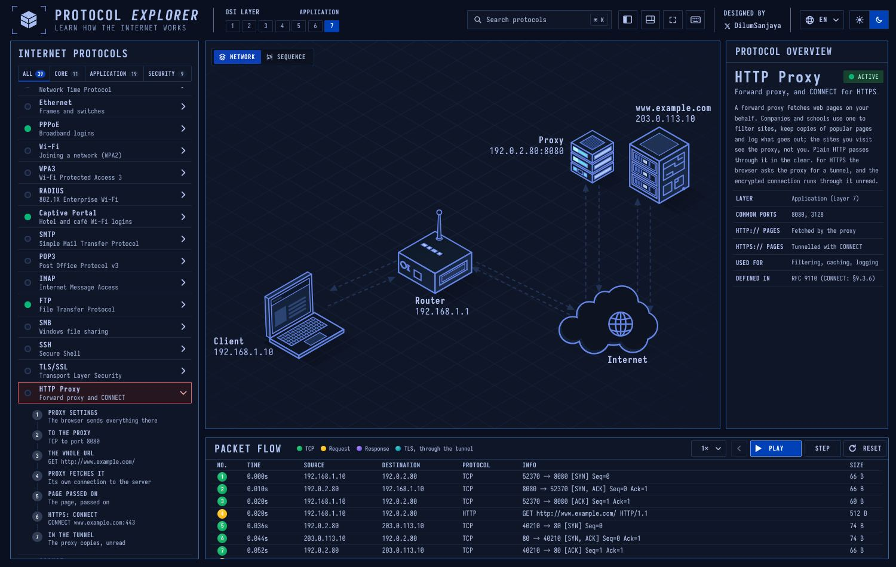

### How the layers fit together (outer to inner)

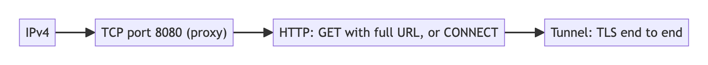

## In-depth explanation of the example (plain-language version)

### The big picture in one minute
A laptop is set up to use a company or school **forward proxy** at `192.0.2.80:8080`. Two things happen (**17 packets**):
1. **Plain HTTP** (packets 1–10): the laptop asks for `http://www.example.com/` *through* the proxy.
2. **HTTPS** (packets 11–17): the laptop opens `https://www.example.com` and asks the proxy to build a **tunnel** using a command called **`CONNECT`**.

**What a forward proxy is.** A middleman that the **client** is configured to use. It fetches things **on the client's behalf**, so the website sees the **proxy's** address, not the client's. Organisations use proxies to **filter sites, cache popular pages, require logins and keep logs.** (The *Reverse Proxy* note covers the opposite: a middleman in front of servers.)

Think of **sending your assistant to the shop**: the shop only ever deals with the assistant, and the assistant can also keep a copy of popular items, refuse to buy certain things, and write everything down.

> **Words you'll see:** *Proxy* = the middleman. *Tunnel* = a pipe of bytes the proxy passes along without reading. *Cache* = a saved copy of a page. *Header* = a labelled line of extra information in a request or reply.

---

### Step 1 – Connect to the proxy, not the website – packets 1 to 3
The browser opens a connection **to the proxy's port 8080**, never to `www.example.com` itself. (The proxy setting comes from the system settings or an automatic configuration script.)

### Step 2 – The full address in the request – packet 4
A request to a proxy carries the **whole URL**: **`GET http://www.example.com/ HTTP/1.1`** (normally it would only say `/`). That's how the proxy knows where to go. If the proxy requires a login, it replies **`407 Proxy Authentication Required`**, and the client tries again with its credentials.

### Step 3 – The proxy fetches the page – packets 5 to 9
The proxy looks up the website, opens **its own connection** to `203.0.113.10` port 80, and sends a normal request, adding:
- **`Via: 1.1 proxy.example.net`**: "this went through a proxy";
- **`X-Forwarded-For: <client address>`**: who the request really came from.
The server replies `200 OK` with the page **to the proxy**. The server only ever talks to `192.0.2.80`.

### Step 4 – The page is passed on – packet 10
The proxy gives the page to the laptop, with its own `Via` label and `X-Cache: MISS` ("I didn't have it saved"). It **could keep a copy** and serve the next person directly (`HIT`). It can also **block** sites, scan content and log everything. **With plain HTTP, the proxy can read everything.**

### Step 5 – HTTPS: the `CONNECT` tunnel – packets 11 to 17
A proxy can't fetch an HTTPS page for you without breaking the encryption, so the browser asks for a **tunnel**:
- **`CONNECT www.example.com:443`** (packet 11).
- The proxy checks its rules ("is this host and port allowed?"), **opens a connection to `203.0.113.10:443`** (packets 12–14), and replies **`200 Connection established`** (packet 15).
- From now on the proxy is a **blind pipe of bytes.** The browser's TLS Client Hello (packet 16) goes in and comes out **unchanged** on the other side (packet 17). The secure handshake and everything after it happen **directly between browser and server.** The proxy learns **which host you connected to and the traffic sizes and timing, but never the pages, URLs or cookies.**

### Step 6 – In the tunnel
The proxy copies bytes both ways until one side closes. (Some company proxies do **TLS inspection**: they open the encryption using a certificate from a **company authority installed on every laptop**, read the traffic, and re-encrypt it. This breaks end-to-end privacy, which is why you should be careful about installing unknown root certificates.)

---

### The 17 packets at a glance
| Packets | What | Why |
|---|---|---|
| 1–3 | TCP handshake to the proxy | connect |
| 4 | `GET http://…` | ask the proxy for a page |
| 5–9 | proxy's own connection and request | fetch it |
| 10 | page returned | deliver it |
| 11 | `CONNECT host:443` | ask for a tunnel |
| 12–15 | proxy connects, `200 Connection established` | tunnel ready |
| 16–17 | Client Hello through the tunnel | HTTPS begins end to end |

### What to remember
- **Plain HTTP via a proxy:** the request has the full URL; the proxy rewrites it, adds **`Via`** and **`X-Forwarded-For`**, and may **cache, filter and log.**
- **HTTPS via a proxy:** **`CONNECT host:443`** → `200 Connection established` → an opaque tunnel.
- Proxy-specific reply: **`407`** (login needed for the proxy).
- The **server sees the proxy's IP**, not the client's, which is useful for hiding clients and controlling outgoing traffic.
- Related: **SOCKS5** (a general-purpose proxy; next note), **reverse proxy**, and **transparent proxy** (intercepts without any client setting).

## Under the hood – technical details

- **Absolute-URI request line.** To a proxy, a request carries the full URL: `GET http://www.example.com/ HTTP/1.1`. A normal request to a server carries only the path (`GET / HTTP/1.1`). The proxy rewrites it to the normal form when it contacts the origin.
- **Proxy headers.** `Proxy-Connection: keep-alive` (non-standard, read only by proxies), `Proxy-Authorization` (credentials), `Via: 1.1 proxy.example.net` (required by HTTP; lists each hop), `X-Forwarded-For` or the standard `Forwarded` (the client's address) and `X-Cache: HIT`/`MISS`.
- **Proxy login.** A proxy that needs authentication replies `407 Proxy Authentication Required` with a `Proxy-Authenticate` challenge (Basic, Digest, NTLM or Negotiate). The client retries with `Proxy-Authorization`.
- **Caching.** The proxy stores responses according to `Cache-Control`, `Expires`, `ETag` and `Last-Modified`, and serves later requests without contacting the server (`X-Cache: HIT`).
- **What a proxy can do with plain HTTP.** Read the URL, headers and body; filter by URL or content; block sites; log everything; rewrite content.
- **CONNECT method.** For HTTPS the browser sends `CONNECT www.example.com:443 HTTP/1.1`. The proxy checks policy (which hosts and ports are allowed, often only 443), opens a TCP connection to the server and replies `200 Connection established`. After that it copies bytes in both directions without understanding them.
- **What the proxy learns with CONNECT.** The destination host and port (and the SNI inside the Client Hello), plus the size and timing of traffic. It never sees the URL path, headers, cookies or content, because TLS runs end to end.
- **TLS inspection ("SSL bumping").** Some company proxies terminate the browser's TLS with a certificate issued by a **company CA installed on every laptop**, read the traffic, and open a second TLS session to the server. This breaks end-to-end privacy and certificate pinning, so be careful about installing unknown root certificates.
- **Configuration.** Set in the operating system or browser, or discovered through a **PAC** script or **WPAD**.
- **Variants.** *Forward* proxy (client-side, this note), *reverse* proxy (server-side, next notes), *transparent* proxy (intercepts without client configuration), and **SOCKS5** (protocol-agnostic).

## Step-by-step walkthrough

### Step 1: PROXY SETTINGS – The browser sends everything there

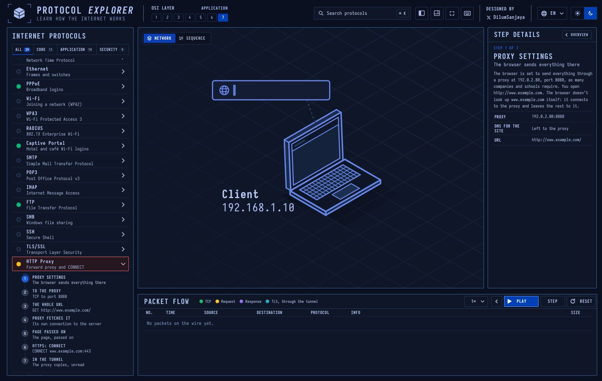

### Step 2: TO THE PROXY – TCP to port 8080

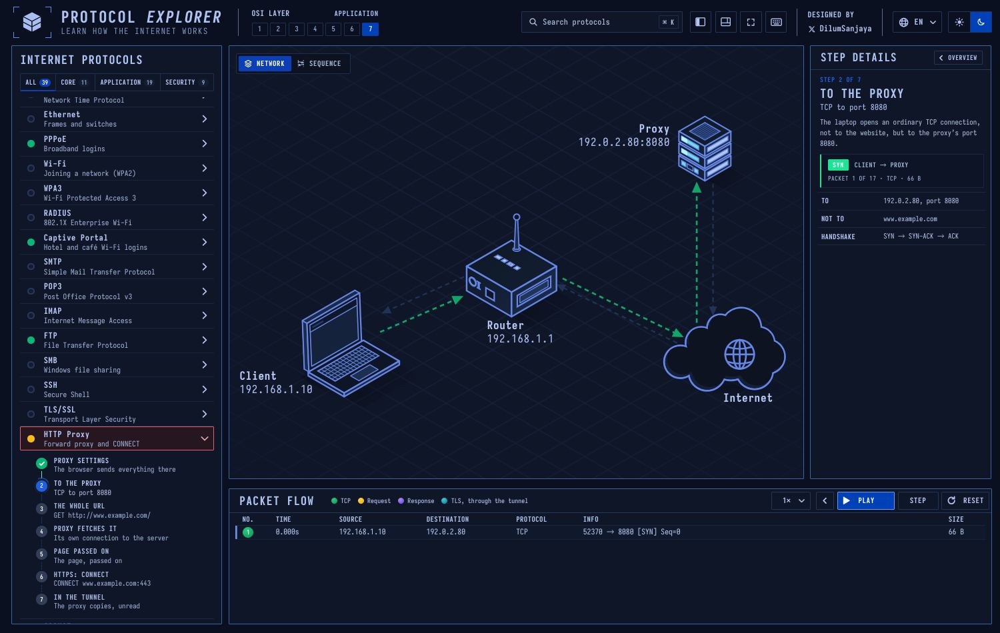

### Step 3: THE WHOLE URL – GET http://www.example.com/

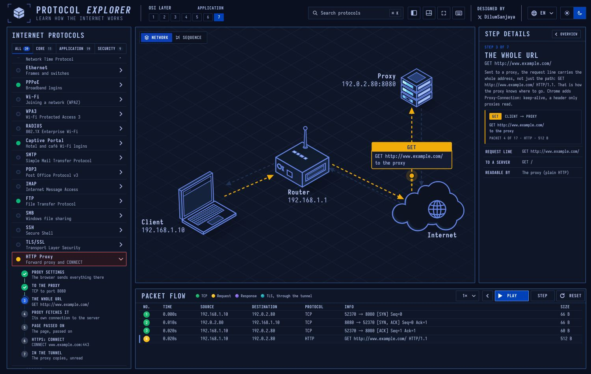

### Step 4: PROXY FETCHES IT – Its own connection to the server

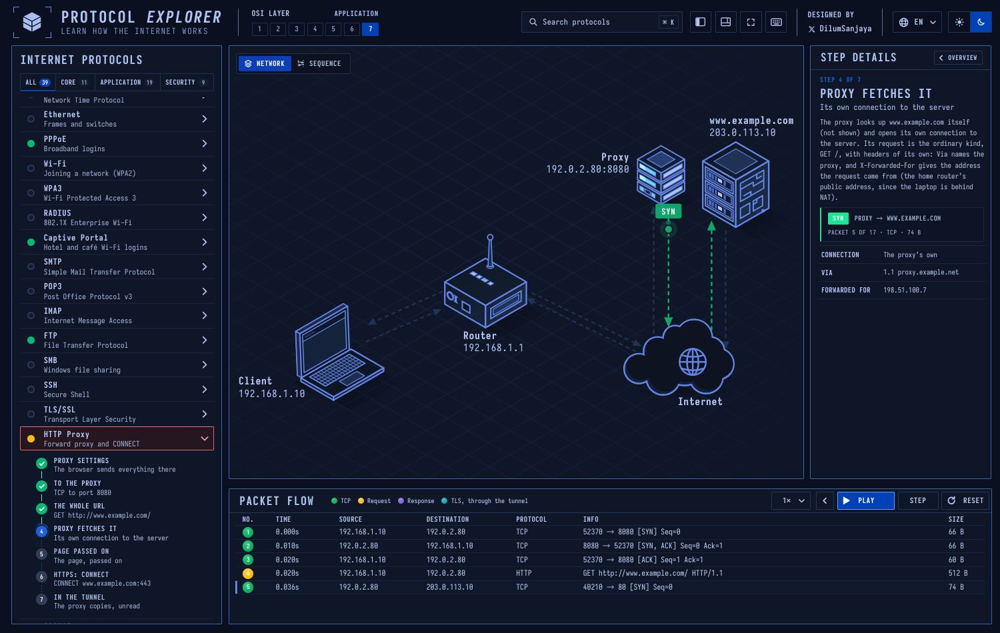

### Step 5: PAGE PASSED ON – The page, passed on

### Step 6: HTTPS: CONNECT – CONNECT www.example.com:443

### Step 7: IN THE TUNNEL – The proxy copies, unread

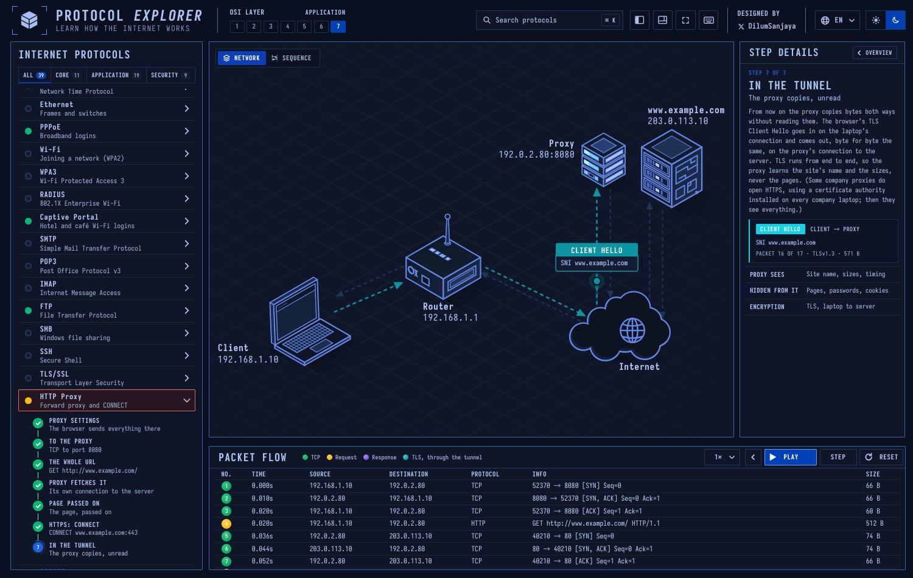

### Lesson summary

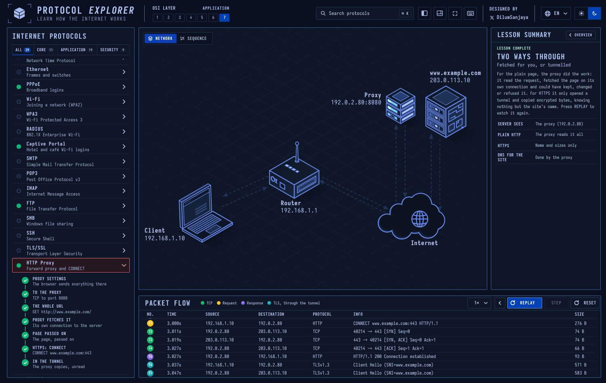

## Packet flow (whole lesson)

| No. | Time | Source | Destination | Protocol | Info | Size |
|---|---|---|---|---|---|---|
| 1 | 0.000s | 192.168.1.10 | 192.0.2.80 | TCP | 52370 → 8080 [SYN] Seq=0 | 66 B |
| 2 | 0.010s | 192.0.2.80 | 192.168.1.10 | TCP | 8080 → 52370 [SYN, ACK] Seq=0 Ack=1 | 66 B |
| 3 | 0.020s | 192.168.1.10 | 192.0.2.80 | TCP | 52370 → 8080 [ACK] Seq=1 Ack=1 | 60 B |
| 4 | 0.020s | 192.168.1.10 | 192.0.2.80 | HTTP | GET http://www.example.com/ HTTP/1.1 | 512 B |
| 5 | 0.036s | 192.0.2.80 | 203.0.113.10 | TCP | 40210 → 80 [SYN] Seq=0 | 74 B |
| 6 | 0.044s | 203.0.113.10 | 192.0.2.80 | TCP | 80 → 40210 [SYN, ACK] Seq=0 Ack=1 | 74 B |
| 7 | 0.052s | 192.0.2.80 | 203.0.113.10 | TCP | 40210 → 80 [ACK] Seq=1 Ack=1 | 66 B |
| 8 | 0.052s | 192.0.2.80 | 203.0.113.10 | HTTP | GET / HTTP/1.1 | 568 B |
| 9 | 0.061s | 203.0.113.10 | 192.0.2.80 | HTTP | HTTP/1.1 200 OK (text/html), 9 segments | 12.9 KB |
| 10 | 0.071s | 192.0.2.80 | 192.168.1.10 | HTTP | HTTP/1.1 200 OK (text/html), 9 segments | 12.9 KB |
| 11 | 3.000s | 192.168.1.10 | 192.0.2.80 | HTTP | CONNECT www.example.com:443 HTTP/1.1 | 276 B |
| 12 | 3.011s | 192.0.2.80 | 203.0.113.10 | TCP | 40214 → 443 [SYN] Seq=0 | 74 B |
| 13 | 3.019s | 203.0.113.10 | 192.0.2.80 | TCP | 443 → 40214 [SYN, ACK] Seq=0 Ack=1 | 74 B |
| 14 | 3.027s | 192.0.2.80 | 203.0.113.10 | TCP | 40214 → 443 [ACK] Seq=1 Ack=1 | 66 B |
| 15 | 3.027s | 192.0.2.80 | 192.168.1.10 | HTTP | HTTP/1.1 200 Connection established | 93 B |
| 16 | 3.037s | 192.168.1.10 | 192.0.2.80 | TLSv1.3 | Client Hello (SNI=www.example.com) | 571 B |
| 17 | 3.047s | 192.0.2.80 | 203.0.113.10 | TLSv1.3 | Client Hello (SNI=www.example.com) | 583 B |

### Sequence diagram

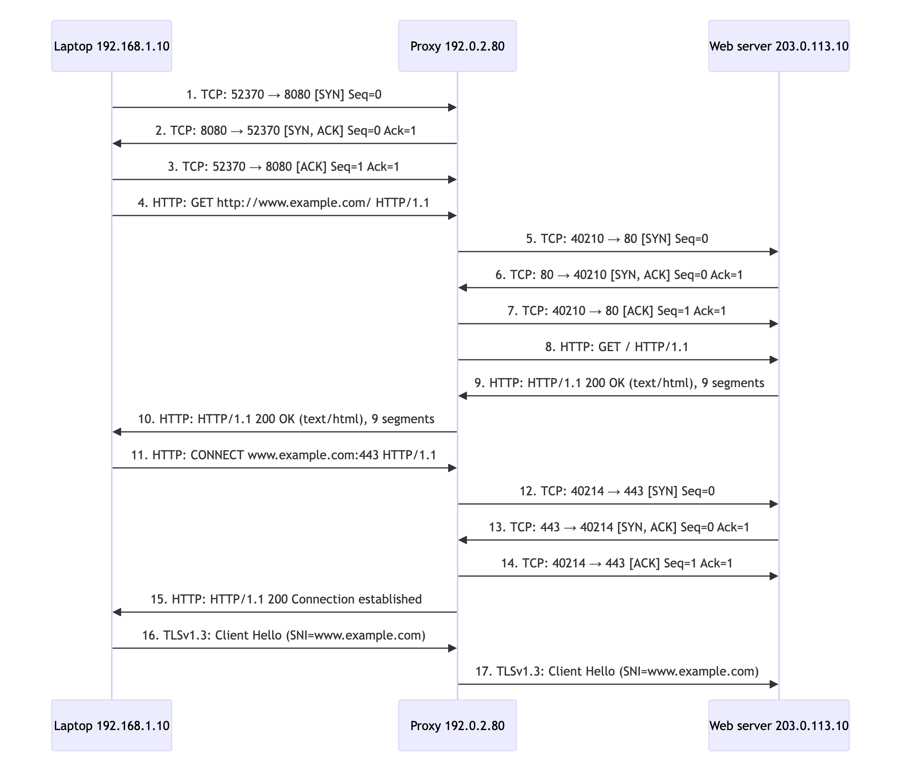

*The lesson's own sequence diagram:*

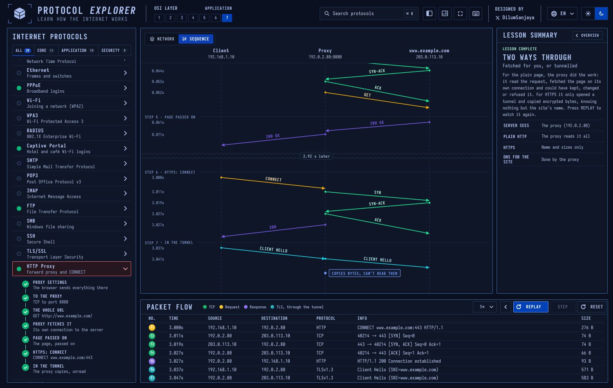

## Packet decoder screenshots

The lesson's decoder view for the first, middle and last packet: headers, field values and the raw hex bytes.

### Packet 1: TCP – 52370 → 8080 [SYN] Seq=0

*192.168.1.10 → 192.0.2.80 · 66 B · t = 0.000s*

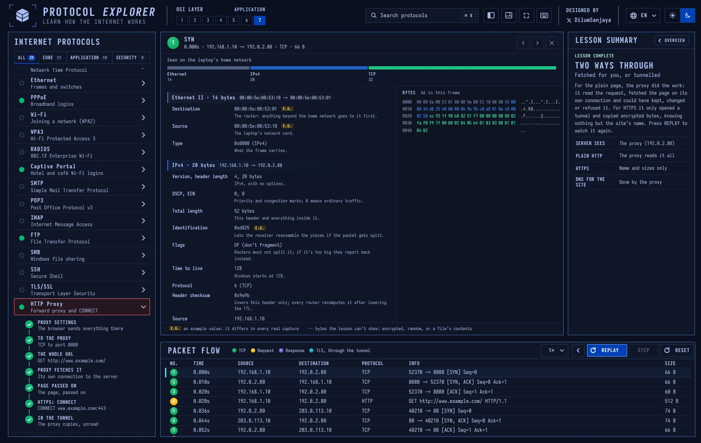

### Packet 9: HTTP – HTTP/1.1 200 OK (text/html), 9 segments

*203.0.113.10 → 192.0.2.80 · 12.9 KB · t = 0.061s*

### Packet 17: TLSv1.3 – Client Hello (SNI=www.example.com)

*192.0.2.80 → 203.0.113.10 · 583 B · t = 3.047s*

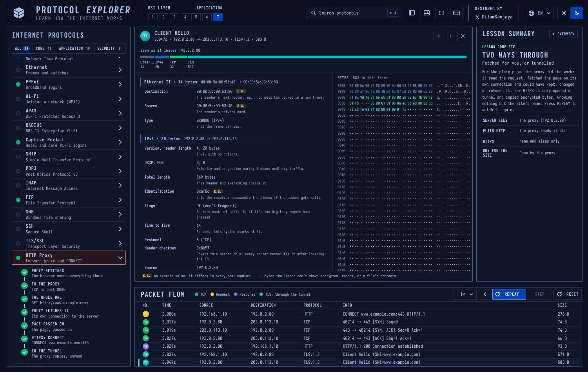

---

<!-- nav -->
⬅ [33 TLS/SSL](33-tls-ssl.md) · [Index](00_Protocols_Index.md) · [35 SOCKS5](35-socks5.md) ➡
<!-- nav -->
