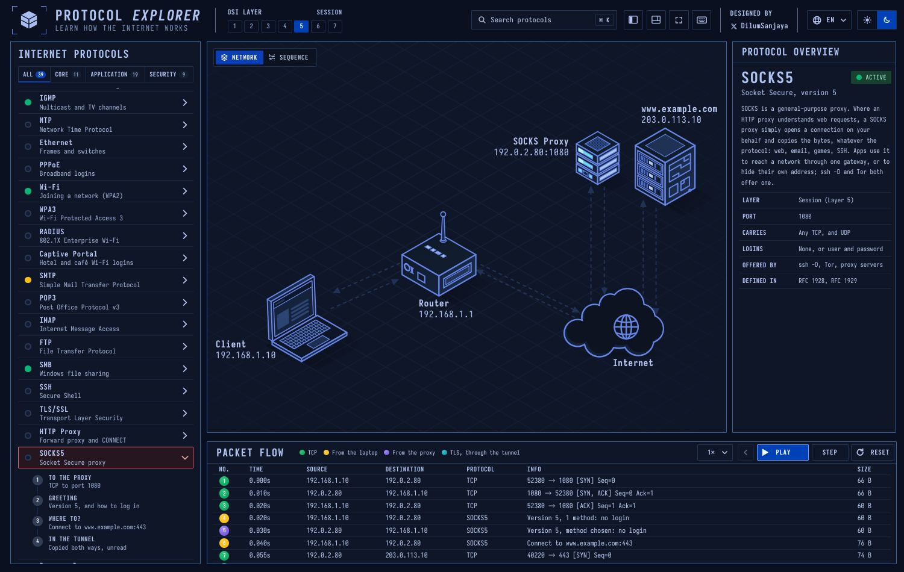
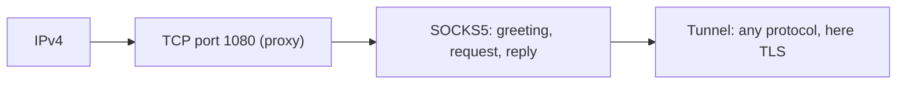
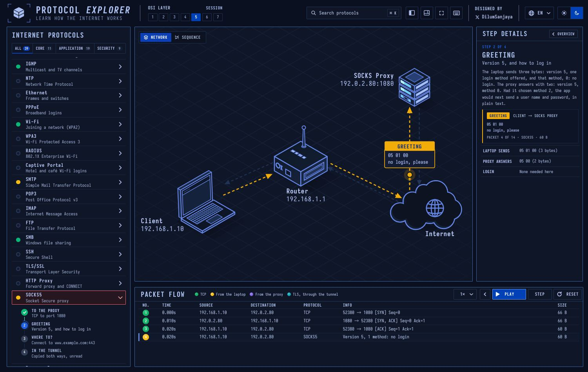
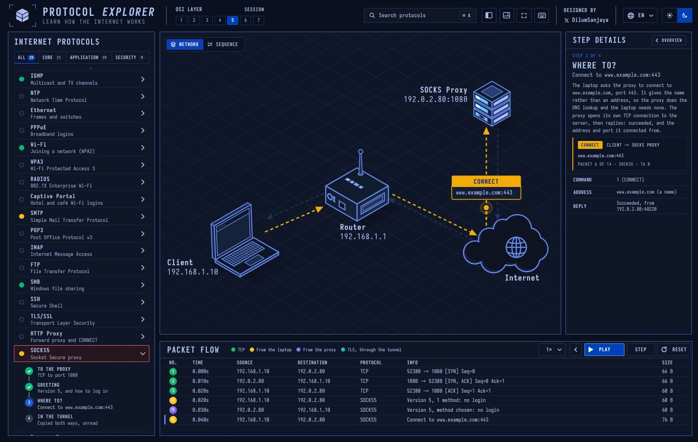
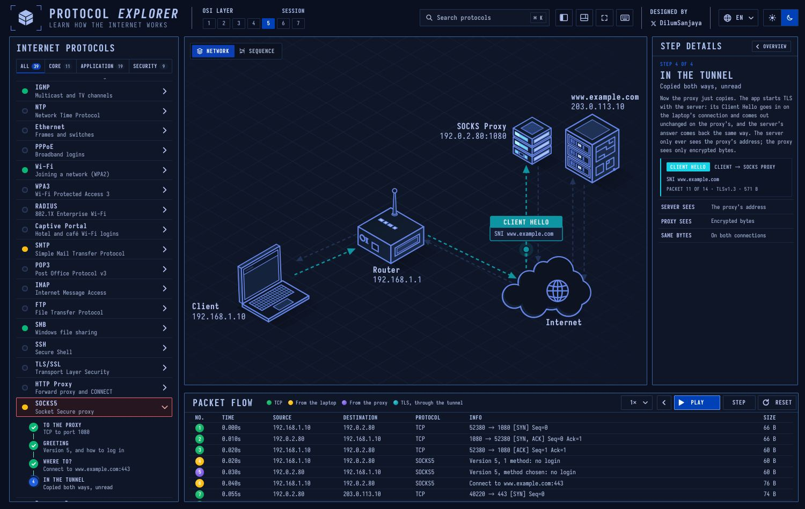
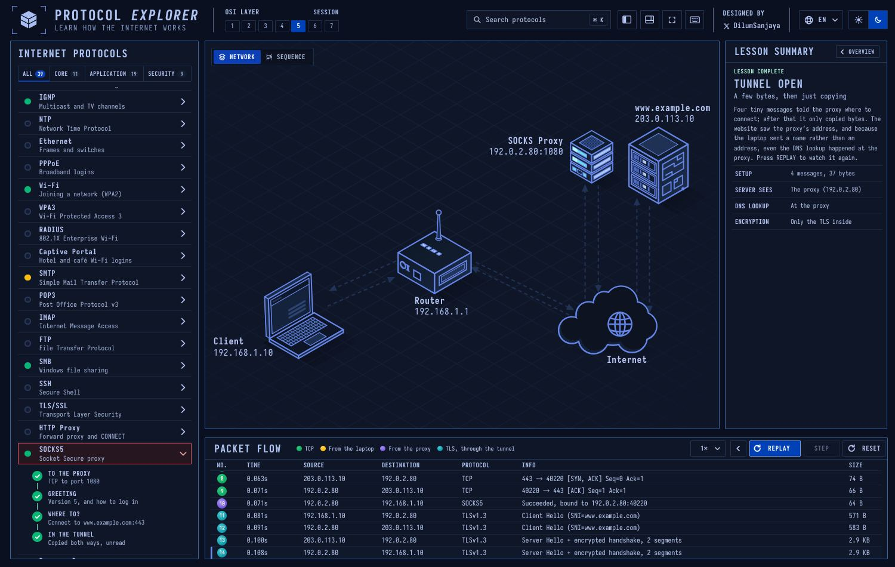
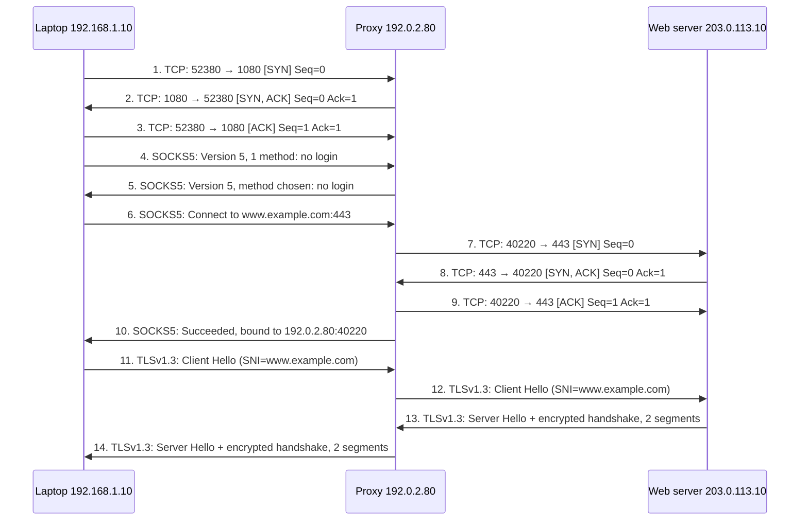
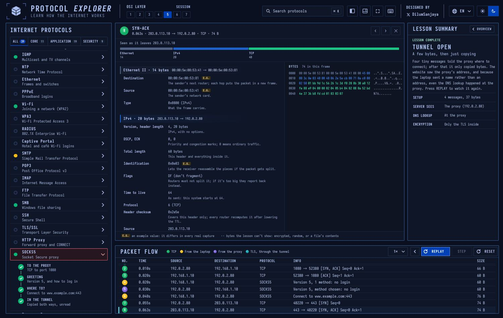
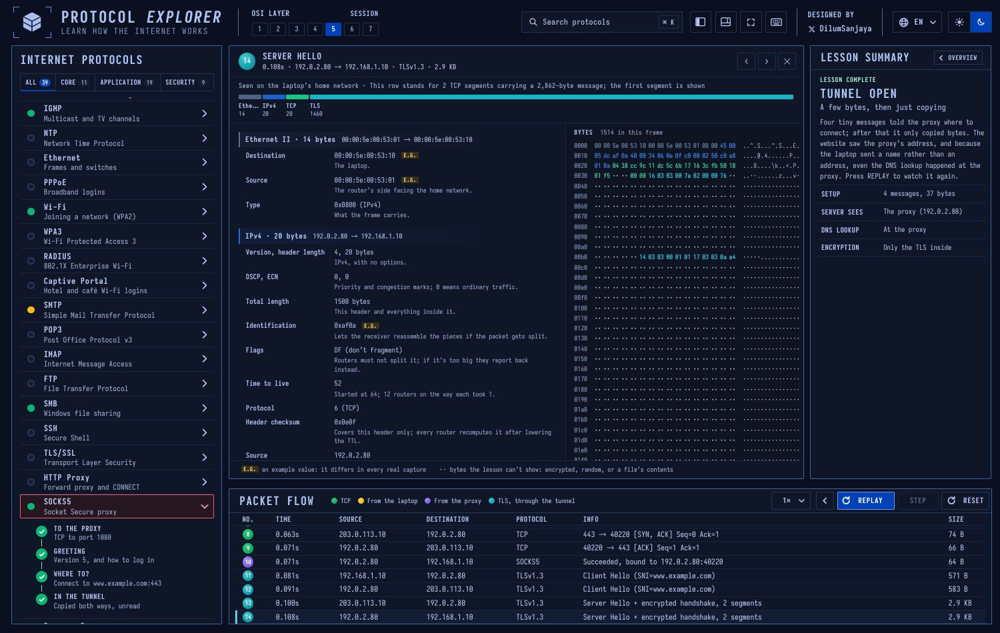

# SOCKS5 – Socket Secure proxy

<!-- nav -->
⬅ [34 HTTP Proxy](34-http-proxy.md) · [Index](00_Protocols_Index.md) · [36 Reverse Proxy](36-reverse-proxy.md) ➡
<!-- nav -->

*Source: Protocol Explorer – https://protocol-explorer-alpha.vercel.app/ (interactive lesson #35). Screenshots captured from the live lesson; packet decodes are the site's example capture (values marked **E.G.** differ in every real capture).*

## Overview

### How the layers fit together (outer to inner)

## In-depth explanation of the example (plain-language version)

### The big picture in one minute
An application on the laptop is set up to reach the internet through a **SOCKS5 proxy** at `192.0.2.80:1080`. It wants a secure (TLS) connection to `www.example.com:443`. **14 packets in 108 ms:** connect to the proxy, a short two-message **greeting**, a **"connect me to this address" request**, the proxy making its own connection to the server, and then the app's **TLS handshake passed through the tunnel.**

**SOCKS vs an HTTP proxy.** An HTTP proxy *understands web requests*. **SOCKS5 doesn't care what you're sending**: it simply **opens a connection for you and copies bytes**, whether they're web pages, email, SSH, file sharing or games. Typical uses: reaching a network through one gateway, hiding your IP address, and tunnelling. (`ssh -D 1080` creates a local SOCKS5 proxy, and the Tor network offers one too.)

Think of **a switchboard operator** who just connects your call to the number you ask for and then doesn't listen. It doesn't matter what you talk about.

> **Words you'll see:** *Proxy* = a middleman. *Tunnel* = a pipe of bytes the proxy copies without reading. *Authentication* = proving who you are. *Domain name* = e.g. `www.example.com`, as opposed to a numeric IP address.

---

### Step 1 – Connect to the proxy – packets 1 to 3
A TCP handshake to **port 1080** on the proxy.

### Step 2 – Greeting: version and login method – packets 4, 5
- **Client → proxy (just 3 bytes):** "I speak **version 5**, I support **1** login method, and it's **number 0** (no login)."
- **Proxy → client (2 bytes):** "Version 5, we'll use **method 0**, no login."
Login methods: `0` none, `1` GSSAPI, **`2` username and password** (sent **in plain text** inside the SOCKS connection, so only as safe as the path), `FF` "none of those are acceptable".

### Step 3 – "Connect me to www.example.com:443" – packets 6 to 10
- **The request (packet 6)** is only 22 bytes and says: version 5, command **CONNECT** (others: BIND for incoming connections, UDP ASSOCIATE for UDP), address type **domain name**, the name itself, and the port **443**.
- **The app sends the *name*, not a numeric address.** So **the proxy does the DNS lookup**, and the laptop needs no DNS of its own. This avoids "DNS leaks". (In tools, `socks5h://` works this way, while plain `socks5://` looks the name up locally.)
- The proxy opens **its own connection** to `203.0.113.10:443` (packets 7–9).
- **The reply (packet 10):** "version 5, **success**," plus the address and port the proxy connected *from*. Other result codes include: general failure, not allowed, network unreachable, host unreachable, **connection refused**, and command not supported.

### Step 4 – In the tunnel – packets 11 to 14
After the success reply, **SOCKS steps aside**: the proxy just copies bytes both ways without reading them. The app starts its **TLS handshake**: its Client Hello goes in on the laptop's connection (11) and **comes out unchanged** on the proxy's connection to the server (12). The server's reply flows back the same way (13–14). The **server only sees the proxy's address**, and the **proxy only sees encrypted bytes** (plus the destination name and sizes).

---

### The 14 packets at a glance
| Packets | What | Why |
|---|---|---|
| 1–3 | TCP handshake to the proxy | connect |
| 4–5 | greeting and method choice | agree on version and login |
| 6 | CONNECT request (name + port) | ask for a connection |
| 7–9 | proxy's own TCP handshake | proxy reaches the server |
| 10 | success reply | tunnel ready |
| 11–14 | TLS handshake through the tunnel | secure connection, end to end |

### What to remember
- **Steps:** greeting → method choice → (optional login) → request → reply.
- **Commands:** CONNECT (TCP), BIND (accept an incoming connection), **UDP ASSOCIATE** (relay UDP, e.g. DNS or voice).
- **Address types:** IPv4, IPv6 or **domain name** (which lets the proxy resolve it).
- **SOCKS5 has no encryption of its own.** It relays; it doesn't protect. Combine it with TLS or SSH, as here. (The older SOCKS4 lacked logins, domain names and UDP.)
- **Compared with an HTTP proxy's `CONNECT`:** both end up as an opaque tunnel for HTTPS. SOCKS works for *any* protocol but is lower level (no caching or URL filtering).

## Under the hood – technical details

- **Standard.** RFC 1928 (SOCKS5), with username/password authentication in RFC 1929. It works at the *session layer*, relaying TCP connections (and UDP) for any protocol.
- **Greeting.** Client: `05` (version), number of methods, then the methods (`00` none, `01` GSSAPI, `02` username/password). Server: `05` and the chosen method, or `FF` for "no acceptable method". Username/password sub-negotiation: `01 | ulen | username | plen | password`, reply `01 00` for success. It is sent in clear inside the SOCKS connection, so it is only as safe as the path.
- **Request layout.** `VER (05) | CMD | RSV (00) | ATYP | DST.ADDR | DST.PORT`. In the example `05 01 00 03 0F "www.example.com" 01 BB`: command `01` CONNECT, address type `03` (domain name, length byte `0F` = 15), port `01 BB` = 443 in network byte order.
- **Commands.** `01 CONNECT` (outgoing TCP), `02 BIND` (accept an incoming connection, as in FTP active mode), `03 UDP ASSOCIATE` (relay UDP datagrams, for DNS or voice).
- **Address types.** `01` IPv4, `03` domain name, `04` IPv6. Sending the *name* lets the **proxy resolve it**, which avoids DNS leaks. In tools, `socks5h://` means "proxy resolves"; plain `socks5://` resolves locally.
- **Reply codes.** `00` succeeded, `01` general failure, `02` not allowed by ruleset, `03` network unreachable, `04` host unreachable, `05` connection refused, `06` TTL expired, `07` command not supported, `08` address type not supported. The reply also gives the address and port the proxy connected *from*.
- **After success.** SOCKS is out of the way: the proxy copies bytes both ways. The TLS handshake that follows is end to end between the app and the server.
- **No encryption of its own.** SOCKS5 relays; it doesn't protect. Combine it with TLS or SSH. SOCKS4/4a lacked authentication, domain names (4a added them) and UDP.
- **Versus an HTTP proxy.** An HTTP proxy understands web requests (caching, URL filtering, `Via` headers). SOCKS5 is lower level and handles any protocol. For HTTPS the HTTP proxy's `CONNECT` and SOCKS5's `CONNECT` both end up as an opaque tunnel.
- **Where you meet it.** `ssh -D 1080` creates a local SOCKS5 proxy; the Tor client exposes one; many corporate gateways and VPN products offer one.

## Step-by-step walkthrough (screenshots from the lesson)

### Step 1: TO THE PROXY – TCP to port 1080

### Step 2: GREETING – Version 5, and how to log in

### Step 3: WHERE TO? – Connect to www.example.com:443

### Step 4: IN THE TUNNEL – Copied both ways, unread

### Lesson summary

## Packet flow (whole lesson)

| No. | Time | Source | Destination | Protocol | Info | Size |
|---|---|---|---|---|---|---|
| 1 | 0.000s | 192.168.1.10 | 192.0.2.80 | TCP | 52380 → 1080 [SYN] Seq=0 | 66 B |
| 2 | 0.010s | 192.0.2.80 | 192.168.1.10 | TCP | 1080 → 52380 [SYN, ACK] Seq=0 Ack=1 | 66 B |
| 3 | 0.020s | 192.168.1.10 | 192.0.2.80 | TCP | 52380 → 1080 [ACK] Seq=1 Ack=1 | 60 B |
| 4 | 0.020s | 192.168.1.10 | 192.0.2.80 | SOCKS5 | Version 5, 1 method: no login | 60 B |
| 5 | 0.030s | 192.0.2.80 | 192.168.1.10 | SOCKS5 | Version 5, method chosen: no login | 60 B |
| 6 | 0.040s | 192.168.1.10 | 192.0.2.80 | SOCKS5 | Connect to www.example.com:443 | 76 B |
| 7 | 0.055s | 192.0.2.80 | 203.0.113.10 | TCP | 40220 → 443 [SYN] Seq=0 | 74 B |
| 8 | 0.063s | 203.0.113.10 | 192.0.2.80 | TCP | 443 → 40220 [SYN, ACK] Seq=0 Ack=1 | 74 B |
| 9 | 0.071s | 192.0.2.80 | 203.0.113.10 | TCP | 40220 → 443 [ACK] Seq=1 Ack=1 | 66 B |
| 10 | 0.071s | 192.0.2.80 | 192.168.1.10 | SOCKS5 | Succeeded, bound to 192.0.2.80:40220 | 64 B |
| 11 | 0.081s | 192.168.1.10 | 192.0.2.80 | TLSv1.3 | Client Hello (SNI=www.example.com) | 571 B |
| 12 | 0.091s | 192.0.2.80 | 203.0.113.10 | TLSv1.3 | Client Hello (SNI=www.example.com) | 583 B |
| 13 | 0.100s | 203.0.113.10 | 192.0.2.80 | TLSv1.3 | Server Hello + encrypted handshake, 2 segments | 2.9 KB |
| 14 | 0.108s | 192.0.2.80 | 192.168.1.10 | TLSv1.3 | Server Hello + encrypted handshake, 2 segments | 2.9 KB |

### Sequence diagram

*The lesson's own sequence diagram:*

## Packet decoder screenshots

The lesson's decoder view for the first, middle and last packet: headers, field values and the raw hex bytes.

### Packet 1: TCP – 52380 → 1080 [SYN] Seq=0

*192.168.1.10 → 192.0.2.80 · 66 B · t = 0.000s*

### Packet 8: TCP – 443 → 40220 [SYN, ACK] Seq=0 Ack=1

*203.0.113.10 → 192.0.2.80 · 74 B · t = 0.063s*

### Packet 14: TLSv1.3 – Server Hello + encrypted handshake, 2 segments

*192.0.2.80 → 192.168.1.10 · 2.9 KB · t = 0.108s*

---

<!-- nav -->
⬅ [34 HTTP Proxy](34-http-proxy.md) · [Index](00_Protocols_Index.md) · [36 Reverse Proxy](36-reverse-proxy.md) ➡
<!-- nav -->
