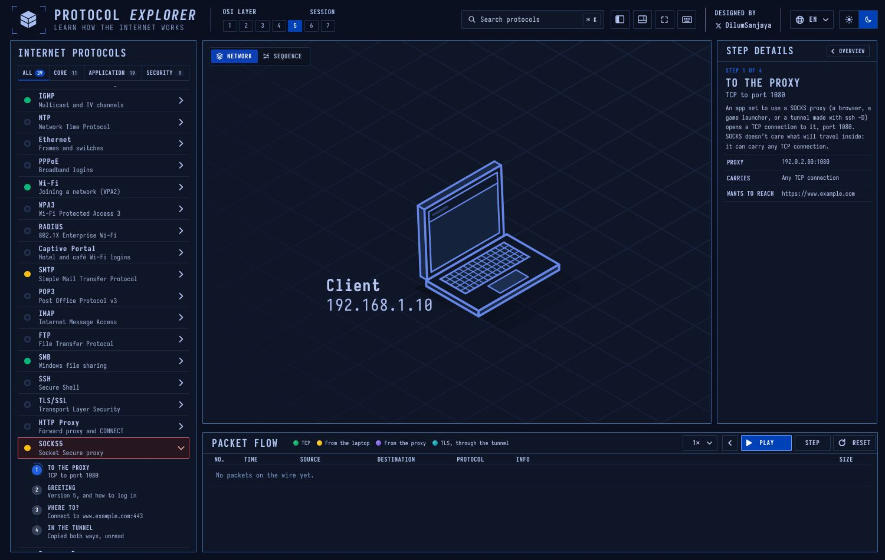
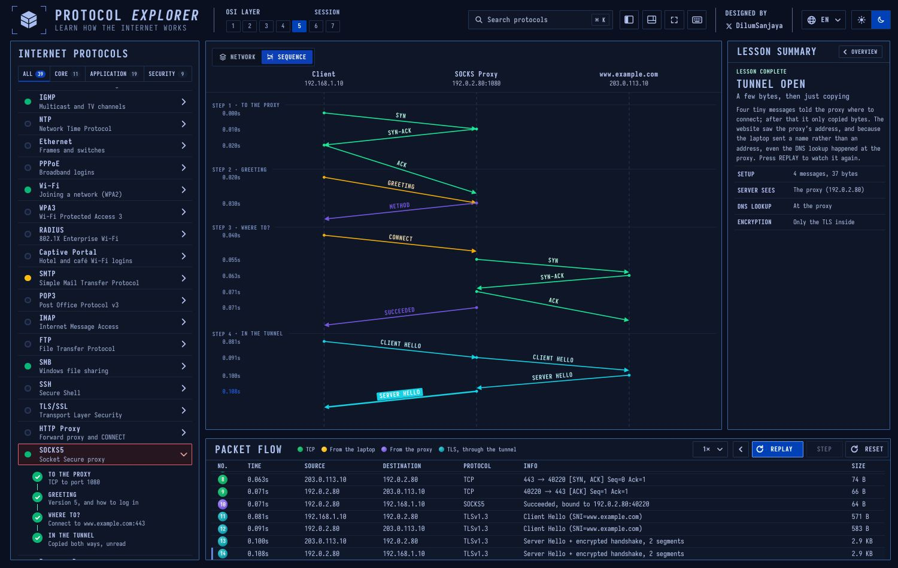
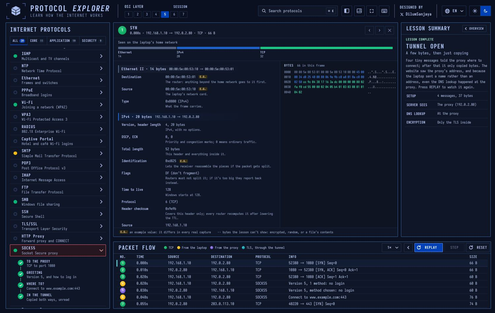

# SOCKS5 – Socket Secure proxy

<!-- nav -->
⬅ [34 HTTP Proxy](34-http-proxy.md) · [Index](00_Protocols_Index.md) · [36 Reverse Proxy](36-reverse-proxy.md) ➡
<!-- nav -->

*Source: Protocol Explorer – https://protocol-explorer-alpha.vercel.app/ (interactive lesson #35). Screenshots captured from the live lesson; packet decodes are the site's example capture (values marked **E.G.** differ in every real capture).*

## Overview


> PROTOCOL OVERVIEW  
> SOCKS5  
> ACTIVE  
> Socket Secure, version 5  
> SOCKS is a general-purpose proxy. Where an HTTP proxy understands web requests, a SOCKS proxy simply opens a connection on your behalf and copies the bytes, whatever the protocol: web, email, games, SSH. Apps use it to reach a network through one gateway, or to hide their own address; ssh -D and Tor both offer one.  
> LAYER  
> Session (Layer 5)  
> PORT  
> 1080  
> CARRIES  
> Any TCP, and UDP  
> LOGINS  
> None, or user and password  
> OFFERED BY  
> ssh -D, Tor, proxy servers  
> DEFINED IN  
> RFC 1928, RFC 1929  

## In-depth explanation of the example (plain-language version)

### The big picture in one minute
An application on the laptop is set up to reach the internet through a **SOCKS5 proxy** at `192.0.2.80:1080`. It wants a secure (TLS) connection to `www.example.com:443`. **14 packets in 108 ms:** connect to the proxy, a short two-message **greeting**, a **"connect me to this address" request**, the proxy making its own connection to the server, and then the app's **TLS handshake passed through the tunnel.**

**SOCKS vs an HTTP proxy.** An HTTP proxy *understands web requests*. **SOCKS5 doesn't care what you're sending**: it simply **opens a connection for you and copies bytes**, whether they're web pages, email, SSH, file sharing or games. Typical uses: reaching a network through one gateway, hiding your IP address, and tunnelling. (`ssh -D 1080` creates a local SOCKS5 proxy, and the Tor network offers one too.)

Think of **a switchboard operator** who just connects your call to the number you ask for and then doesn't listen. It doesn't matter what you talk about.

> **Words you'll see:** *Proxy* = a middleman. *Tunnel* = a pipe of bytes the proxy copies without reading. *Authentication* = proving who you are. *Domain name* = e.g. `www.example.com`, as opposed to a numeric IP address.

---

### Step 1 – Connect to the proxy – packets 1 to 3
A TCP handshake to **port 1080** on the proxy.

### Step 2 – Greeting: version and login method – packets 4, 5
- **Client → proxy (just 3 bytes):** "I speak **version 5**, I support **1** login method, and it's **number 0** (no login)."
- **Proxy → client (2 bytes):** "Version 5, we'll use **method 0**, no login."
Login methods: `0` none, `1` GSSAPI, **`2` username and password** (sent **in plain text** inside the SOCKS connection, so only as safe as the path), `FF` "none of those are acceptable".

### Step 3 – "Connect me to www.example.com:443" – packets 6 to 10
- **The request (packet 6)** is only 22 bytes and says: version 5, command **CONNECT** (others: BIND for incoming connections, UDP ASSOCIATE for UDP), address type **domain name**, the name itself, and the port **443**.
- **The app sends the *name*, not a numeric address.** So **the proxy does the DNS lookup**, and the laptop needs no DNS of its own. This avoids "DNS leaks". (In tools, `socks5h://` works this way, while plain `socks5://` looks the name up locally.)
- The proxy opens **its own connection** to `203.0.113.10:443` (packets 7–9).
- **The reply (packet 10):** "version 5, **success**," plus the address and port the proxy connected *from*. Other result codes include: general failure, not allowed, network unreachable, host unreachable, **connection refused**, and command not supported.

### Step 4 – In the tunnel – packets 11 to 14
After the success reply, **SOCKS steps aside**: the proxy just copies bytes both ways without reading them. The app starts its **TLS handshake**: its Client Hello goes in on the laptop's connection (11) and **comes out unchanged** on the proxy's connection to the server (12). The server's reply flows back the same way (13–14). The **server only sees the proxy's address**, and the **proxy only sees encrypted bytes** (plus the destination name and sizes).

---

### The 14 packets at a glance
| Packets | What | Why |
|---|---|---|
| 1–3 | TCP handshake to the proxy | connect |
| 4–5 | greeting and method choice | agree on version and login |
| 6 | CONNECT request (name + port) | ask for a connection |
| 7–9 | proxy's own TCP handshake | proxy reaches the server |
| 10 | success reply | tunnel ready |
| 11–14 | TLS handshake through the tunnel | secure connection, end to end |

### What to remember
- **Steps:** greeting → method choice → (optional login) → request → reply.
- **Commands:** CONNECT (TCP), BIND (accept an incoming connection), **UDP ASSOCIATE** (relay UDP, e.g. DNS or voice).
- **Address types:** IPv4, IPv6 or **domain name** (which lets the proxy resolve it).
- **SOCKS5 has no encryption of its own.** It relays; it doesn't protect. Combine it with TLS or SSH, as here. (The older SOCKS4 lacked logins, domain names and UDP.)
- **Compared with an HTTP proxy's `CONNECT`:** both end up as an opaque tunnel for HTTPS. SOCKS works for *any* protocol but is lower level (no caching or URL filtering).

## Step-by-step walkthrough (screenshots from the lesson)

### Step 1: TO THE PROXY – TCP to port 1080



> STEP 1 OF 4  
> TO THE PROXY  
> TCP to port 1080  
> An app set to use a SOCKS proxy (a browser, a game launcher, or a tunnel made with ssh -D) opens a TCP connection to it, port 1080. SOCKS doesn’t care what will travel inside: it can carry any TCP connection.  
> PROXY  
> 192.0.2.80:1080  
> CARRIES  
> Any TCP connection  
> WANTS TO REACH  
> https://www.example.com  

### Step 2: GREETING – Version 5, and how to log in


> STEP 2 OF 4  
> GREETING  
> Version 5, and how to log in  
> The laptop sends three bytes: version 5, one login method offered, and that method, 0: no login. The proxy answers with two: version 5, method 0. Had it chosen method 2, the app would next send a user name and password, in plain text.  
> GREETING  
> CLIENT → SOCKS PROXY  
> 05 01 00  
> no login, please  
> PACKET 4 OF 14 · SOCKS5 · 60 B  
> LAPTOP SENDS  
> 05 01 00 (3 bytes)  
> PROXY ANSWERS  
> 05 00 (2 bytes)  
> LOGIN  
> None needed here  

### Step 3: WHERE TO? – Connect to www.example.com:443


> STEP 3 OF 4  
> WHERE TO?  
> Connect to www.example.com:443  
> The laptop asks the proxy to connect to www.example.com, port 443. It gives the name rather than an address, so the proxy does the DNS lookup and the laptop needs none. The proxy opens its own TCP connection to the server, then replies: succeeded, and the address and port it connected from.  
> CONNECT  
> CLIENT → SOCKS PROXY  
> www.example.com:443  
> PACKET 6 OF 14 · SOCKS5 · 76 B  
> COMMAND  
> 1 (CONNECT)  
> ADDRESS  
> www.example.com (a name)  
> REPLY  
> Succeeded, from 192.0.2.80:40220  

### Step 4: IN THE TUNNEL – Copied both ways, unread


> STEP 4 OF 4  
> IN THE TUNNEL  
> Copied both ways, unread  
> Now the proxy just copies. The app starts TLS with the server: its Client Hello goes in on the laptop’s connection and comes out unchanged on the proxy’s, and the server’s answer comes back the same way. The server only ever sees the proxy’s address; the proxy sees only encrypted bytes.  
> CLIENT HELLO  
> CLIENT → SOCKS PROXY  
> SNI www.example.com  
> PACKET 11 OF 14 · TLSv1.3 · 571 B  
> SERVER SEES  
> The proxy’s address  
> PROXY SEES  
> Encrypted bytes  
> SAME BYTES  
> On both connections  

### Lesson summary


> LESSON SUMMARY  
> LESSON COMPLETE  
> TUNNEL OPEN  
> A few bytes, then just copying  
> Four tiny messages told the proxy where to connect; after that it only copied bytes. The website saw the proxy’s address, and because the laptop sent a name rather than an address, even the DNS lookup happened at the proxy. Press REPLAY to watch it again.  
> SERVER HELLO  
> SOCKS PROXY → CLIENT  
> unchanged  
> PACKET 14 OF 14 · TLSv1.3 · 2.9 KB  
> SETUP  
> 4 messages, 37 bytes  
> SERVER SEES  
> The proxy (192.0.2.80)  
> DNS LOOKUP  
> At the proxy  
> ENCRYPTION  
> Only the TLS inside  

## Packet flow (whole lesson)

| No. | Time | Source | Destination | Protocol | Info | Size |
|---|---|---|---|---|---|---|
| 1 | 0.000s | 192.168.1.10 | 192.0.2.80 | TCP | 52380 → 1080 [SYN] Seq=0 | 66 B |
| 2 | 0.010s | 192.0.2.80 | 192.168.1.10 | TCP | 1080 → 52380 [SYN, ACK] Seq=0 Ack=1 | 66 B |
| 3 | 0.020s | 192.168.1.10 | 192.0.2.80 | TCP | 52380 → 1080 [ACK] Seq=1 Ack=1 | 60 B |
| 4 | 0.020s | 192.168.1.10 | 192.0.2.80 | SOCKS5 | Version 5, 1 method: no login | 60 B |
| 5 | 0.030s | 192.0.2.80 | 192.168.1.10 | SOCKS5 | Version 5, method chosen: no login | 60 B |
| 6 | 0.040s | 192.168.1.10 | 192.0.2.80 | SOCKS5 | Connect to www.example.com:443 | 76 B |
| 7 | 0.055s | 192.0.2.80 | 203.0.113.10 | TCP | 40220 → 443 [SYN] Seq=0 | 74 B |
| 8 | 0.063s | 203.0.113.10 | 192.0.2.80 | TCP | 443 → 40220 [SYN, ACK] Seq=0 Ack=1 | 74 B |
| 9 | 0.071s | 192.0.2.80 | 203.0.113.10 | TCP | 40220 → 443 [ACK] Seq=1 Ack=1 | 66 B |
| 10 | 0.071s | 192.0.2.80 | 192.168.1.10 | SOCKS5 | Succeeded, bound to 192.0.2.80:40220 | 64 B |
| 11 | 0.081s | 192.168.1.10 | 192.0.2.80 | TLSv1.3 | Client Hello (SNI=www.example.com) | 571 B |
| 12 | 0.091s | 192.0.2.80 | 203.0.113.10 | TLSv1.3 | Client Hello (SNI=www.example.com) | 583 B |
| 13 | 0.100s | 203.0.113.10 | 192.0.2.80 | TLSv1.3 | Server Hello + encrypted handshake, 2 segments | 2.9 KB |
| 14 | 0.108s | 192.0.2.80 | 192.168.1.10 | TLSv1.3 | Server Hello + encrypted handshake, 2 segments | 2.9 KB |

### Sequence diagram



## Packets decoded byte by byte

Each packet below is the lesson's own decode (headers, field values and the plain-English meaning of each field). Screenshots show the first, middle and last packet in the lesson's decoder view with the raw hex bytes.

### Packet 1: TCP – 52380 → 1080 [SYN] Seq=0

*192.168.1.10 → 192.0.2.80 · 66 B · t = 0.000s*



<details><summary>Decoded fields</summary>

```text
1
SYN
0.000s · 192.168.1.10 → 192.0.2.80 · TCP · 66 B
Seen on the laptop’s home network
Ethernet
14
IPv4
20
TCP
32
Ethernet II · 14 bytes
00:00:5e:00:53:10 → 00:00:5e:00:53:01
Destination
00:00:5e:00:53:01 E.G.

The router: anything beyond the home network goes to it first.

Source
00:00:5e:00:53:10 E.G.

The laptop’s network card.

Type
0x0800 (IPv4)

What the frame carries.

IPv4 · 20 bytes
192.168.1.10 → 192.0.2.80
Version, header length
4, 20 bytes

IPv4, with no options.

DSCP, ECN
0, 0

Priority and congestion marks; 0 means ordinary traffic.

Total length
52 bytes

This header and everything inside it.

Identification
0xd825 E.G.

Lets the receiver reassemble the pieces if the packet gets split.

Flags
DF (don’t fragment)

Routers must not split it; if it’s too big they report back instead.

Time to live
128

Windows starts at 128.

Protocol
6 (TCP)
Header checksum
0x9e9b

Covers this header only; every router recomputes it after lowering the TTL.

Source
192.168.1.10
Destination
192.0.2.80
TCP · 32 bytes
52380 → 1080, SYN
Source port
52380

Picked by the laptop’s system for this connection.

Destination port
1080
Sequence number
0 (relative)

This side’s starting number. Shown as 0; the real one is random.

Real sequence number
387332828 E.G.
Acknowledgment
0 (not used yet)

A first SYN has nothing to acknowledge.

Header length
32 bytes

20 bytes, plus 12 of options.

Flags
0x002 (SYN)
Window
64240 E.G.

How much more data this side can take right now.

Checksum
0xcd55

Covers the header, the data and the IP addresses, so damage is caught.

Urgent pointer
0
Options
12 bytes
Maximum segment size
1460 bytes

The most data this side wants in one segment.

No-op
1

Spacing, so the next option lines up.

Window scale
× 256

Window values are multiplied by this, so windows can be larger than 64 KB.

No-op
1

Spacing, so the next option lines up.

No-op
1

Spacing, so the next option lines up.

SACK permitted
yes

This side understands selective acknowledgements.

BYTES 66 in this frame
0000
00
00
5e
00
53
01
00
00
5e
00
53
10
08
00
45
00
.
.
^
.
S
.
.
.
^
.
S
.
.
.
E
.
0010
00
34
d8
25
40
00
80
06
9e
9b
c0
a8
01
0a
c0
00
.
4
.
%
@
.
.
.
.
.
.
.
.
.
.
.
0020
02
50
cc
9c
04
38
17
16
3a
dc
00
00
00
00
80
02
.
P
.
.
.
8
.
.
:
.
.
.
.
.
.
.
0030
fa
f0
cd
55
00
00
02
04
05
b4
01
03
03
08
01
01
.
.
.
U
.
.
.
.
.
.
.
.
.
.
.
.
0040
04
02
.
.
E.G. an example value: it differs in every real capture
·· bytes the lesson can’t show: encrypted, random, or a file’s contents
```

</details>

### Packet 2: TCP – 1080 → 52380 [SYN, ACK] Seq=0 Ack=1

*192.0.2.80 → 192.168.1.10 · 66 B · t = 0.010s*

<details><summary>Decoded fields</summary>

```text
2
SYN-ACK
0.010s · 192.0.2.80 → 192.168.1.10 · TCP · 66 B
Seen on the laptop’s home network
Ethernet
14
IPv4
20
TCP
32
Ethernet II · 14 bytes
00:00:5e:00:53:01 → 00:00:5e:00:53:10
Destination
00:00:5e:00:53:10 E.G.

The laptop.

Source
00:00:5e:00:53:01 E.G.

The router’s side facing the home network.

Type
0x0800 (IPv4)

What the frame carries.

IPv4 · 20 bytes
192.0.2.80 → 192.168.1.10
Version, header length
4, 20 bytes

IPv4, with no options.

DSCP, ECN
0, 0

Priority and congestion marks; 0 means ordinary traffic.

Total length
52 bytes

This header and everything inside it.

Identification
0xaf04 E.G.

Lets the receiver reassemble the pieces if the packet gets split.

Flags
DF (don’t fragment)

Routers must not split it; if it’s too big they report back instead.

Time to live
52

Started at 64; 12 routers on the way each took 1.

Protocol
6 (TCP)
Header checksum
0x13bd

Covers this header only; every router recomputes it after lowering the TTL.

Source
192.0.2.80
Destination
192.168.1.10
TCP · 32 bytes
1080 → 52380, SYN, ACK
Source port
1080
Destination port
52380
Sequence number
0 (relative)

This side’s starting number. Shown as 0; the real one is random.

Real sequence number
299654238 E.G.
Acknowledgment
1 (relative)

The next byte this side expects: everything before it has arrived.

Header length
32 bytes

20 bytes, plus 12 of options.

Flags
0x012 (SYN, ACK)
Window
64240 E.G.

How much more data this side can take right now.

Checksum
0x5f0b

Covers the header, the data and the IP addresses, so damage is caught.

Urgent pointer
0
Options
12 bytes
Maximum segment size
1460 bytes

The most data this side wants in one segment.

No-op
1

Spacing, so the next option lines up.

No-op
1

Spacing, so the next option lines up.

SACK permitted
yes

This side understands selective acknowledgements.

No-op
1

Spacing, so the next option lines up.

Window scale
× 128

Window values are multiplied by this, so windows can be larger than 64 KB.

BYTES 66 in this frame
0000
00
00
5e
00
53
10
00
00
5e
00
53
01
08
00
45
00
.
.
^
.
S
.
.
.
^
.
S
.
.
.
E
.
0010
00
34
af
04
40
00
34
06
13
bd
c0
00
02
50
c0
a8
.
4
.
.
@
.
4
.
.
.
.
.
.
P
.
.
0020
01
0a
04
38
cc
9c
11
dc
5c
5e
17
16
3a
dd
80
12
.
.
.
8
.
.
.
.
\
^
.
.
:
.
.
.
0030
fa
f0
5f
0b
00
00
02
04
05
b4
01
01
04
02
01
03
.
.
_
.
.
.
.
.
.
.
.
.
.
.
.
.
0040
03
07
.
.
E.G. an example value: it differs in every real capture
·· bytes the lesson can’t show: encrypted, random, or a file’s contents
```

</details>

### Packet 3: TCP – 52380 → 1080 [ACK] Seq=1 Ack=1

*192.168.1.10 → 192.0.2.80 · 60 B · t = 0.020s*

<details><summary>Decoded fields</summary>

```text
3
ACK
0.020s · 192.168.1.10 → 192.0.2.80 · TCP · 60 B
Seen on the laptop’s home network
Ethernet
14
IPv4
20
TCP
20
Padding
6
Ethernet II · 14 bytes
00:00:5e:00:53:10 → 00:00:5e:00:53:01
Destination
00:00:5e:00:53:01 E.G.

The router: anything beyond the home network goes to it first.

Source
00:00:5e:00:53:10 E.G.

The laptop’s network card.

Type
0x0800 (IPv4)

What the frame carries.

IPv4 · 20 bytes
192.168.1.10 → 192.0.2.80
Version, header length
4, 20 bytes

IPv4, with no options.

DSCP, ECN
0, 0

Priority and congestion marks; 0 means ordinary traffic.

Total length
40 bytes

This header and everything inside it.

Identification
0xd826 E.G.

Lets the receiver reassemble the pieces if the packet gets split.

Flags
DF (don’t fragment)

Routers must not split it; if it’s too big they report back instead.

Time to live
128

Windows starts at 128.

Protocol
6 (TCP)
Header checksum
0x9ea6

Covers this header only; every router recomputes it after lowering the TTL.

Source
192.168.1.10
Destination
192.0.2.80
TCP · 20 bytes
52380 → 1080, ACK
Source port
52380

Picked by the laptop’s system for this connection.

Destination port
1080
Sequence number
1 (relative)

Position of this segment’s first byte, counted from this side’s SYN.

Real sequence number
387332829 E.G.
Acknowledgment
1 (relative)

The next byte this side expects: everything before it has arrived.

Header length
20 bytes
Flags
0x010 (ACK)
Window
1026 (× 256 = 262,656 bytes) E.G.

How much more data this side can take right now.

Checksum
0x96cc

Covers the header, the data and the IP addresses, so damage is caught.

Urgent pointer
0
Ethernet padding · 6 bytes
Padding
6 zero bytes

Ethernet frames are at least 60 bytes (64 with the checksum the card adds), so short ones are padded.

BYTES 60 in this frame
0000
00
00
5e
00
53
01
00
00
5e
00
53
10
08
00
45
00
.
.
^
.
S
.
.
.
^
.
S
.
.
.
E
.
0010
00
28
d8
26
40
00
80
06
9e
a6
c0
a8
01
0a
c0
00
.
(
.
&
@
.
.
.
.
.
.
.
.
.
.
.
0020
02
50
cc
9c
04
38
17
16
3a
dd
11
dc
5c
5f
50
10
.
P
.
.
.
8
.
.
:
.
.
.
\
_
P
.
0030
04
02
96
cc
00
00
00
00
00
00
00
00
.
.
.
.
.
.
.
.
.
.
.
.
E.G. an example value: it differs in every real capture
·· bytes the lesson can’t show: encrypted, random, or a file’s contents
```

</details>

### Packet 4: SOCKS5 – Version 5, 1 method: no login

*192.168.1.10 → 192.0.2.80 · 60 B · t = 0.020s*

<details><summary>Decoded fields</summary>

```text
4
GREETING
0.020s · 192.168.1.10 → 192.0.2.80 · SOCKS5 · 60 B
Seen on the laptop’s home network
Ethernet
14
IPv4
20
TCP
20
SOCKS5
3
Padding
3
Ethernet II · 14 bytes
00:00:5e:00:53:10 → 00:00:5e:00:53:01
Destination
00:00:5e:00:53:01 E.G.

The router: anything beyond the home network goes to it first.

Source
00:00:5e:00:53:10 E.G.

The laptop’s network card.

Type
0x0800 (IPv4)

What the frame carries.

IPv4 · 20 bytes
192.168.1.10 → 192.0.2.80
Version, header length
4, 20 bytes

IPv4, with no options.

DSCP, ECN
0, 0

Priority and congestion marks; 0 means ordinary traffic.

Total length
43 bytes

This header and everything inside it.

Identification
0xd827 E.G.

Lets the receiver reassemble the pieces if the packet gets split.

Flags
DF (don’t fragment)

Routers must not split it; if it’s too big they report back instead.

Time to live
128

Windows starts at 128.

Protocol
6 (TCP)
Header checksum
0x9ea2

Covers this header only; every router recomputes it after lowering the TTL.

Source
192.168.1.10
Destination
192.0.2.80
TCP · 20 bytes
52380 → 1080, PSH, ACK
Source port
52380

Picked by the laptop’s system for this connection.

Destination port
1080
Sequence number
1 (relative)

Position of this segment’s first byte, counted from this side’s SYN.

Real sequence number
387332829 E.G.
Acknowledgment
1 (relative)

The next byte this side expects: everything before it has arrived.

Header length
20 bytes
Flags
0x018 (PSH, ACK)
Window
1026 (× 256 = 262,656 bytes) E.G.

How much more data this side can take right now.

Checksum
0x91c0

Covers the header, the data and the IP addresses, so damage is caught.

Urgent pointer
0
SOCKS5 · greeting
Version
5
Methods offered
1
Method
0 (no login)
Ethernet padding · 3 bytes
Padding
3 zero bytes

Ethernet frames are at least 60 bytes (64 with the checksum the card adds), so short ones are padded.

BYTES 60 in this frame
0000
00
00
5e
00
53
01
00
00
5e
00
53
10
08
00
45
00
.
.
^
.
S
.
.
.
^
.
S
.
.
.
E
.
0010
00
2b
d8
27
40
00
80
06
9e
a2
c0
a8
01
0a
c0
00
.
+
.
'
@
.
.
.
.
.
.
.
.
.
.
.
0020
02
50
cc
9c
04
38
17
16
3a
dd
11
dc
5c
5f
50
18
.
P
.
.
.
8
.
.
:
.
.
.
\
_
P
.
0030
04
02
91
c0
00
00
05
01
00
00
00
00
.
.
.
.
.
.
.
.
.
.
.
.
E.G. an example value: it differs in every real capture
·· bytes the lesson can’t show: encrypted, random, or a file’s contents
```

</details>

### Packet 5: SOCKS5 – Version 5, method chosen: no login

*192.0.2.80 → 192.168.1.10 · 60 B · t = 0.030s*

<details><summary>Decoded fields</summary>

```text
5
METHOD
0.030s · 192.0.2.80 → 192.168.1.10 · SOCKS5 · 60 B
Seen on the laptop’s home network
Ethernet
14
IPv4
20
TCP
20
SOCKS5
2
Padding
4
Ethernet II · 14 bytes
00:00:5e:00:53:01 → 00:00:5e:00:53:10
Destination
00:00:5e:00:53:10 E.G.

The laptop.

Source
00:00:5e:00:53:01 E.G.

The router’s side facing the home network.

Type
0x0800 (IPv4)

What the frame carries.

IPv4 · 20 bytes
192.0.2.80 → 192.168.1.10
Version, header length
4, 20 bytes

IPv4, with no options.

DSCP, ECN
0, 0

Priority and congestion marks; 0 means ordinary traffic.

Total length
42 bytes

This header and everything inside it.

Identification
0xaf05 E.G.

Lets the receiver reassemble the pieces if the packet gets split.

Flags
DF (don’t fragment)

Routers must not split it; if it’s too big they report back instead.

Time to live
52

Started at 64; 12 routers on the way each took 1.

Protocol
6 (TCP)
Header checksum
0x13c6

Covers this header only; every router recomputes it after lowering the TTL.

Source
192.0.2.80
Destination
192.168.1.10
TCP · 20 bytes
1080 → 52380, PSH, ACK
Source port
1080
Destination port
52380
Sequence number
1 (relative)

Position of this segment’s first byte, counted from this side’s SYN.

Real sequence number
299654239 E.G.
Acknowledgment
4 (relative)

The next byte this side expects: everything before it has arrived.

Header length
20 bytes
Flags
0x018 (PSH, ACK)
Window
501 (× 128 = 64,128 bytes) E.G.

How much more data this side can take right now.

Checksum
0x93cc

Covers the header, the data and the IP addresses, so damage is caught.

Urgent pointer
0
SOCKS5 · method chosen
Version
5
Method chosen
0 (no login)
Ethernet padding · 4 bytes
Padding
4 zero bytes

Ethernet frames are at least 60 bytes (64 with the checksum the card adds), so short ones are padded.

BYTES 60 in this frame
0000
00
00
5e
00
53
10
00
00
5e
00
53
01
08
00
45
00
.
.
^
.
S
.
.
.
^
.
S
.
.
.
E
.
0010
00
2a
af
05
40
00
34
06
13
c6
c0
00
02
50
c0
a8
.
*
.
.
@
.
4
.
.
.
.
.
.
P
.
.
0020
01
0a
04
38
cc
9c
11
dc
5c
5f
17
16
3a
e0
50
18
.
.
.
8
.
.
.
.
\
_
.
.
:
.
P
.
0030
01
f5
93
cc
00
00
05
00
00
00
00
00
.
.
.
.
.
.
.
.
.
.
.
.
E.G. an example value: it differs in every real capture
·· bytes the lesson can’t show: encrypted, random, or a file’s contents
```

</details>

### Packet 6: SOCKS5 – Connect to www.example.com:443

*192.168.1.10 → 192.0.2.80 · 76 B · t = 0.040s*

<details><summary>Decoded fields</summary>

```text
6
CONNECT
0.040s · 192.168.1.10 → 192.0.2.80 · SOCKS5 · 76 B
Seen on the laptop’s home network
Ethernet
14
IPv4
20
TCP
20
SOCKS5
22
Ethernet II · 14 bytes
00:00:5e:00:53:10 → 00:00:5e:00:53:01
Destination
00:00:5e:00:53:01 E.G.

The router: anything beyond the home network goes to it first.

Source
00:00:5e:00:53:10 E.G.

The laptop’s network card.

Type
0x0800 (IPv4)

What the frame carries.

IPv4 · 20 bytes
192.168.1.10 → 192.0.2.80
Version, header length
4, 20 bytes

IPv4, with no options.

DSCP, ECN
0, 0

Priority and congestion marks; 0 means ordinary traffic.

Total length
62 bytes

This header and everything inside it.

Identification
0xd828 E.G.

Lets the receiver reassemble the pieces if the packet gets split.

Flags
DF (don’t fragment)

Routers must not split it; if it’s too big they report back instead.

Time to live
128

Windows starts at 128.

Protocol
6 (TCP)
Header checksum
0x9e8e

Covers this header only; every router recomputes it after lowering the TTL.

Source
192.168.1.10
Destination
192.0.2.80
TCP · 20 bytes
52380 → 1080, PSH, ACK
Source port
52380

Picked by the laptop’s system for this connection.

Destination port
1080
Sequence number
4 (relative)

Position of this segment’s first byte, counted from this side’s SYN.

Real sequence number
387332832 E.G.
Acknowledgment
3 (relative)

The next byte this side expects: everything before it has arrived.

Header length
20 bytes
Flags
0x018 (PSH, ACK)
Window
1026 (× 256 = 262,656 bytes) E.G.

How much more data this side can take right now.

Checksum
0xea8e

Covers the header, the data and the IP addresses, so damage is caught.

Urgent pointer
0
SOCKS5 · connect request
Version
5
Command
1 (CONNECT)

Open a TCP connection on my behalf.

Reserved
0
Address type
3 (domain name)
Address
www.example.com

The proxy looks the name up itself, so the laptop needs no DNS lookup of its own.

Port
443
BYTES 76 in this frame
0000
00
00
5e
00
53
01
00
00
5e
00
53
10
08
00
45
00
.
.
^
.
S
.
.
.
^
.
S
.
.
.
E
.
0010
00
3e
d8
28
40
00
80
06
9e
8e
c0
a8
01
0a
c0
00
.
>
.
(
@
.
.
.
.
.
.
.
.
.
.
.
0020
02
50
cc
9c
04
38
17
16
3a
e0
11
dc
5c
61
50
18
.
P
.
.
.
8
.
.
:
.
.
.
\
a
P
.
0030
04
02
ea
8e
00
00
05
01
00
03
0f
77
77
77
2e
65
.
.
.
.
.
.
.
.
.
.
.
w
w
w
.
e
0040
78
61
6d
70
6c
65
2e
63
6f
6d
01
bb
x
a
m
p
l
e
.
c
o
m
.
.
E.G. an example value: it differs in every real capture
·· bytes the lesson can’t show: encrypted, random, or a file’s contents
```

</details>

### Packet 7: TCP – 40220 → 443 [SYN] Seq=0

*192.0.2.80 → 203.0.113.10 · 74 B · t = 0.055s*

<details><summary>Decoded fields</summary>

```text
7
SYN
0.055s · 192.0.2.80 → 203.0.113.10 · TCP · 74 B
Seen as it leaves 192.0.2.80
Ethernet
14
IPv4
20
TCP
40
Ethernet II · 14 bytes
00:00:5e:00:53:40 → 00:00:5e:00:53:80
Destination
00:00:5e:00:53:80 E.G.

The sender’s next router; each hop puts the packet in a new frame.

Source
00:00:5e:00:53:40 E.G.

The sender’s network card.

Type
0x0800 (IPv4)

What the frame carries.

IPv4 · 20 bytes
192.0.2.80 → 203.0.113.10
Version, header length
4, 20 bytes

IPv4, with no options.

DSCP, ECN
0, 0

Priority and congestion marks; 0 means ordinary traffic.

Total length
60 bytes

This header and everything inside it.

Identification
0xaf06 E.G.

Lets the receiver reassemble the pieces if the packet gets split.

Flags
DF (don’t fragment)

Routers must not split it; if it’s too big they report back instead.

Time to live
64

As sent: this system starts at 64.

Protocol
6 (TCP)
Header checksum
0x8d5a

Covers this header only; every router recomputes it after lowering the TTL.

Source
192.0.2.80
Destination
203.0.113.10
TCP · 40 bytes
40220 → 443, SYN
Source port
40220
Destination port
443
Sequence number
0 (relative)

This side’s starting number. Shown as 0; the real one is random.

Real sequence number
4028664623 E.G.
Acknowledgment
0 (not used yet)

A first SYN has nothing to acknowledge.

Header length
40 bytes

20 bytes, plus 20 of options.

Flags
0x002 (SYN)
Window
64240 E.G.

How much more data this side can take right now.

Checksum
0x0006

Covers the header, the data and the IP addresses, so damage is caught.

Urgent pointer
0
Options
20 bytes
Maximum segment size
1460 bytes

The most data this side wants in one segment.

SACK permitted
yes

This side understands selective acknowledgements.

Timestamps
value 918093261, echo 0 E.G.

Used to measure round trips; both sides offered them.

No-op
1

Spacing, so the next option lines up.

Window scale
× 128

Window values are multiplied by this, so windows can be larger than 64 KB.

BYTES 74 in this frame
0000
00
00
5e
00
53
80
00
00
5e
00
53
40
08
00
45
00
.
.
^
.
S
.
.
.
^
.
S
@
.
.
E
.
0010
00
3c
af
06
40
00
40
06
8d
5a
c0
00
02
50
cb
00
.
<
.
.
@
.
@
.
.
Z
.
.
.
P
.
.
0020
71
0a
9d
1c
01
bb
f0
20
8b
2f
00
00
00
00
a0
02
q
.
.
.
.
.
.
.
/
.
.
.
.
.
.
0030
fa
f0
00
06
00
00
02
04
05
b4
04
02
08
0a
36
b8
.
.
.
.
.
.
.
.
.
.
.
.
.
.
6
.
0040
fd
cd
00
00
00
00
01
03
03
07
.
.
.
.
.
.
.
.
.
.
E.G. an example value: it differs in every real capture
·· bytes the lesson can’t show: encrypted, random, or a file’s contents
```

</details>

### Packet 8: TCP – 443 → 40220 [SYN, ACK] Seq=0 Ack=1

*203.0.113.10 → 192.0.2.80 · 74 B · t = 0.063s*


<details><summary>Decoded fields</summary>

```text
8
SYN-ACK
0.063s · 203.0.113.10 → 192.0.2.80 · TCP · 74 B
Seen as it leaves 203.0.113.10
Ethernet
14
IPv4
20
TCP
40
Ethernet II · 14 bytes
00:00:5e:00:53:41 → 00:00:5e:00:53:81
Destination
00:00:5e:00:53:81 E.G.

The sender’s next router; each hop puts the packet in a new frame.

Source
00:00:5e:00:53:41 E.G.

The sender’s network card.

Type
0x0800 (IPv4)

What the frame carries.

IPv4 · 20 bytes
203.0.113.10 → 192.0.2.80
Version, header length
4, 20 bytes

IPv4, with no options.

DSCP, ECN
0, 0

Priority and congestion marks; 0 means ordinary traffic.

Total length
60 bytes

This header and everything inside it.

Identification
0x0e03 E.G.

Lets the receiver reassemble the pieces if the packet gets split.

Flags
DF (don’t fragment)

Routers must not split it; if it’s too big they report back instead.

Time to live
64

As sent: this system starts at 64.

Protocol
6 (TCP)
Header checksum
0x2e5e

Covers this header only; every router recomputes it after lowering the TTL.

Source
203.0.113.10
Destination
192.0.2.80
TCP · 40 bytes
443 → 40220, SYN, ACK
Source port
443
Destination port
40220
Sequence number
0 (relative)

This side’s starting number. Shown as 0; the real one is random.

Real sequence number
1445338173 E.G.
Acknowledgment
1 (relative)

The next byte this side expects: everything before it has arrived.

Header length
40 bytes

20 bytes, plus 20 of options.

Flags
0x012 (SYN, ACK)
Window
65160 E.G.

How much more data this side can take right now.

Checksum
0xe904

Covers the header, the data and the IP addresses, so damage is caught.

Urgent pointer
0
Options
20 bytes
Maximum segment size
1460 bytes

The most data this side wants in one segment.

SACK permitted
yes

This side understands selective acknowledgements.

Timestamps
value 1388138039, echo 918093261 E.G.

Used to measure round trips; both sides offered them.

No-op
1

Spacing, so the next option lines up.

Window scale
× 128

Window values are multiplied by this, so windows can be larger than 64 KB.

BYTES 74 in this frame
0000
00
00
5e
00
53
81
00
00
5e
00
53
41
08
00
45
00
.
.
^
.
S
.
.
.
^
.
S
A
.
.
E
.
0010
00
3c
0e
03
40
00
40
06
2e
5e
cb
00
71
0a
c0
00
.
<
.
.
@
.
@
.
.
^
.
.
q
.
.
.
0020
02
50
01
bb
9d
1c
56
26
1c
3d
f0
20
8b
30
a0
12
.
P
.
.
.
.
V
&
.
=
.
.
0
.
.
0030
fe
88
e9
04
00
00
02
04
05
b4
04
02
08
0a
52
bd
.
.
.
.
.
.
.
.
.
.
.
.
.
.
R
.
0040
4e
37
36
b8
fd
cd
01
03
03
07
N
7
6
.
.
.
.
.
.
.
E.G. an example value: it differs in every real capture
·· bytes the lesson can’t show: encrypted, random, or a file’s contents
```

</details>

### Packet 9: TCP – 40220 → 443 [ACK] Seq=1 Ack=1

*192.0.2.80 → 203.0.113.10 · 66 B · t = 0.071s*

<details><summary>Decoded fields</summary>

```text
9
ACK
0.071s · 192.0.2.80 → 203.0.113.10 · TCP · 66 B
Seen as it leaves 192.0.2.80
Ethernet
14
IPv4
20
TCP
32
Ethernet II · 14 bytes
00:00:5e:00:53:40 → 00:00:5e:00:53:80
Destination
00:00:5e:00:53:80 E.G.

The sender’s next router; each hop puts the packet in a new frame.

Source
00:00:5e:00:53:40 E.G.

The sender’s network card.

Type
0x0800 (IPv4)

What the frame carries.

IPv4 · 20 bytes
192.0.2.80 → 203.0.113.10
Version, header length
4, 20 bytes

IPv4, with no options.

DSCP, ECN
0, 0

Priority and congestion marks; 0 means ordinary traffic.

Total length
52 bytes

This header and everything inside it.

Identification
0xaf07 E.G.

Lets the receiver reassemble the pieces if the packet gets split.

Flags
DF (don’t fragment)

Routers must not split it; if it’s too big they report back instead.

Time to live
64

As sent: this system starts at 64.

Protocol
6 (TCP)
Header checksum
0x8d61

Covers this header only; every router recomputes it after lowering the TTL.

Source
192.0.2.80
Destination
203.0.113.10
TCP · 32 bytes
40220 → 443, ACK
Source port
40220
Destination port
443
Sequence number
1 (relative)

Position of this segment’s first byte, counted from this side’s SYN.

Real sequence number
4028664624 E.G.
Acknowledgment
1 (relative)

The next byte this side expects: everything before it has arrived.

Header length
32 bytes

20 bytes, plus 12 of options.

Flags
0x010 (ACK)
Window
501 (× 128 = 64,128 bytes) E.G.

How much more data this side can take right now.

Checksum
0x1455

Covers the header, the data and the IP addresses, so damage is caught.

Urgent pointer
0
Options
12 bytes
No-op
1

Spacing, so the next option lines up.

No-op
1

Spacing, so the next option lines up.

Timestamps
value 918093277, echo 1388138039 E.G.

Used to measure round trips; both sides offered them.

BYTES 66 in this frame
0000
00
00
5e
00
53
80
00
00
5e
00
53
40
08
00
45
00
.
.
^
.
S
.
.
.
^
.
S
@
.
.
E
.
0010
00
34
af
07
40
00
40
06
8d
61
c0
00
02
50
cb
00
.
4
.
.
@
.
@
.
.
a
.
.
.
P
.
.
0020
71
0a
9d
1c
01
bb
f0
20
8b
30
56
26
1c
3e
80
10
q
.
.
.
.
.
.
.
0
V
&
.
>
.
.
0030
01
f5
14
55
00
00
01
01
08
0a
36
b8
fd
dd
52
bd
.
.
.
U
.
.
.
.
.
.
6
.
.
.
R
.
0040
4e
37
N
7
E.G. an example value: it differs in every real capture
·· bytes the lesson can’t show: encrypted, random, or a file’s contents
```

</details>

### Packet 10: SOCKS5 – Succeeded, bound to 192.0.2.80:40220

*192.0.2.80 → 192.168.1.10 · 64 B · t = 0.071s*

<details><summary>Decoded fields</summary>

```text
10
SUCCEEDED
0.071s · 192.0.2.80 → 192.168.1.10 · SOCKS5 · 64 B
Seen on the laptop’s home network
Ethernet
14
IPv4
20
TCP
20
SOCKS5
10
Ethernet II · 14 bytes
00:00:5e:00:53:01 → 00:00:5e:00:53:10
Destination
00:00:5e:00:53:10 E.G.

The laptop.

Source
00:00:5e:00:53:01 E.G.

The router’s side facing the home network.

Type
0x0800 (IPv4)

What the frame carries.

IPv4 · 20 bytes
192.0.2.80 → 192.168.1.10
Version, header length
4, 20 bytes

IPv4, with no options.

DSCP, ECN
0, 0

Priority and congestion marks; 0 means ordinary traffic.

Total length
50 bytes

This header and everything inside it.

Identification
0xaf08 E.G.

Lets the receiver reassemble the pieces if the packet gets split.

Flags
DF (don’t fragment)

Routers must not split it; if it’s too big they report back instead.

Time to live
52

Started at 64; 12 routers on the way each took 1.

Protocol
6 (TCP)
Header checksum
0x13bb

Covers this header only; every router recomputes it after lowering the TTL.

Source
192.0.2.80
Destination
192.168.1.10
TCP · 20 bytes
1080 → 52380, PSH, ACK
Source port
1080
Destination port
52380
Sequence number
3 (relative)

Position of this segment’s first byte, counted from this side’s SYN.

Real sequence number
299654241 E.G.
Acknowledgment
26 (relative)

The next byte this side expects: everything before it has arrived.

Header length
20 bytes
Flags
0x018 (PSH, ACK)
Window
501 (× 128 = 64,128 bytes) E.G.

How much more data this side can take right now.

Checksum
0x343e

Covers the header, the data and the IP addresses, so damage is caught.

Urgent pointer
0
SOCKS5 · reply
Version
5
Reply
0 (succeeded)
Reserved
0
Address type
1 (IPv4)
Address
192.0.2.80

The address the proxy connects from.

Port
40220 E.G.
BYTES 64 in this frame
0000
00
00
5e
00
53
10
00
00
5e
00
53
01
08
00
45
00
.
.
^
.
S
.
.
.
^
.
S
.
.
.
E
.
0010
00
32
af
08
40
00
34
06
13
bb
c0
00
02
50
c0
a8
.
2
.
.
@
.
4
.
.
.
.
.
.
P
.
.
0020
01
0a
04
38
cc
9c
11
dc
5c
61
17
16
3a
f6
50
18
.
.
.
8
.
.
.
.
\
a
.
.
:
.
P
.
0030
01
f5
34
3e
00
00
05
00
00
01
c0
00
02
50
9d
1c
.
.
4
>
.
.
.
.
.
.
.
.
.
P
.
.
E.G. an example value: it differs in every real capture
·· bytes the lesson can’t show: encrypted, random, or a file’s contents
```

</details>

### Packet 11: TLSv1.3 – Client Hello (SNI=www.example.com)

*192.168.1.10 → 192.0.2.80 · 571 B · t = 0.081s*

<details><summary>Decoded fields</summary>

```text
11
CLIENT HELLO
0.081s · 192.168.1.10 → 192.0.2.80 · TLSv1.3 · 571 B
Seen on the laptop’s home network
Ethernet
14
IPv4
20
TCP
20
TLS
517
Ethernet II · 14 bytes
00:00:5e:00:53:10 → 00:00:5e:00:53:01
Destination
00:00:5e:00:53:01 E.G.

The router: anything beyond the home network goes to it first.

Source
00:00:5e:00:53:10 E.G.

The laptop’s network card.

Type
0x0800 (IPv4)

What the frame carries.

IPv4 · 20 bytes
192.168.1.10 → 192.0.2.80
Version, header length
4, 20 bytes

IPv4, with no options.

DSCP, ECN
0, 0

Priority and congestion marks; 0 means ordinary traffic.

Total length
557 bytes

This header and everything inside it.

Identification
0xd829 E.G.

Lets the receiver reassemble the pieces if the packet gets split.

Flags
DF (don’t fragment)

Routers must not split it; if it’s too big they report back instead.

Time to live
128

Windows starts at 128.

Protocol
6 (TCP)
Header checksum
0x9c9e

Covers this header only; every router recomputes it after lowering the TTL.

Source
192.168.1.10
Destination
192.0.2.80
TCP · 20 bytes
52380 → 1080, PSH, ACK
Source port
52380

Picked by the laptop’s system for this connection.

Destination port
1080
Sequence number
26 (relative)

Position of this segment’s first byte, counted from this side’s SYN.

Real sequence number
387332854 E.G.
Acknowledgment
13 (relative)

The next byte this side expects: everything before it has arrived.

Header length
20 bytes
Flags
0x018 (PSH, ACK)
Window
1026 (× 256 = 262,656 bytes) E.G.

How much more data this side can take right now.

Checksum
covers bytes not shown here

Covers the header, the data and the IP addresses, so damage is caught.

Urgent pointer
0
TLS 1.3 · 1 record
Record
Handshake, 512 bytes
Content type
22 (Handshake)
Version
0x0301 (TLS 1.0)

A Client Hello’s record says TLS 1.0 so old middleboxes let it through; the real versions are offered inside.

Length
512
Handshake type
1 (Client Hello)
Length
508
Contents
508 bytes

What this client supports. Its exact contents vary from client to client; this is an example.

Server name (SNI)
www.example.com
Versions offered
TLS 1.3, TLS 1.2
Key share
X25519
Padding
up to 512 bytes
BYTES 571 in this frame
0000
00
00
5e
00
53
01
00
00
5e
00
53
10
08
00
45
00
.
.
^
.
S
.
.
.
^
.
S
.
.
.
E
.
0010
02
2d
d8
29
40
00
80
06
9c
9e
c0
a8
01
0a
c0
00
.
-
.
)
@
.
.
.
.
.
.
.
.
.
.
.
0020
02
50
cc
9c
04
38
17
16
3a
f6
11
dc
5c
6b
50
18
.
P
.
.
.
8
.
.
:
.
.
.
\
k
P
.
0030
04
02
··
··
00
00
16
03
01
02
00
01
00
01
fc
··
.
.
·
·
.
.
.
.
.
.
.
.
.
.
.
·
0040
··
··
··
··
··
··
··
··
··
··
··
··
··
··
··
··
·
·
·
·
·
·
·
·
·
·
·
·
·
·
·
·
0050
··
··
··
··
··
··
··
··
··
··
··
··
··
··
··
··
·
·
·
·
·
·
·
·
·
·
·
·
·
·
·
·
0060
··
··
··
··
··
··
··
··
··
··
··
··
··
··
··
··
·
·
·
·
·
·
·
·
·
·
·
·
·
·
·
·
0070
··
··
··
··
··
··
··
··
··
··
··
··
··
··
··
··
·
·
·
·
·
·
·
·
·
·
·
·
·
·
·
·
0080
··
··
··
··
··
··
··
··
··
··
··
··
··
··
··
··
·
·
·
·
·
·
·
·
·
·
·
·
·
·
·
·
0090
··
··
··
··
··
··
··
··
··
··
··
··
··
··
··
··
·
·
·
·
·
·
·
·
·
·
·
·
·
·
·
·
00a0
··
··
··
··
··
··
··
··
··
··
··
··
··
··
··
··
·
·
·
·
·
·
·
·
·
·
·
·
·
·
·
·
00b0
··
··
··
··
··
··
··
··
··
··
··
··
··
··
··
··
·
·
·
·
·
·
·
·
·
·
·
·
·
·
·
·
00c0
··
··
··
··
··
··
··
··
··
··
··
··
··
··
··
··
·
·
·
·
·
·
·
·
·
·
·
·
·
·
·
·
00d0
··
··
··
··
··
··
··
··
··
··
··
··
··
··
··
··
·
·
·
·
·
·
·
·
·
·
·
·
·
·
·
·
00e0
··
··
··
··
··
··
··
··
··
··
··
··
··
··
··
··
·
·
·
·
·
·
·
·
·
·
·
·
·
·
·
·
00f0
··
··
··
··
··
··
··
··
··
··
··
··
··
··
··
··
·
·
·
·
·
·
·
·
·
·
·
·
·
·
·
·
0100
··
··
··
··
··
··
··
··
··
··
··
··
··
··
··
··
·
·
·
·
·
·
·
·
·
·
·
·
·
·
·
·
0110
··
··
··
··
··
··
··
··
··
··
··
··
··
··
··
··
·
·
·
·
·
·
·
·
·
·
·
·
·
·
·
·
0120
··
··
··
··
··
··
··
··
··
··
··
··
··
··
··
··
·
·
·
·
·
·
·
·
·
·
·
·
·
·
·
·
0130
··
··
··
··
··
··
··
··
··
··
··
··
··
··
··
··
·
·
·
·
·
·
·
·
·
·
·
·
·
·
·
·
0140
··
··
··
··
··
··
··
··
··
··
··
··
··
··
··
··
·
·
·
·
·
·
·
·
·
·
·
·
·
·
·
·
0150
··
··
··
··
··
··
··
··
··
··
··
··
··
··
··
··
·
·
·
·
·
·
·
·
·
·
·
·
·
·
·
·
0160
··
··
··
··
··
··
··
··
··
··
··
··
··
··
··
··
·
·
·
·
·
·
·
·
·
·
·
·
·
·
·
·
0170
··
··
··
··
··
··
··
··
··
··
··
··
··
··
··
··
·
·
·
·
·
·
·
·
·
·
·
·
·
·
·
·
0180
··
··
··
··
··
··
··
··
··
··
··
··
··
··
··
··
·
·
·
·
·
·
·
·
·
·
·
·
·
·
·
·
0190
··
··
··
··
··
··
··
··
··
··
··
··
··
··
··
··
·
·
·
·
·
·
·
·
·
·
·
·
·
·
·
·
01a0
··
··
··
··
··
··
··
··
··
··
··
··
··
··
··
··
·
·
·
·
·
·
·
·
·
·
·
·
·
·
·
·
01b0
··
··
··
··
··
··
··
··
··
··
··
··
··
··
··
··
·
·
·
·
·
·
·
·
·
·
·
·
·
·
·
·
01c0
··
··
··
··
··
··
··
··
··
··
··
··
··
··
··
··
·
·
·
·
·
·
·
·
·
·
·
·
·
·
·
·
01d0
··
··
··
··
··
··
··
··
··
··
··
··
··
··
··
··
·
·
·
·
·
·
·
·
·
·
·
·
·
·
·
·
01e0
··
··
··
··
··
··
··
··
··
··
··
··
··
··
··
··
·
·
·
·
·
·
·
·
·
·
·
·
·
·
·
·
01f0
··
··
··
··
··
··
··
··
··
··
··
··
··
··
··
··
·
·
·
·
·
·
·
·
·
·
·
·
·
·
·
·
0200
··
··
··
··
··
··
··
··
··
··
··
··
··
··
··
··
·
·
·
·
·
·
·
·
·
·
·
·
·
·
·
·
0210
··
··
··
··
··
··
··
··
··
··
··
··
··
··
··
··
·
·
·
·
·
·
·
·
·
·
·
·
·
·
·
·
0220
··
··
··
··
··
··
··
··
··
··
··
··
··
··
··
··
·
·
·
·
·
·
·
·
·
·
·
·
·
·
·
·
0230
··
··
··
··
··
··
··
··
··
··
··
·
·
·
·
·
·
·
·
·
·
·
E.G. an example value: it differs in every real capture
·· bytes the lesson can’t show: encrypted, random, or a file’s contents
```

</details>

### Packet 12: TLSv1.3 – Client Hello (SNI=www.example.com)

*192.0.2.80 → 203.0.113.10 · 583 B · t = 0.091s*

<details><summary>Decoded fields</summary>

```text
12
CLIENT HELLO
0.091s · 192.0.2.80 → 203.0.113.10 · TLSv1.3 · 583 B
Seen as it leaves 192.0.2.80
Ethernet
14
IPv4
20
TCP
32
TLS
517
Ethernet II · 14 bytes
00:00:5e:00:53:40 → 00:00:5e:00:53:80
Destination
00:00:5e:00:53:80 E.G.

The sender’s next router; each hop puts the packet in a new frame.

Source
00:00:5e:00:53:40 E.G.

The sender’s network card.

Type
0x0800 (IPv4)

What the frame carries.

IPv4 · 20 bytes
192.0.2.80 → 203.0.113.10
Version, header length
4, 20 bytes

IPv4, with no options.

DSCP, ECN
0, 0

Priority and congestion marks; 0 means ordinary traffic.

Total length
569 bytes

This header and everything inside it.

Identification
0xaf09 E.G.

Lets the receiver reassemble the pieces if the packet gets split.

Flags
DF (don’t fragment)

Routers must not split it; if it’s too big they report back instead.

Time to live
64

As sent: this system starts at 64.

Protocol
6 (TCP)
Header checksum
0x8b5a

Covers this header only; every router recomputes it after lowering the TTL.

Source
192.0.2.80
Destination
203.0.113.10
TCP · 32 bytes
40220 → 443, PSH, ACK
Source port
40220
Destination port
443
Sequence number
1 (relative)

Position of this segment’s first byte, counted from this side’s SYN.

Real sequence number
4028664624 E.G.
Acknowledgment
1 (relative)

The next byte this side expects: everything before it has arrived.

Header length
32 bytes

20 bytes, plus 12 of options.

Flags
0x018 (PSH, ACK)
Window
501 (× 128 = 64,128 bytes) E.G.

How much more data this side can take right now.

Checksum
covers bytes not shown here

Covers the header, the data and the IP addresses, so damage is caught.

Urgent pointer
0
Options
12 bytes
No-op
1

Spacing, so the next option lines up.

No-op
1

Spacing, so the next option lines up.

Timestamps
value 918093297, echo 1388138039 E.G.

Used to measure round trips; both sides offered them.

TLS 1.3 · 1 record
Record
Handshake, 512 bytes
Content type
22 (Handshake)
Version
0x0301 (TLS 1.0)

A Client Hello’s record says TLS 1.0 so old middleboxes let it through; the real versions are offered inside.

Length
512
Handshake type
1 (Client Hello)
Length
508
Contents
508 bytes

What this client supports. Its exact contents vary from client to client; this is an example.

Server name (SNI)
www.example.com
Versions offered
TLS 1.3, TLS 1.2
Key share
X25519
Padding
up to 512 bytes
BYTES 583 in this frame
0000
00
00
5e
00
53
80
00
00
5e
00
53
40
08
00
45
00
.
.
^
.
S
.
.
.
^
.
S
@
.
.
E
.
0010
02
39
af
09
40
00
40
06
8b
5a
c0
00
02
50
cb
00
.
9
.
.
@
.
@
.
.
Z
.
.
.
P
.
.
0020
71
0a
9d
1c
01
bb
f0
20
8b
30
56
26
1c
3e
80
18
q
.
.
.
.
.
.
.
0
V
&
.
>
.
.
0030
01
f5
··
··
00
00
01
01
08
0a
36
b8
fd
f1
52
bd
.
.
·
·
.
.
.
.
.
.
6
.
.
.
R
.
0040
4e
37
16
03
01
02
00
01
00
01
fc
··
··
··
··
··
N
7
.
.
.
.
.
.
.
.
.
·
·
·
·
·
0050
··
··
··
··
··
··
··
··
··
··
··
··
··
··
··
··
·
·
·
·
·
·
·
·
·
·
·
·
·
·
·
·
0060
··
··
··
··
··
··
··
··
··
··
··
··
··
··
··
··
·
·
·
·
·
·
·
·
·
·
·
·
·
·
·
·
0070
··
··
··
··
··
··
··
··
··
··
··
··
··
··
··
··
·
·
·
·
·
·
·
·
·
·
·
·
·
·
·
·
0080
··
··
··
··
··
··
··
··
··
··
··
··
··
··
··
··
·
·
·
·
·
·
·
·
·
·
·
·
·
·
·
·
0090
··
··
··
··
··
··
··
··
··
··
··
··
··
··
··
··
·
·
·
·
·
·
·
·
·
·
·
·
·
·
·
·
00a0
··
··
··
··
··
··
··
··
··
··
··
··
··
··
··
··
·
·
·
·
·
·
·
·
·
·
·
·
·
·
·
·
00b0
··
··
··
··
··
··
··
··
··
··
··
··
··
··
··
··
·
·
·
·
·
·
·
·
·
·
·
·
·
·
·
·
00c0
··
··
··
··
··
··
··
··
··
··
··
··
··
··
··
··
·
·
·
·
·
·
·
·
·
·
·
·
·
·
·
·
00d0
··
··
··
··
··
··
··
··
··
··
··
··
··
··
··
··
·
·
·
·
·
·
·
·
·
·
·
·
·
·
·
·
00e0
··
··
··
··
··
··
··
··
··
··
··
··
··
··
··
··
·
·
·
·
·
·
·
·
·
·
·
·
·
·
·
·
00f0
··
··
··
··
··
··
··
··
··
··
··
··
··
··
··
··
·
·
·
·
·
·
·
·
·
·
·
·
·
·
·
·
0100
··
··
··
··
··
··
··
··
··
··
··
··
··
··
··
··
·
·
·
·
·
·
·
·
·
·
·
·
·
·
·
·
0110
··
··
··
··
··
··
··
··
··
··
··
··
··
··
··
··
·
·
·
·
·
·
·
·
·
·
·
·
·
·
·
·
0120
··
··
··
··
··
··
··
··
··
··
··
··
··
··
··
··
·
·
·
·
·
·
·
·
·
·
·
·
·
·
·
·
0130
··
··
··
··
··
··
··
··
··
··
··
··
··
··
··
··
·
·
·
·
·
·
·
·
·
·
·
·
·
·
·
·
0140
··
··
··
··
··
··
··
··
··
··
··
··
··
··
··
··
·
·
·
·
·
·
·
·
·
·
·
·
·
·
·
·
0150
··
··
··
··
··
··
··
··
··
··
··
··
··
··
··
··
·
·
·
·
·
·
·
·
·
·
·
·
·
·
·
·
0160
··
··
··
··
··
··
··
··
··
··
··
··
··
··
··
··
·
·
·
·
·
·
·
·
·
·
·
·
·
·
·
·
0170
··
··
··
··
··
··
··
··
··
··
··
··
··
··
··
··
·
·
·
·
·
·
·
·
·
·
·
·
·
·
·
·
0180
··
··
··
··
··
··
··
··
··
··
··
··
··
··
··
··
·
·
·
·
·
·
·
·
·
·
·
·
·
·
·
·
0190
··
··
··
··
··
··
··
··
··
··
··
··
··
··
··
··
·
·
·
·
·
·
·
·
·
·
·
·
·
·
·
·
01a0
··
··
··
··
··
··
··
··
··
··
··
··
··
··
··
··
·
·
·
·
·
·
·
·
·
·
·
·
·
·
·
·
01b0
··
··
··
··
··
··
··
··
··
··
··
··
··
··
··
··
·
·
·
·
·
·
·
·
·
·
·
·
·
·
·
·
01c0
··
··
··
··
··
··
··
··
··
··
··
··
··
··
··
··
·
·
·
·
·
·
·
·
·
·
·
·
·
·
·
·
01d0
··
··
··
··
··
··
··
··
··
··
··
··
··
··
··
··
·
·
·
·
·
·
·
·
·
·
·
·
·
·
·
·
01e0
··
··
··
··
··
··
··
··
··
··
··
··
··
··
··
··
·
·
·
·
·
·
·
·
·
·
·
·
·
·
·
·
01f0
··
··
··
··
··
··
··
··
··
··
··
··
··
··
··
··
·
·
·
·
·
·
·
·
·
·
·
·
·
·
·
·
0200
··
··
··
··
··
··
··
··
··
··
··
··
··
··
··
··
·
·
·
·
·
·
·
·
·
·
·
·
·
·
·
·
0210
··
··
··
··
··
··
··
··
··
··
··
··
··
··
··
··
·
·
·
·
·
·
·
·
·
·
·
·
·
·
·
·
0220
··
··
··
··
··
··
··
··
··
··
··
··
··
··
··
··
·
·
·
·
·
·
·
·
·
·
·
·
·
·
·
·
0230
··
··
··
··
··
··
··
··
··
··
··
··
··
··
··
··
·
·
·
·
·
·
·
·
·
·
·
·
·
·
·
·
0240
··
··
··
··
··
··
··
·
·
·
·
·
·
·
E.G. an example value: it differs in every real capture
·· bytes the lesson can’t show: encrypted, random, or a file’s contents
```

</details>

### Packet 13: TLSv1.3 – Server Hello + encrypted handshake, 2 segments

*203.0.113.10 → 192.0.2.80 · 2.9 KB · t = 0.100s*

<details><summary>Decoded fields</summary>

```text
13
SERVER HELLO
0.100s · 203.0.113.10 → 192.0.2.80 · TLSv1.3 · 2.9 KB
Seen as it leaves 203.0.113.10 · This row stands for 2 TCP segments carrying a 2,862-byte message; the first segment is shown
Ethernet
14
IPv4
20
TCP
32
TLS
1448
Ethernet II · 14 bytes
00:00:5e:00:53:41 → 00:00:5e:00:53:81
Destination
00:00:5e:00:53:81 E.G.

The sender’s next router; each hop puts the packet in a new frame.

Source
00:00:5e:00:53:41 E.G.

The sender’s network card.

Type
0x0800 (IPv4)

What the frame carries.

IPv4 · 20 bytes
203.0.113.10 → 192.0.2.80
Version, header length
4, 20 bytes

IPv4, with no options.

DSCP, ECN
0, 0

Priority and congestion marks; 0 means ordinary traffic.

Total length
1500 bytes

This header and everything inside it.

Identification
0x0e04 E.G.

Lets the receiver reassemble the pieces if the packet gets split.

Flags
DF (don’t fragment)

Routers must not split it; if it’s too big they report back instead.

Time to live
64

As sent: this system starts at 64.

Protocol
6 (TCP)
Header checksum
0x28bd

Covers this header only; every router recomputes it after lowering the TTL.

Source
203.0.113.10
Destination
192.0.2.80
TCP · 32 bytes
443 → 40220, PSH, ACK
Source port
443
Destination port
40220
Sequence number
1 (relative)

Position of this segment’s first byte, counted from this side’s SYN.

Real sequence number
1445338174 E.G.
Acknowledgment
518 (relative)

The next byte this side expects: everything before it has arrived.

Header length
32 bytes

20 bytes, plus 12 of options.

Flags
0x018 (PSH, ACK)
Window
501 (× 128 = 64,128 bytes) E.G.

How much more data this side can take right now.

Checksum
covers bytes not shown here

Covers the header, the data and the IP addresses, so damage is caught.

Urgent pointer
0
Options
12 bytes
No-op
1

Spacing, so the next option lines up.

No-op
1

Spacing, so the next option lines up.

Timestamps
value 1388138076, echo 918093297 E.G.

Used to measure round trips; both sides offered them.

TLS 1.3 · 3 records
Record
Handshake, 122 bytes
Content type
22 (Handshake)
Version
0x0303 (TLS 1.2)

TLS 1.3 records say 1.2 on the outside, for compatibility.

Length
122
Handshake type
2 (Server Hello)
Length
118
Contents
118 bytes

The server’s choices and its key share.

Version
TLS 1.3
Cipher suite
TLS_AES_128_GCM_SHA256
Key share
X25519
Record
Change Cipher Spec, 1 byte
Content type
20 (Change Cipher Spec)
Version
0x0303 (TLS 1.2)

TLS 1.3 records say 1.2 on the outside, for compatibility.

Length
1
Change cipher spec
1

Has no job in TLS 1.3; sent so middleboxes see a familiar handshake.

Record
Application Data, 2,724 bytes
Content type
23 (Application Data)

Every encrypted record says Application Data on the outside; the real type is inside.

Version
0x0303 (TLS 1.2)

TLS 1.3 records say 1.2 on the outside, for compatibility.

Length
2,724
Encrypted data
2,724 bytes

Ciphertext, ending in a 16-byte tag that shows any change. Only the two ends can read it.

Inside
Encrypted Extensions, Certificate (the chain), Certificate Verify (the signature), Finished
BYTES 1514 in this frame
0000
00
00
5e
00
53
81
00
00
5e
00
53
41
08
00
45
00
.
.
^
.
S
.
.
.
^
.
S
A
.
.
E
.
0010
05
dc
0e
04
40
00
40
06
28
bd
cb
00
71
0a
c0
00
.
.
.
.
@
.
@
.
(
.
.
.
q
.
.
.
0020
02
50
01
bb
9d
1c
56
26
1c
3e
f0
20
8d
35
80
18
.
P
.
.
.
.
V
&
.
>
.
.
5
.
.
0030
01
f5
··
··
00
00
01
01
08
0a
52
bd
4e
5c
36
b8
.
.
·
·
.
.
.
.
.
.
R
.
N
\
6
.
0040
fd
f1
16
03
03
00
7a
02
00
00
76
··
··
··
··
··
.
.
.
.
.
.
z
.
.
.
v
·
·
·
·
·
0050
··
··
··
··
··
··
··
··
··
··
··
··
··
··
··
··
·
·
·
·
·
·
·
·
·
·
·
·
·
·
·
·
0060
··
··
··
··
··
··
··
··
··
··
··
··
··
··
··
··
·
·
·
·
·
·
·
·
·
·
·
·
·
·
·
·
0070
··
··
··
··
··
··
··
··
··
··
··
··
··
··
··
··
·
·
·
·
·
·
·
·
·
·
·
·
·
·
·
·
0080
··
··
··
··
··
··
··
··
··
··
··
··
··
··
··
··
·
·
·
·
·
·
·
·
·
·
·
·
·
·
·
·
0090
··
··
··
··
··
··
··
··
··
··
··
··
··
··
··
··
·
·
·
·
·
·
·
·
·
·
·
·
·
·
·
·
00a0
··
··
··
··
··
··
··
··
··
··
··
··
··
··
··
··
·
·
·
·
·
·
·
·
·
·
·
·
·
·
·
·
00b0
··
··
··
··
··
··
··
··
··
··
··
··
··
··
··
··
·
·
·
·
·
·
·
·
·
·
·
·
·
·
·
·
00c0
··
14
03
03
00
01
01
17
03
03
0a
a4
··
··
··
··
·
.
.
.
.
.
.
.
.
.
.
.
·
·
·
·
00d0
··
··
··
··
··
··
··
··
··
··
··
··
··
··
··
··
·
·
·
·
·
·
·
·
·
·
·
·
·
·
·
·
00e0
··
··
··
··
··
··
··
··
··
··
··
··
··
··
··
··
·
·
·
·
·
·
·
·
·
·
·
·
·
·
·
·
00f0
··
··
··
··
··
··
··
··
··
··
··
··
··
··
··
··
·
·
·
·
·
·
·
·
·
·
·
·
·
·
·
·
0100
··
··
··
··
··
··
··
··
··
··
··
··
··
··
··
··
·
·
·
·
·
·
·
·
·
·
·
·
·
·
·
·
0110
··
··
··
··
··
··
··
··
··
··
··
··
··
··
··
··
·
·
·
·
·
·
·
·
·
·
·
·
·
·
·
·
0120
··
··
··
··
··
··
··
··
··
··
··
··
··
··
··
··
·
·
·
·
·
·
·
·
·
·
·
·
·
·
·
·
0130
··
··
··
··
··
··
··
··
··
··
··
··
··
··
··
··
·
·
·
·
·
·
·
·
·
·
·
·
·
·
·
·
0140
··
··
··
··
··
··
··
··
··
··
··
··
··
··
··
··
·
·
·
·
·
·
·
·
·
·
·
·
·
·
·
·
0150
··
··
··
··
··
··
··
··
··
··
··
··
··
··
··
··
·
·
·
·
·
·
·
·
·
·
·
·
·
·
·
·
0160
··
··
··
··
··
··
··
··
··
··
··
··
··
··
··
··
·
·
·
·
·
·
·
·
·
·
·
·
·
·
·
·
0170
··
··
··
··
··
··
··
··
··
··
··
··
··
··
··
··
·
·
·
·
·
·
·
·
·
·
·
·
·
·
·
·
0180
··
··
··
··
··
··
··
··
··
··
··
··
··
··
··
··
·
·
·
·
·
·
·
·
·
·
·
·
·
·
·
·
0190
··
··
··
··
··
··
··
··
··
··
··
··
··
··
··
··
·
·
·
·
·
·
·
·
·
·
·
·
·
·
·
·
01a0
··
··
··
··
··
··
··
··
··
··
··
··
··
··
··
··
·
·
·
·
·
·
·
·
·
·
·
·
·
·
·
·
01b0
··
··
··
··
··
··
··
··
··
··
··
··
··
··
··
··
·
·
·
·
·
·
·
·
·
·
·
·
·
·
·
·
01c0
··
··
··
··
··
··
··
··
··
··
··
··
··
··
··
··
·
·
·
·
·
·
·
·
·
·
·
·
·
·
·
·
01d0
··
··
··
··
··
··
··
··
··
··
··
··
··
··
··
··
·
·
·
·
·
·
·
·
·
·
·
·
·
·
·
·
01e0
··
··
··
··
··
··
··
··
··
··
··
··
··
··
··
··
·
·
·
·
·
·
·
·
·
·
·
·
·
·
·
·
01f0
··
··
··
··
··
··
··
··
··
··
··
··
··
··
··
··
·
·
·
·
·
·
·
·
·
·
·
·
·
·
·
·
0200
··
··
··
··
··
··
··
··
··
··
··
··
··
··
··
··
·
·
·
·
·
·
·
·
·
·
·
·
·
·
·
·
0210
··
··
··
··
··
··
··
··
··
··
··
··
··
··
··
··
·
·
·
·
·
·
·
·
·
·
·
·
·
·
·
·
0220
··
··
··
··
··
··
··
··
··
··
··
··
··
··
··
··
·
·
·
·
·
·
·
·
·
·
·
·
·
·
·
·
0230
··
··
··
··
··
··
··
··
··
··
··
··
··
··
··
··
·
·
·
·
·
·
·
·
·
·
·
·
·
·
·
·
0240
··
··
··
··
··
··
··
··
··
··
··
··
··
··
··
··
·
·
·
·
·
·
·
·
·
·
·
·
·
·
·
·
0250
··
··
··
··
··
··
··
··
··
··
··
··
··
··
··
··
·
·
·
·
·
·
·
·
·
·
·
·
·
·
·
·
0260
··
··
··
··
··
··
··
··
··
··
··
··
··
··
··
··
·
·
·
·
·
·
·
·
·
·
·
·
·
·
·
·
0270
··
··
··
··
··
··
··
··
··
··
··
··
··
··
··
··
·
·
·
·
·
·
·
·
·
·
·
·
·
·
·
·
0280
··
··
··
··
··
··
··
··
··
··
··
··
··
··
··
··
·
·
·
·
·
·
·
·
·
·
·
·
·
·
·
·
0290
··
··
··
··
··
··
··
··
··
··
··
··
··
··
··
··
·
·
·
·
·
·
·
·
·
·
·
·
·
·
·
·
02a0
··
··
··
··
··
··
··
··
··
··
··
··
··
··
··
··
·
·
·
·
·
·
·
·
·
·
·
·
·
·
·
·
02b0
··
··
··
··
··
··
··
··
··
··
··
··
··
··
··
··
·
·
·
·
·
·
·
·
·
·
·
·
·
·
·
·
02c0
··
··
··
··
··
··
··
··
··
··
··
··
··
··
··
··
·
·
·
·
·
·
·
·
·
·
·
·
·
·
·
·
02d0
··
··
··
··
··
··
··
··
··
··
··
··
··
··
··
··
·
·
·
·
·
·
·
·
·
·
·
·
·
·
·
·
02e0
··
··
··
··
··
··
··
··
··
··
··
··
··
··
··
··
·
·
·
·
·
·
·
·
·
·
·
·
·
·
·
·
02f0
··
··
··
··
··
··
··
··
··
··
··
··
··
··
··
··
·
·
·
·
·
·
·
·
·
·
·
·
·
·
·
·
0300
··
··
··
··
··
··
··
··
··
··
··
··
··
··
··
··
·
·
·
·
·
·
·
·
·
·
·
·
·
·
·
·
0310
··
··
··
··
··
··
··
··
··
··
··
··
··
··
··
··
·
·
·
·
·
·
·
·
·
·
·
·
·
·
·
·
0320
··
··
··
··
··
··
··
··
··
··
··
··
··
··
··
··
·
·
·
·
·
·
·
·
·
·
·
·
·
·
·
·
0330
··
··
··
··
··
··
··
··
··
··
··
··
··
··
··
··
·
·
·
·
·
·
·
·
·
·
·
·
·
·
·
·
0340
··
··
··
··
··
··
··
··
··
··
··
··
··
··
··
··
·
·
·
·
·
·
·
·
·
·
·
·
·
·
·
·
0350
··
··
··
··
··
··
··
··
··
··
··
··
··
··
··
··
·
·
·
·
·
·
·
·
·
·
·
·
·
·
·
·
0360
··
··
··
··
··
··
··
··
··
··
··
··
··
··
··
··
·
·
·
·
·
·
·
·
·
·
·
·
·
·
·
·
0370
··
··
··
··
··
··
··
··
··
··
··
··
··
··
··
··
·
·
·
·
·
·
·
·
·
·
·
·
·
·
·
·
0380
··
··
··
··
··
··
··
··
··
··
··
··
··
··
··
··
·
·
·
·
·
·
·
·
·
·
·
·
·
·
·
·
0390
··
··
··
··
··
··
··
··
··
··
··
··
··
··
··
··
·
·
·
·
·
·
·
·
·
·
·
·
·
·
·
·
03a0
··
··
··
··
··
··
··
··
··
··
··
··
··
··
··
··
·
·
·
·
·
·
·
·
·
·
·
·
·
·
·
·
03b0
··
··
··
··
··
··
··
··
··
··
··
··
··
··
··
··
·
·
·
·
·
·
·
·
·
·
·
·
·
·
·
·
03c0
··
··
··
··
··
··
··
··
··
··
··
··
··
··
··
··
·
·
·
·
·
·
·
·
·
·
·
·
·
·
·
·
03d0
··
··
··
··
··
··
··
··
··
··
··
··
··
··
··
··
·
·
·
·
·
·
·
·
·
·
·
·
·
·
·
·
03e0
··
··
··
··
··
··
··
··
··
··
··
··
··
··
··
··
·
·
·
·
·
·
·
·
·
·
·
·
·
·
·
·
03f0
··
··
··
··
··
··
··
··
··
··
··
··
··
··
··
··
·
·
·
·
·
·
·
·
·
·
·
·
·
·
·
·
0400
··
··
··
··
··
··
··
··
··
··
··
··
··
··
··
··
·
·
·
·
·
·
·
·
·
·
·
·
·
·
·
·
0410
··
··
··
··
··
··
··
··
··
··
··
··
··
··
··
··
·
·
·
·
·
·
·
·
·
·
·
·
·
·
·
·
0420
··
··
··
··
··
··
··
··
··
··
··
··
··
··
··
··
·
·
·
·
·
·
·
·
·
·
·
·
·
·
·
·
0430
··
··
··
··
··
··
··
··
··
··
··
··
··
··
··
··
·
·
·
·
·
·
·
·
·
·
·
·
·
·
·
·
0440
··
··
··
··
··
··
··
··
··
··
··
··
··
··
··
··
·
·
·
·
·
·
·
·
·
·
·
·
·
·
·
·
0450
··
··
··
··
··
··
··
··
··
··
··
··
··
··
··
··
·
·
·
·
·
·
·
·
·
·
·
·
·
·
·
·
0460
··
··
··
··
··
··
··
··
··
··
··
··
··
··
··
··
·
·
·
·
·
·
·
·
·
·
·
·
·
·
·
·
0470
··
··
··
··
··
··
··
··
··
··
··
··
··
··
··
··
·
·
·
·
·
·
·
·
·
·
·
·
·
·
·
·
0480
··
··
··
··
··
··
··
··
··
··
··
··
··
··
··
··
·
·
·
·
·
·
·
·
·
·
·
·
·
·
·
·
0490
··
··
··
··
··
··
··
··
··
··
··
··
··
··
··
··
·
·
·
·
·
·
·
·
·
·
·
·
·
·
·
·
04a0
··
··
··
··
··
··
··
··
··
··
··
··
··
··
··
··
·
·
·
·
·
·
·
·
·
·
·
·
·
·
·
·
04b0
··
··
··
··
··
··
··
··
··
··
··
··
··
··
··
··
·
·
·
·
·
·
·
·
·
·
·
·
·
·
·
·
04c0
··
··
··
··
··
··
··
··
··
··
··
··
··
··
··
··
·
·
·
·
·
·
·
·
·
·
·
·
·
·
·
·
04d0
··
··
··
··
··
··
··
··
··
··
··
··
··
··
··
··
·
·
·
·
·
·
·
·
·
·
·
·
·
·
·
·
04e0
··
··
··
··
··
··
··
··
··
··
··
··
··
··
··
··
·
·
·
·
·
·
·
·
·
·
·
·
·
·
·
·
04f0
··
··
··
··
··
··
··
··
··
··
··
··
··
··
··
··
·
·
·
·
·
·
·
·
·
·
·
·
·
·
·
·
0500
··
··
··
··
··
··
··
··
··
··
··
··
··
··
··
··
·
·
·
·
·
·
·
·
·
·
·
·
·
·
·
·
0510
··
··
··
··
··
··
··
··
··
··
··
··
··
··
··
··
·
·
·
·
·
·
·
·
·
·
·
·
·
·
·
·
0520
··
··
··
··
··
··
··
··
··
··
··
··
··
··
··
··
·
·
·
·
·
·
·
·
·
·
·
·
·
·
·
·
0530
··
··
··
··
··
··
··
··
··
··
··
··
··
··
··
··
·
·
·
·
·
·
·
·
·
·
·
·
·
·
·
·
0540
··
··
··
··
··
··
··
··
··
··
··
··
··
··
··
··
·
·
·
·
·
·
·
·
·
·
·
·
·
·
·
·
0550
··
··
··
··
··
··
··
··
··
··
··
··
··
··
··
··
·
·
·
·
·
·
·
·
·
·
·
·
·
·
·
·
0560
··
··
··
··
··
··
··
··
··
··
··
··
··
··
··
··
·
·
·
·
·
·
·
·
·
·
·
·
·
·
·
·
0570
··
··
··
··
··
··
··
··
··
··
··
··
··
··
··
··
·
·
·
·
·
·
·
·
·
·
·
·
·
·
·
·
0580
··
··
··
··
··
··
··
··
··
··
··
··
··
··
··
··
·
·
·
·
·
·
·
·
·
·
·
·
·
·
·
·
0590
··
··
··
··
··
··
··
··
··
··
··
··
··
··
··
··
·
·
·
·
·
·
·
·
·
·
·
·
·
·
·
·
05a0
··
··
··
··
··
··
··
··
··
··
··
··
··
··
··
··
·
·
·
·
·
·
·
·
·
·
·
·
·
·
·
·
05b0
··
··
··
··
··
··
··
··
··
··
··
··
··
··
··
··
·
·
·
·
·
·
·
·
·
·
·
·
·
·
·
·
05c0
··
··
··
··
··
··
··
··
··
··
··
··
··
··
··
··
·
·
·
·
·
·
·
·
·
·
·
·
·
·
·
·
05d0
··
··
··
··
··
··
··
··
··
··
··
··
··
··
··
··
·
·
·
·
·
·
·
·
·
·
·
·
·
·
·
·
05e0
··
··
··
··
··
··
··
··
··
··
·
·
·
·
·
·
·
·
·
·
E.G. an example value: it differs in every real capture
·· bytes the lesson can’t show: encrypted, random, or a file’s contents
```

</details>

### Packet 14: TLSv1.3 – Server Hello + encrypted handshake, 2 segments

*192.0.2.80 → 192.168.1.10 · 2.9 KB · t = 0.108s*


<details><summary>Decoded fields</summary>

```text
14
SERVER HELLO
0.108s · 192.0.2.80 → 192.168.1.10 · TLSv1.3 · 2.9 KB
Seen on the laptop’s home network · This row stands for 2 TCP segments carrying a 2,862-byte message; the first segment is shown
Ethernet
14
IPv4
20
TCP
20
TLS
1460
Ethernet II · 14 bytes
00:00:5e:00:53:01 → 00:00:5e:00:53:10
Destination
00:00:5e:00:53:10 E.G.

The laptop.

Source
00:00:5e:00:53:01 E.G.

The router’s side facing the home network.

Type
0x0800 (IPv4)

What the frame carries.

IPv4 · 20 bytes
192.0.2.80 → 192.168.1.10
Version, header length
4, 20 bytes

IPv4, with no options.

DSCP, ECN
0, 0

Priority and congestion marks; 0 means ordinary traffic.

Total length
1500 bytes

This header and everything inside it.

Identification
0xaf0a E.G.

Lets the receiver reassemble the pieces if the packet gets split.

Flags
DF (don’t fragment)

Routers must not split it; if it’s too big they report back instead.

Time to live
52

Started at 64; 12 routers on the way each took 1.

Protocol
6 (TCP)
Header checksum
0x0e0f

Covers this header only; every router recomputes it after lowering the TTL.

Source
192.0.2.80
Destination
192.168.1.10
TCP · 20 bytes
1080 → 52380, PSH, ACK
Source port
1080
Destination port
52380
Sequence number
13 (relative)

Position of this segment’s first byte, counted from this side’s SYN.

Real sequence number
299654251 E.G.
Acknowledgment
543 (relative)

The next byte this side expects: everything before it has arrived.

Header length
20 bytes
Flags
0x018 (PSH, ACK)
Window
501 (× 128 = 64,128 bytes) E.G.

How much more data this side can take right now.

Checksum
covers bytes not shown here

Covers the header, the data and the IP addresses, so damage is caught.

Urgent pointer
0
TLS 1.3 · 3 records
Record
Handshake, 122 bytes
Content type
22 (Handshake)
Version
0x0303 (TLS 1.2)

TLS 1.3 records say 1.2 on the outside, for compatibility.

Length
122
Handshake type
2 (Server Hello)
Length
118
Contents
118 bytes

The server’s choices and its key share.

Version
TLS 1.3
Cipher suite
TLS_AES_128_GCM_SHA256
Key share
X25519
Record
Change Cipher Spec, 1 byte
Content type
20 (Change Cipher Spec)
Version
0x0303 (TLS 1.2)

TLS 1.3 records say 1.2 on the outside, for compatibility.

Length
1
Change cipher spec
1

Has no job in TLS 1.3; sent so middleboxes see a familiar handshake.

Record
Application Data, 2,724 bytes
Content type
23 (Application Data)

Every encrypted record says Application Data on the outside; the real type is inside.

Version
0x0303 (TLS 1.2)

TLS 1.3 records say 1.2 on the outside, for compatibility.

Length
2,724
Encrypted data
2,724 bytes

Ciphertext, ending in a 16-byte tag that shows any change. Only the two ends can read it.

Inside
Encrypted Extensions, Certificate (the chain), Certificate Verify (the signature), Finished
BYTES 1514 in this frame
0000
00
00
5e
00
53
10
00
00
5e
00
53
01
08
00
45
00
.
.
^
.
S
.
.
.
^
.
S
.
.
.
E
.
0010
05
dc
af
0a
40
00
34
06
0e
0f
c0
00
02
50
c0
a8
.
.
.
.
@
.
4
.
.
.
.
.
.
P
.
.
0020
01
0a
04
38
cc
9c
11
dc
5c
6b
17
16
3c
fb
50
18
.
.
.
8
.
.
.
.
\
k
.
.
<
.
P
.
0030
01
f5
··
··
00
00
16
03
03
00
7a
02
00
00
76
··
.
.
·
·
.
.
.
.
.
.
z
.
.
.
v
·
0040
··
··
··
··
··
··
··
··
··
··
··
··
··
··
··
··
·
·
·
·
·
·
·
·
·
·
·
·
·
·
·
·
0050
··
··
··
··
··
··
··
··
··
··
··
··
··
··
··
··
·
·
·
·
·
·
·
·
·
·
·
·
·
·
·
·
0060
··
··
··
··
··
··
··
··
··
··
··
··
··
··
··
··
·
·
·
·
·
·
·
·
·
·
·
·
·
·
·
·
0070
··
··
··
··
··
··
··
··
··
··
··
··
··
··
··
··
·
·
·
·
·
·
·
·
·
·
·
·
·
·
·
·
0080
··
··
··
··
··
··
··
··
··
··
··
··
··
··
··
··
·
·
·
·
·
·
·
·
·
·
·
·
·
·
·
·
0090
··
··
··
··
··
··
··
··
··
··
··
··
··
··
··
··
·
·
·
·
·
·
·
·
·
·
·
·
·
·
·
·
00a0
··
··
··
··
··
··
··
··
··
··
··
··
··
··
··
··
·
·
·
·
·
·
·
·
·
·
·
·
·
·
·
·
00b0
··
··
··
··
··
14
03
03
00
01
01
17
03
03
0a
a4
·
·
·
·
·
.
.
.
.
.
.
.
.
.
.
.
00c0
··
··
··
··
··
··
··
··
··
··
··
··
··
··
··
··
·
·
·
·
·
·
·
·
·
·
·
·
·
·
·
·
00d0
··
··
··
··
··
··
··
··
··
··
··
··
··
··
··
··
·
·
·
·
·
·
·
·
·
·
·
·
·
·
·
·
00e0
··
··
··
··
··
··
··
··
··
··
··
··
··
··
··
··
·
·
·
·
·
·
·
·
·
·
·
·
·
·
·
·
00f0
··
··
··
··
··
··
··
··
··
··
··
··
··
··
··
··
·
·
·
·
·
·
·
·
·
·
·
·
·
·
·
·
0100
··
··
··
··
··
··
··
··
··
··
··
··
··
··
··
··
·
·
·
·
·
·
·
·
·
·
·
·
·
·
·
·
0110
··
··
··
··
··
··
··
··
··
··
··
··
··
··
··
··
·
·
·
·
·
·
·
·
·
·
·
·
·
·
·
·
0120
··
··
··
··
··
··
··
··
··
··
··
··
··
··
··
··
·
·
·
·
·
·
·
·
·
·
·
·
·
·
·
·
0130
··
··
··
··
··
··
··
··
··
··
··
··
··
··
··
··
·
·
·
·
·
·
·
·
·
·
·
·
·
·
·
·
0140
··
··
··
··
··
··
··
··
··
··
··
··
··
··
··
··
·
·
·
·
·
·
·
·
·
·
·
·
·
·
·
·
0150
··
··
··
··
··
··
··
··
··
··
··
··
··
··
··
··
·
·
·
·
·
·
·
·
·
·
·
·
·
·
·
·
0160
··
··
··
··
··
··
··
··
··
··
··
··
··
··
··
··
·
·
·
·
·
·
·
·
·
·
·
·
·
·
·
·
0170
··
··
··
··
··
··
··
··
··
··
··
··
··
··
··
··
·
·
·
·
·
·
·
·
·
·
·
·
·
·
·
·
0180
··
··
··
··
··
··
··
··
··
··
··
··
··
··
··
··
·
·
·
·
·
·
·
·
·
·
·
·
·
·
·
·
0190
··
··
··
··
··
··
··
··
··
··
··
··
··
··
··
··
·
·
·
·
·
·
·
·
·
·
·
·
·
·
·
·
01a0
··
··
··
··
··
··
··
··
··
··
··
··
··
··
··
··
·
·
·
·
·
·
·
·
·
·
·
·
·
·
·
·
01b0
··
··
··
··
··
··
··
··
··
··
··
··
··
··
··
··
·
·
·
·
·
·
·
·
·
·
·
·
·
·
·
·
01c0
··
··
··
··
··
··
··
··
··
··
··
··
··
··
··
··
·
·
·
·
·
·
·
·
·
·
·
·
·
·
·
·
01d0
··
··
··
··
··
··
··
··
··
··
··
··
··
··
··
··
·
·
·
·
·
·
·
·
·
·
·
·
·
·
·
·
01e0
··
··
··
··
··
··
··
··
··
··
··
··
··
··
··
··
·
·
·
·
·
·
·
·
·
·
·
·
·
·
·
·
01f0
··
··
··
··
··
··
··
··
··
··
··
··
··
··
··
··
·
·
·
·
·
·
·
·
·
·
·
·
·
·
·
·
0200
··
··
··
··
··
··
··
··
··
··
··
··
··
··
··
··
·
·
·
·
·
·
·
·
·
·
·
·
·
·
·
·
0210
··
··
··
··
··
··
··
··
··
··
··
··
··
··
··
··
·
·
·
·
·
·
·
·
·
·
·
·
·
·
·
·
0220
··
··
··
··
··
··
··
··
··
··
··
··
··
··
··
··
·
·
·
·
·
·
·
·
·
·
·
·
·
·
·
·
0230
··
··
··
··
··
··
··
··
··
··
··
··
··
··
··
··
·
·
·
·
·
·
·
·
·
·
·
·
·
·
·
·
0240
··
··
··
··
··
··
··
··
··
··
··
··
··
··
··
··
·
·
·
·
·
·
·
·
·
·
·
·
·
·
·
·
0250
··
··
··
··
··
··
··
··
··
··
··
··
··
··
··
··
·
·
·
·
·
·
·
·
·
·
·
·
·
·
·
·
0260
··
··
··
··
··
··
··
··
··
··
··
··
··
··
··
··
·
·
·
·
·
·
·
·
·
·
·
·
·
·
·
·
0270
··
··
··
··
··
··
··
··
··
··
··
··
··
··
··
··
·
·
·
·
·
·
·
·
·
·
·
·
·
·
·
·
0280
··
··
··
··
··
··
··
··
··
··
··
··
··
··
··
··
·
·
·
·
·
·
·
·
·
·
·
·
·
·
·
·
0290
··
··
··
··
··
··
··
··
··
··
··
··
··
··
··
··
·
·
·
·
·
·
·
·
·
·
·
·
·
·
·
·
02a0
··
··
··
··
··
··
··
··
··
··
··
··
··
··
··
··
·
·
·
·
·
·
·
·
·
·
·
·
·
·
·
·
02b0
··
··
··
··
··
··
··
··
··
··
··
··
··
··
··
··
·
·
·
·
·
·
·
·
·
·
·
·
·
·
·
·
02c0
··
··
··
··
··
··
··
··
··
··
··
··
··
··
··
··
·
·
·
·
·
·
·
·
·
·
·
·
·
·
·
·
02d0
··
··
··
··
··
··
··
··
··
··
··
··
··
··
··
··
·
·
·
·
·
·
·
·
·
·
·
·
·
·
·
·
02e0
··
··
··
··
··
··
··
··
··
··
··
··
··
··
··
··
·
·
·
·
·
·
·
·
·
·
·
·
·
·
·
·
02f0
··
··
··
··
··
··
··
··
··
··
··
··
··
··
··
··
·
·
·
·
·
·
·
·
·
·
·
·
·
·
·
·
0300
··
··
··
··
··
··
··
··
··
··
··
··
··
··
··
··
·
·
·
·
·
·
·
·
·
·
·
·
·
·
·
·
0310
··
··
··
··
··
··
··
··
··
··
··
··
··
··
··
··
·
·
·
·
·
·
·
·
·
·
·
·
·
·
·
·
0320
··
··
··
··
··
··
··
··
··
··
··
··
··
··
··
··
·
·
·
·
·
·
·
·
·
·
·
·
·
·
·
·
0330
··
··
··
··
··
··
··
··
··
··
··
··
··
··
··
··
·
·
·
·
·
·
·
·
·
·
·
·
·
·
·
·
0340
··
··
··
··
··
··
··
··
··
··
··
··
··
··
··
··
·
·
·
·
·
·
·
·
·
·
·
·
·
·
·
·
0350
··
··
··
··
··
··
··
··
··
··
··
··
··
··
··
··
·
·
·
·
·
·
·
·
·
·
·
·
·
·
·
·
0360
··
··
··
··
··
··
··
··
··
··
··
··
··
··
··
··
·
·
·
·
·
·
·
·
·
·
·
·
·
·
·
·
0370
··
··
··
··
··
··
··
··
··
··
··
··
··
··
··
··
·
·
·
·
·
·
·
·
·
·
·
·
·
·
·
·
0380
··
··
··
··
··
··
··
··
··
··
··
··
··
··
··
··
·
·
·
·
·
·
·
·
·
·
·
·
·
·
·
·
0390
··
··
··
··
··
··
··
··
··
··
··
··
··
··
··
··
·
·
·
·
·
·
·
·
·
·
·
·
·
·
·
·
03a0
··
··
··
··
··
··
··
··
··
··
··
··
··
··
··
··
·
·
·
·
·
·
·
·
·
·
·
·
·
·
·
·
03b0
··
··
··
··
··
··
··
··
··
··
··
··
··
··
··
··
·
·
·
·
·
·
·
·
·
·
·
·
·
·
·
·
03c0
··
··
··
··
··
··
··
··
··
··
··
··
··
··
··
··
·
·
·
·
·
·
·
·
·
·
·
·
·
·
·
·
03d0
··
··
··
··
··
··
··
··
··
··
··
··
··
··
··
··
·
·
·
·
·
·
·
·
·
·
·
·
·
·
·
·
03e0
··
··
··
··
··
··
··
··
··
··
··
··
··
··
··
··
·
·
·
·
·
·
·
·
·
·
·
·
·
·
·
·
03f0
··
··
··
··
··
··
··
··
··
··
··
··
··
··
··
··
·
·
·
·
·
·
·
·
·
·
·
·
·
·
·
·
0400
··
··
··
··
··
··
··
··
··
··
··
··
··
··
··
··
·
·
·
·
·
·
·
·
·
·
·
·
·
·
·
·
0410
··
··
··
··
··
··
··
··
··
··
··
··
··
··
··
··
·
·
·
·
·
·
·
·
·
·
·
·
·
·
·
·
0420
··
··
··
··
··
··
··
··
··
··
··
··
··
··
··
··
·
·
·
·
·
·
·
·
·
·
·
·
·
·
·
·
0430
··
··
··
··
··
··
··
··
··
··
··
··
··
··
··
··
·
·
·
·
·
·
·
·
·
·
·
·
·
·
·
·
0440
··
··
··
··
··
··
··
··
··
··
··
··
··
··
··
··
·
·
·
·
·
·
·
·
·
·
·
·
·
·
·
·
0450
··
··
··
··
··
··
··
··
··
··
··
··
··
··
··
··
·
·
·
·
·
·
·
·
·
·
·
·
·
·
·
·
0460
··
··
··
··
··
··
··
··
··
··
··
··
··
··
··
··
·
·
·
·
·
·
·
·
·
·
·
·
·
·
·
·
0470
··
··
··
··
··
··
··
··
··
··
··
··
··
··
··
··
·
·
·
·
·
·
·
·
·
·
·
·
·
·
·
·
0480
··
··
··
··
··
··
··
··
··
··
··
··
··
··
··
··
·
·
·
·
·
·
·
·
·
·
·
·
·
·
·
·
0490
··
··
··
··
··
··
··
··
··
··
··
··
··
··
··
··
·
·
·
·
·
·
·
·
·
·
·
·
·
·
·
·
04a0
··
··
··
··
··
··
··
··
··
··
··
··
··
··
··
··
·
·
·
·
·
·
·
·
·
·
·
·
·
·
·
·
04b0
··
··
··
··
··
··
··
··
··
··
··
··
··
··
··
··
·
·
·
·
·
·
·
·
·
·
·
·
·
·
·
·
04c0
··
··
··
··
··
··
··
··
··
··
··
··
··
··
··
··
·
·
·
·
·
·
·
·
·
·
·
·
·
·
·
·
04d0
··
··
··
··
··
··
··
··
··
··
··
··
··
··
··
··
·
·
·
·
·
·
·
·
·
·
·
·
·
·
·
·
04e0
··
··
··
··
··
··
··
··
··
··
··
··
··
··
··
··
·
·
·
·
·
·
·
·
·
·
·
·
·
·
·
·
04f0
··
··
··
··
··
··
··
··
··
··
··
··
··
··
··
··
·
·
·
·
·
·
·
·
·
·
·
·
·
·
·
·
0500
··
··
··
··
··
··
··
··
··
··
··
··
··
··
··
··
·
·
·
·
·
·
·
·
·
·
·
·
·
·
·
·
0510
··
··
··
··
··
··
··
··
··
··
··
··
··
··
··
··
·
·
·
·
·
·
·
·
·
·
·
·
·
·
·
·
0520
··
··
··
··
··
··
··
··
··
··
··
··
··
··
··
··
·
·
·
·
·
·
·
·
·
·
·
·
·
·
·
·
0530
··
··
··
··
··
··
··
··
··
··
··
··
··
··
··
··
·
·
·
·
·
·
·
·
·
·
·
·
·
·
·
·
0540
··
··
··
··
··
··
··
··
··
··
··
··
··
··
··
··
·
·
·
·
·
·
·
·
·
·
·
·
·
·
·
·
0550
··
··
··
··
··
··
··
··
··
··
··
··
··
··
··
··
·
·
·
·
·
·
·
·
·
·
·
·
·
·
·
·
0560
··
··
··
··
··
··
··
··
··
··
··
··
··
··
··
··
·
·
·
·
·
·
·
·
·
·
·
·
·
·
·
·
0570
··
··
··
··
··
··
··
··
··
··
··
··
··
··
··
··
·
·
·
·
·
·
·
·
·
·
·
·
·
·
·
·
0580
··
··
··
··
··
··
··
··
··
··
··
··
··
··
··
··
·
·
·
·
·
·
·
·
·
·
·
·
·
·
·
·
0590
··
··
··
··
··
··
··
··
··
··
··
··
··
··
··
··
·
·
·
·
·
·
·
·
·
·
·
·
·
·
·
·
05a0
··
··
··
··
··
··
··
··
··
··
··
··
··
··
··
··
·
·
·
·
·
·
·
·
·
·
·
·
·
·
·
·
05b0
··
··
··
··
··
··
··
··
··
··
··
··
··
··
··
··
·
·
·
·
·
·
·
·
·
·
·
·
·
·
·
·
05c0
··
··
··
··
··
··
··
··
··
··
··
··
··
··
··
··
·
·
·
·
·
·
·
·
·
·
·
·
·
·
·
·
05d0
··
··
··
··
··
··
··
··
··
··
··
··
··
··
··
··
·
·
·
·
·
·
·
·
·
·
·
·
·
·
·
·
05e0
··
··
··
··
··
··
··
··
··
··
·
·
·
·
·
·
·
·
·
·
E.G. an example value: it differs in every real capture
·· bytes the lesson can’t show: encrypted, random, or a file’s contents
```

</details>

---

<!-- nav -->
⬅ [34 HTTP Proxy](34-http-proxy.md) · [Index](00_Protocols_Index.md) · [36 Reverse Proxy](36-reverse-proxy.md) ➡
<!-- nav -->
