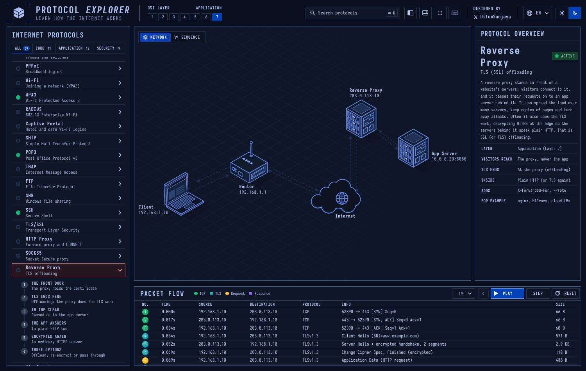
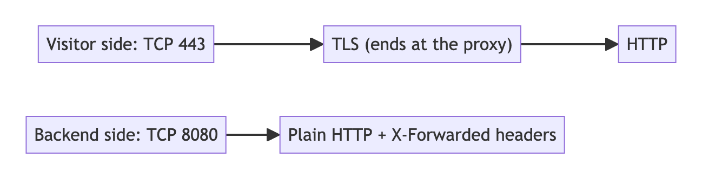
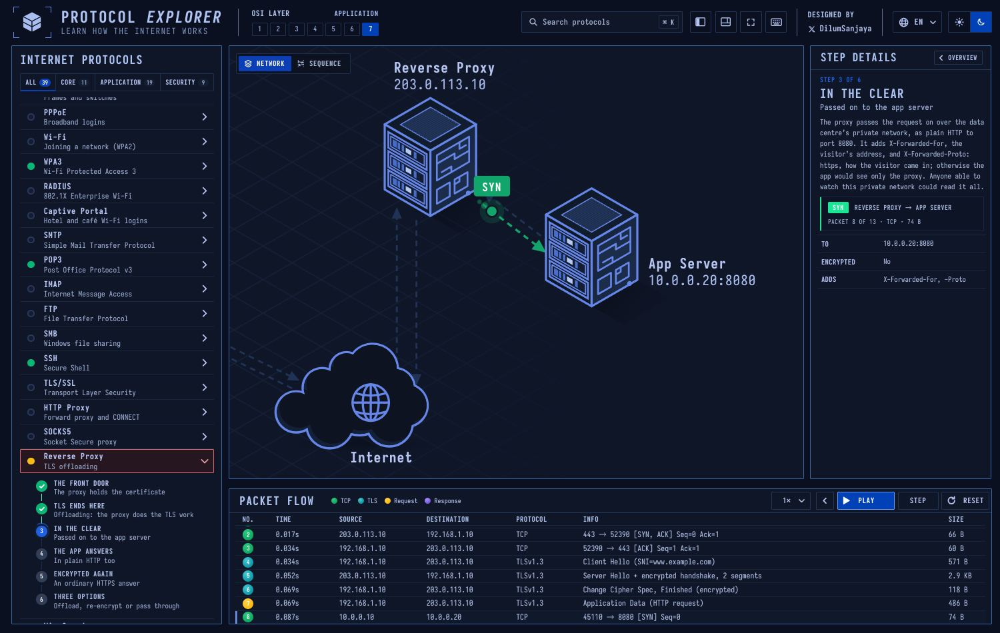
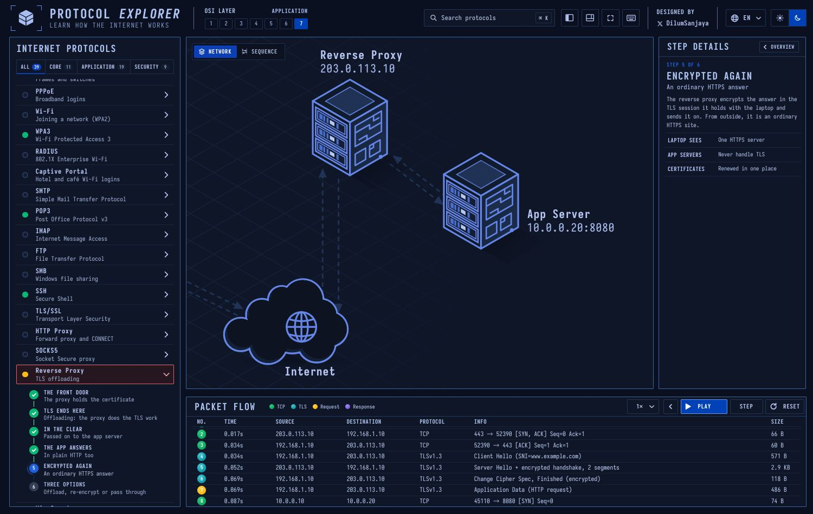
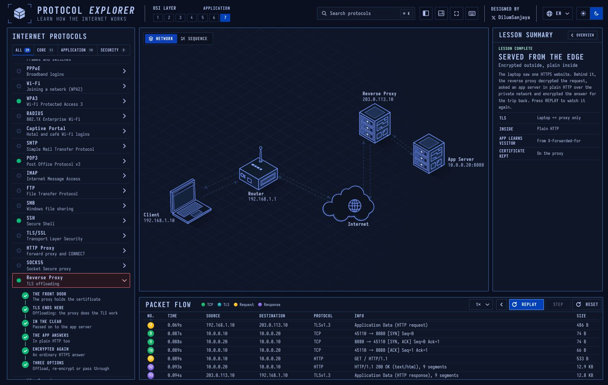
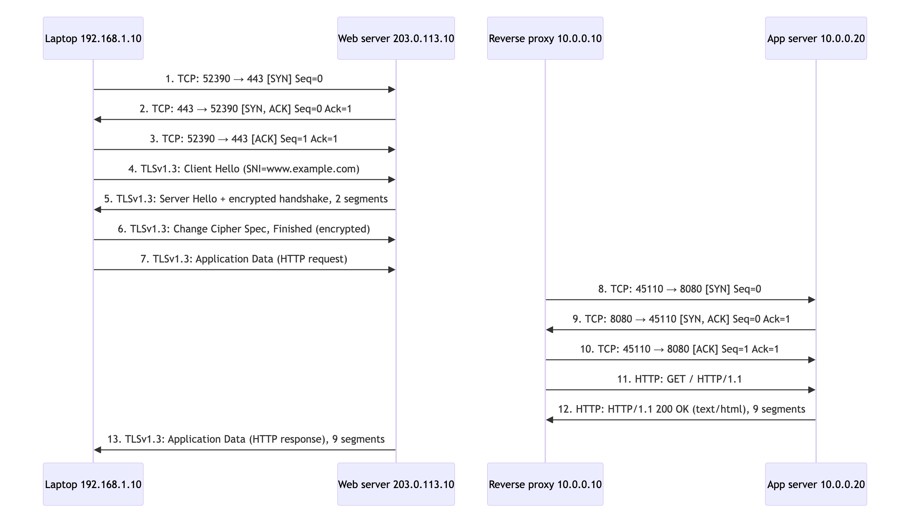
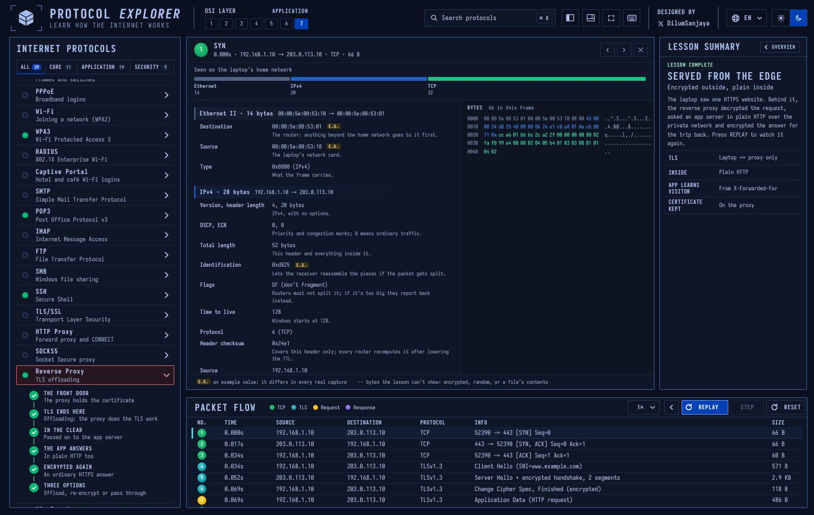
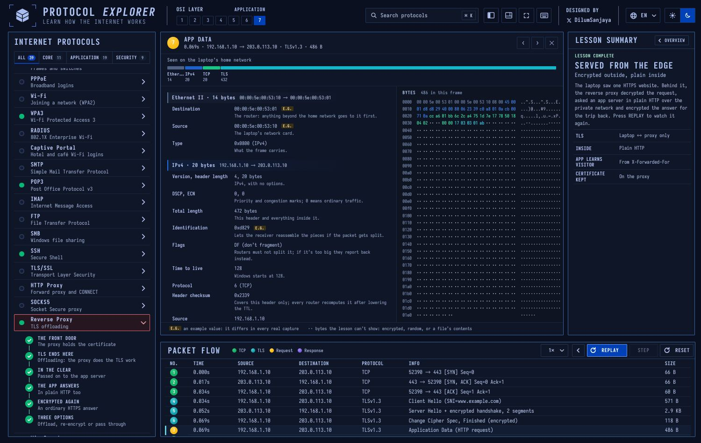
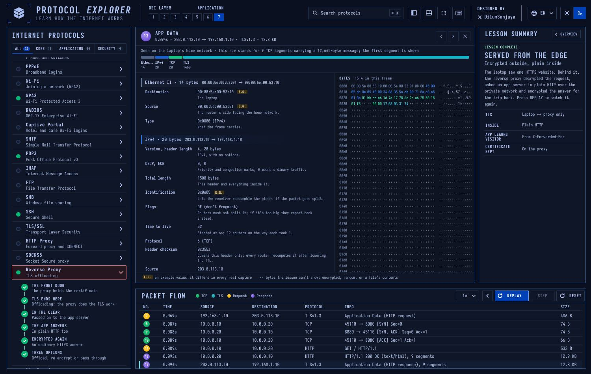

# Reverse Proxy – TLS offloading

<!-- nav -->
⬅ [35 SOCKS5](35-socks5.md) · [Index](00_Protocols_Index.md) · [37 WireGuard](37-wireguard.md) ➡
<!-- nav -->

*Source: Protocol Explorer – https://protocol-explorer-alpha.vercel.app/ (interactive lesson #36). Screenshots captured from the live lesson; packet decodes are the site's example capture (values marked **E.G.** differ in every real capture).*

## Overview

### How the layers fit together (outer to inner)

## In-depth explanation of the example (plain-language version)

### The big picture in one minute
A visitor opens `https://www.example.com`. What they think of as "the web server" at `203.0.113.10` is actually a **reverse proxy** (a "front door" server such as NGINX, HAProxy or a cloud load balancer). Behind it, on a private network (`10.0.0.x`), an **app server** (`10.0.0.20:8080`) creates the pages. **13 packets in 94 ms:** the visitor does a normal HTTPS handshake with the proxy, the proxy **unscrambles** the request, asks the app server over **plain HTTP**, and **scrambles** the answer again.

**What a reverse proxy is.** The mirror image of a forward proxy: it stands **in front of servers** and works on **their** behalf. Visitors connect to it without knowing what's behind. It can **spread load** across many servers, **cache** pages, **handle encryption**, compress, rewrite addresses, check logins, limit request rates, hide the internal servers and **absorb attacks**. A **CDN** is basically a worldwide network of reverse proxies.

Think of **a restaurant's waiter**: you only ever talk to the waiter, who takes your order to the kitchen and brings back the food. You never see the kitchen.

> **Words you'll see:** *TLS termination* = ending the encryption at the proxy. *Backend / app server* = the server behind the proxy. *Header* = a labelled line of extra information. *Private network* = addresses like `10.0.0.x` that aren't reachable from the internet.

---

### Step 1 – Secure connection to the proxy – packets 1 to 6
The laptop sees just one HTTPS server: a TCP handshake (1–3) to `203.0.113.10:443`, then the TLS handshake (4–6). **The site's certificate and private key live on the proxy**, and this secure session **ends at the proxy.**

### Step 2 – Encryption ends here – packet 7
The request arrives as an encrypted record, and **the reverse proxy unscrambles it.** This is called **TLS termination (or offloading)**. The heavy maths is done **once, at the front**, not on every app server, and certificates are **managed and renewed in one place.** Now the proxy can **read the URL, headers and cookies** and choose a backend (for example `/api` to one group and `/static` to another, or the same visitor always to the same server).

### Step 3 – Plain text on the private network – packets 8 to 11
The proxy connects to the app server (`10.0.0.20:8080`) in packets 8–10 and sends the request as **plain HTTP** (packet 11). It adds headers, because otherwise the app would only see the proxy:
- **`X-Forwarded-For`**: the visitor's real address,
- **`X-Forwarded-Proto: https`**: "the visitor used HTTPS" (so the app builds `https://` links and secure cookies),
- often `X-Forwarded-Host` and `X-Real-IP`.
**Trade-off:** anyone able to watch the internal network could read this traffic. Where that matters, the proxy can **re-encrypt** the connection to the backend.

### Step 4 – The app answers – packet 12
The app server returns **`200 OK`** with the page (12.9 KB) over the internal link. It never handled encryption and never saw a certificate.

### Step 5 – Encrypted again – packet 13
The proxy **re-encrypts** the answer inside its secure session with the laptop and sends it. From outside it looks like **an ordinary HTTPS site**: one address, one certificate. The proxy might also have **cached** or compressed the page for the next visitor.

### What the visitor can and can't see
- **Sees:** the proxy's address, its certificate, the secure session.
- **Doesn't see:** the internal addresses (`10.0.0.x`), how many app servers there are, which one answered, or the app's port.

---

### The 13 packets at a glance
| Packets | What | Why |
|---|---|---|
| 1–3 | TCP handshake to the proxy | connect |
| 4–6 | TLS handshake with the proxy | secure connection |
| 7 | encrypted request, decrypted by the proxy | TLS termination |
| 8–10 | proxy's connection to the app server | reach the backend |
| 11 | plain HTTP with forwarded headers | pass the request on |
| 12 | app's `200 OK` | the page |
| 13 | re-encrypted response | back to the visitor |

### What to remember
- **Forward proxy** is on the client side (hides *clients*); **reverse proxy** is on the server side (hides *servers*).
- **TLS termination:** decrypt at the front → plain (or re-encrypted) HTTP to the backends → encrypt again to the visitor. Benefits: less work for app servers, one place for certificates, ability to inspect, route, cache and filter. Cost: the front must be trusted, and internal traffic is exposed unless re-encrypted.
- **Forwarded headers** restore client information. Apps should **trust them only if they come from the proxy**; otherwise they can be faked.
- Related roles: **load balancer**, **API gateway**, **CDN edge** and **web application firewall.** See the HLD notes on *Proxy vs Reverse Proxy*, *Load Balancers* and *API Gateway*.

## Under the hood – technical details

- **Two separate TLS/TCP worlds.** The visitor's TLS session ends at the proxy. The proxy has a different, usually plain, HTTP connection to the backend. It is a full *man in the middle* by design: it must hold the site's certificate and private key.
- **TLS termination (offloading).** The proxy performs the expensive cryptography once, at the edge. Benefits: backends are simpler and faster, certificates are managed and renewed in one place, and the proxy can read the request to route, cache and filter. Cost: the proxy must be trusted, and traffic to the backend is exposed unless it is re-encrypted (*TLS bridging* or mTLS).
- **Connection pooling.** The proxy keeps backend connections open (keep-alive) and reuses them, so each visitor request does not pay for a new TCP handshake.
- **Headers added for the backend.** `X-Forwarded-For` (client address), `X-Forwarded-Proto: https` (so the app builds `https://` links and sets `Secure` cookies), `X-Forwarded-Host`, `X-Real-IP`, or the standard `Forwarded` header. The app should trust them only when they come from the proxy, because anyone can forge them.
- **Routing.** By host name, URL path (`/api` versus `/static`), cookie (sticky sessions), header or load (health-aware load balancing). Products: NGINX, HAProxy, Envoy, cloud load balancers.
- **Other jobs.** Caching, compression, HTTP/2 and HTTP/3 to the client while speaking HTTP/1.1 to the backend, rate limiting, authentication, URL rewriting, a *web application firewall*, and absorbing DDoS traffic.
- **What the visitor sees.** The proxy's IP address and certificate. They cannot see the internal addresses (`10.0.0.x`), how many app servers exist, which one answered, or the app's port.
- **CDN.** A content delivery network is a worldwide set of reverse proxies that cache near users.
- **Compared with a forward proxy.** A forward proxy is configured on the client side and hides clients. A reverse proxy is on the server side and hides servers.
- **Related roles.** Layer-7 load balancer, API gateway, ingress controller, WAF, edge cache. See the HLD notes on proxy vs reverse proxy, load balancers and API gateways.

## Step-by-step walkthrough

### Step 1: THE FRONT DOOR – The proxy holds the certificate

### Step 2: TLS ENDS HERE – Offloading: the proxy does the TLS work

### Step 3: IN THE CLEAR – Passed on to the app server

### Step 4: THE APP ANSWERS – In plain HTTP too

### Step 5: ENCRYPTED AGAIN – An ordinary HTTPS answer

### Step 6: THREE OPTIONS – Offload, re-encrypt or pass through

### Lesson summary

## Packet flow (whole lesson)

| No. | Time | Source | Destination | Protocol | Info | Size |
|---|---|---|---|---|---|---|
| 1 | 0.000s | 192.168.1.10 | 203.0.113.10 | TCP | 52390 → 443 [SYN] Seq=0 | 66 B |
| 2 | 0.017s | 203.0.113.10 | 192.168.1.10 | TCP | 443 → 52390 [SYN, ACK] Seq=0 Ack=1 | 66 B |
| 3 | 0.034s | 192.168.1.10 | 203.0.113.10 | TCP | 52390 → 443 [ACK] Seq=1 Ack=1 | 60 B |
| 4 | 0.034s | 192.168.1.10 | 203.0.113.10 | TLSv1.3 | Client Hello (SNI=www.example.com) | 571 B |
| 5 | 0.052s | 203.0.113.10 | 192.168.1.10 | TLSv1.3 | Server Hello + encrypted handshake, 2 segments | 2.9 KB |
| 6 | 0.069s | 192.168.1.10 | 203.0.113.10 | TLSv1.3 | Change Cipher Spec, Finished (encrypted) | 118 B |
| 7 | 0.069s | 192.168.1.10 | 203.0.113.10 | TLSv1.3 | Application Data (HTTP request) | 486 B |
| 8 | 0.087s | 10.0.0.10 | 10.0.0.20 | TCP | 45110 → 8080 [SYN] Seq=0 | 74 B |
| 9 | 0.088s | 10.0.0.20 | 10.0.0.10 | TCP | 8080 → 45110 [SYN, ACK] Seq=0 Ack=1 | 74 B |
| 10 | 0.089s | 10.0.0.10 | 10.0.0.20 | TCP | 45110 → 8080 [ACK] Seq=1 Ack=1 | 66 B |
| 11 | 0.089s | 10.0.0.10 | 10.0.0.20 | HTTP | GET / HTTP/1.1 | 533 B |
| 12 | 0.093s | 10.0.0.20 | 10.0.0.10 | HTTP | HTTP/1.1 200 OK (text/html), 9 segments | 12.9 KB |
| 13 | 0.094s | 203.0.113.10 | 192.168.1.10 | TLSv1.3 | Application Data (HTTP response), 9 segments | 12.8 KB |

### Sequence diagram

*The lesson's own sequence diagram:*

## Packet decoder screenshots

The lesson's decoder view for the first, middle and last packet: headers, field values and the raw hex bytes.

### Packet 1: TCP – 52390 → 443 [SYN] Seq=0

*192.168.1.10 → 203.0.113.10 · 66 B · t = 0.000s*

### Packet 7: TLSv1.3 – Application Data (HTTP request)

*192.168.1.10 → 203.0.113.10 · 486 B · t = 0.069s*

### Packet 13: TLSv1.3 – Application Data (HTTP response), 9 segments

*203.0.113.10 → 192.168.1.10 · 12.8 KB · t = 0.094s*

---

<!-- nav -->
⬅ [35 SOCKS5](35-socks5.md) · [Index](00_Protocols_Index.md) · [37 WireGuard](37-wireguard.md) ➡
<!-- nav -->
