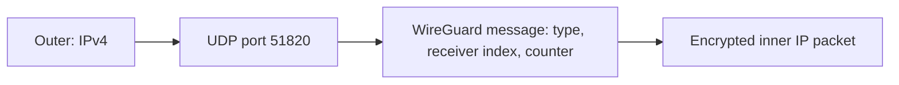
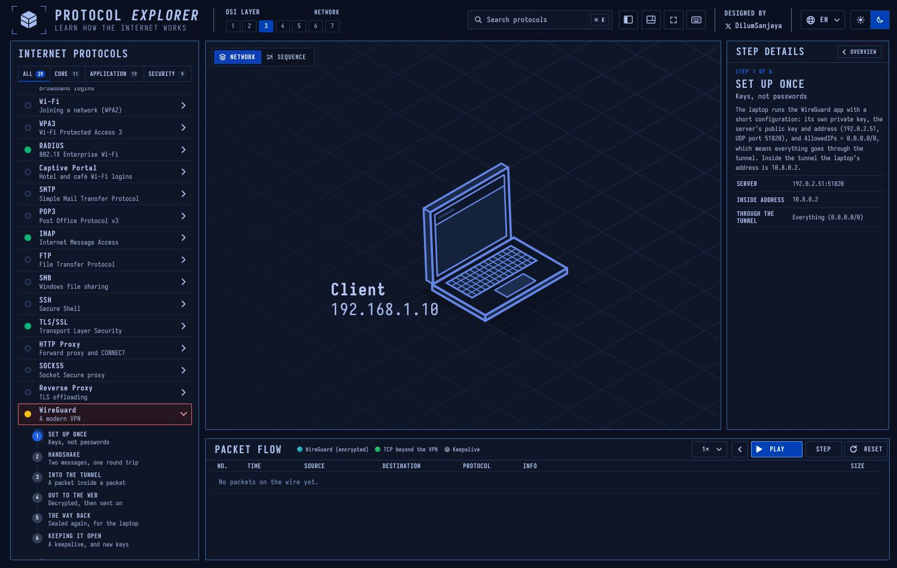
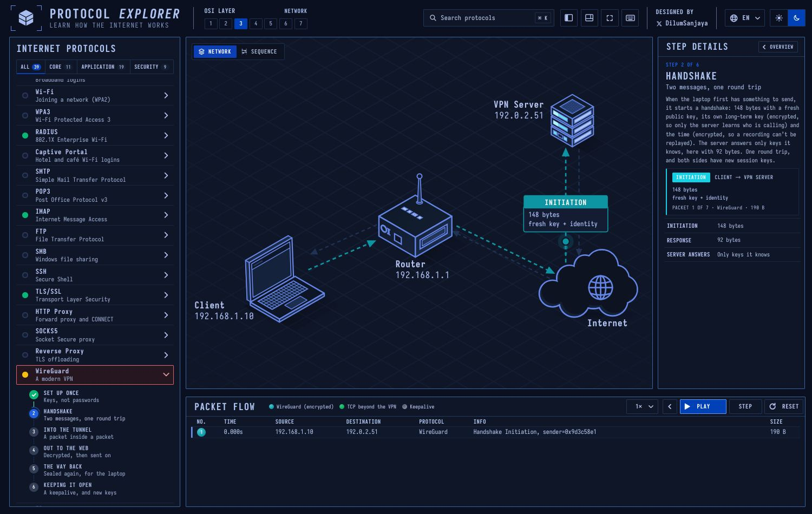
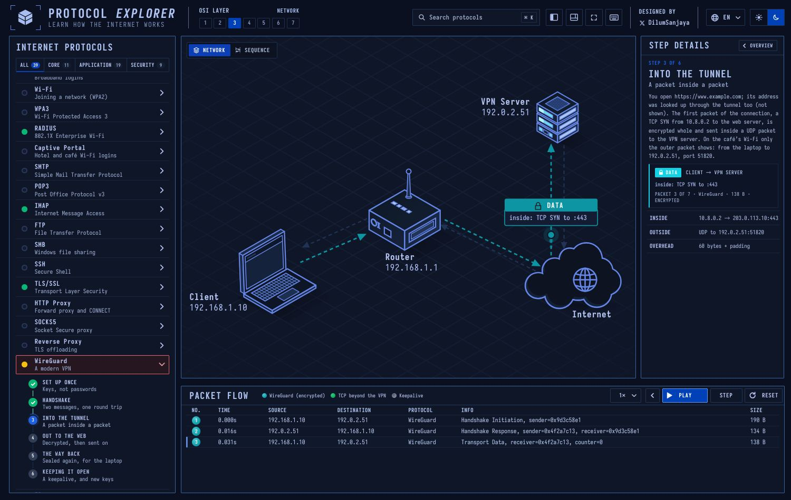
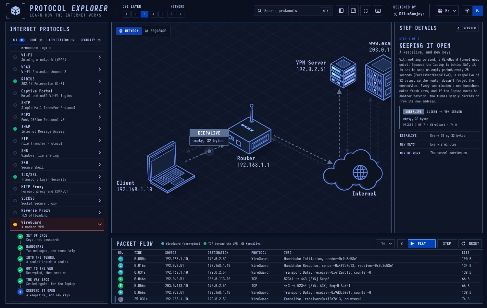
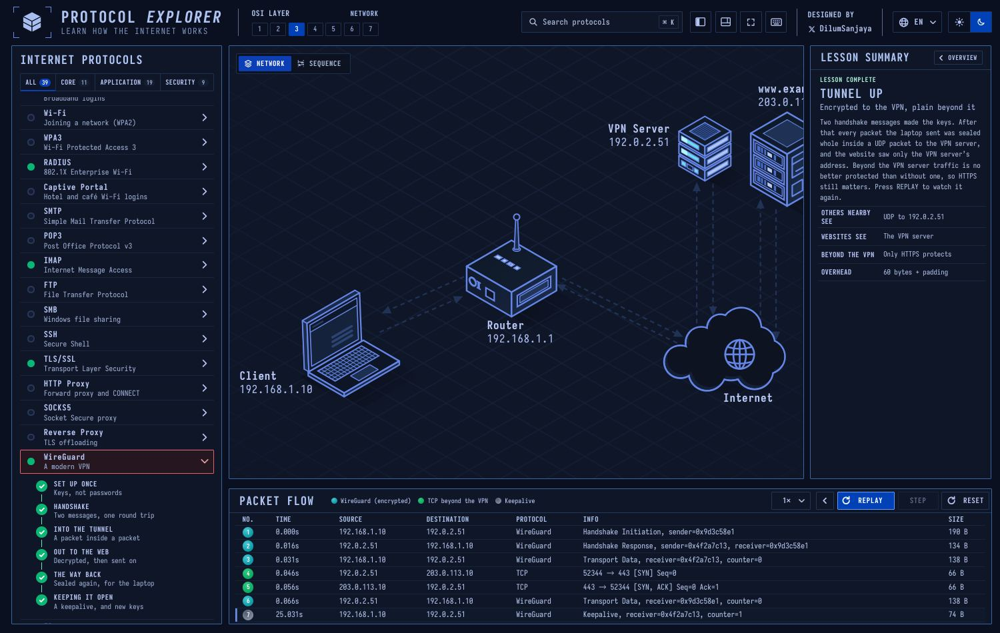
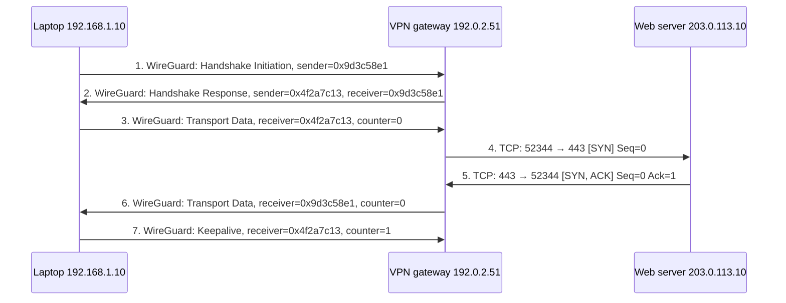

# WireGuard – A modern VPN

<!-- nav -->
⬅ [36 Reverse Proxy](36-reverse-proxy.md) · [Index](00_Protocols_Index.md) · [38 IPsec](38-ipsec.md) ➡
<!-- nav -->

*Source: Protocol Explorer – https://protocol-explorer-alpha.vercel.app/ (interactive lesson #37). Screenshots captured from the live lesson; packet decodes are the site's example capture (values marked **E.G.** differ in every real capture).*

## Overview

### How the layers fit together (outer to inner)

## In-depth explanation of the example (plain-language version)

### The big picture in one minute
On café Wi-Fi, the laptop uses a **WireGuard VPN** to a VPN server at `192.0.2.51:51820`. (The laptop's tunnel address is `10.8.0.2`.) **7 packets over 25 seconds:** a **two-message handshake**, the first web packet sent **inside the tunnel**, the reply, and a **keep-alive**.

**What a VPN does.** It wraps your traffic in an **encrypted tunnel** to a VPN server, which then forwards it to the internet. On the café network, others see only **scrambled packets going to the VPN server.** Websites see the **VPN server's address instead of yours.**

**WireGuard** is a modern VPN. It is tiny (about 4,000 lines of code), uses **one fixed set of modern algorithms** (nothing to negotiate, so nothing to downgrade) and runs over **UDP**.

Think of **a sealed, armoured pipe** between your laptop and a trusted server. People on the street can see that the pipe exists and where it goes, but not what's inside.

> **Words you'll see:** *Tunnel* = a protected path. *Public/private key* = a key pair; the public half can be shared. *Handshake* = the opening exchange. *NAT* = a router sharing one public address between many devices. *Keep-alive* = a tiny message sent regularly so the connection isn't dropped.

---

### The fixed ingredients
WireGuard always uses the same modern tools: **Curve25519** (key exchange), **ChaCha20-Poly1305** (encryption + tamper detection), **BLAKE2s** (hashing). Each side has a **key pair** and knows the other's **public key** (like SSH keys; no certificates or passwords). Each peer also has a list of **AllowedIPs** (which inner addresses may come from that peer), which acts as both its **routing table and its firewall.**

### Step 1 – Idle
Nothing is sent until there is traffic. The laptop is configured with its tunnel address `10.8.0.2` and the server as its peer.

### Step 2 – The handshake: two messages – packets 1, 2
- **Initiation (laptop → server):** a **fresh temporary public key**, the laptop's **long-term public key (encrypted, so a watcher can't tell who is calling)** and an **encrypted timestamp (so a recording can't be replayed).** It also carries a **checksum that proves the sender already knows the server's public key.**
- The server **only answers if that checks out**, and stays **silent to everyone else**, so a port scan sees nothing. WireGuard is effectively invisible to strangers.
- **Response (server → laptop):** the server's temporary public key and an empty encrypted message that **proves it holds its private key.**
One round trip later, both sides calculate the same **session keys** (one per direction). New keys are created **about every 2 minutes**, so a leaked key exposes very little (this is *forward secrecy*).

### Step 3 – A packet inside a packet – packet 3
You open `https://www.example.com`. The first packet of that connection (a TCP SYN from `10.8.0.2` to `203.0.113.10`) is **encrypted whole, including its own address header**, and placed inside a **WireGuard data message** sent in a **UDP packet** to the VPN server. On the café Wi-Fi, **only the outer packet is visible:** laptop → `192.0.2.51`, UDP port 51820.
**Overhead:** about **60 bytes per packet** (outer IP + UDP + WireGuard header + tag). That's why the tunnel's packet size limit is usually **1,420** and the inner connection offers a smaller segment size (**1,380** instead of 1,460).

### Step 4 – Out to the web – packet 4
The VPN server **unscrambles** the packet and checks that `10.8.0.2` is allowed for this peer (AllowedIPs). Then it **swaps in its own public address (NAT)** and sends the SYN to the website. The website sees a visitor at **`192.0.2.51`** and replies there (packet 5).

### Step 5 – The way back – packet 6
The server matches the reply to the tunnel, **seals it in a WireGuard packet** and sends it to the laptop. The laptop unscrambles it and hands it to the system **as if it had come straight from the website.** Each side keeps a **counter** per direction and a sliding window to reject replayed packets.

### Step 6 – Keeping it open – packet 7
With nothing to send, a WireGuard tunnel is **completely silent.** Because the laptop is behind a NAT router, it's set up with **`PersistentKeepalive = 25`**: an **empty packet every 25 seconds** keeps the router's "return path" open so the server can reach the laptop. Peers are identified by **keys, not IP addresses**, so if the laptop **moves to another network**, the tunnel just carries on from the new address as soon as a valid packet arrives.

---

### The 7 packets at a glance
| Packets | What | Why |
|---|---|---|
| 1–2 | Handshake initiation and response | agree on keys |
| 3 | encrypted SYN inside UDP | first web packet, through the tunnel |
| 4 | SYN from the VPN server to the website | out to the internet |
| 5–6 | reply, sealed and returned | the way back |
| 7 | keep-alive | keep the NAT path open |

### What to remember
- **The handshake is only 2 messages**, then data. Keys refresh about every 2 minutes.
- **Identity = public keys**, and **AllowedIPs** acts as routing and firewall. **No algorithm negotiation.** Silent to unauthenticated probes.
- **UDP only.** About **60 bytes** of overhead per packet; typical tunnel size 1,420.
- **Compared with others:** **IPsec/IKEv2** (next note) is a standard with many options and more complexity; **OpenVPN** is TLS-based with a larger code base. WireGuard is smaller, faster and built into the Linux kernel.
- Typical uses: remote access, linking offices, privacy on untrusted Wi-Fi, and tools built on it (such as Tailscale and Cloudflare WARP).

## Under the hood – technical details

- **Cryptography (fixed, no negotiation).** **Noise_IK** handshake pattern with **Curve25519** (key exchange), **ChaCha20-Poly1305** (encryption and authentication), **BLAKE2s** (hashing) and **HKDF** (key derivation). There is nothing to downgrade.
- **Identity.** Each peer has a static key pair and is configured with the other's *public key* (like SSH keys; no certificates). A peer is identified by its key, not its IP address.
- **AllowedIPs.** A list per peer. It works as a **routing table** (which destinations go into this peer's tunnel) and as an **access list** (which inner source addresses are accepted from this peer).
- **Handshake Initiation (type 1, 148 bytes).** Message type, a sender index, a fresh **ephemeral public key**, the initiator's **static public key (encrypted)**, an **encrypted TAI64N timestamp** (so recordings can't be replayed) and two MACs: `mac1` proves the sender knows the server's public key, `mac2` is used only when the server is under load.
- **Silent to strangers.** The responder ignores any packet whose `mac1` is invalid or whose static key it doesn't know, so port scans see nothing.
- **Handshake Response (type 2, 92 bytes).** The responder's ephemeral public key and an empty encrypted payload that proves it holds its private key. After one round trip both sides derive **separate sending and receiving keys**.
- **Transport Data (type 4).** Layout: `type (4) | reserved | receiver index | 64-bit counter | encrypted payload (padded to a multiple of 16) + 16-byte Poly1305 tag`. The counter is the AEAD nonce, and a sliding window rejects replays.
- **Overhead.** Outer IPv4 (20) + UDP (8) + WireGuard header (16) + tag (16) = **60 bytes** (80 with IPv6). So the tunnel MTU is typically **1,420** and the inner TCP segment size becomes **1,380**.
- **Rekeying.** New session keys about every **2 minutes** (or after lots of data), giving forward secrecy: a leaked key reveals only a short window of traffic.
- **Silence and keep-alive.** With no traffic, nothing is sent. Behind NAT, `PersistentKeepalive = 25` sends an empty packet every 25 seconds to keep the NAT mapping open.
- **Roaming.** If the laptop's IP address changes, the tunnel continues as soon as a valid packet arrives from the new address.
- **Compared with others.** IPsec/IKEv2 is standardised and flexible but complex; OpenVPN is TLS-based in user space. WireGuard is small, fast and in the Linux kernel.

## Step-by-step walkthrough (screenshots from the lesson)

### Step 1: SET UP ONCE – Keys, not passwords

### Step 2: HANDSHAKE – Two messages, one round trip

### Step 3: INTO THE TUNNEL – A packet inside a packet

### Step 4: OUT TO THE WEB – Decrypted, then sent on

### Step 5: THE WAY BACK – Sealed again, for the laptop

### Step 6: KEEPING IT OPEN – A keepalive, and new keys

### Lesson summary

## Packet flow (whole lesson)

| No. | Time | Source | Destination | Protocol | Info | Size |
|---|---|---|---|---|---|---|
| 1 | 0.000s | 192.168.1.10 | 192.0.2.51 | WireGuard | Handshake Initiation, sender=0x9d3c58e1 | 190 B |
| 2 | 0.016s | 192.0.2.51 | 192.168.1.10 | WireGuard | Handshake Response, sender=0x4f2a7c13, receiver=0x9d3c58e1 | 134 B |
| 3 | 0.031s | 192.168.1.10 | 192.0.2.51 | WireGuard | Transport Data, receiver=0x4f2a7c13, counter=0 | 138 B |
| 4 | 0.046s | 192.0.2.51 | 203.0.113.10 | TCP | 52344 → 443 [SYN] Seq=0 | 66 B |
| 5 | 0.056s | 203.0.113.10 | 192.0.2.51 | TCP | 443 → 52344 [SYN, ACK] Seq=0 Ack=1 | 66 B |
| 6 | 0.066s | 192.0.2.51 | 192.168.1.10 | WireGuard | Transport Data, receiver=0x9d3c58e1, counter=0 | 138 B |
| 7 | 25.031s | 192.168.1.10 | 192.0.2.51 | WireGuard | Keepalive, receiver=0x4f2a7c13, counter=1 | 74 B |

### Sequence diagram

*The lesson's own sequence diagram:*

## Packet decoder screenshots

The lesson's decoder view for the first, middle and last packet: headers, field values and the raw hex bytes.

### Packet 1: WireGuard – Handshake Initiation, sender=0x9d3c58e1

*192.168.1.10 → 192.0.2.51 · 190 B · t = 0.000s*

### Packet 4: TCP – 52344 → 443 [SYN] Seq=0

*192.0.2.51 → 203.0.113.10 · 66 B · t = 0.046s*

### Packet 7: WireGuard – Keepalive, receiver=0x4f2a7c13, counter=1

*192.168.1.10 → 192.0.2.51 · 74 B · t = 25.031s*

---

<!-- nav -->
⬅ [36 Reverse Proxy](36-reverse-proxy.md) · [Index](00_Protocols_Index.md) · [38 IPsec](38-ipsec.md) ➡
<!-- nav -->
