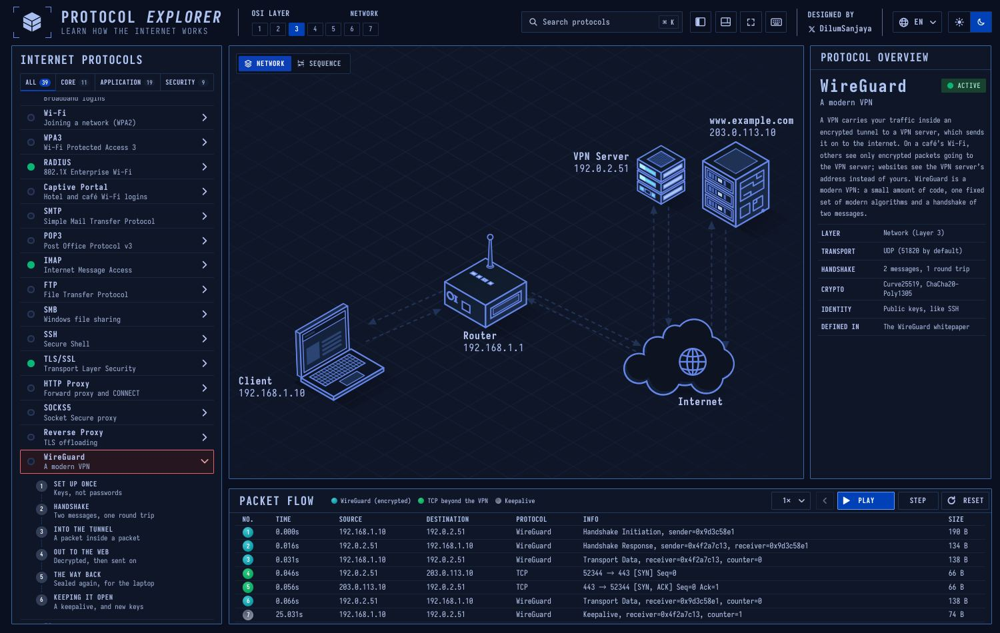
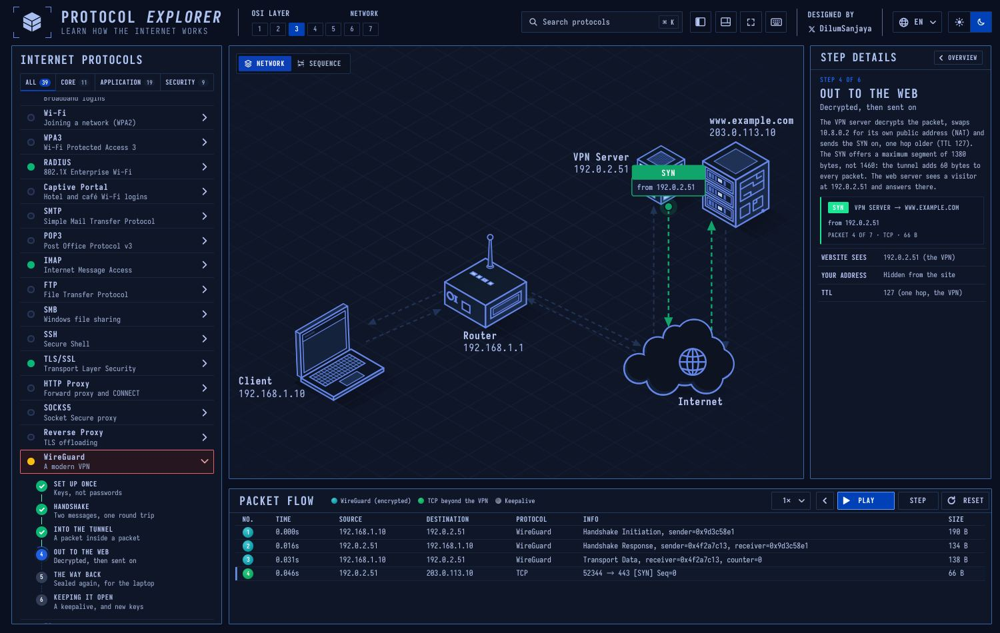
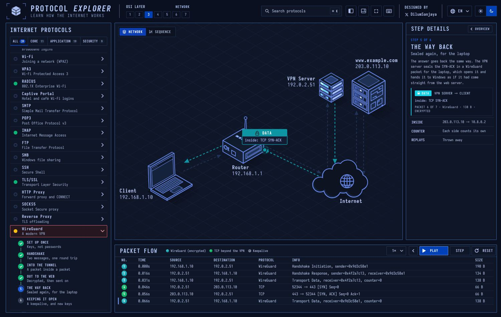
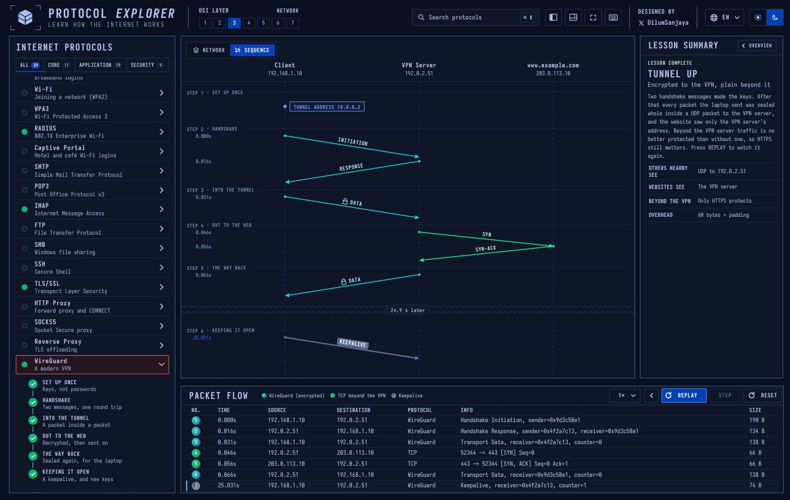
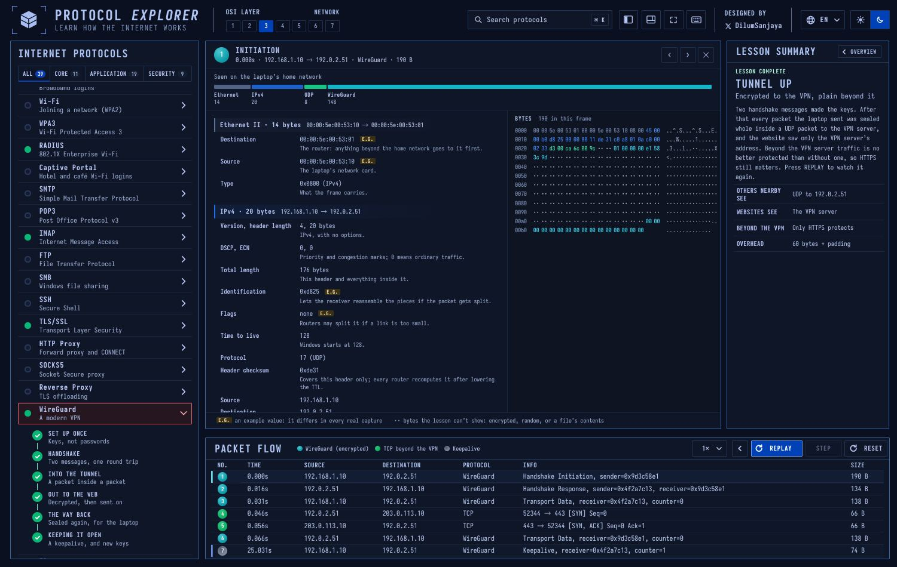
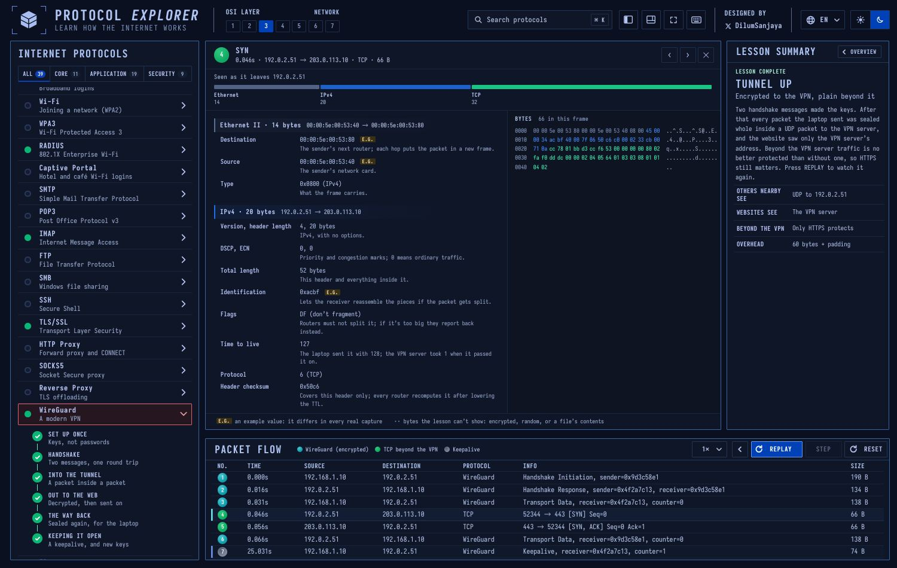
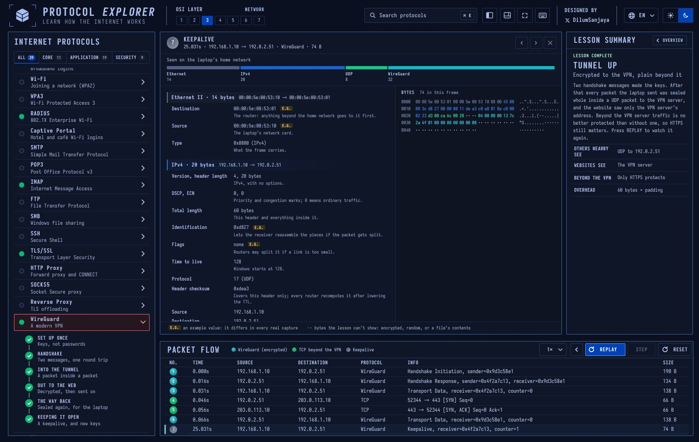

# WireGuard – A modern VPN

<!-- nav -->
⬅ [36 Reverse Proxy](36-reverse-proxy.md) · [Index](00_Protocols_Index.md) · [38 IPsec](38-ipsec.md) ➡
<!-- nav -->

*Source: Protocol Explorer – https://protocol-explorer-alpha.vercel.app/ (interactive lesson #37). Screenshots captured from the live lesson; packet decodes are the site's example capture (values marked **E.G.** differ in every real capture).*

## Overview



> PROTOCOL OVERVIEW  
> WireGuard  
> ACTIVE  
> A modern VPN  
> A VPN carries your traffic inside an encrypted tunnel to a VPN server, which sends it on to the internet. On a café’s Wi-Fi, others see only encrypted packets going to the VPN server; websites see the VPN server’s address instead of yours. WireGuard is a modern VPN: a small amount of code, one fixed set of modern algorithms and a handshake of two messages.  
> LAYER  
> Network (Layer 3)  
> TRANSPORT  
> UDP (51820 by default)  
> HANDSHAKE  
> 2 messages, 1 round trip  
> CRYPTO  
> Curve25519, ChaCha20-Poly1305  
> IDENTITY  
> Public keys, like SSH  
> DEFINED IN  
> The WireGuard whitepaper  

## In-depth explanation of the example (plain-language version)

### The big picture in one minute
On café Wi-Fi, the laptop uses a **WireGuard VPN** to a VPN server at `192.0.2.51:51820`. (The laptop's tunnel address is `10.8.0.2`.) **7 packets over 25 seconds:** a **two-message handshake**, the first web packet sent **inside the tunnel**, the reply, and a **keep-alive**.

**What a VPN does.** It wraps your traffic in an **encrypted tunnel** to a VPN server, which then forwards it to the internet. On the café network, others see only **scrambled packets going to the VPN server.** Websites see the **VPN server's address instead of yours.**

**WireGuard** is a modern VPN. It is tiny (about 4,000 lines of code), uses **one fixed set of modern algorithms** (nothing to negotiate, so nothing to downgrade) and runs over **UDP**.

Think of **a sealed, armoured pipe** between your laptop and a trusted server. People on the street can see that the pipe exists and where it goes, but not what's inside.

> **Words you'll see:** *Tunnel* = a protected path. *Public/private key* = a key pair; the public half can be shared. *Handshake* = the opening exchange. *NAT* = a router sharing one public address between many devices. *Keep-alive* = a tiny message sent regularly so the connection isn't dropped.

---

### The fixed ingredients
WireGuard always uses the same modern tools: **Curve25519** (key exchange), **ChaCha20-Poly1305** (encryption + tamper detection), **BLAKE2s** (hashing). Each side has a **key pair** and knows the other's **public key** (like SSH keys; no certificates or passwords). Each peer also has a list of **AllowedIPs** (which inner addresses may come from that peer), which acts as both its **routing table and its firewall.**

### Step 1 – Idle
Nothing is sent until there is traffic. The laptop is configured with its tunnel address `10.8.0.2` and the server as its peer.

### Step 2 – The handshake: two messages – packets 1, 2
- **Initiation (laptop → server):** a **fresh temporary public key**, the laptop's **long-term public key (encrypted, so a watcher can't tell who is calling)** and an **encrypted timestamp (so a recording can't be replayed).** It also carries a **checksum that proves the sender already knows the server's public key.**
- The server **only answers if that checks out**, and stays **silent to everyone else**, so a port scan sees nothing. WireGuard is effectively invisible to strangers.
- **Response (server → laptop):** the server's temporary public key and an empty encrypted message that **proves it holds its private key.**
One round trip later, both sides calculate the same **session keys** (one per direction). New keys are created **about every 2 minutes**, so a leaked key exposes very little (this is *forward secrecy*).

### Step 3 – A packet inside a packet – packet 3
You open `https://www.example.com`. The first packet of that connection (a TCP SYN from `10.8.0.2` to `203.0.113.10`) is **encrypted whole, including its own address header**, and placed inside a **WireGuard data message** sent in a **UDP packet** to the VPN server. On the café Wi-Fi, **only the outer packet is visible:** laptop → `192.0.2.51`, UDP port 51820.
**Overhead:** about **60 bytes per packet** (outer IP + UDP + WireGuard header + tag). That's why the tunnel's packet size limit is usually **1,420** and the inner connection offers a smaller segment size (**1,380** instead of 1,460).

### Step 4 – Out to the web – packet 4
The VPN server **unscrambles** the packet and checks that `10.8.0.2` is allowed for this peer (AllowedIPs). Then it **swaps in its own public address (NAT)** and sends the SYN to the website. The website sees a visitor at **`192.0.2.51`** and replies there (packet 5).

### Step 5 – The way back – packet 6
The server matches the reply to the tunnel, **seals it in a WireGuard packet** and sends it to the laptop. The laptop unscrambles it and hands it to the system **as if it had come straight from the website.** Each side keeps a **counter** per direction and a sliding window to reject replayed packets.

### Step 6 – Keeping it open – packet 7
With nothing to send, a WireGuard tunnel is **completely silent.** Because the laptop is behind a NAT router, it's set up with **`PersistentKeepalive = 25`**: an **empty packet every 25 seconds** keeps the router's "return path" open so the server can reach the laptop. Peers are identified by **keys, not IP addresses**, so if the laptop **moves to another network**, the tunnel just carries on from the new address as soon as a valid packet arrives.

---

### The 7 packets at a glance
| Packets | What | Why |
|---|---|---|
| 1–2 | Handshake initiation and response | agree on keys |
| 3 | encrypted SYN inside UDP | first web packet, through the tunnel |
| 4 | SYN from the VPN server to the website | out to the internet |
| 5–6 | reply, sealed and returned | the way back |
| 7 | keep-alive | keep the NAT path open |

### What to remember
- **The handshake is only 2 messages**, then data. Keys refresh about every 2 minutes.
- **Identity = public keys**, and **AllowedIPs** acts as routing and firewall. **No algorithm negotiation.** Silent to unauthenticated probes.
- **UDP only.** About **60 bytes** of overhead per packet; typical tunnel size 1,420.
- **Compared with others:** **IPsec/IKEv2** (next note) is a standard with many options and more complexity; **OpenVPN** is TLS-based with a larger code base. WireGuard is smaller, faster and built into the Linux kernel.
- Typical uses: remote access, linking offices, privacy on untrusted Wi-Fi, and tools built on it (such as Tailscale and Cloudflare WARP).

## Step-by-step walkthrough (screenshots from the lesson)

### Step 1: SET UP ONCE – Keys, not passwords


> STEP 1 OF 6  
> SET UP ONCE  
> Keys, not passwords  
> The laptop runs the WireGuard app with a short configuration: its own private key, the server’s public key and address (192.0.2.51, UDP port 51820), and AllowedIPs = 0.0.0.0/0, which means everything goes through the tunnel. Inside the tunnel the laptop’s address is 10.8.0.2.  
> SERVER  
> 192.0.2.51:51820  
> INSIDE ADDRESS  
> 10.8.0.2  
> THROUGH THE TUNNEL  
> Everything (0.0.0.0/0)  

### Step 2: HANDSHAKE – Two messages, one round trip


> STEP 2 OF 6  
> HANDSHAKE  
> Two messages, one round trip  
> When the laptop first has something to send, it starts a handshake: 148 bytes with a fresh public key, its own long-term key (encrypted, so only the server learns who is calling) and the time (encrypted, so a recording can’t be replayed). The server answers only keys it knows, here with 92 bytes. One round trip, and both sides have new session keys.  
> INITIATION  
> CLIENT → VPN SERVER  
> 148 bytes  
> fresh key + identity  
> PACKET 1 OF 7 · WireGuard · 190 B  
> INITIATION  
> 148 bytes  
> RESPONSE  
> 92 bytes  
> SERVER ANSWERS  
> Only keys it knows  

### Step 3: INTO THE TUNNEL – A packet inside a packet


> STEP 3 OF 6  
> INTO THE TUNNEL  
> A packet inside a packet  
> You open https://www.example.com; its address was looked up through the tunnel too (not shown). The first packet of the connection, a TCP SYN from 10.8.0.2 to the web server, is encrypted whole and sent inside a UDP packet to the VPN server. On the café’s Wi-Fi only the outer packet shows: from the laptop to 192.0.2.51, port 51820.  
> DATA  
> CLIENT → VPN SERVER  
> inside: TCP SYN to :443  
> PACKET 3 OF 7 · WireGuard · 138 B · ENCRYPTED  
> INSIDE  
> 10.8.0.2 → 203.0.113.10:443  
> OUTSIDE  
> UDP to 192.0.2.51:51820  
> OVERHEAD  
> 60 bytes + padding  

### Step 4: OUT TO THE WEB – Decrypted, then sent on



> STEP 4 OF 6  
> OUT TO THE WEB  
> Decrypted, then sent on  
> The VPN server decrypts the packet, swaps 10.8.0.2 for its own public address (NAT) and sends the SYN on, one hop older (TTL 127). The SYN offers a maximum segment of 1380 bytes, not 1460: the tunnel adds 60 bytes to every packet. The web server sees a visitor at 192.0.2.51 and answers there.  
> SYN  
> VPN SERVER → WWW.EXAMPLE.COM  
> from 192.0.2.51  
> PACKET 4 OF 7 · TCP · 66 B  
> WEBSITE SEES  
> 192.0.2.51 (the VPN)  
> YOUR ADDRESS  
> Hidden from the site  
> TTL  
> 127 (one hop, the VPN)  

### Step 5: THE WAY BACK – Sealed again, for the laptop



> STEP 5 OF 6  
> THE WAY BACK  
> Sealed again, for the laptop  
> The answer goes back the same way. The VPN server seals the SYN-ACK in a WireGuard packet for the laptop, which opens it and hands it to Windows as if it had come straight from the web server.  
> DATA  
> VPN SERVER → CLIENT  
> inside: TCP SYN-ACK  
> PACKET 6 OF 7 · WireGuard · 138 B · ENCRYPTED  
> INSIDE  
> 203.0.113.10 → 10.8.0.2  
> COUNTER  
> Each side counts its own  
> REPLAYS  
> Thrown away  

### Step 6: KEEPING IT OPEN – A keepalive, and new keys


> STEP 6 OF 6  
> KEEPING IT OPEN  
> A keepalive, and new keys  
> With nothing to send, a WireGuard tunnel goes quiet. Because the laptop is behind NAT, it is set to send an empty packet every 25 seconds (PersistentKeepalive), a keepalive of 32 bytes, so the router doesn’t forget the connection. Every two minutes a new handshake makes fresh keys, and if the laptop moves to another network, the tunnel simply carries on from its new address.  
> KEEPALIVE  
> CLIENT → VPN SERVER  
> empty, 32 bytes  
> PACKET 7 OF 7 · WireGuard · 74 B  
> KEEPALIVE  
> Every 25 s, 32 bytes  
> NEW KEYS  
> Every 2 minutes  
> NEW NETWORK  
> The tunnel carries on  

### Lesson summary


> LESSON SUMMARY  
> LESSON COMPLETE  
> TUNNEL UP  
> Encrypted to the VPN, plain beyond it  
> Two handshake messages made the keys. After that every packet the laptop sent was sealed whole inside a UDP packet to the VPN server, and the website saw only the VPN server’s address. Beyond the VPN server traffic is no better protected than without one, so HTTPS still matters. Press REPLAY to watch it again.  
> KEEPALIVE  
> CLIENT → VPN SERVER  
> empty, 32 bytes  
> PACKET 7 OF 7 · WireGuard · 74 B  
> OTHERS NEARBY SEE  
> UDP to 192.0.2.51  
> WEBSITES SEE  
> The VPN server  
> BEYOND THE VPN  
> Only HTTPS protects  
> OVERHEAD  
> 60 bytes + padding  

## Packet flow (whole lesson)

| No. | Time | Source | Destination | Protocol | Info | Size |
|---|---|---|---|---|---|---|
| 1 | 0.000s | 192.168.1.10 | 192.0.2.51 | WireGuard | Handshake Initiation, sender=0x9d3c58e1 | 190 B |
| 2 | 0.016s | 192.0.2.51 | 192.168.1.10 | WireGuard | Handshake Response, sender=0x4f2a7c13, receiver=0x9d3c58e1 | 134 B |
| 3 | 0.031s | 192.168.1.10 | 192.0.2.51 | WireGuard | Transport Data, receiver=0x4f2a7c13, counter=0 | 138 B |
| 4 | 0.046s | 192.0.2.51 | 203.0.113.10 | TCP | 52344 → 443 [SYN] Seq=0 | 66 B |
| 5 | 0.056s | 203.0.113.10 | 192.0.2.51 | TCP | 443 → 52344 [SYN, ACK] Seq=0 Ack=1 | 66 B |
| 6 | 0.066s | 192.0.2.51 | 192.168.1.10 | WireGuard | Transport Data, receiver=0x9d3c58e1, counter=0 | 138 B |
| 7 | 25.031s | 192.168.1.10 | 192.0.2.51 | WireGuard | Keepalive, receiver=0x4f2a7c13, counter=1 | 74 B |

### Sequence diagram



## Packets decoded byte by byte

Each packet below is the lesson's own decode (headers, field values and the plain-English meaning of each field). Screenshots show the first, middle and last packet in the lesson's decoder view with the raw hex bytes.

### Packet 1: WireGuard – Handshake Initiation, sender=0x9d3c58e1

*192.168.1.10 → 192.0.2.51 · 190 B · t = 0.000s*



<details><summary>Decoded fields</summary>

```text
1
INITIATION
0.000s · 192.168.1.10 → 192.0.2.51 · WireGuard · 190 B
Seen on the laptop’s home network
Ethernet
14
IPv4
20
UDP
8
WireGuard
148
Ethernet II · 14 bytes
00:00:5e:00:53:10 → 00:00:5e:00:53:01
Destination
00:00:5e:00:53:01 E.G.

The router: anything beyond the home network goes to it first.

Source
00:00:5e:00:53:10 E.G.

The laptop’s network card.

Type
0x0800 (IPv4)

What the frame carries.

IPv4 · 20 bytes
192.168.1.10 → 192.0.2.51
Version, header length
4, 20 bytes

IPv4, with no options.

DSCP, ECN
0, 0

Priority and congestion marks; 0 means ordinary traffic.

Total length
176 bytes

This header and everything inside it.

Identification
0xd825 E.G.

Lets the receiver reassemble the pieces if the packet gets split.

Flags
none E.G.

Routers may split it if a link is too small.

Time to live
128

Windows starts at 128.

Protocol
17 (UDP)
Header checksum
0xde31

Covers this header only; every router recomputes it after lowering the TTL.

Source
192.168.1.10
Destination
192.0.2.51
UDP · 8 bytes
54016 → 51820
Source port
54016
Destination port
51820
Length
156 bytes

UDP header and data. That is all of UDP: no numbering, no acknowledgements.

Checksum
covers bytes not shown here

Covers the header, the data and the IP addresses.

WireGuard · handshake initiation
Message type
1 (handshake initiation)
Reserved
0
Sender index
0x9d3c58e1 E.G.

A number this side picked for the session; the other side puts it in every packet it sends back.

Ephemeral key
32 bytes

A new public key, made just for this handshake.

Encrypted static key
48 bytes

The laptop’s long-term public key (32 bytes) and a 16-byte tag, encrypted: only the server learns who is calling.

Encrypted timestamp
28 bytes

The time (12 bytes) and a tag, encrypted. An old initiation sent again is refused.

MAC 1
16 bytes

Keyed with the server’s public key: without it, the server doesn’t answer at all.

MAC 2
zeros

Used only when the server is busy and asks for a cookie first.

BYTES 190 in this frame
0000
00
00
5e
00
53
01
00
00
5e
00
53
10
08
00
45
00
.
.
^
.
S
.
.
.
^
.
S
.
.
.
E
.
0010
00
b0
d8
25
00
00
80
11
de
31
c0
a8
01
0a
c0
00
.
.
.
%
.
.
.
.
.
1
.
.
.
.
.
.
0020
02
33
d3
00
ca
6c
00
9c
··
··
01
00
00
00
e1
58
.
3
.
.
.
l
.
.
·
·
.
.
.
.
.
X
0030
3c
9d
··
··
··
··
··
··
··
··
··
··
··
··
··
··
<
.
·
·
·
·
·
·
·
·
·
·
·
·
·
·
0040
··
··
··
··
··
··
··
··
··
··
··
··
··
··
··
··
·
·
·
·
·
·
·
·
·
·
·
·
·
·
·
·
0050
··
··
··
··
··
··
··
··
··
··
··
··
··
··
··
··
·
·
·
·
·
·
·
·
·
·
·
·
·
·
·
·
0060
··
··
··
··
··
··
··
··
··
··
··
··
··
··
··
··
·
·
·
·
·
·
·
·
·
·
·
·
·
·
·
·
0070
··
··
··
··
··
··
··
··
··
··
··
··
··
··
··
··
·
·
·
·
·
·
·
·
·
·
·
·
·
·
·
·
0080
··
··
··
··
··
··
··
··
··
··
··
··
··
··
··
··
·
·
·
·
·
·
·
·
·
·
·
·
·
·
·
·
0090
··
··
··
··
··
··
··
··
··
··
··
··
··
··
··
··
·
·
·
·
·
·
·
·
·
·
·
·
·
·
·
·
00a0
··
··
··
··
··
··
··
··
··
··
··
··
··
··
00
00
·
·
·
·
·
·
·
·
·
·
·
·
·
·
.
.
00b0
00
00
00
00
00
00
00
00
00
00
00
00
00
00
.
.
.
.
.
.
.
.
.
.
.
.
.
.
E.G. an example value: it differs in every real capture
·· bytes the lesson can’t show: encrypted, random, or a file’s contents
```

</details>

### Packet 2: WireGuard – Handshake Response, sender=0x4f2a7c13, receiver=0x9d3c58e1

*192.0.2.51 → 192.168.1.10 · 134 B · t = 0.016s*

<details><summary>Decoded fields</summary>

```text
2
RESPONSE
0.016s · 192.0.2.51 → 192.168.1.10 · WireGuard · 134 B
Seen on the laptop’s home network
Ethernet
14
IPv4
20
UDP
8
WireGuard
92
Ethernet II · 14 bytes
00:00:5e:00:53:01 → 00:00:5e:00:53:10
Destination
00:00:5e:00:53:10 E.G.

The laptop.

Source
00:00:5e:00:53:01 E.G.

The router’s side facing the home network.

Type
0x0800 (IPv4)

What the frame carries.

IPv4 · 20 bytes
192.0.2.51 → 192.168.1.10
Version, header length
4, 20 bytes

IPv4, with no options.

DSCP, ECN
0, 0

Priority and congestion marks; 0 means ordinary traffic.

Total length
120 bytes

This header and everything inside it.

Identification
0xacbe E.G.

Lets the receiver reassemble the pieces if the packet gets split.

Flags
DF (don’t fragment) E.G.

Routers must not split it; if it’s too big they report back instead.

Time to live
52

Started at 64; 12 routers on the way each took 1.

Protocol
17 (UDP)
Header checksum
0x15d1

Covers this header only; every router recomputes it after lowering the TTL.

Source
192.0.2.51
Destination
192.168.1.10
UDP · 8 bytes
51820 → 54016
Source port
51820
Destination port
54016
Length
100 bytes

UDP header and data. That is all of UDP: no numbering, no acknowledgements.

Checksum
covers bytes not shown here

Covers the header, the data and the IP addresses.

WireGuard · handshake response
Message type
2 (handshake response)
Reserved
0
Sender index
0x4f2a7c13 E.G.

A number this side picked for the session; the other side puts it in every packet it sends back.

Receiver index
0x9d3c58e1 E.G.

The other side’s index: which session this packet belongs to.

Ephemeral key
32 bytes

The server’s new public key for this handshake.

Encrypted nothing
16 bytes

Only a tag: it proves the server holds its private key.

MAC 1
16 bytes

Keyed with the server’s public key: without it, the server doesn’t answer at all.

MAC 2
zeros

Used only when the server is busy and asks for a cookie first.

BYTES 134 in this frame
0000
00
00
5e
00
53
10
00
00
5e
00
53
01
08
00
45
00
.
.
^
.
S
.
.
.
^
.
S
.
.
.
E
.
0010
00
78
ac
be
40
00
34
11
15
d1
c0
00
02
33
c0
a8
.
x
.
.
@
.
4
.
.
.
.
.
.
3
.
.
0020
01
0a
ca
6c
d3
00
00
64
··
··
02
00
00
00
13
7c
.
.
.
l
.
.
.
d
·
·
.
.
.
.
.
|
0030
2a
4f
e1
58
3c
9d
··
··
··
··
··
··
··
··
··
··
*
O
.
X
<
.
·
·
·
·
·
·
·
·
·
·
0040
··
··
··
··
··
··
··
··
··
··
··
··
··
··
··
··
·
·
·
·
·
·
·
·
·
·
·
·
·
·
·
·
0050
··
··
··
··
··
··
··
··
··
··
··
··
··
··
··
··
·
·
·
·
·
·
·
·
·
·
·
·
·
·
·
·
0060
··
··
··
··
··
··
··
··
··
··
··
··
··
··
··
··
·
·
·
·
·
·
·
·
·
·
·
·
·
·
·
·
0070
··
··
··
··
··
··
00
00
00
00
00
00
00
00
00
00
·
·
·
·
·
·
.
.
.
.
.
.
.
.
.
.
0080
00
00
00
00
00
00
.
.
.
.
.
.
E.G. an example value: it differs in every real capture
·· bytes the lesson can’t show: encrypted, random, or a file’s contents
```

</details>

### Packet 3: WireGuard – Transport Data, receiver=0x4f2a7c13, counter=0

*192.168.1.10 → 192.0.2.51 · 138 B · t = 0.031s*

<details><summary>Decoded fields</summary>

```text
3
DATA
0.031s · 192.168.1.10 → 192.0.2.51 · WireGuard · 138 B
Seen on the laptop’s home network
Ethernet
14
IPv4
20
UDP
8
WireGuard
96
Ethernet II · 14 bytes
00:00:5e:00:53:10 → 00:00:5e:00:53:01
Destination
00:00:5e:00:53:01 E.G.

The router: anything beyond the home network goes to it first.

Source
00:00:5e:00:53:10 E.G.

The laptop’s network card.

Type
0x0800 (IPv4)

What the frame carries.

IPv4 · 20 bytes
192.168.1.10 → 192.0.2.51
Version, header length
4, 20 bytes

IPv4, with no options.

DSCP, ECN
0, 0

Priority and congestion marks; 0 means ordinary traffic.

Total length
124 bytes

This header and everything inside it.

Identification
0xd826 E.G.

Lets the receiver reassemble the pieces if the packet gets split.

Flags
none E.G.

Routers may split it if a link is too small.

Time to live
128

Windows starts at 128.

Protocol
17 (UDP)
Header checksum
0xde64

Covers this header only; every router recomputes it after lowering the TTL.

Source
192.168.1.10
Destination
192.0.2.51
UDP · 8 bytes
54016 → 51820
Source port
54016
Destination port
51820
Length
104 bytes

UDP header and data. That is all of UDP: no numbering, no acknowledgements.

Checksum
covers bytes not shown here

Covers the header, the data and the IP addresses.

WireGuard · transport data
Message type
4 (transport data)
Reserved
0
Receiver index
0x4f2a7c13 E.G.

The other side’s index: which session this packet belongs to.

Counter
0

Counts up with every packet; one seen before is thrown away.

Encrypted packet
80 bytes

The whole inner packet, padded to a multiple of 16 bytes, then a 16-byte tag.

Inside
IPv4 10.8.0.2 → 203.0.113.10
TCP 52344 → 443 [SYN]
then 12 bytes of padding, and the tag
BYTES 138 in this frame
0000
00
00
5e
00
53
01
00
00
5e
00
53
10
08
00
45
00
.
.
^
.
S
.
.
.
^
.
S
.
.
.
E
.
0010
00
7c
d8
26
00
00
80
11
de
64
c0
a8
01
0a
c0
00
.
|
.
&
.
.
.
.
.
d
.
.
.
.
.
.
0020
02
33
d3
00
ca
6c
00
68
··
··
04
00
00
00
13
7c
.
3
.
.
.
l
.
h
·
·
.
.
.
.
.
|
0030
2a
4f
00
00
00
00
00
00
00
00
··
··
··
··
··
··
*
O
.
.
.
.
.
.
.
.
·
·
·
·
·
·
0040
··
··
··
··
··
··
··
··
··
··
··
··
··
··
··
··
·
·
·
·
·
·
·
·
·
·
·
·
·
·
·
·
0050
··
··
··
··
··
··
··
··
··
··
··
··
··
··
··
··
·
·
·
·
·
·
·
·
·
·
·
·
·
·
·
·
0060
··
··
··
··
··
··
··
··
··
··
··
··
··
··
··
··
·
·
·
·
·
·
·
·
·
·
·
·
·
·
·
·
0070
··
··
··
··
··
··
··
··
··
··
··
··
··
··
··
··
·
·
·
·
·
·
·
·
·
·
·
·
·
·
·
·
0080
··
··
··
··
··
··
··
··
··
··
·
·
·
·
·
·
·
·
·
·
E.G. an example value: it differs in every real capture
·· bytes the lesson can’t show: encrypted, random, or a file’s contents
```

</details>

### Packet 4: TCP – 52344 → 443 [SYN] Seq=0

*192.0.2.51 → 203.0.113.10 · 66 B · t = 0.046s*



<details><summary>Decoded fields</summary>

```text
4
SYN
0.046s · 192.0.2.51 → 203.0.113.10 · TCP · 66 B
Seen as it leaves 192.0.2.51
Ethernet
14
IPv4
20
TCP
32
Ethernet II · 14 bytes
00:00:5e:00:53:40 → 00:00:5e:00:53:80
Destination
00:00:5e:00:53:80 E.G.

The sender’s next router; each hop puts the packet in a new frame.

Source
00:00:5e:00:53:40 E.G.

The sender’s network card.

Type
0x0800 (IPv4)

What the frame carries.

IPv4 · 20 bytes
192.0.2.51 → 203.0.113.10
Version, header length
4, 20 bytes

IPv4, with no options.

DSCP, ECN
0, 0

Priority and congestion marks; 0 means ordinary traffic.

Total length
52 bytes

This header and everything inside it.

Identification
0xacbf E.G.

Lets the receiver reassemble the pieces if the packet gets split.

Flags
DF (don’t fragment)

Routers must not split it; if it’s too big they report back instead.

Time to live
127

The laptop sent it with 128; the VPN server took 1 when it passed it on.

Protocol
6 (TCP)
Header checksum
0x50c6

Covers this header only; every router recomputes it after lowering the TTL.

Source
192.0.2.51
Destination
203.0.113.10
TCP · 32 bytes
52344 → 443, SYN
Source port
52344

Picked by the laptop’s system for this connection.

Destination port
443
Sequence number
0 (relative)

This side’s starting number. Shown as 0; the real one is random.

Real sequence number
3553424979 E.G.
Acknowledgment
0 (not used yet)

A first SYN has nothing to acknowledge.

Header length
32 bytes

20 bytes, plus 12 of options.

Flags
0x002 (SYN)
Window
64240 E.G.

How much more data this side can take right now.

Checksum
0xdddc

Covers the header, the data and the IP addresses, so damage is caught.

Urgent pointer
0
Options
12 bytes
Maximum segment size
1380 bytes

The most data this side wants in one segment.

No-op
1

Spacing, so the next option lines up.

Window scale
× 256

Window values are multiplied by this, so windows can be larger than 64 KB.

No-op
1

Spacing, so the next option lines up.

No-op
1

Spacing, so the next option lines up.

SACK permitted
yes

This side understands selective acknowledgements.

BYTES 66 in this frame
0000
00
00
5e
00
53
80
00
00
5e
00
53
40
08
00
45
00
.
.
^
.
S
.
.
.
^
.
S
@
.
.
E
.
0010
00
34
ac
bf
40
00
7f
06
50
c6
c0
00
02
33
cb
00
.
4
.
.
@
.
.
.
P
.
.
.
.
3
.
.
0020
71
0a
cc
78
01
bb
d3
cc
f6
53
00
00
00
00
80
02
q
.
.
x
.
.
.
.
.
S
.
.
.
.
.
.
0030
fa
f0
dd
dc
00
00
02
04
05
64
01
03
03
08
01
01
.
.
.
.
.
.
.
.
.
d
.
.
.
.
.
.
0040
04
02
.
.
E.G. an example value: it differs in every real capture
·· bytes the lesson can’t show: encrypted, random, or a file’s contents
```

</details>

### Packet 5: TCP – 443 → 52344 [SYN, ACK] Seq=0 Ack=1

*203.0.113.10 → 192.0.2.51 · 66 B · t = 0.056s*

<details><summary>Decoded fields</summary>

```text
5
SYN-ACK
0.056s · 203.0.113.10 → 192.0.2.51 · TCP · 66 B
Seen as it leaves 203.0.113.10
Ethernet
14
IPv4
20
TCP
32
Ethernet II · 14 bytes
00:00:5e:00:53:41 → 00:00:5e:00:53:81
Destination
00:00:5e:00:53:81 E.G.

The sender’s next router; each hop puts the packet in a new frame.

Source
00:00:5e:00:53:41 E.G.

The sender’s network card.

Type
0x0800 (IPv4)

What the frame carries.

IPv4 · 20 bytes
203.0.113.10 → 192.0.2.51
Version, header length
4, 20 bytes

IPv4, with no options.

DSCP, ECN
0, 0

Priority and congestion marks; 0 means ordinary traffic.

Total length
52 bytes

This header and everything inside it.

Identification
0x0e03 E.G.

Lets the receiver reassemble the pieces if the packet gets split.

Flags
DF (don’t fragment)

Routers must not split it; if it’s too big they report back instead.

Time to live
64

As sent: this system starts at 64.

Protocol
6 (TCP)
Header checksum
0x2e83

Covers this header only; every router recomputes it after lowering the TTL.

Source
203.0.113.10
Destination
192.0.2.51
TCP · 32 bytes
443 → 52344, SYN, ACK
Source port
443
Destination port
52344
Sequence number
0 (relative)

This side’s starting number. Shown as 0; the real one is random.

Real sequence number
3470856756 E.G.
Acknowledgment
1 (relative)

The next byte this side expects: everything before it has arrived.

Header length
32 bytes

20 bytes, plus 12 of options.

Flags
0x012 (SYN, ACK)
Window
64240 E.G.

How much more data this side can take right now.

Checksum
0xfc66

Covers the header, the data and the IP addresses, so damage is caught.

Urgent pointer
0
Options
12 bytes
Maximum segment size
1460 bytes

The most data this side wants in one segment.

No-op
1

Spacing, so the next option lines up.

No-op
1

Spacing, so the next option lines up.

SACK permitted
yes

This side understands selective acknowledgements.

No-op
1

Spacing, so the next option lines up.

Window scale
× 128

Window values are multiplied by this, so windows can be larger than 64 KB.

BYTES 66 in this frame
0000
00
00
5e
00
53
81
00
00
5e
00
53
41
08
00
45
00
.
.
^
.
S
.
.
.
^
.
S
A
.
.
E
.
0010
00
34
0e
03
40
00
40
06
2e
83
cb
00
71
0a
c0
00
.
4
.
.
@
.
@
.
.
.
.
.
q
.
.
.
0020
02
33
01
bb
cc
78
ce
e1
12
34
d3
cc
f6
54
80
12
.
3
.
.
.
x
.
.
.
4
.
.
.
T
.
.
0030
fa
f0
fc
66
00
00
02
04
05
b4
01
01
04
02
01
03
.
.
.
f
.
.
.
.
.
.
.
.
.
.
.
.
0040
03
07
.
.
E.G. an example value: it differs in every real capture
·· bytes the lesson can’t show: encrypted, random, or a file’s contents
```

</details>

### Packet 6: WireGuard – Transport Data, receiver=0x9d3c58e1, counter=0

*192.0.2.51 → 192.168.1.10 · 138 B · t = 0.066s*

<details><summary>Decoded fields</summary>

```text
6
DATA
0.066s · 192.0.2.51 → 192.168.1.10 · WireGuard · 138 B
Seen on the laptop’s home network
Ethernet
14
IPv4
20
UDP
8
WireGuard
96
Ethernet II · 14 bytes
00:00:5e:00:53:01 → 00:00:5e:00:53:10
Destination
00:00:5e:00:53:10 E.G.

The laptop.

Source
00:00:5e:00:53:01 E.G.

The router’s side facing the home network.

Type
0x0800 (IPv4)

What the frame carries.

IPv4 · 20 bytes
192.0.2.51 → 192.168.1.10
Version, header length
4, 20 bytes

IPv4, with no options.

DSCP, ECN
0, 0

Priority and congestion marks; 0 means ordinary traffic.

Total length
124 bytes

This header and everything inside it.

Identification
0xacc0 E.G.

Lets the receiver reassemble the pieces if the packet gets split.

Flags
DF (don’t fragment) E.G.

Routers must not split it; if it’s too big they report back instead.

Time to live
52

Started at 64; 12 routers on the way each took 1.

Protocol
17 (UDP)
Header checksum
0x15cb

Covers this header only; every router recomputes it after lowering the TTL.

Source
192.0.2.51
Destination
192.168.1.10
UDP · 8 bytes
51820 → 54016
Source port
51820
Destination port
54016
Length
104 bytes

UDP header and data. That is all of UDP: no numbering, no acknowledgements.

Checksum
covers bytes not shown here

Covers the header, the data and the IP addresses.

WireGuard · transport data
Message type
4 (transport data)
Reserved
0
Receiver index
0x9d3c58e1 E.G.

The other side’s index: which session this packet belongs to.

Counter
0

Counts up with every packet; one seen before is thrown away.

Encrypted packet
80 bytes

The whole inner packet, padded to a multiple of 16 bytes, then a 16-byte tag.

Inside
IPv4 203.0.113.10 → 10.8.0.2
TCP 443 → 52344 [SYN, ACK]
then 12 bytes of padding, and the tag
BYTES 138 in this frame
0000
00
00
5e
00
53
10
00
00
5e
00
53
01
08
00
45
00
.
.
^
.
S
.
.
.
^
.
S
.
.
.
E
.
0010
00
7c
ac
c0
40
00
34
11
15
cb
c0
00
02
33
c0
a8
.
|
.
.
@
.
4
.
.
.
.
.
.
3
.
.
0020
01
0a
ca
6c
d3
00
00
68
··
··
04
00
00
00
e1
58
.
.
.
l
.
.
.
h
·
·
.
.
.
.
.
X
0030
3c
9d
00
00
00
00
00
00
00
00
··
··
··
··
··
··
<
.
.
.
.
.
.
.
.
.
·
·
·
·
·
·
0040
··
··
··
··
··
··
··
··
··
··
··
··
··
··
··
··
·
·
·
·
·
·
·
·
·
·
·
·
·
·
·
·
0050
··
··
··
··
··
··
··
··
··
··
··
··
··
··
··
··
·
·
·
·
·
·
·
·
·
·
·
·
·
·
·
·
0060
··
··
··
··
··
··
··
··
··
··
··
··
··
··
··
··
·
·
·
·
·
·
·
·
·
·
·
·
·
·
·
·
0070
··
··
··
··
··
··
··
··
··
··
··
··
··
··
··
··
·
·
·
·
·
·
·
·
·
·
·
·
·
·
·
·
0080
··
··
··
··
··
··
··
··
··
··
·
·
·
·
·
·
·
·
·
·
E.G. an example value: it differs in every real capture
·· bytes the lesson can’t show: encrypted, random, or a file’s contents
```

</details>

### Packet 7: WireGuard – Keepalive, receiver=0x4f2a7c13, counter=1

*192.168.1.10 → 192.0.2.51 · 74 B · t = 25.031s*



<details><summary>Decoded fields</summary>

```text
7
KEEPALIVE
25.031s · 192.168.1.10 → 192.0.2.51 · WireGuard · 74 B
Seen on the laptop’s home network
Ethernet
14
IPv4
20
UDP
8
WireGuard
32
Ethernet II · 14 bytes
00:00:5e:00:53:10 → 00:00:5e:00:53:01
Destination
00:00:5e:00:53:01 E.G.

The router: anything beyond the home network goes to it first.

Source
00:00:5e:00:53:10 E.G.

The laptop’s network card.

Type
0x0800 (IPv4)

What the frame carries.

IPv4 · 20 bytes
192.168.1.10 → 192.0.2.51
Version, header length
4, 20 bytes

IPv4, with no options.

DSCP, ECN
0, 0

Priority and congestion marks; 0 means ordinary traffic.

Total length
60 bytes

This header and everything inside it.

Identification
0xd827 E.G.

Lets the receiver reassemble the pieces if the packet gets split.

Flags
none E.G.

Routers may split it if a link is too small.

Time to live
128

Windows starts at 128.

Protocol
17 (UDP)
Header checksum
0xdea3

Covers this header only; every router recomputes it after lowering the TTL.

Source
192.168.1.10
Destination
192.0.2.51
UDP · 8 bytes
54016 → 51820
Source port
54016
Destination port
51820
Length
40 bytes

UDP header and data. That is all of UDP: no numbering, no acknowledgements.

Checksum
covers bytes not shown here

Covers the header, the data and the IP addresses.

WireGuard · transport data
Message type
4 (transport data)
Reserved
0
Receiver index
0x4f2a7c13 E.G.

The other side’s index: which session this packet belongs to.

Counter
1

Counts up with every packet; one seen before is thrown away.

Encrypted packet
16 bytes

Nothing but the 16-byte tag: an empty packet that keeps the tunnel open.

BYTES 74 in this frame
0000
00
00
5e
00
53
01
00
00
5e
00
53
10
08
00
45
00
.
.
^
.
S
.
.
.
^
.
S
.
.
.
E
.
0010
00
3c
d8
27
00
00
80
11
de
a3
c0
a8
01
0a
c0
00
.
<
.
'
.
.
.
.
.
.
.
.
.
.
.
.
0020
02
33
d3
00
ca
6c
00
28
··
··
04
00
00
00
13
7c
.
3
.
.
.
l
.
(
·
·
.
.
.
.
.
|
0030
2a
4f
01
00
00
00
00
00
00
00
··
··
··
··
··
··
*
O
.
.
.
.
.
.
.
.
·
·
·
·
·
·
0040
··
··
··
··
··
··
··
··
··
··
·
·
·
·
·
·
·
·
·
·
E.G. an example value: it differs in every real capture
·· bytes the lesson can’t show: encrypted, random, or a file’s contents
```

</details>

---

<!-- nav -->
⬅ [36 Reverse Proxy](36-reverse-proxy.md) · [Index](00_Protocols_Index.md) · [38 IPsec](38-ipsec.md) ➡
<!-- nav -->
