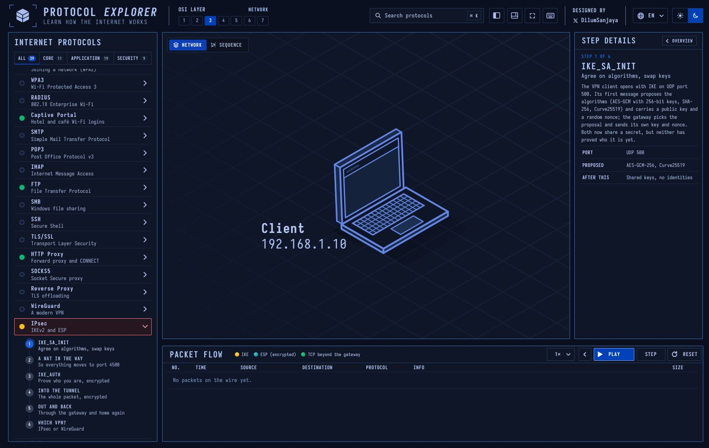
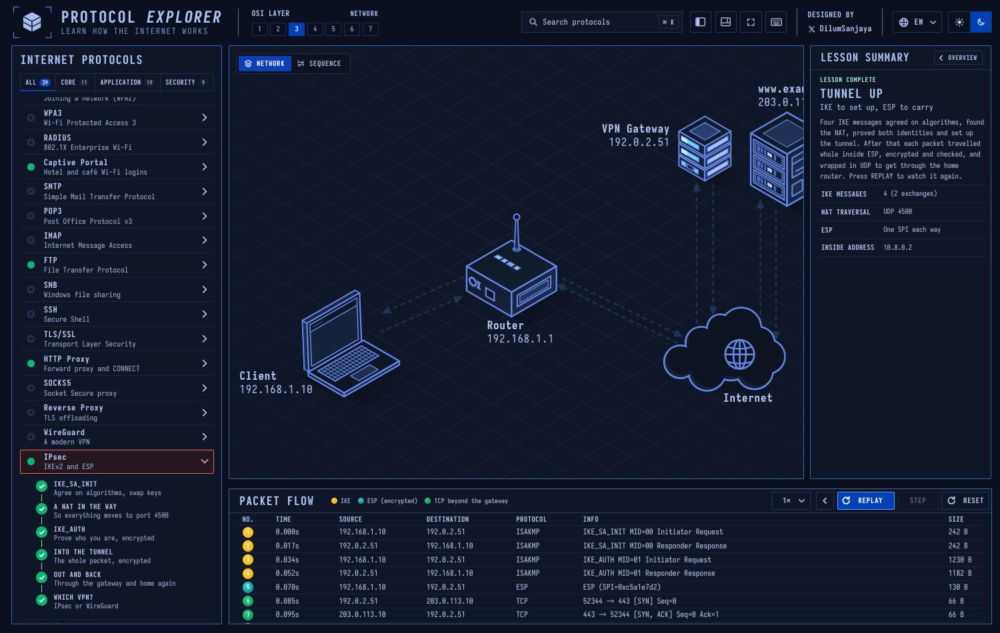
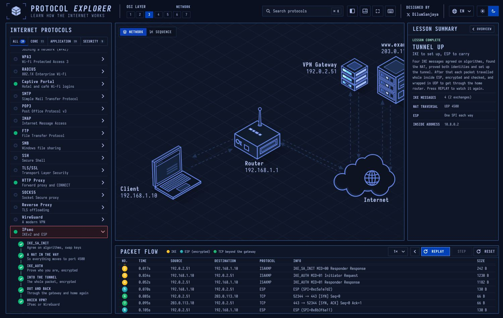
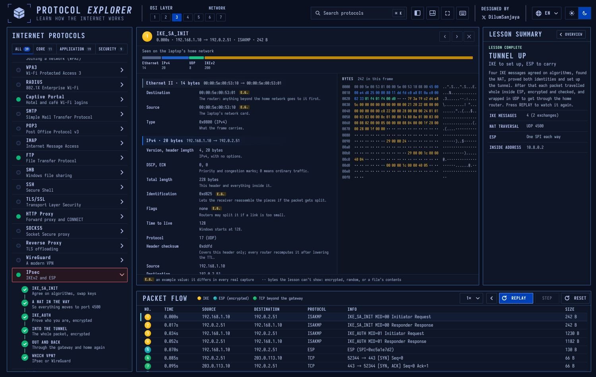

# IPsec – IKEv2 and ESP

<!-- nav -->
⬅ [37 WireGuard](37-wireguard.md) · [Index](00_Protocols_Index.md) · [39 Modbus](39-modbus.md) ➡
<!-- nav -->

*Source: Protocol Explorer – https://protocol-explorer-alpha.vercel.app/ (interactive lesson #38). Screenshots captured from the live lesson; packet decodes are the site's example capture (values marked **E.G.** differ in every real capture).*

## Overview


> PROTOCOL OVERVIEW  
> IPsec  
> ACTIVE  
> IP Security  
> IPsec protects IP packets themselves. IKEv2 sets things up: the two sides agree on algorithms, make keys and prove who they are with certificates or other credentials. Then ESP carries each packet encrypted inside another. IPsec links offices together and brings laptops into company networks, and it is built into most operating systems and firewalls.  
> LAYER  
> Network (Layer 3)  
> SETUP  
> IKEv2, UDP 500  
> BEHIND NAT  
> UDP 4500  
> DATA  
> ESP (IP protocol 50)  
> IDENTITY  
> Certificates, EAP, keys  
> DEFINED IN  
> RFC 7296, RFC 4303  

## In-depth explanation of the example (plain-language version)

### The big picture in one minute
A laptop (behind a home router) connects to a company **IPsec VPN gateway** (`192.0.2.51`) and then opens `https://www.example.com` **through the tunnel.** **8 packets:** **4 IKEv2 messages** that set everything up, and then **ESP** packets that carry the traffic. (Compare with WireGuard: same goal, but much older and more flexible.)

**What IPsec is.** A set of protocols that protects **IP packets themselves**, so it works for *any* application without changes. It has two parts:
- **IKEv2** (on UDP port **500**, or **4500** when a router is in the way): **negotiates** the methods, **checks identities** and **creates the keys.**
- **ESP** (the data part): carries each packet **encrypted and tamper-proof** inside another packet.
IPsec joins offices together (**site-to-site**) and connects laptops to company networks (**remote access**). It's built into Windows, macOS, iOS, Android, Linux and almost every firewall.

Think of **a security convoy**: first the two sides meet to agree on the route and verify each other's badges (IKE), and then every package travels in a locked, numbered, sealed box (ESP).

> **Words you'll see:** *SA (security association)* = the agreed methods and keys for one tunnel. *SPI* = a number that names a tunnel. *NAT* = a router swapping addresses. *Nonce* = a random number used once.

---

### Step 1 – First exchange: IKE_SA_INIT – packets 1, 2
Sent in clear on **UDP port 500**:
- **Laptop (initiator):** a list of **proposed methods** (e.g. AES-256-GCM encryption and a modern key-agreement group), **its half of the key agreement**, a **random number**, and some **NAT-detection** data.
- **Gateway (responder):** its **chosen method**, **its half of the key agreement**, its own random number and NAT-detection data.
Both sides now calculate a **shared secret** (never sent) and derive their keys. **Everything from here on is encrypted.**

### Step 2 – A router in the way: switch to port 4500
Both messages included **fingerprints of the addresses each side believed it was using.** At the gateway, the laptop's fingerprint **doesn't match**: the home router **rewrote the laptop's address.** ESP has no port numbers, so a router can't forward it properly. So both sides **switch to UDP port 4500** and **wrap the ESP packets inside UDP** (called **NAT-T**). Tiny keep-alive packets keep the router's mapping open.

### Step 3 – Login and tunnel set-up: IKE_AUTH – packets 3, 4
Now encrypted:
- Each side sends its **identity**, its **certificate** (or uses a shared key or a username/password), and a **signature over everything said so far.** Anyone who had tampered with the clear-text first messages (for instance to force weaker methods) would be caught here.
- The laptop asks for an **inner address** and the gateway gives it **`10.8.0.2`.**
- In the same exchange, the first **data tunnel** (a **Child SA**) is created: its methods, **which inner addresses may use it**, and a **tunnel number (SPI) for each direction.**
Result: a **control channel** (IKE SA) plus a **data tunnel** (Child SA), from **four IKE messages in total.**

### Step 4 – Into the tunnel – packet 5
You open the website. The first packet of that connection (a TCP SYN from `10.8.0.2`) is **encrypted whole, including its inner address header** (this is **tunnel mode**), and sent as an **ESP packet**: a tunnel number | a sequence number (stops replays) | an initialisation value | the **scrambled inner packet** | an **integrity check.** It travels over UDP 4500. Overhead is about 50–70 bytes per packet, so the maximum packet size is reduced. (*Transport mode*, used host to host, protects only the contents and keeps the original address header.)

### Step 5 – Out and back – packets 6 to 8
The gateway **unscrambles** the packet (finding the tunnel by its number, checking the sequence number and integrity), swaps in its own public address (NAT) and forwards it (packet 6). The reply returns to the gateway (7), which seals it in a new ESP packet for the laptop (8).

### Step 6 – Tunnel up
Four IKE messages agreed on the methods, found the router, proved both identities and built the tunnel. After that each packet travels whole inside ESP, encrypted and checked. Tunnels have **lifetimes** and are **rekeyed** automatically (with fresh key agreement for **forward secrecy**), and **dead-peer detection** removes broken tunnels.

---

### The 8 packets at a glance
| Packets | What | Why |
|---|---|---|
| 1–2 | IKE_SA_INIT | agree on methods, make keys, detect the router |
| 3–4 | IKE_AUTH | prove identities, get an inner address, build the tunnel |
| 5 | ESP packet with the SYN | first web packet, through the tunnel |
| 6–8 | gateway forwards, reply returns in ESP | out and back |

### IKEv2 vs ESP
| | IKEv2 | ESP |
|---|---|---|
| Job | control: negotiate, authenticate, make keys | data: encrypt and protect each packet |
| Travels over | UDP 500 / 4500 | IP protocol 50, or inside UDP 4500 |

### What to remember
- **SA = security association** (agreed methods + keys + number), named by its **SPI.** **Tunnel mode** encrypts the whole packet (used by VPNs).
- **Login options:** certificates, a pre-shared key, or EAP (username/password, SIM).
- **Strengths:** standard, everywhere, flexible, hardware-accelerated. **Weaknesses:** complexity (many options make mistakes easy) and the extra overhead of NAT-T.
- Compare: **WireGuard** (simple, fixed crypto), **OpenVPN / TLS VPNs**, **SSH tunnels**.

## Step-by-step walkthrough (screenshots from the lesson)

### Step 1: IKE_SA_INIT – Agree on algorithms, swap keys



> STEP 1 OF 6  
> IKE_SA_INIT  
> Agree on algorithms, swap keys  
> The VPN client opens with IKE on UDP port 500. Its first message proposes the algorithms (AES-GCM with 256-bit keys, SHA-256, Curve25519) and carries a public key and a random nonce; the gateway picks the proposal and sends its own key and nonce. Both now share a secret, but neither has proved who it is yet.  
> PORT  
> UDP 500  
> PROPOSED  
> AES-GCM-256, Curve25519  
> AFTER THIS  
> Shared keys, no identities  

### Step 2: A NAT IN THE WAY – So everything moves to port 4500


> STEP 2 OF 6  
> A NAT IN THE WAY  
> So everything moves to port 4500  
> Both messages also carried hashes of the address and port each side sent from. At the gateway they don’t match what arrived: the home router rewrote the laptop’s address on the way (NAT). ESP has no port numbers, so a NAT can’t pass it; both sides move to UDP port 4500 and wrap ESP in UDP from now on.  
> HASHES OF  
> Address and port sent from  
> MISMATCH  
> The router rewrote them  
> FIX  
> Everything over UDP 4500  

### Step 3: IKE_AUTH – Prove who you are, encrypted


> STEP 3 OF 6  
> IKE_AUTH  
> Prove who you are, encrypted  
> Now encrypted, each side sends its identity, its certificate and a signature over everything said so far, so anyone in the middle would be caught. The laptop asks for an address inside the network and gets 10.8.0.2. The same exchange sets up the ESP tunnel itself, with its own keys and an SPI for each direction.  
> IKE_AUTH  
> CLIENT → VPN GATEWAY  
> identity, certificate  
> signature  
> PACKET 3 OF 8 · ISAKMP · 1230 B · ENCRYPTED  
> PORT  
> UDP 4500 (NAT traversal)  
> PROVES  
> Identity, by certificate  
> LAPTOP GETS  
> 10.8.0.2, and a DNS server  

### Step 4: INTO THE TUNNEL – The whole packet, encrypted


> STEP 4 OF 6  
> INTO THE TUNNEL  
> The whole packet, encrypted  
> You open https://www.example.com, looked up through the tunnel at the DNS server the gateway gave (not shown). The SYN from 10.8.0.2 is encrypted whole into an ESP packet: an SPI that names the tunnel, a sequence number, then the encrypted packet and a check value, all inside UDP port 4500. Its UDP checksum is zero: ESP checks its own contents.  
> ESP  
> CLIENT → VPN GATEWAY  
> inside: TCP SYN to :443  
> PACKET 5 OF 8 · ESP · 130 B · ENCRYPTED  
> SPI  
> Names the tunnel  
> INSIDE  
> The whole IP packet  
> OVERHEAD  
> 62 bytes + padding  

### Step 5: OUT AND BACK – Through the gateway and home again


> STEP 5 OF 6  
> OUT AND BACK  
> Through the gateway and home again  
> The gateway decrypts the packet and sends the SYN on from its own address, one hop older. The answer comes back to the gateway and returns through the tunnel as another ESP packet, with the SPI for the laptop’s direction and its own sequence numbers.  
> SYN  
> VPN GATEWAY → WWW.EXAMPLE.COM  
> from 192.0.2.51  
> PACKET 6 OF 8 · TCP · 66 B  
> WEBSITE SEES  
> 192.0.2.51 (the gateway)  
> EACH DIRECTION  
> Its own SPI and keys  
> REPLAYS  
> Thrown away  

### Step 6: WHICH VPN? – IPsec or WireGuard



> LESSON SUMMARY  
> LESSON COMPLETE  
> TUNNEL UP  
> IKE to set up, ESP to carry  
> Four IKE messages agreed on algorithms, found the NAT, proved both identities and set up the tunnel. After that each packet travelled whole inside ESP, encrypted and checked, and wrapped in UDP to get through the home router. Press REPLAY to watch it again.  
> SYN  
> VPN GATEWAY → WWW.EXAMPLE.COM  
> from 192.0.2.51  
> PACKET 6 OF 8 · TCP · 66 B  
> IKE MESSAGES  
> 4 (2 exchanges)  
> NAT TRAVERSAL  
> UDP 4500  
> ESP  
> One SPI each way  
> INSIDE ADDRESS  
> 10.8.0.2  

### Lesson summary



> LESSON SUMMARY  
> LESSON COMPLETE  
> TUNNEL UP  
> IKE to set up, ESP to carry  
> Four IKE messages agreed on algorithms, found the NAT, proved both identities and set up the tunnel. After that each packet travelled whole inside ESP, encrypted and checked, and wrapped in UDP to get through the home router. Press REPLAY to watch it again.  
> ESP  
> VPN GATEWAY → CLIENT  
> inside: TCP SYN-ACK  
> PACKET 8 OF 8 · ESP · 130 B · ENCRYPTED  
> IKE MESSAGES  
> 4 (2 exchanges)  
> NAT TRAVERSAL  
> UDP 4500  
> ESP  
> One SPI each way  
> INSIDE ADDRESS  
> 10.8.0.2  

## Packet flow (whole lesson)

| No. | Time | Source | Destination | Protocol | Info | Size |
|---|---|---|---|---|---|---|
| 1 | 0.000s | 192.168.1.10 | 192.0.2.51 | ISAKMP | IKE_SA_INIT MID=00 Initiator Request | 242 B |
| 2 | 0.017s | 192.0.2.51 | 192.168.1.10 | ISAKMP | IKE_SA_INIT MID=00 Responder Response | 242 B |
| 3 | 0.034s | 192.168.1.10 | 192.0.2.51 | ISAKMP | IKE_AUTH MID=01 Initiator Request | 1230 B |
| 4 | 0.052s | 192.0.2.51 | 192.168.1.10 | ISAKMP | IKE_AUTH MID=01 Responder Response | 1182 B |
| 5 | 0.070s | 192.168.1.10 | 192.0.2.51 | ESP | ESP (SPI=0xc5a1e7d2) | 130 B |
| 6 | 0.085s | 192.0.2.51 | 203.0.113.10 | TCP | 52344 → 443 [SYN] Seq=0 | 66 B |
| 7 | 0.095s | 203.0.113.10 | 192.0.2.51 | TCP | 443 → 52344 [SYN, ACK] Seq=0 Ack=1 | 66 B |
| 8 | 0.105s | 192.0.2.51 | 192.168.1.10 | ESP | ESP (SPI=0x8b3f6a11) | 130 B |

### Sequence diagram


## Packets decoded byte by byte

Each packet below is the lesson's own decode (headers, field values and the plain-English meaning of each field). Screenshots show the first, middle and last packet in the lesson's decoder view with the raw hex bytes.

### Packet 1: ISAKMP – IKE_SA_INIT MID=00 Initiator Request

*192.168.1.10 → 192.0.2.51 · 242 B · t = 0.000s*



<details><summary>Decoded fields</summary>

```text
1
IKE_SA_INIT
0.000s · 192.168.1.10 → 192.0.2.51 · ISAKMP · 242 B
Seen on the laptop’s home network
Ethernet
14
IPv4
20
UDP
8
IKEv2
200
Ethernet II · 14 bytes
00:00:5e:00:53:10 → 00:00:5e:00:53:01
Destination
00:00:5e:00:53:01 E.G.

The router: anything beyond the home network goes to it first.

Source
00:00:5e:00:53:10 E.G.

The laptop’s network card.

Type
0x0800 (IPv4)

What the frame carries.

IPv4 · 20 bytes
192.168.1.10 → 192.0.2.51
Version, header length
4, 20 bytes

IPv4, with no options.

DSCP, ECN
0, 0

Priority and congestion marks; 0 means ordinary traffic.

Total length
228 bytes

This header and everything inside it.

Identification
0xd825 E.G.

Lets the receiver reassemble the pieces if the packet gets split.

Flags
none E.G.

Routers may split it if a link is too small.

Time to live
128

Windows starts at 128.

Protocol
17 (UDP)
Header checksum
0xddfd

Covers this header only; every router recomputes it after lowering the TTL.

Source
192.168.1.10
Destination
192.0.2.51
UDP · 8 bytes
500 → 500
Source port
500
Destination port
500
Length
208 bytes

UDP header and data. That is all of UDP: no numbering, no acknowledgements.

Checksum
covers bytes not shown here

Covers the header, the data and the IP addresses.

IKEv2 · IKE_SA_INIT request
Initiator SPI
0x7f3a19c2d4e85c00 E.G.

Picked by the laptop: which IKE session this is.

Responder SPI
0 (not known yet)
Next payload
33 (SA)
Version
2.0
Exchange type
34 (IKE_SA_INIT)
Flags
0x08 (initiator)
Message ID
0

Each request and its response share a number; the next exchange counts up.

Length
200 bytes
SA payload
40 bytes
Next payload, length
34 (KE), 40 bytes
Proposal
IKE: AES-GCM-256, PRF HMAC-SHA-256, Curve25519

What the laptop offers; a real client often offers several.

KE payload
40 bytes
Next payload, length
40 (Nonce), 40 bytes
DH group
31 (Curve25519)
Key data
32 bytes

This side’s public key. From the two, both work out the same secret.

Nonce payload
36 bytes
Next payload, length
41 (Notify), 36 bytes
Nonce
32 random bytes
Notify payload
28 bytes
Next payload, length
41 (Notify), 28 bytes
Notify
16388 (NAT_DETECTION_SOURCE_IP)
Hash
20 bytes

A hash of the SPIs and the address and port this side sent from. If what arrives doesn’t match, a NAT changed it on the way.

Notify payload
28 bytes
Next payload, length
0 (none), 28 bytes
Notify
16389 (NAT_DETECTION_DESTINATION_IP)
Hash
20 bytes

The same for the address and port it sent to.

BYTES 242 in this frame
0000
00
00
5e
00
53
01
00
00
5e
00
53
10
08
00
45
00
.
.
^
.
S
.
.
.
^
.
S
.
.
.
E
.
0010
00
e4
d8
25
00
00
80
11
dd
fd
c0
a8
01
0a
c0
00
.
.
.
%
.
.
.
.
.
.
.
.
.
.
.
.
0020
02
33
01
f4
01
f4
00
d0
··
··
7f
3a
19
c2
d4
e8
.
3
.
.
.
.
.
.
·
·
.
:
.
.
.
.
0030
5c
00
00
00
00
00
00
00
00
00
21
20
22
08
00
00
\
.
.
.
.
.
.
.
.
.
!
"
.
.
.
0040
00
00
00
00
00
c8
22
00
00
28
00
00
00
24
01
01
.
.
.
.
.
.
"
.
.
(
.
.
.
$
.
.
0050
00
03
03
00
00
0c
01
00
00
14
80
0e
01
00
03
00
.
.
.
.
.
.
.
.
.
.
.
.
.
.
.
.
0060
00
08
02
00
00
05
00
00
00
08
04
00
00
1f
28
00
.
.
.
.
.
.
.
.
.
.
.
.
.
.
(
.
0070
00
28
00
1f
00
00
··
··
··
··
··
··
··
··
··
··
.
(
.
.
.
.
·
·
·
·
·
·
·
·
·
·
0080
··
··
··
··
··
··
··
··
··
··
··
··
··
··
··
··
·
·
·
·
·
·
·
·
·
·
·
·
·
·
·
·
0090
··
··
··
··
··
··
29
00
00
24
··
··
··
··
··
··
·
·
·
·
·
·
)
.
.
$
·
·
·
·
·
·
00a0
··
··
··
··
··
··
··
··
··
··
··
··
··
··
··
··
·
·
·
·
·
·
·
·
·
·
·
·
·
·
·
·
00b0
··
··
··
··
··
··
··
··
··
··
29
00
00
1c
00
00
·
·
·
·
·
·
·
·
·
·
)
.
.
.
.
.
00c0
40
04
··
··
··
··
··
··
··
··
··
··
··
··
··
··
@
.
·
·
·
·
·
·
·
·
·
·
·
·
·
·
00d0
··
··
··
··
··
··
00
00
00
1c
00
00
40
05
··
··
·
·
·
·
·
·
.
.
.
.
.
.
@
.
·
·
00e0
··
··
··
··
··
··
··
··
··
··
··
··
··
··
··
··
·
·
·
·
·
·
·
·
·
·
·
·
·
·
·
·
00f0
··
··
·
·
E.G. an example value: it differs in every real capture
·· bytes the lesson can’t show: encrypted, random, or a file’s contents
```

</details>

### Packet 2: ISAKMP – IKE_SA_INIT MID=00 Responder Response

*192.0.2.51 → 192.168.1.10 · 242 B · t = 0.017s*

<details><summary>Decoded fields</summary>

```text
2
IKE_SA_INIT
0.017s · 192.0.2.51 → 192.168.1.10 · ISAKMP · 242 B
Seen on the laptop’s home network
Ethernet
14
IPv4
20
UDP
8
IKEv2
200
Ethernet II · 14 bytes
00:00:5e:00:53:01 → 00:00:5e:00:53:10
Destination
00:00:5e:00:53:10 E.G.

The laptop.

Source
00:00:5e:00:53:01 E.G.

The router’s side facing the home network.

Type
0x0800 (IPv4)

What the frame carries.

IPv4 · 20 bytes
192.0.2.51 → 192.168.1.10
Version, header length
4, 20 bytes

IPv4, with no options.

DSCP, ECN
0, 0

Priority and congestion marks; 0 means ordinary traffic.

Total length
228 bytes

This header and everything inside it.

Identification
0xacbe E.G.

Lets the receiver reassemble the pieces if the packet gets split.

Flags
DF (don’t fragment) E.G.

Routers must not split it; if it’s too big they report back instead.

Time to live
52

Started at 64; 12 routers on the way each took 1.

Protocol
17 (UDP)
Header checksum
0x1565

Covers this header only; every router recomputes it after lowering the TTL.

Source
192.0.2.51
Destination
192.168.1.10
UDP · 8 bytes
500 → 500
Source port
500
Destination port
500
Length
208 bytes

UDP header and data. That is all of UDP: no numbering, no acknowledgements.

Checksum
covers bytes not shown here

Covers the header, the data and the IP addresses.

IKEv2 · IKE_SA_INIT response
Initiator SPI
0x7f3a19c2d4e85c00 E.G.

Picked by the laptop: which IKE session this is.

Responder SPI
0x2c6e0b9f41a3d800 E.G.
Next payload
33 (SA)
Version
2.0
Exchange type
34 (IKE_SA_INIT)
Flags
0x20 (response)
Message ID
0

Each request and its response share a number; the next exchange counts up.

Length
200 bytes
SA payload
40 bytes
Next payload, length
34 (KE), 40 bytes
Proposal
IKE: AES-GCM-256, PRF HMAC-SHA-256, Curve25519

The one the server chose from the laptop’s offer.

KE payload
40 bytes
Next payload, length
40 (Nonce), 40 bytes
DH group
31 (Curve25519)
Key data
32 bytes

This side’s public key. From the two, both work out the same secret.

Nonce payload
36 bytes
Next payload, length
41 (Notify), 36 bytes
Nonce
32 random bytes
Notify payload
28 bytes
Next payload, length
41 (Notify), 28 bytes
Notify
16388 (NAT_DETECTION_SOURCE_IP)
Hash
20 bytes

A hash of the SPIs and the address and port this side sent from. If what arrives doesn’t match, a NAT changed it on the way.

Notify payload
28 bytes
Next payload, length
0 (none), 28 bytes
Notify
16389 (NAT_DETECTION_DESTINATION_IP)
Hash
20 bytes

The same for the address and port it sent to.

BYTES 242 in this frame
0000
00
00
5e
00
53
10
00
00
5e
00
53
01
08
00
45
00
.
.
^
.
S
.
.
.
^
.
S
.
.
.
E
.
0010
00
e4
ac
be
40
00
34
11
15
65
c0
00
02
33
c0
a8
.
.
.
.
@
.
4
.
.
e
.
.
.
3
.
.
0020
01
0a
01
f4
01
f4
00
d0
··
··
7f
3a
19
c2
d4
e8
.
.
.
.
.
.
.
.
·
·
.
:
.
.
.
.
0030
5c
00
2c
6e
0b
9f
41
a3
d8
00
21
20
22
20
00
00
\
.
,
n
.
.
A
.
.
.
!
"
.
.
0040
00
00
00
00
00
c8
22
00
00
28
00
00
00
24
01
01
.
.
.
.
.
.
"
.
.
(
.
.
.
$
.
.
0050
00
03
03
00
00
0c
01
00
00
14
80
0e
01
00
03
00
.
.
.
.
.
.
.
.
.
.
.
.
.
.
.
.
0060
00
08
02
00
00
05
00
00
00
08
04
00
00
1f
28
00
.
.
.
.
.
.
.
.
.
.
.
.
.
.
(
.
0070
00
28
00
1f
00
00
··
··
··
··
··
··
··
··
··
··
.
(
.
.
.
.
·
·
·
·
·
·
·
·
·
·
0080
··
··
··
··
··
··
··
··
··
··
··
··
··
··
··
··
·
·
·
·
·
·
·
·
·
·
·
·
·
·
·
·
0090
··
··
··
··
··
··
29
00
00
24
··
··
··
··
··
··
·
·
·
·
·
·
)
.
.
$
·
·
·
·
·
·
00a0
··
··
··
··
··
··
··
··
··
··
··
··
··
··
··
··
·
·
·
·
·
·
·
·
·
·
·
·
·
·
·
·
00b0
··
··
··
··
··
··
··
··
··
··
29
00
00
1c
00
00
·
·
·
·
·
·
·
·
·
·
)
.
.
.
.
.
00c0
40
04
··
··
··
··
··
··
··
··
··
··
··
··
··
··
@
.
·
·
·
·
·
·
·
·
·
·
·
·
·
·
00d0
··
··
··
··
··
··
00
00
00
1c
00
00
40
05
··
··
·
·
·
·
·
·
.
.
.
.
.
.
@
.
·
·
00e0
··
··
··
··
··
··
··
··
··
··
··
··
··
··
··
··
·
·
·
·
·
·
·
·
·
·
·
·
·
·
·
·
00f0
··
··
·
·
E.G. an example value: it differs in every real capture
·· bytes the lesson can’t show: encrypted, random, or a file’s contents
```

</details>

### Packet 3: ISAKMP – IKE_AUTH MID=01 Initiator Request

*192.168.1.10 → 192.0.2.51 · 1230 B · t = 0.034s*

<details><summary>Decoded fields</summary>

```text
3
IKE_AUTH
0.034s · 192.168.1.10 → 192.0.2.51 · ISAKMP · 1230 B
Seen on the laptop’s home network
Ethernet
14
IPv4
20
UDP
8
IKEv2
1188
Ethernet II · 14 bytes
00:00:5e:00:53:10 → 00:00:5e:00:53:01
Destination
00:00:5e:00:53:01 E.G.

The router: anything beyond the home network goes to it first.

Source
00:00:5e:00:53:10 E.G.

The laptop’s network card.

Type
0x0800 (IPv4)

What the frame carries.

IPv4 · 20 bytes
192.168.1.10 → 192.0.2.51
Version, header length
4, 20 bytes

IPv4, with no options.

DSCP, ECN
0, 0

Priority and congestion marks; 0 means ordinary traffic.

Total length
1216 bytes

This header and everything inside it.

Identification
0xd826 E.G.

Lets the receiver reassemble the pieces if the packet gets split.

Flags
none E.G.

Routers may split it if a link is too small.

Time to live
128

Windows starts at 128.

Protocol
17 (UDP)
Header checksum
0xda20

Covers this header only; every router recomputes it after lowering the TTL.

Source
192.168.1.10
Destination
192.0.2.51
UDP · 8 bytes
4500 → 4500
Source port
4500
Destination port
4500
Length
1196 bytes

UDP header and data. That is all of UDP: no numbering, no acknowledgements.

Checksum
covers bytes not shown here

Covers the header, the data and the IP addresses.

IKEv2 · IKE_AUTH request
Non-ESP marker
0x00000000

Four zero bytes: an IKE message, not an ESP packet (they share port 4500).

Initiator SPI
0x7f3a19c2d4e85c00 E.G.

Picked by the laptop: which IKE session this is.

Responder SPI
0x2c6e0b9f41a3d800 E.G.
Next payload
46 (Encrypted)
Version
2.0
Exchange type
35 (IKE_AUTH)
Flags
0x08 (initiator)
Message ID
1

Each request and its response share a number; the next exchange counts up.

Length
1184 bytes
Encrypted payload
1156 bytes
Next payload, length
35 (IDi), 1156 bytes
IV
8 bytes
Encrypted payloads
1128 bytes

Everything else in this message, encrypted with the keys from IKE_SA_INIT.

Inside
IDi, CERT, AUTH: who the laptop is, proven
CP: asks for an inside address and DNS
SA: what to use for ESP (AES-GCM)
TSi, TSr: which traffic goes in the tunnel
Integrity check
16 bytes
BYTES 1230 in this frame
0000
00
00
5e
00
53
01
00
00
5e
00
53
10
08
00
45
00
.
.
^
.
S
.
.
.
^
.
S
.
.
.
E
.
0010
04
c0
d8
26
00
00
80
11
da
20
c0
a8
01
0a
c0
00
.
.
.
&
.
.
.
.
.
.
.
.
.
.
.
0020
02
33
11
94
11
94
04
ac
··
··
00
00
00
00
7f
3a
.
3
.
.
.
.
.
.
·
·
.
.
.
.
.
:
0030
19
c2
d4
e8
5c
00
2c
6e
0b
9f
41
a3
d8
00
2e
20
.
.
.
.
\
.
,
n
.
.
A
.
.
.
.
0040
23
08
00
00
00
01
00
00
04
a0
23
00
04
84
··
··
#
.
.
.
.
.
.
.
.
.
#
.
.
.
·
·
0050
··
··
··
··
··
··
··
··
··
··
··
··
··
··
··
··
·
·
·
·
·
·
·
·
·
·
·
·
·
·
·
·
0060
··
··
··
··
··
··
··
··
··
··
··
··
··
··
··
··
·
·
·
·
·
·
·
·
·
·
·
·
·
·
·
·
0070
··
··
··
··
··
··
··
··
··
··
··
··
··
··
··
··
·
·
·
·
·
·
·
·
·
·
·
·
·
·
·
·
0080
··
··
··
··
··
··
··
··
··
··
··
··
··
··
··
··
·
·
·
·
·
·
·
·
·
·
·
·
·
·
·
·
0090
··
··
··
··
··
··
··
··
··
··
··
··
··
··
··
··
·
·
·
·
·
·
·
·
·
·
·
·
·
·
·
·
00a0
··
··
··
··
··
··
··
··
··
··
··
··
··
··
··
··
·
·
·
·
·
·
·
·
·
·
·
·
·
·
·
·
00b0
··
··
··
··
··
··
··
··
··
··
··
··
··
··
··
··
·
·
·
·
·
·
·
·
·
·
·
·
·
·
·
·
00c0
··
··
··
··
··
··
··
··
··
··
··
··
··
··
··
··
·
·
·
·
·
·
·
·
·
·
·
·
·
·
·
·
00d0
··
··
··
··
··
··
··
··
··
··
··
··
··
··
··
··
·
·
·
·
·
·
·
·
·
·
·
·
·
·
·
·
00e0
··
··
··
··
··
··
··
··
··
··
··
··
··
··
··
··
·
·
·
·
·
·
·
·
·
·
·
·
·
·
·
·
00f0
··
··
··
··
··
··
··
··
··
··
··
··
··
··
··
··
·
·
·
·
·
·
·
·
·
·
·
·
·
·
·
·
0100
··
··
··
··
··
··
··
··
··
··
··
··
··
··
··
··
·
·
·
·
·
·
·
·
·
·
·
·
·
·
·
·
0110
··
··
··
··
··
··
··
··
··
··
··
··
··
··
··
··
·
·
·
·
·
·
·
·
·
·
·
·
·
·
·
·
0120
··
··
··
··
··
··
··
··
··
··
··
··
··
··
··
··
·
·
·
·
·
·
·
·
·
·
·
·
·
·
·
·
0130
··
··
··
··
··
··
··
··
··
··
··
··
··
··
··
··
·
·
·
·
·
·
·
·
·
·
·
·
·
·
·
·
0140
··
··
··
··
··
··
··
··
··
··
··
··
··
··
··
··
·
·
·
·
·
·
·
·
·
·
·
·
·
·
·
·
0150
··
··
··
··
··
··
··
··
··
··
··
··
··
··
··
··
·
·
·
·
·
·
·
·
·
·
·
·
·
·
·
·
0160
··
··
··
··
··
··
··
··
··
··
··
··
··
··
··
··
·
·
·
·
·
·
·
·
·
·
·
·
·
·
·
·
0170
··
··
··
··
··
··
··
··
··
··
··
··
··
··
··
··
·
·
·
·
·
·
·
·
·
·
·
·
·
·
·
·
0180
··
··
··
··
··
··
··
··
··
··
··
··
··
··
··
··
·
·
·
·
·
·
·
·
·
·
·
·
·
·
·
·
0190
··
··
··
··
··
··
··
··
··
··
··
··
··
··
··
··
·
·
·
·
·
·
·
·
·
·
·
·
·
·
·
·
01a0
··
··
··
··
··
··
··
··
··
··
··
··
··
··
··
··
·
·
·
·
·
·
·
·
·
·
·
·
·
·
·
·
01b0
··
··
··
··
··
··
··
··
··
··
··
··
··
··
··
··
·
·
·
·
·
·
·
·
·
·
·
·
·
·
·
·
01c0
··
··
··
··
··
··
··
··
··
··
··
··
··
··
··
··
·
·
·
·
·
·
·
·
·
·
·
·
·
·
·
·
01d0
··
··
··
··
··
··
··
··
··
··
··
··
··
··
··
··
·
·
·
·
·
·
·
·
·
·
·
·
·
·
·
·
01e0
··
··
··
··
··
··
··
··
··
··
··
··
··
··
··
··
·
·
·
·
·
·
·
·
·
·
·
·
·
·
·
·
01f0
··
··
··
··
··
··
··
··
··
··
··
··
··
··
··
··
·
·
·
·
·
·
·
·
·
·
·
·
·
·
·
·
0200
··
··
··
··
··
··
··
··
··
··
··
··
··
··
··
··
·
·
·
·
·
·
·
·
·
·
·
·
·
·
·
·
0210
··
··
··
··
··
··
··
··
··
··
··
··
··
··
··
··
·
·
·
·
·
·
·
·
·
·
·
·
·
·
·
·
0220
··
··
··
··
··
··
··
··
··
··
··
··
··
··
··
··
·
·
·
·
·
·
·
·
·
·
·
·
·
·
·
·
0230
··
··
··
··
··
··
··
··
··
··
··
··
··
··
··
··
·
·
·
·
·
·
·
·
·
·
·
·
·
·
·
·
0240
··
··
··
··
··
··
··
··
··
··
··
··
··
··
··
··
·
·
·
·
·
·
·
·
·
·
·
·
·
·
·
·
0250
··
··
··
··
··
··
··
··
··
··
··
··
··
··
··
··
·
·
·
·
·
·
·
·
·
·
·
·
·
·
·
·
0260
··
··
··
··
··
··
··
··
··
··
··
··
··
··
··
··
·
·
·
·
·
·
·
·
·
·
·
·
·
·
·
·
0270
··
··
··
··
··
··
··
··
··
··
··
··
··
··
··
··
·
·
·
·
·
·
·
·
·
·
·
·
·
·
·
·
0280
··
··
··
··
··
··
··
··
··
··
··
··
··
··
··
··
·
·
·
·
·
·
·
·
·
·
·
·
·
·
·
·
0290
··
··
··
··
··
··
··
··
··
··
··
··
··
··
··
··
·
·
·
·
·
·
·
·
·
·
·
·
·
·
·
·
02a0
··
··
··
··
··
··
··
··
··
··
··
··
··
··
··
··
·
·
·
·
·
·
·
·
·
·
·
·
·
·
·
·
02b0
··
··
··
··
··
··
··
··
··
··
··
··
··
··
··
··
·
·
·
·
·
·
·
·
·
·
·
·
·
·
·
·
02c0
··
··
··
··
··
··
··
··
··
··
··
··
··
··
··
··
·
·
·
·
·
·
·
·
·
·
·
·
·
·
·
·
02d0
··
··
··
··
··
··
··
··
··
··
··
··
··
··
··
··
·
·
·
·
·
·
·
·
·
·
·
·
·
·
·
·
02e0
··
··
··
··
··
··
··
··
··
··
··
··
··
··
··
··
·
·
·
·
·
·
·
·
·
·
·
·
·
·
·
·
02f0
··
··
··
··
··
··
··
··
··
··
··
··
··
··
··
··
·
·
·
·
·
·
·
·
·
·
·
·
·
·
·
·
0300
··
··
··
··
··
··
··
··
··
··
··
··
··
··
··
··
·
·
·
·
·
·
·
·
·
·
·
·
·
·
·
·
0310
··
··
··
··
··
··
··
··
··
··
··
··
··
··
··
··
·
·
·
·
·
·
·
·
·
·
·
·
·
·
·
·
0320
··
··
··
··
··
··
··
··
··
··
··
··
··
··
··
··
·
·
·
·
·
·
·
·
·
·
·
·
·
·
·
·
0330
··
··
··
··
··
··
··
··
··
··
··
··
··
··
··
··
·
·
·
·
·
·
·
·
·
·
·
·
·
·
·
·
0340
··
··
··
··
··
··
··
··
··
··
··
··
··
··
··
··
·
·
·
·
·
·
·
·
·
·
·
·
·
·
·
·
0350
··
··
··
··
··
··
··
··
··
··
··
··
··
··
··
··
·
·
·
·
·
·
·
·
·
·
·
·
·
·
·
·
0360
··
··
··
··
··
··
··
··
··
··
··
··
··
··
··
··
·
·
·
·
·
·
·
·
·
·
·
·
·
·
·
·
0370
··
··
··
··
··
··
··
··
··
··
··
··
··
··
··
··
·
·
·
·
·
·
·
·
·
·
·
·
·
·
·
·
0380
··
··
··
··
··
··
··
··
··
··
··
··
··
··
··
··
·
·
·
·
·
·
·
·
·
·
·
·
·
·
·
·
0390
··
··
··
··
··
··
··
··
··
··
··
··
··
··
··
··
·
·
·
·
·
·
·
·
·
·
·
·
·
·
·
·
03a0
··
··
··
··
··
··
··
··
··
··
··
··
··
··
··
··
·
·
·
·
·
·
·
·
·
·
·
·
·
·
·
·
03b0
··
··
··
··
··
··
··
··
··
··
··
··
··
··
··
··
·
·
·
·
·
·
·
·
·
·
·
·
·
·
·
·
03c0
··
··
··
··
··
··
··
··
··
··
··
··
··
··
··
··
·
·
·
·
·
·
·
·
·
·
·
·
·
·
·
·
03d0
··
··
··
··
··
··
··
··
··
··
··
··
··
··
··
··
·
·
·
·
·
·
·
·
·
·
·
·
·
·
·
·
03e0
··
··
··
··
··
··
··
··
··
··
··
··
··
··
··
··
·
·
·
·
·
·
·
·
·
·
·
·
·
·
·
·
03f0
··
··
··
··
··
··
··
··
··
··
··
··
··
··
··
··
·
·
·
·
·
·
·
·
·
·
·
·
·
·
·
·
0400
··
··
··
··
··
··
··
··
··
··
··
··
··
··
··
··
·
·
·
·
·
·
·
·
·
·
·
·
·
·
·
·
0410
··
··
··
··
··
··
··
··
··
··
··
··
··
··
··
··
·
·
·
·
·
·
·
·
·
·
·
·
·
·
·
·
0420
··
··
··
··
··
··
··
··
··
··
··
··
··
··
··
··
·
·
·
·
·
·
·
·
·
·
·
·
·
·
·
·
0430
··
··
··
··
··
··
··
··
··
··
··
··
··
··
··
··
·
·
·
·
·
·
·
·
·
·
·
·
·
·
·
·
0440
··
··
··
··
··
··
··
··
··
··
··
··
··
··
··
··
·
·
·
·
·
·
·
·
·
·
·
·
·
·
·
·
0450
··
··
··
··
··
··
··
··
··
··
··
··
··
··
··
··
·
·
·
·
·
·
·
·
·
·
·
·
·
·
·
·
0460
··
··
··
··
··
··
··
··
··
··
··
··
··
··
··
··
·
·
·
·
·
·
·
·
·
·
·
·
·
·
·
·
0470
··
··
··
··
··
··
··
··
··
··
··
··
··
··
··
··
·
·
·
·
·
·
·
·
·
·
·
·
·
·
·
·
0480
··
··
··
··
··
··
··
··
··
··
··
··
··
··
··
··
·
·
·
·
·
·
·
·
·
·
·
·
·
·
·
·
0490
··
··
··
··
··
··
··
··
··
··
··
··
··
··
··
··
·
·
·
·
·
·
·
·
·
·
·
·
·
·
·
·
04a0
··
··
··
··
··
··
··
··
··
··
··
··
··
··
··
··
·
·
·
·
·
·
·
·
·
·
·
·
·
·
·
·
04b0
··
··
··
··
··
··
··
··
··
··
··
··
··
··
··
··
·
·
·
·
·
·
·
·
·
·
·
·
·
·
·
·
04c0
··
··
··
··
··
··
··
··
··
··
··
··
··
··
·
·
·
·
·
·
·
·
·
·
·
·
·
·
E.G. an example value: it differs in every real capture
·· bytes the lesson can’t show: encrypted, random, or a file’s contents
```

</details>

### Packet 4: ISAKMP – IKE_AUTH MID=01 Responder Response

*192.0.2.51 → 192.168.1.10 · 1182 B · t = 0.052s*

<details><summary>Decoded fields</summary>

```text
4
IKE_AUTH
0.052s · 192.0.2.51 → 192.168.1.10 · ISAKMP · 1182 B
Seen on the laptop’s home network
Ethernet
14
IPv4
20
UDP
8
IKEv2
1140
Ethernet II · 14 bytes
00:00:5e:00:53:01 → 00:00:5e:00:53:10
Destination
00:00:5e:00:53:10 E.G.

The laptop.

Source
00:00:5e:00:53:01 E.G.

The router’s side facing the home network.

Type
0x0800 (IPv4)

What the frame carries.

IPv4 · 20 bytes
192.0.2.51 → 192.168.1.10
Version, header length
4, 20 bytes

IPv4, with no options.

DSCP, ECN
0, 0

Priority and congestion marks; 0 means ordinary traffic.

Total length
1168 bytes

This header and everything inside it.

Identification
0xacbf E.G.

Lets the receiver reassemble the pieces if the packet gets split.

Flags
DF (don’t fragment) E.G.

Routers must not split it; if it’s too big they report back instead.

Time to live
52

Started at 64; 12 routers on the way each took 1.

Protocol
17 (UDP)
Header checksum
0x11b8

Covers this header only; every router recomputes it after lowering the TTL.

Source
192.0.2.51
Destination
192.168.1.10
UDP · 8 bytes
4500 → 4500
Source port
4500
Destination port
4500
Length
1148 bytes

UDP header and data. That is all of UDP: no numbering, no acknowledgements.

Checksum
covers bytes not shown here

Covers the header, the data and the IP addresses.

IKEv2 · IKE_AUTH response
Non-ESP marker
0x00000000

Four zero bytes: an IKE message, not an ESP packet (they share port 4500).

Initiator SPI
0x7f3a19c2d4e85c00 E.G.

Picked by the laptop: which IKE session this is.

Responder SPI
0x2c6e0b9f41a3d800 E.G.
Next payload
46 (Encrypted)
Version
2.0
Exchange type
35 (IKE_AUTH)
Flags
0x20 (response)
Message ID
1

Each request and its response share a number; the next exchange counts up.

Length
1136 bytes
Encrypted payload
1108 bytes
Next payload, length
36 (IDr), 1108 bytes
IV
8 bytes
Encrypted payloads
1080 bytes

Everything else in this message, encrypted with the keys from IKE_SA_INIT.

Inside
IDr, CERT, AUTH: who the gateway is, proven
CP: inside address 10.8.0.2, DNS 10.8.0.1
SA: ESP with AES-GCM, and the SPIs
TSi, TSr: everything (0.0.0.0/0)
Integrity check
16 bytes
BYTES 1182 in this frame
0000
00
00
5e
00
53
10
00
00
5e
00
53
01
08
00
45
00
.
.
^
.
S
.
.
.
^
.
S
.
.
.
E
.
0010
04
90
ac
bf
40
00
34
11
11
b8
c0
00
02
33
c0
a8
.
.
.
.
@
.
4
.
.
.
.
.
.
3
.
.
0020
01
0a
11
94
11
94
04
7c
··
··
00
00
00
00
7f
3a
.
.
.
.
.
.
.
|
·
·
.
.
.
.
.
:
0030
19
c2
d4
e8
5c
00
2c
6e
0b
9f
41
a3
d8
00
2e
20
.
.
.
.
\
.
,
n
.
.
A
.
.
.
.
0040
23
20
00
00
00
01
00
00
04
70
24
00
04
54
··
··
#
.
.
.
.
.
.
.
p
$
.
.
T
·
·
0050
··
··
··
··
··
··
··
··
··
··
··
··
··
··
··
··
·
·
·
·
·
·
·
·
·
·
·
·
·
·
·
·
0060
··
··
··
··
··
··
··
··
··
··
··
··
··
··
··
··
·
·
·
·
·
·
·
·
·
·
·
·
·
·
·
·
0070
··
··
··
··
··
··
··
··
··
··
··
··
··
··
··
··
·
·
·
·
·
·
·
·
·
·
·
·
·
·
·
·
0080
··
··
··
··
··
··
··
··
··
··
··
··
··
··
··
··
·
·
·
·
·
·
·
·
·
·
·
·
·
·
·
·
0090
··
··
··
··
··
··
··
··
··
··
··
··
··
··
··
··
·
·
·
·
·
·
·
·
·
·
·
·
·
·
·
·
00a0
··
··
··
··
··
··
··
··
··
··
··
··
··
··
··
··
·
·
·
·
·
·
·
·
·
·
·
·
·
·
·
·
00b0
··
··
··
··
··
··
··
··
··
··
··
··
··
··
··
··
·
·
·
·
·
·
·
·
·
·
·
·
·
·
·
·
00c0
··
··
··
··
··
··
··
··
··
··
··
··
··
··
··
··
·
·
·
·
·
·
·
·
·
·
·
·
·
·
·
·
00d0
··
··
··
··
··
··
··
··
··
··
··
··
··
··
··
··
·
·
·
·
·
·
·
·
·
·
·
·
·
·
·
·
00e0
··
··
··
··
··
··
··
··
··
··
··
··
··
··
··
··
·
·
·
·
·
·
·
·
·
·
·
·
·
·
·
·
00f0
··
··
··
··
··
··
··
··
··
··
··
··
··
··
··
··
·
·
·
·
·
·
·
·
·
·
·
·
·
·
·
·
0100
··
··
··
··
··
··
··
··
··
··
··
··
··
··
··
··
·
·
·
·
·
·
·
·
·
·
·
·
·
·
·
·
0110
··
··
··
··
··
··
··
··
··
··
··
··
··
··
··
··
·
·
·
·
·
·
·
·
·
·
·
·
·
·
·
·
0120
··
··
··
··
··
··
··
··
··
··
··
··
··
··
··
··
·
·
·
·
·
·
·
·
·
·
·
·
·
·
·
·
0130
··
··
··
··
··
··
··
··
··
··
··
··
··
··
··
··
·
·
·
·
·
·
·
·
·
·
·
·
·
·
·
·
0140
··
··
··
··
··
··
··
··
··
··
··
··
··
··
··
··
·
·
·
·
·
·
·
·
·
·
·
·
·
·
·
·
0150
··
··
··
··
··
··
··
··
··
··
··
··
··
··
··
··
·
·
·
·
·
·
·
·
·
·
·
·
·
·
·
·
0160
··
··
··
··
··
··
··
··
··
··
··
··
··
··
··
··
·
·
·
·
·
·
·
·
·
·
·
·
·
·
·
·
0170
··
··
··
··
··
··
··
··
··
··
··
··
··
··
··
··
·
·
·
·
·
·
·
·
·
·
·
·
·
·
·
·
0180
··
··
··
··
··
··
··
··
··
··
··
··
··
··
··
··
·
·
·
·
·
·
·
·
·
·
·
·
·
·
·
·
0190
··
··
··
··
··
··
··
··
··
··
··
··
··
··
··
··
·
·
·
·
·
·
·
·
·
·
·
·
·
·
·
·
01a0
··
··
··
··
··
··
··
··
··
··
··
··
··
··
··
··
·
·
·
·
·
·
·
·
·
·
·
·
·
·
·
·
01b0
··
··
··
··
··
··
··
··
··
··
··
··
··
··
··
··
·
·
·
·
·
·
·
·
·
·
·
·
·
·
·
·
01c0
··
··
··
··
··
··
··
··
··
··
··
··
··
··
··
··
·
·
·
·
·
·
·
·
·
·
·
·
·
·
·
·
01d0
··
··
··
··
··
··
··
··
··
··
··
··
··
··
··
··
·
·
·
·
·
·
·
·
·
·
·
·
·
·
·
·
01e0
··
··
··
··
··
··
··
··
··
··
··
··
··
··
··
··
·
·
·
·
·
·
·
·
·
·
·
·
·
·
·
·
01f0
··
··
··
··
··
··
··
··
··
··
··
··
··
··
··
··
·
·
·
·
·
·
·
·
·
·
·
·
·
·
·
·
0200
··
··
··
··
··
··
··
··
··
··
··
··
··
··
··
··
·
·
·
·
·
·
·
·
·
·
·
·
·
·
·
·
0210
··
··
··
··
··
··
··
··
··
··
··
··
··
··
··
··
·
·
·
·
·
·
·
·
·
·
·
·
·
·
·
·
0220
··
··
··
··
··
··
··
··
··
··
··
··
··
··
··
··
·
·
·
·
·
·
·
·
·
·
·
·
·
·
·
·
0230
··
··
··
··
··
··
··
··
··
··
··
··
··
··
··
··
·
·
·
·
·
·
·
·
·
·
·
·
·
·
·
·
0240
··
··
··
··
··
··
··
··
··
··
··
··
··
··
··
··
·
·
·
·
·
·
·
·
·
·
·
·
·
·
·
·
0250
··
··
··
··
··
··
··
··
··
··
··
··
··
··
··
··
·
·
·
·
·
·
·
·
·
·
·
·
·
·
·
·
0260
··
··
··
··
··
··
··
··
··
··
··
··
··
··
··
··
·
·
·
·
·
·
·
·
·
·
·
·
·
·
·
·
0270
··
··
··
··
··
··
··
··
··
··
··
··
··
··
··
··
·
·
·
·
·
·
·
·
·
·
·
·
·
·
·
·
0280
··
··
··
··
··
··
··
··
··
··
··
··
··
··
··
··
·
·
·
·
·
·
·
·
·
·
·
·
·
·
·
·
0290
··
··
··
··
··
··
··
··
··
··
··
··
··
··
··
··
·
·
·
·
·
·
·
·
·
·
·
·
·
·
·
·
02a0
··
··
··
··
··
··
··
··
··
··
··
··
··
··
··
··
·
·
·
·
·
·
·
·
·
·
·
·
·
·
·
·
02b0
··
··
··
··
··
··
··
··
··
··
··
··
··
··
··
··
·
·
·
·
·
·
·
·
·
·
·
·
·
·
·
·
02c0
··
··
··
··
··
··
··
··
··
··
··
··
··
··
··
··
·
·
·
·
·
·
·
·
·
·
·
·
·
·
·
·
02d0
··
··
··
··
··
··
··
··
··
··
··
··
··
··
··
··
·
·
·
·
·
·
·
·
·
·
·
·
·
·
·
·
02e0
··
··
··
··
··
··
··
··
··
··
··
··
··
··
··
··
·
·
·
·
·
·
·
·
·
·
·
·
·
·
·
·
02f0
··
··
··
··
··
··
··
··
··
··
··
··
··
··
··
··
·
·
·
·
·
·
·
·
·
·
·
·
·
·
·
·
0300
··
··
··
··
··
··
··
··
··
··
··
··
··
··
··
··
·
·
·
·
·
·
·
·
·
·
·
·
·
·
·
·
0310
··
··
··
··
··
··
··
··
··
··
··
··
··
··
··
··
·
·
·
·
·
·
·
·
·
·
·
·
·
·
·
·
0320
··
··
··
··
··
··
··
··
··
··
··
··
··
··
··
··
·
·
·
·
·
·
·
·
·
·
·
·
·
·
·
·
0330
··
··
··
··
··
··
··
··
··
··
··
··
··
··
··
··
·
·
·
·
·
·
·
·
·
·
·
·
·
·
·
·
0340
··
··
··
··
··
··
··
··
··
··
··
··
··
··
··
··
·
·
·
·
·
·
·
·
·
·
·
·
·
·
·
·
0350
··
··
··
··
··
··
··
··
··
··
··
··
··
··
··
··
·
·
·
·
·
·
·
·
·
·
·
·
·
·
·
·
0360
··
··
··
··
··
··
··
··
··
··
··
··
··
··
··
··
·
·
·
·
·
·
·
·
·
·
·
·
·
·
·
·
0370
··
··
··
··
··
··
··
··
··
··
··
··
··
··
··
··
·
·
·
·
·
·
·
·
·
·
·
·
·
·
·
·
0380
··
··
··
··
··
··
··
··
··
··
··
··
··
··
··
··
·
·
·
·
·
·
·
·
·
·
·
·
·
·
·
·
0390
··
··
··
··
··
··
··
··
··
··
··
··
··
··
··
··
·
·
·
·
·
·
·
·
·
·
·
·
·
·
·
·
03a0
··
··
··
··
··
··
··
··
··
··
··
··
··
··
··
··
·
·
·
·
·
·
·
·
·
·
·
·
·
·
·
·
03b0
··
··
··
··
··
··
··
··
··
··
··
··
··
··
··
··
·
·
·
·
·
·
·
·
·
·
·
·
·
·
·
·
03c0
··
··
··
··
··
··
··
··
··
··
··
··
··
··
··
··
·
·
·
·
·
·
·
·
·
·
·
·
·
·
·
·
03d0
··
··
··
··
··
··
··
··
··
··
··
··
··
··
··
··
·
·
·
·
·
·
·
·
·
·
·
·
·
·
·
·
03e0
··
··
··
··
··
··
··
··
··
··
··
··
··
··
··
··
·
·
·
·
·
·
·
·
·
·
·
·
·
·
·
·
03f0
··
··
··
··
··
··
··
··
··
··
··
··
··
··
··
··
·
·
·
·
·
·
·
·
·
·
·
·
·
·
·
·
0400
··
··
··
··
··
··
··
··
··
··
··
··
··
··
··
··
·
·
·
·
·
·
·
·
·
·
·
·
·
·
·
·
0410
··
··
··
··
··
··
··
··
··
··
··
··
··
··
··
··
·
·
·
·
·
·
·
·
·
·
·
·
·
·
·
·
0420
··
··
··
··
··
··
··
··
··
··
··
··
··
··
··
··
·
·
·
·
·
·
·
·
·
·
·
·
·
·
·
·
0430
··
··
··
··
··
··
··
··
··
··
··
··
··
··
··
··
·
·
·
·
·
·
·
·
·
·
·
·
·
·
·
·
0440
··
··
··
··
··
··
··
··
··
··
··
··
··
··
··
··
·
·
·
·
·
·
·
·
·
·
·
·
·
·
·
·
0450
··
··
··
··
··
··
··
··
··
··
··
··
··
··
··
··
·
·
·
·
·
·
·
·
·
·
·
·
·
·
·
·
0460
··
··
··
··
··
··
··
··
··
··
··
··
··
··
··
··
·
·
·
·
·
·
·
·
·
·
·
·
·
·
·
·
0470
··
··
··
··
··
··
··
··
··
··
··
··
··
··
··
··
·
·
·
·
·
·
·
·
·
·
·
·
·
·
·
·
0480
··
··
··
··
··
··
··
··
··
··
··
··
··
··
··
··
·
·
·
·
·
·
·
·
·
·
·
·
·
·
·
·
0490
··
··
··
··
··
··
··
··
··
··
··
··
··
··
·
·
·
·
·
·
·
·
·
·
·
·
·
·
E.G. an example value: it differs in every real capture
·· bytes the lesson can’t show: encrypted, random, or a file’s contents
```

</details>

### Packet 5: ESP – ESP (SPI=0xc5a1e7d2)

*192.168.1.10 → 192.0.2.51 · 130 B · t = 0.070s*


<details><summary>Decoded fields</summary>

```text
5
ESP
0.070s · 192.168.1.10 → 192.0.2.51 · ESP · 130 B
Seen on the laptop’s home network
Ethernet
14
IPv4
20
UDP
8
ESP
88
Ethernet II · 14 bytes
00:00:5e:00:53:10 → 00:00:5e:00:53:01
Destination
00:00:5e:00:53:01 E.G.

The router: anything beyond the home network goes to it first.

Source
00:00:5e:00:53:10 E.G.

The laptop’s network card.

Type
0x0800 (IPv4)

What the frame carries.

IPv4 · 20 bytes
192.168.1.10 → 192.0.2.51
Version, header length
4, 20 bytes

IPv4, with no options.

DSCP, ECN
0, 0

Priority and congestion marks; 0 means ordinary traffic.

Total length
116 bytes

This header and everything inside it.

Identification
0xd827 E.G.

Lets the receiver reassemble the pieces if the packet gets split.

Flags
none E.G.

Routers may split it if a link is too small.

Time to live
128

Windows starts at 128.

Protocol
17 (UDP)
Header checksum
0xde6b

Covers this header only; every router recomputes it after lowering the TTL.

Source
192.168.1.10
Destination
192.0.2.51
UDP · 8 bytes
4500 → 4500
Source port
4500
Destination port
4500
Length
96 bytes

UDP header and data. That is all of UDP: no numbering, no acknowledgements.

Checksum
0 (not used)

ESP checks its own contents, so ESP carried in UDP leaves this at zero.

ESP
SPI
0xc5a1e7d2 E.G.

Which tunnel (security association) this belongs to; the receiving side chose it during IKE_AUTH.

Sequence number
1

Counts up with every packet; one seen before is thrown away.

IV
8 bytes

Different for every packet.

Encrypted data
56 bytes

The whole inner packet, then padding, the pad length and the next header (4: an IPv4 packet).

Inside
IPv4 10.8.0.2 → 203.0.113.10
TCP 52344 → 443 [SYN]
then padding, pad length and next header (4)
Integrity check
16 bytes

Shows any change to the packet.

BYTES 130 in this frame
0000
00
00
5e
00
53
01
00
00
5e
00
53
10
08
00
45
00
.
.
^
.
S
.
.
.
^
.
S
.
.
.
E
.
0010
00
74
d8
27
00
00
80
11
de
6b
c0
a8
01
0a
c0
00
.
t
.
'
.
.
.
.
.
k
.
.
.
.
.
.
0020
02
33
11
94
11
94
00
60
00
00
c5
a1
e7
d2
00
00
.
3
.
.
.
.
.
`
.
.
.
.
.
.
.
.
0030
00
01
··
··
··
··
··
··
··
··
··
··
··
··
··
··
.
.
·
·
·
·
·
·
·
·
·
·
·
·
·
·
0040
··
··
··
··
··
··
··
··
··
··
··
··
··
··
··
··
·
·
·
·
·
·
·
·
·
·
·
·
·
·
·
·
0050
··
··
··
··
··
··
··
··
··
··
··
··
··
··
··
··
·
·
·
·
·
·
·
·
·
·
·
·
·
·
·
·
0060
··
··
··
··
··
··
··
··
··
··
··
··
··
··
··
··
·
·
·
·
·
·
·
·
·
·
·
·
·
·
·
·
0070
··
··
··
··
··
··
··
··
··
··
··
··
··
··
··
··
·
·
·
·
·
·
·
·
·
·
·
·
·
·
·
·
0080
··
··
·
·
E.G. an example value: it differs in every real capture
·· bytes the lesson can’t show: encrypted, random, or a file’s contents
```

</details>

### Packet 6: TCP – 52344 → 443 [SYN] Seq=0

*192.0.2.51 → 203.0.113.10 · 66 B · t = 0.085s*

<details><summary>Decoded fields</summary>

```text
6
SYN
0.085s · 192.0.2.51 → 203.0.113.10 · TCP · 66 B
Seen as it leaves 192.0.2.51
Ethernet
14
IPv4
20
TCP
32
Ethernet II · 14 bytes
00:00:5e:00:53:40 → 00:00:5e:00:53:80
Destination
00:00:5e:00:53:80 E.G.

The sender’s next router; each hop puts the packet in a new frame.

Source
00:00:5e:00:53:40 E.G.

The sender’s network card.

Type
0x0800 (IPv4)

What the frame carries.

IPv4 · 20 bytes
192.0.2.51 → 203.0.113.10
Version, header length
4, 20 bytes

IPv4, with no options.

DSCP, ECN
0, 0

Priority and congestion marks; 0 means ordinary traffic.

Total length
52 bytes

This header and everything inside it.

Identification
0xacc0 E.G.

Lets the receiver reassemble the pieces if the packet gets split.

Flags
DF (don’t fragment)

Routers must not split it; if it’s too big they report back instead.

Time to live
127

The laptop sent it with 128; the gateway took 1 when it passed it on.

Protocol
6 (TCP)
Header checksum
0x50c5

Covers this header only; every router recomputes it after lowering the TTL.

Source
192.0.2.51
Destination
203.0.113.10
TCP · 32 bytes
52344 → 443, SYN
Source port
52344

Picked by the laptop’s system for this connection.

Destination port
443
Sequence number
0 (relative)

This side’s starting number. Shown as 0; the real one is random.

Real sequence number
3553424979 E.G.
Acknowledgment
0 (not used yet)

A first SYN has nothing to acknowledge.

Header length
32 bytes

20 bytes, plus 12 of options.

Flags
0x002 (SYN)
Window
64240 E.G.

How much more data this side can take right now.

Checksum
0xddf0

Covers the header, the data and the IP addresses, so damage is caught.

Urgent pointer
0
Options
12 bytes
Maximum segment size
1360 bytes

The most data this side wants in one segment.

No-op
1

Spacing, so the next option lines up.

Window scale
× 256

Window values are multiplied by this, so windows can be larger than 64 KB.

No-op
1

Spacing, so the next option lines up.

No-op
1

Spacing, so the next option lines up.

SACK permitted
yes

This side understands selective acknowledgements.

BYTES 66 in this frame
0000
00
00
5e
00
53
80
00
00
5e
00
53
40
08
00
45
00
.
.
^
.
S
.
.
.
^
.
S
@
.
.
E
.
0010
00
34
ac
c0
40
00
7f
06
50
c5
c0
00
02
33
cb
00
.
4
.
.
@
.
.
.
P
.
.
.
.
3
.
.
0020
71
0a
cc
78
01
bb
d3
cc
f6
53
00
00
00
00
80
02
q
.
.
x
.
.
.
.
.
S
.
.
.
.
.
.
0030
fa
f0
dd
f0
00
00
02
04
05
50
01
03
03
08
01
01
.
.
.
.
.
.
.
.
.
P
.
.
.
.
.
.
0040
04
02
.
.
E.G. an example value: it differs in every real capture
·· bytes the lesson can’t show: encrypted, random, or a file’s contents
```

</details>

### Packet 7: TCP – 443 → 52344 [SYN, ACK] Seq=0 Ack=1

*203.0.113.10 → 192.0.2.51 · 66 B · t = 0.095s*

<details><summary>Decoded fields</summary>

```text
7
SYN-ACK
0.095s · 203.0.113.10 → 192.0.2.51 · TCP · 66 B
Seen as it leaves 203.0.113.10
Ethernet
14
IPv4
20
TCP
32
Ethernet II · 14 bytes
00:00:5e:00:53:41 → 00:00:5e:00:53:81
Destination
00:00:5e:00:53:81 E.G.

The sender’s next router; each hop puts the packet in a new frame.

Source
00:00:5e:00:53:41 E.G.

The sender’s network card.

Type
0x0800 (IPv4)

What the frame carries.

IPv4 · 20 bytes
203.0.113.10 → 192.0.2.51
Version, header length
4, 20 bytes

IPv4, with no options.

DSCP, ECN
0, 0

Priority and congestion marks; 0 means ordinary traffic.

Total length
52 bytes

This header and everything inside it.

Identification
0x0e03 E.G.

Lets the receiver reassemble the pieces if the packet gets split.

Flags
DF (don’t fragment)

Routers must not split it; if it’s too big they report back instead.

Time to live
64

As sent: this system starts at 64.

Protocol
6 (TCP)
Header checksum
0x2e83

Covers this header only; every router recomputes it after lowering the TTL.

Source
203.0.113.10
Destination
192.0.2.51
TCP · 32 bytes
443 → 52344, SYN, ACK
Source port
443
Destination port
52344
Sequence number
0 (relative)

This side’s starting number. Shown as 0; the real one is random.

Real sequence number
3470856756 E.G.
Acknowledgment
1 (relative)

The next byte this side expects: everything before it has arrived.

Header length
32 bytes

20 bytes, plus 12 of options.

Flags
0x012 (SYN, ACK)
Window
64240 E.G.

How much more data this side can take right now.

Checksum
0xfc66

Covers the header, the data and the IP addresses, so damage is caught.

Urgent pointer
0
Options
12 bytes
Maximum segment size
1460 bytes

The most data this side wants in one segment.

No-op
1

Spacing, so the next option lines up.

No-op
1

Spacing, so the next option lines up.

SACK permitted
yes

This side understands selective acknowledgements.

No-op
1

Spacing, so the next option lines up.

Window scale
× 128

Window values are multiplied by this, so windows can be larger than 64 KB.

BYTES 66 in this frame
0000
00
00
5e
00
53
81
00
00
5e
00
53
41
08
00
45
00
.
.
^
.
S
.
.
.
^
.
S
A
.
.
E
.
0010
00
34
0e
03
40
00
40
06
2e
83
cb
00
71
0a
c0
00
.
4
.
.
@
.
@
.
.
.
.
.
q
.
.
.
0020
02
33
01
bb
cc
78
ce
e1
12
34
d3
cc
f6
54
80
12
.
3
.
.
.
x
.
.
.
4
.
.
.
T
.
.
0030
fa
f0
fc
66
00
00
02
04
05
b4
01
01
04
02
01
03
.
.
.
f
.
.
.
.
.
.
.
.
.
.
.
.
0040
03
07
.
.
E.G. an example value: it differs in every real capture
·· bytes the lesson can’t show: encrypted, random, or a file’s contents
```

</details>

### Packet 8: ESP – ESP (SPI=0x8b3f6a11)

*192.0.2.51 → 192.168.1.10 · 130 B · t = 0.105s*


<details><summary>Decoded fields</summary>

```text
8
ESP
0.105s · 192.0.2.51 → 192.168.1.10 · ESP · 130 B
Seen on the laptop’s home network
Ethernet
14
IPv4
20
UDP
8
ESP
88
Ethernet II · 14 bytes
00:00:5e:00:53:01 → 00:00:5e:00:53:10
Destination
00:00:5e:00:53:10 E.G.

The laptop.

Source
00:00:5e:00:53:01 E.G.

The router’s side facing the home network.

Type
0x0800 (IPv4)

What the frame carries.

IPv4 · 20 bytes
192.0.2.51 → 192.168.1.10
Version, header length
4, 20 bytes

IPv4, with no options.

DSCP, ECN
0, 0

Priority and congestion marks; 0 means ordinary traffic.

Total length
116 bytes

This header and everything inside it.

Identification
0xacc1 E.G.

Lets the receiver reassemble the pieces if the packet gets split.

Flags
DF (don’t fragment) E.G.

Routers must not split it; if it’s too big they report back instead.

Time to live
52

Started at 64; 12 routers on the way each took 1.

Protocol
17 (UDP)
Header checksum
0x15d2

Covers this header only; every router recomputes it after lowering the TTL.

Source
192.0.2.51
Destination
192.168.1.10
UDP · 8 bytes
4500 → 4500
Source port
4500
Destination port
4500
Length
96 bytes

UDP header and data. That is all of UDP: no numbering, no acknowledgements.

Checksum
0 (not used)

ESP checks its own contents, so ESP carried in UDP leaves this at zero.

ESP
SPI
0x8b3f6a11 E.G.

Which tunnel (security association) this belongs to; the receiving side chose it during IKE_AUTH.

Sequence number
1

Counts up with every packet; one seen before is thrown away.

IV
8 bytes

Different for every packet.

Encrypted data
56 bytes

The whole inner packet, then padding, the pad length and the next header (4: an IPv4 packet).

Inside
IPv4 203.0.113.10 → 10.8.0.2
TCP 443 → 52344 [SYN, ACK]
then padding, pad length and next header (4)
Integrity check
16 bytes

Shows any change to the packet.

BYTES 130 in this frame
0000
00
00
5e
00
53
10
00
00
5e
00
53
01
08
00
45
00
.
.
^
.
S
.
.
.
^
.
S
.
.
.
E
.
0010
00
74
ac
c1
40
00
34
11
15
d2
c0
00
02
33
c0
a8
.
t
.
.
@
.
4
.
.
.
.
.
.
3
.
.
0020
01
0a
11
94
11
94
00
60
00
00
8b
3f
6a
11
00
00
.
.
.
.
.
.
.
`
.
.
.
?
j
.
.
.
0030
00
01
··
··
··
··
··
··
··
··
··
··
··
··
··
··
.
.
·
·
·
·
·
·
·
·
·
·
·
·
·
·
0040
··
··
··
··
··
··
··
··
··
··
··
··
··
··
··
··
·
·
·
·
·
·
·
·
·
·
·
·
·
·
·
·
0050
··
··
··
··
··
··
··
··
··
··
··
··
··
··
··
··
·
·
·
·
·
·
·
·
·
·
·
·
·
·
·
·
0060
··
··
··
··
··
··
··
··
··
··
··
··
··
··
··
··
·
·
·
·
·
·
·
·
·
·
·
·
·
·
·
·
0070
··
··
··
··
··
··
··
··
··
··
··
··
··
··
··
··
·
·
·
·
·
·
·
·
·
·
·
·
·
·
·
·
0080
··
··
·
·
E.G. an example value: it differs in every real capture
·· bytes the lesson can’t show: encrypted, random, or a file’s contents
```

</details>

---

<!-- nav -->
⬅ [37 WireGuard](37-wireguard.md) · [Index](00_Protocols_Index.md) · [39 Modbus](39-modbus.md) ➡
<!-- nav -->
