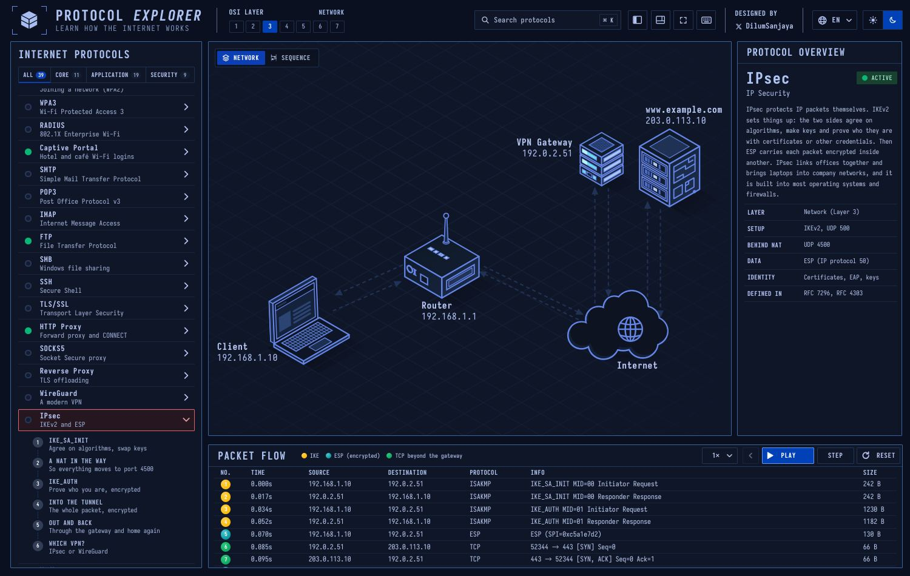
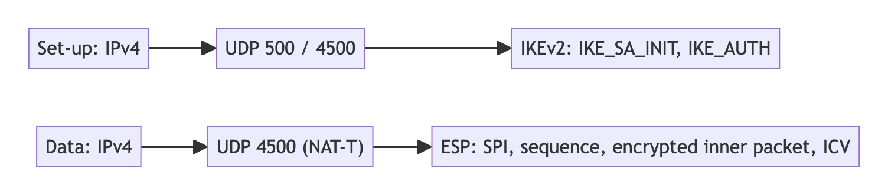
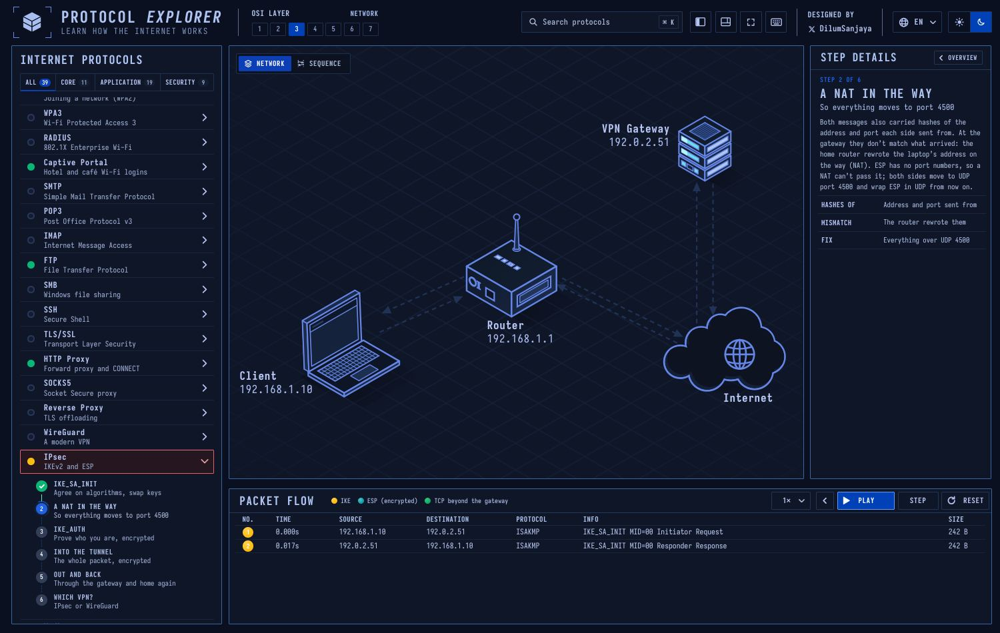
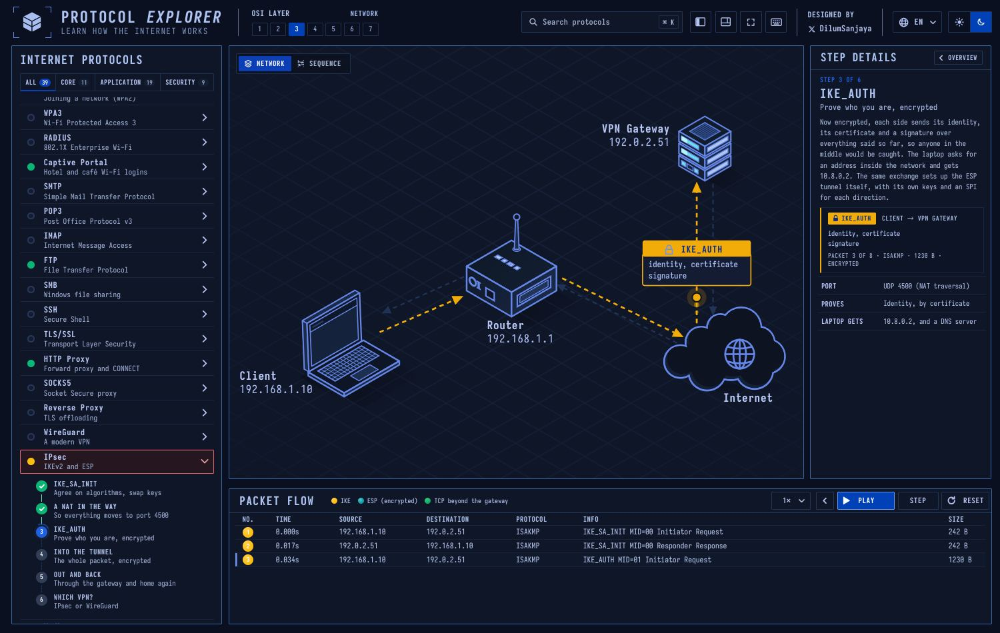
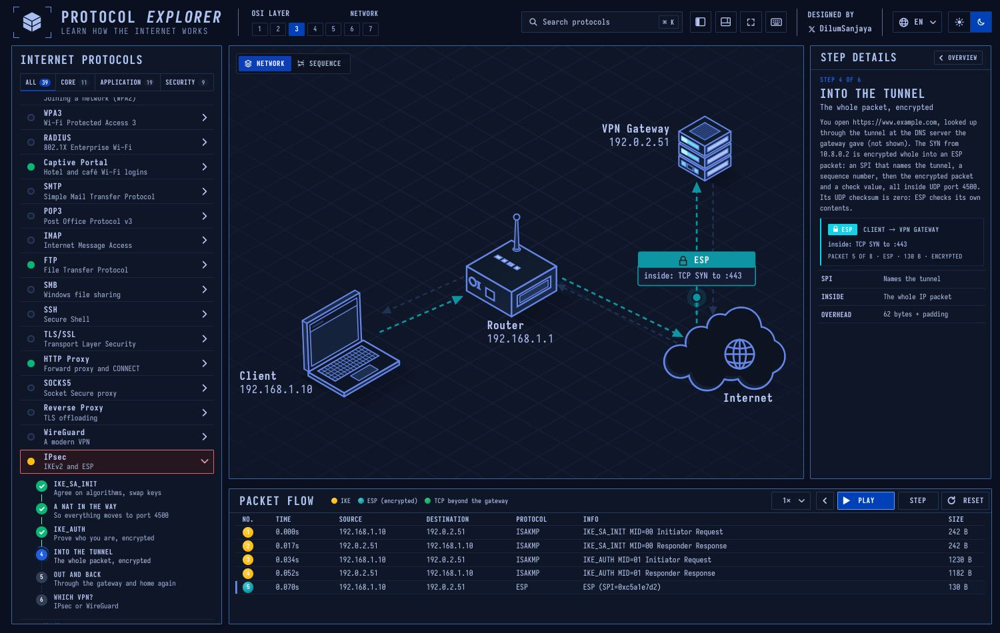
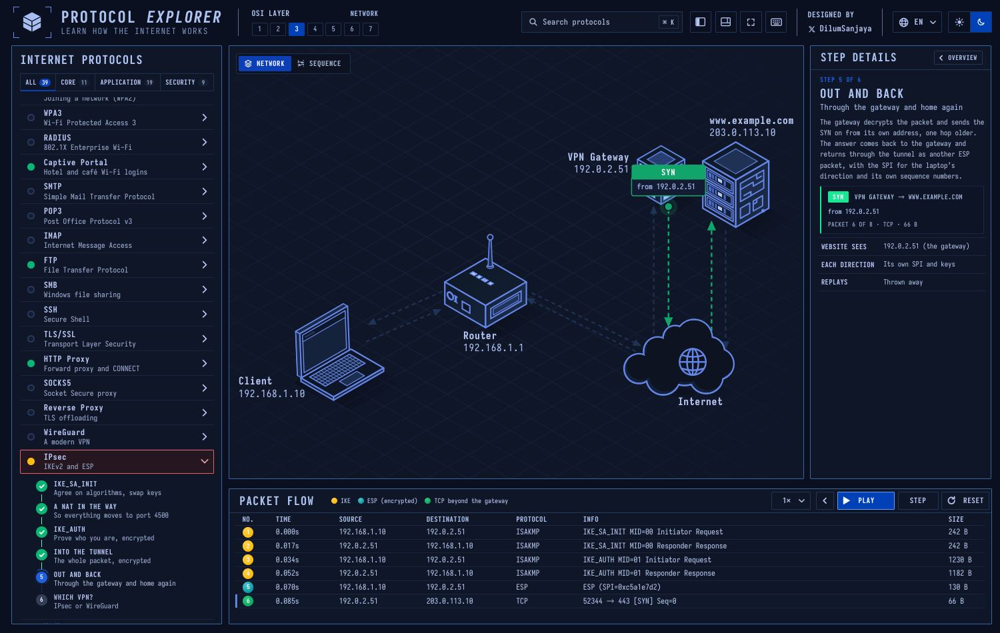
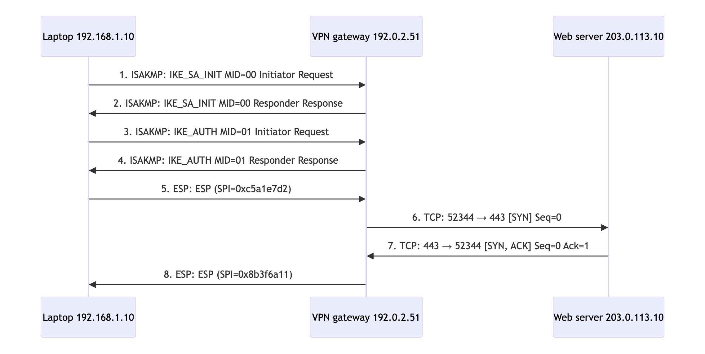
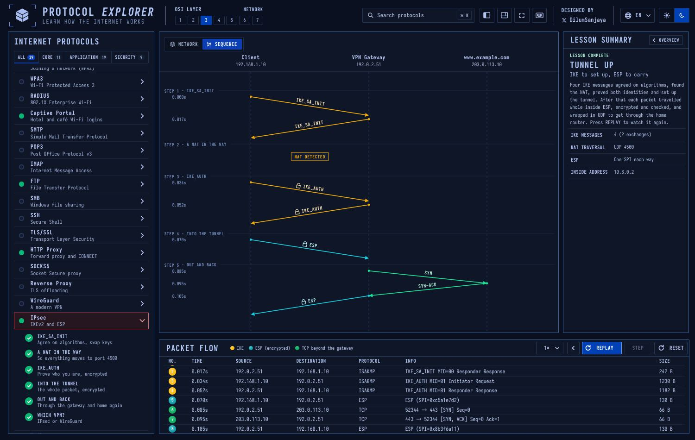
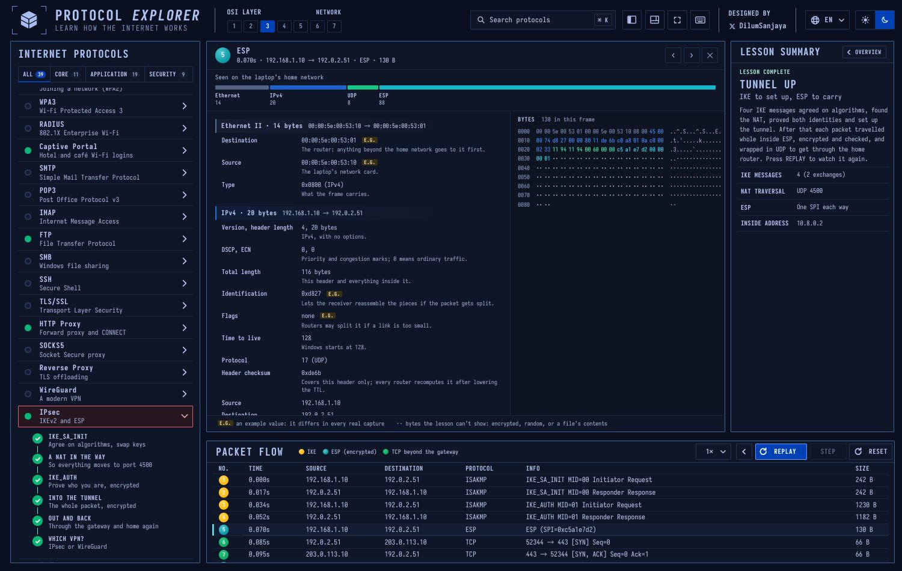
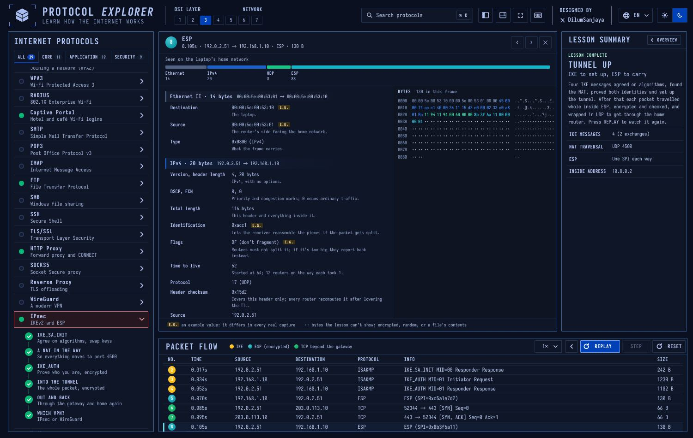

# IPsec – IKEv2 and ESP

<!-- nav -->
⬅ [37 WireGuard](37-wireguard.md) · [Index](00_Protocols_Index.md) · [39 Modbus](39-modbus.md) ➡
<!-- nav -->

*Source: Protocol Explorer – https://protocol-explorer-alpha.vercel.app/ (interactive lesson #38). Screenshots captured from the live lesson; packet decodes are the site's example capture (values marked **E.G.** differ in every real capture).*

## Overview

### How the layers fit together (outer to inner)

## In-depth explanation of the example (plain-language version)

### The big picture in one minute
A laptop (behind a home router) connects to a company **IPsec VPN gateway** (`192.0.2.51`) and then opens `https://www.example.com` **through the tunnel.** **8 packets:** **4 IKEv2 messages** that set everything up, and then **ESP** packets that carry the traffic. (Compare with WireGuard: same goal, but much older and more flexible.)

**What IPsec is.** A set of protocols that protects **IP packets themselves**, so it works for *any* application without changes. It has two parts:
- **IKEv2** (on UDP port **500**, or **4500** when a router is in the way): **negotiates** the methods, **checks identities** and **creates the keys.**
- **ESP** (the data part): carries each packet **encrypted and tamper-proof** inside another packet.
IPsec joins offices together (**site-to-site**) and connects laptops to company networks (**remote access**). It's built into Windows, macOS, iOS, Android, Linux and almost every firewall.

Think of **a security convoy**: first the two sides meet to agree on the route and verify each other's badges (IKE), and then every package travels in a locked, numbered, sealed box (ESP).

> **Words you'll see:** *SA (security association)* = the agreed methods and keys for one tunnel. *SPI* = a number that names a tunnel. *NAT* = a router swapping addresses. *Nonce* = a random number used once.

---

### Step 1 – First exchange: IKE_SA_INIT – packets 1, 2
Sent in clear on **UDP port 500**:
- **Laptop (initiator):** a list of **proposed methods** (e.g. AES-256-GCM encryption and a modern key-agreement group), **its half of the key agreement**, a **random number**, and some **NAT-detection** data.
- **Gateway (responder):** its **chosen method**, **its half of the key agreement**, its own random number and NAT-detection data.
Both sides now calculate a **shared secret** (never sent) and derive their keys. **Everything from here on is encrypted.**

### Step 2 – A router in the way: switch to port 4500
Both messages included **fingerprints of the addresses each side believed it was using.** At the gateway, the laptop's fingerprint **doesn't match**: the home router **rewrote the laptop's address.** ESP has no port numbers, so a router can't forward it properly. So both sides **switch to UDP port 4500** and **wrap the ESP packets inside UDP** (called **NAT-T**). Tiny keep-alive packets keep the router's mapping open.

### Step 3 – Login and tunnel set-up: IKE_AUTH – packets 3, 4
Now encrypted:
- Each side sends its **identity**, its **certificate** (or uses a shared key or a username/password), and a **signature over everything said so far.** Anyone who had tampered with the clear-text first messages (for instance to force weaker methods) would be caught here.
- The laptop asks for an **inner address** and the gateway gives it **`10.8.0.2`.**
- In the same exchange, the first **data tunnel** (a **Child SA**) is created: its methods, **which inner addresses may use it**, and a **tunnel number (SPI) for each direction.**
Result: a **control channel** (IKE SA) plus a **data tunnel** (Child SA), from **four IKE messages in total.**

### Step 4 – Into the tunnel – packet 5
You open the website. The first packet of that connection (a TCP SYN from `10.8.0.2`) is **encrypted whole, including its inner address header** (this is **tunnel mode**), and sent as an **ESP packet**: a tunnel number | a sequence number (stops replays) | an initialisation value | the **scrambled inner packet** | an **integrity check.** It travels over UDP 4500. Overhead is about 50–70 bytes per packet, so the maximum packet size is reduced. (*Transport mode*, used host to host, protects only the contents and keeps the original address header.)

### Step 5 – Out and back – packets 6 to 8
The gateway **unscrambles** the packet (finding the tunnel by its number, checking the sequence number and integrity), swaps in its own public address (NAT) and forwards it (packet 6). The reply returns to the gateway (7), which seals it in a new ESP packet for the laptop (8).

### Step 6 – Tunnel up
Four IKE messages agreed on the methods, found the router, proved both identities and built the tunnel. After that each packet travels whole inside ESP, encrypted and checked. Tunnels have **lifetimes** and are **rekeyed** automatically (with fresh key agreement for **forward secrecy**), and **dead-peer detection** removes broken tunnels.

---

### The 8 packets at a glance
| Packets | What | Why |
|---|---|---|
| 1–2 | IKE_SA_INIT | agree on methods, make keys, detect the router |
| 3–4 | IKE_AUTH | prove identities, get an inner address, build the tunnel |
| 5 | ESP packet with the SYN | first web packet, through the tunnel |
| 6–8 | gateway forwards, reply returns in ESP | out and back |

### IKEv2 vs ESP
| | IKEv2 | ESP |
|---|---|---|
| Job | control: negotiate, authenticate, make keys | data: encrypt and protect each packet |
| Travels over | UDP 500 / 4500 | IP protocol 50, or inside UDP 4500 |

### What to remember
- **SA = security association** (agreed methods + keys + number), named by its **SPI.** **Tunnel mode** encrypts the whole packet (used by VPNs).
- **Login options:** certificates, a pre-shared key, or EAP (username/password, SIM).
- **Strengths:** standard, everywhere, flexible, hardware-accelerated. **Weaknesses:** complexity (many options make mistakes easy) and the extra overhead of NAT-T.
- Compare: **WireGuard** (simple, fixed crypto), **OpenVPN / TLS VPNs**, **SSH tunnels**.

## Under the hood – technical details

- **Two parts.** **IKEv2** (RFC 7296) negotiates algorithms, authenticates and creates keys over UDP 500 (or 4500). **ESP** (RFC 4303, IP protocol 50) carries each protected packet. AH (protocol 51) only authenticates and is rarely used.
- **Security Association (SA).** The agreed algorithms, keys and an **SPI** (security parameter index) that names the tunnel. IKE has its own SA (the control channel); each *Child SA* is a data tunnel, with one SPI per direction.
- **IKE_SA_INIT.** In clear. The initiator sends its proposals (`SAi1`: for example AES-256-GCM, SHA-256, Curve25519), its Diffie-Hellman value (`KEi`), a nonce (`Ni`) and NAT-detection payloads. The responder replies with `SAr1`, `KEr`, `Nr` and its own NAT detection. Both derive `SKEYSEED` and from it the keys `SK_d`, `SK_ai`/`SK_ar`, `SK_ei`/`SK_er` and `SK_pi`/`SK_pr`. Everything after this is encrypted.
- **NAT detection.** Each side sends SHA-1 hashes of the (IP, port) it believes it uses. A mismatch proves a NAT rewrote an address. ESP has no ports, so a NAT cannot map it. Both sides therefore switch to **UDP 4500** and wrap ESP in UDP (**NAT-T**). IKE messages on 4500 get a 4-byte zero *non-ESP marker* so they can be told apart from ESP. 1-byte `0xFF` keep-alives hold the mapping open.
- **IKE_AUTH.** Each side sends its identity, its certificate (or uses a pre-shared key or EAP) and an **AUTH** payload, a signature over everything said so far. That catches any tampering with the clear-text first exchange (such as a forced downgrade). The same exchange assigns the laptop an inner address (`CP(CFG_REQUEST/REPLY)`) and creates the first Child SA with **traffic selectors** (which inner addresses may use the tunnel).
- **ESP packet.** `SPI | sequence number | IV | encrypted [inner packet + padding + pad length + next header] | ICV (integrity tag)`. The sequence number stops replays. Over NAT-T the UDP checksum is 0 because ESP authenticates its own content.
- **Modes.** *Tunnel mode* encrypts the whole original packet, including its IP header (VPNs). *Transport mode* protects only the payload (host to host).
- **Overhead.** About 50 to 70 bytes per packet, so the MTU and MSS are reduced.
- **Lifetimes and rekeying.** The IKE SA may last about a day, the Child SA about an hour or a volume of data. `CREATE_CHILD_SA` rekeys, with fresh Diffie-Hellman for **perfect forward secrecy**. *Dead Peer Detection* uses empty INFORMATIONAL messages.
- **Authentication options.** Certificates, pre-shared keys or EAP (username/password, SIM).
- **Strengths and weaknesses.** Standard, everywhere and hardware-accelerated; but complex (many options mean misconfiguration) and adds NAT-T overhead. Compare WireGuard, OpenVPN and SSH tunnels.

## Step-by-step walkthrough

### Step 1: IKE_SA_INIT – Agree on algorithms, swap keys

### Step 2: A NAT IN THE WAY – So everything moves to port 4500

### Step 3: IKE_AUTH – Prove who you are, encrypted

### Step 4: INTO THE TUNNEL – The whole packet, encrypted

### Step 5: OUT AND BACK – Through the gateway and home again

### Step 6: WHICH VPN? – IPsec or WireGuard

### Lesson summary

## Packet flow (whole lesson)

| No. | Time | Source | Destination | Protocol | Info | Size |
|---|---|---|---|---|---|---|
| 1 | 0.000s | 192.168.1.10 | 192.0.2.51 | ISAKMP | IKE_SA_INIT MID=00 Initiator Request | 242 B |
| 2 | 0.017s | 192.0.2.51 | 192.168.1.10 | ISAKMP | IKE_SA_INIT MID=00 Responder Response | 242 B |
| 3 | 0.034s | 192.168.1.10 | 192.0.2.51 | ISAKMP | IKE_AUTH MID=01 Initiator Request | 1230 B |
| 4 | 0.052s | 192.0.2.51 | 192.168.1.10 | ISAKMP | IKE_AUTH MID=01 Responder Response | 1182 B |
| 5 | 0.070s | 192.168.1.10 | 192.0.2.51 | ESP | ESP (SPI=0xc5a1e7d2) | 130 B |
| 6 | 0.085s | 192.0.2.51 | 203.0.113.10 | TCP | 52344 → 443 [SYN] Seq=0 | 66 B |
| 7 | 0.095s | 203.0.113.10 | 192.0.2.51 | TCP | 443 → 52344 [SYN, ACK] Seq=0 Ack=1 | 66 B |
| 8 | 0.105s | 192.0.2.51 | 192.168.1.10 | ESP | ESP (SPI=0x8b3f6a11) | 130 B |

### Sequence diagram

*The lesson's own sequence diagram:*

## Packet decoder screenshots

The lesson's decoder view for the first, middle and last packet: headers, field values and the raw hex bytes.

### Packet 1: ISAKMP – IKE_SA_INIT MID=00 Initiator Request

*192.168.1.10 → 192.0.2.51 · 242 B · t = 0.000s*

### Packet 5: ESP – ESP (SPI=0xc5a1e7d2)

*192.168.1.10 → 192.0.2.51 · 130 B · t = 0.070s*

### Packet 8: ESP – ESP (SPI=0x8b3f6a11)

*192.0.2.51 → 192.168.1.10 · 130 B · t = 0.105s*

---

<!-- nav -->
⬅ [37 WireGuard](37-wireguard.md) · [Index](00_Protocols_Index.md) · [39 Modbus](39-modbus.md) ➡
<!-- nav -->
