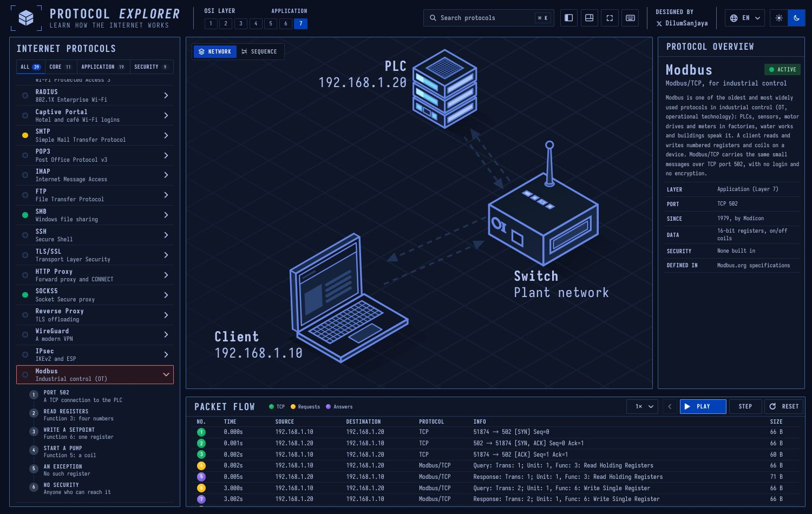
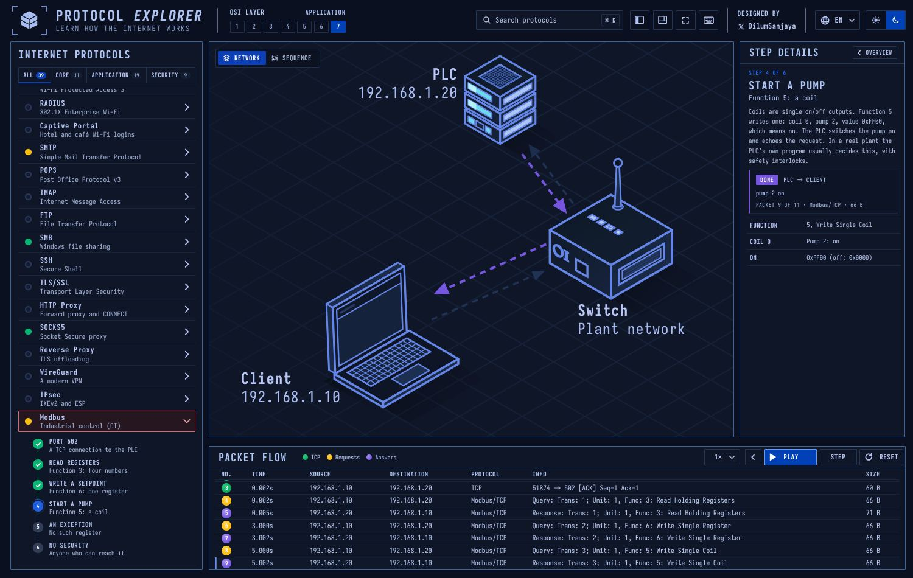
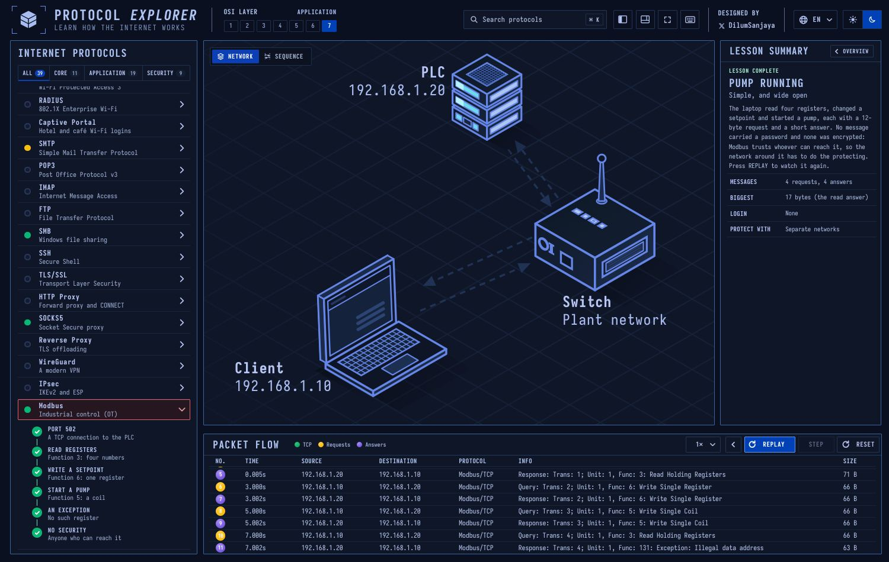
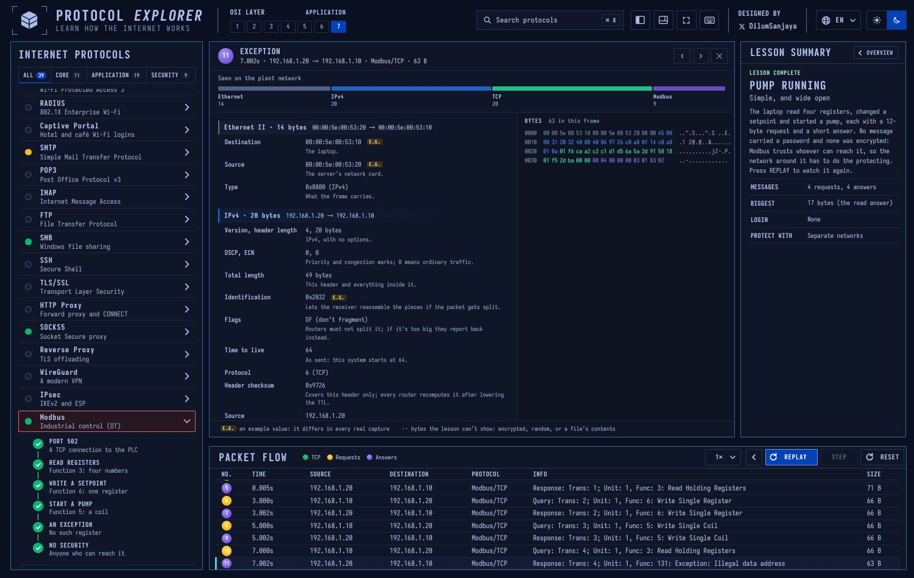

# Modbus – Industrial control (OT)

<!-- nav -->
⬅ [38 IPsec](38-ipsec.md) · [Index](00_Protocols_Index.md)
<!-- nav -->

*Source: Protocol Explorer – https://protocol-explorer-alpha.vercel.app/ (interactive lesson #39). Screenshots captured from the live lesson; packet decodes are the site's example capture (values marked **E.G.** differ in every real capture).*

## Overview



> PROTOCOL OVERVIEW  
> Modbus  
> ACTIVE  
> Modbus/TCP, for industrial control  
> Modbus is one of the oldest and most widely used protocols in industrial control (OT, operational technology): PLCs, sensors, motor drives and meters in factories, water works and buildings speak it. A client reads and writes numbered registers and coils on a device. Modbus/TCP carries the same small messages over TCP port 502, with no login and no encryption.  
> LAYER  
> Application (Layer 7)  
> PORT  
> TCP 502  
> SINCE  
> 1979, by Modicon  
> DATA  
> 16-bit registers, on/off coils  
> SECURITY  
> None built in  
> DEFINED IN  
> Modbus.org specifications  

## In-depth explanation of the example (plain-language version)

### The big picture in one minute
An engineer's laptop (the Modbus *client*) talks to a **PLC** (programmable logic controller, the *server*) that controls a **water tank and pumps.** **11 packets in 7 seconds:** connect, **read four values**, **change a target level**, **switch a pump on**, and one **request that fails** with an error.

**What Modbus is.** Created in **1979** for PLCs, it's one of the oldest and most widely used **industrial control** protocols. You find it in factories, water works, power stations, buildings, meters and motor drives. A client simply **reads and writes numbered values and switches** on a device. **Modbus/TCP** carries the same tiny messages over **TCP port 502**, with **no login and no encryption.**

Think of **a remote control with numbered buttons and displays**: "show me display 0 to 3", "set dial 3 to 500", "switch on button 0". The numbers mean something only if you've read the device's manual.

> **Words you'll see:** *PLC* = a small industrial computer that controls machines. *Register* = a 16-bit number slot. *Coil* = an on/off switch (1 bit). *Setpoint* = a target value, e.g. a desired tank level. *HMI* = the operator's display screen.

---

### The data model (what's inside the device)
| Object | Size | Access | Used for | Function codes |
|---|---|---|---|---|
| **Coils** | 1 bit | read/write | outputs: pumps, valves | 1 read, 5 write one, 15 write many |
| **Discrete inputs** | 1 bit | read only | switches, limit sensors | 2 |
| **Input registers** | 16 bit | read only | measurements | 4 |
| **Holding registers** | 16 bit | read/write | setpoints, settings | 3 read, 6 write one, 16 write many |
**The message carries only numbers.** What register 0 *means* ("tank level in cm") is written only in the device's manual. No names or units travel on the wire.

### What a Modbus/TCP message looks like
- **Header (7 bytes):** a **transaction ID** (matches replies to requests), a protocol ID (always 0), a **length**, and a **unit ID** (which device behind a gateway; here 1).
- **Then:** a **function code** (what to do) and the data. A read request is just 12 bytes.

### Step 1 – Connect – packets 1 to 3
A TCP handshake to **port 502**, only about 2 ms on a local network. Many devices accept just a few connections at once.

### Step 2 – Read four values – packets 4, 5
**Request:** function **3** (Read Holding Registers), **start at 0, read 4.** **Response:** a count of 8 bytes followed by **four 16-bit values** (e.g. tank level in centimetres, temperature in tenths of a degree). An operator screen asks like this every second or so. Values are **big-endian**; scaling (divide by 10, signed numbers, 32-bit values taking two registers) depends on the device.

### Step 3 – Change a setpoint – packets 6, 7
The engineer raises the tank's **target level from 4.50 m to 5.00 m**: function **6** (Write Single Register), **register 3**, **value 500** (5.00 m in centimetres). The PLC **repeats the request back** as its answer, which means "done." Its own control program now keeps the tank fuller.

### Step 4 – Start a pump – packets 8, 9
Function **5** (Write Single Coil), **coil 0 (pump 2)**, value **`0xFF00` = ON** (`0x0000` = off). The PLC switches the output on and **repeats the request back.** In a real plant the PLC program usually decides this, with **safety interlocks**; writing coils directly can bypass that logic if the device allows it.

### Step 5 – An error – packets 10, 11
A request for **registers 100–101**, which don't exist, gets an **exception response:** the function code with its **top bit set** (3 + 128 = `0x83`) followed by **exception code 2, "Illegal Data Address."** Other codes: **01** illegal function, **03** illegal value, **04** device failure, **06** device busy.

### Step 6 – Simple, and wide open
Each action was a **tiny request with a short answer.** **No message contained a password and none was encrypted.** Modbus **trusts anyone who can reach port 502.** Anyone on the network can read values, **change setpoints or flip switches.** There is no login, no permission check, no tamper detection and no replay protection.

---

### The 11 packets at a glance
| Packets | What | Why |
|---|---|---|
| 1–3 | TCP handshake (port 502) | connect |
| 4–5 | function 3, read 4 registers | read process values |
| 6–7 | function 6, write register 3 = 500 | change the setpoint |
| 8–9 | function 5, write coil 0 = ON | start pump 2 |
| 10–11 | read of registers 100–101, exception 2 | an invalid request fails |

### What to remember
- **Request/response, started by the client.** Function codes 1–6, 15 and 16 cover almost everything (plus 8 diagnostics, 43 device ID).
- **Variants:** **RTU** (binary over a serial line with a CRC), **ASCII**, **TCP** (the version here), and **Modbus/TCP Security** (with TLS, port 802), which is rarely used.
- **Security comes from the network around it:** keep industrial networks isolated, put **firewalls** between office and industrial networks, allow only expected function codes, use **VPNs** for remote access, **never expose port 502 to the internet** (search engines like Shodan find thousands that are), and watch for unexpected writes.
- Strengths: very easy to implement, open and universal. Weakness: designed in 1979 for isolated serial lines, long before cyber threats.

## Step-by-step walkthrough (screenshots from the lesson)

### Step 1: PORT 502 – A TCP connection to the PLC


> STEP 1 OF 6  
> PORT 502  
> A TCP connection to the PLC  
> A PLC (programmable logic controller) runs a small pumping station: it reads the sensors and switches the pumps. An engineer’s laptop on the plant network talks to it in Modbus/TCP, so it opens a TCP connection to port 502. In Modbus terms the laptop is the client and the PLC the server.  
> PLC  
> 192.168.1.20  
> PORT  
> TCP 502  
> ROLES  
> Client asks, server answers  

### Step 2: READ REGISTERS – Function 3: four numbers


> STEP 2 OF 6  
> READ REGISTERS  
> Function 3: four numbers  
> The laptop asks for 4 holding registers starting at address 0, with function code 3. The PLC answers with 8 bytes: four 16-bit numbers. What they mean (the tank level in centimetres, the temperature in tenths of a degree) is written only in the PLC’s documentation; the message carries no names and no units. An HMI screen sends reads like this every second or so.  
> VALUES  
> PLC → CLIENT  
> 412, 183, 1450, 450  
> PACKET 5 OF 11 · Modbus/TCP · 71 B  
> FUNCTION  
> 3, Read Holding Registers  
> ASKS FOR  
> 4 registers from 0  
> ANSWER  
> 412, 183, 1450, 450  

### Step 3: WRITE A SETPOINT – Function 6: one register


> STEP 3 OF 6  
> WRITE A SETPOINT  
> Function 6: one register  
> The engineer raises the tank’s level setpoint from 4.50 m to 5.00 m: function 6, write single register, register 3, value 500. The PLC answers by repeating the request, which means done. From now on its program keeps the tank fuller.  
> DONE  
> PLC → CLIENT  
> register 3 = 500  
> PACKET 7 OF 11 · Modbus/TCP · 66 B  
> FUNCTION  
> 6, Write Single Register  
> REGISTER 3  
> 450 → 500  
> ANSWER  
> The request, repeated  

### Step 4: START A PUMP – Function 5: a coil



> STEP 4 OF 6  
> START A PUMP  
> Function 5: a coil  
> Coils are single on/off outputs. Function 5 writes one: coil 0, pump 2, value 0xFF00, which means on. The PLC switches the pump on and echoes the request. In a real plant the PLC’s own program usually decides this, with safety interlocks.  
> DONE  
> PLC → CLIENT  
> pump 2 on  
> PACKET 9 OF 11 · Modbus/TCP · 66 B  
> FUNCTION  
> 5, Write Single Coil  
> COIL 0  
> Pump 2: on  
> ON  
> 0xFF00 (off: 0x0000)  

### Step 5: AN EXCEPTION – No such register


> STEP 5 OF 6  
> AN EXCEPTION  
> No such register  
> A request for registers that don’t exist, here 100 and 101, gets an exception: the function code with its top bit set (3 + 128 = 131) and exception code 2, illegal data address. Other codes say the function isn’t supported or the device is busy.  
> EXCEPTION  
> PLC → CLIENT  
> code 2: no such register  
> PACKET 11 OF 11 · Modbus/TCP · 63 B  
> FUNCTION  
> 131 (3 + 128)  
> EXCEPTION  
> 2, Illegal Data Address  
> MEANS  
> No register there  

### Step 6: NO SECURITY – Anyone who can reach it


> LESSON SUMMARY  
> LESSON COMPLETE  
> PUMP RUNNING  
> Simple, and wide open  
> The laptop read four registers, changed a setpoint and started a pump, each with a 12-byte request and a short answer. No message carried a password and none was encrypted: Modbus trusts whoever can reach it, so the network around it has to do the protecting. Press REPLAY to watch it again.  
> EXCEPTION  
> PLC → CLIENT  
> code 2: no such register  
> PACKET 11 OF 11 · Modbus/TCP · 63 B  
> MESSAGES  
> 4 requests, 4 answers  
> BIGGEST  
> 17 bytes (the read answer)  
> LOGIN  
> None  
> PROTECT WITH  
> Separate networks  

### Lesson summary



> LESSON SUMMARY  
> LESSON COMPLETE  
> PUMP RUNNING  
> Simple, and wide open  
> The laptop read four registers, changed a setpoint and started a pump, each with a 12-byte request and a short answer. No message carried a password and none was encrypted: Modbus trusts whoever can reach it, so the network around it has to do the protecting. Press REPLAY to watch it again.  
> EXCEPTION  
> PLC → CLIENT  
> code 2: no such register  
> PACKET 11 OF 11 · Modbus/TCP · 63 B  
> MESSAGES  
> 4 requests, 4 answers  
> BIGGEST  
> 17 bytes (the read answer)  
> LOGIN  
> None  
> PROTECT WITH  
> Separate networks  

## Packet flow (whole lesson)

| No. | Time | Source | Destination | Protocol | Info | Size |
|---|---|---|---|---|---|---|
| 1 | 0.000s | 192.168.1.10 | 192.168.1.20 | TCP | 51874 → 502 [SYN] Seq=0 | 66 B |
| 2 | 0.001s | 192.168.1.20 | 192.168.1.10 | TCP | 502 → 51874 [SYN, ACK] Seq=0 Ack=1 | 66 B |
| 3 | 0.002s | 192.168.1.10 | 192.168.1.20 | TCP | 51874 → 502 [ACK] Seq=1 Ack=1 | 60 B |
| 4 | 0.002s | 192.168.1.10 | 192.168.1.20 | Modbus/TCP | Query: Trans: 1; Unit: 1, Func: 3: Read Holding Registers | 66 B |
| 5 | 0.005s | 192.168.1.20 | 192.168.1.10 | Modbus/TCP | Response: Trans: 1; Unit: 1, Func: 3: Read Holding Registers | 71 B |
| 6 | 3.000s | 192.168.1.10 | 192.168.1.20 | Modbus/TCP | Query: Trans: 2; Unit: 1, Func: 6: Write Single Register | 66 B |
| 7 | 3.002s | 192.168.1.20 | 192.168.1.10 | Modbus/TCP | Response: Trans: 2; Unit: 1, Func: 6: Write Single Register | 66 B |
| 8 | 5.000s | 192.168.1.10 | 192.168.1.20 | Modbus/TCP | Query: Trans: 3; Unit: 1, Func: 5: Write Single Coil | 66 B |
| 9 | 5.002s | 192.168.1.20 | 192.168.1.10 | Modbus/TCP | Response: Trans: 3; Unit: 1, Func: 5: Write Single Coil | 66 B |
| 10 | 7.000s | 192.168.1.10 | 192.168.1.20 | Modbus/TCP | Query: Trans: 4; Unit: 1, Func: 3: Read Holding Registers | 66 B |
| 11 | 7.002s | 192.168.1.20 | 192.168.1.10 | Modbus/TCP | Response: Trans: 4; Unit: 1, Func: 131: Exception: Illegal data address | 63 B |

### Sequence diagram


## Packets decoded byte by byte

Each packet below is the lesson's own decode (headers, field values and the plain-English meaning of each field). Screenshots show the first, middle and last packet in the lesson's decoder view with the raw hex bytes.

### Packet 1: TCP – 51874 → 502 [SYN] Seq=0

*192.168.1.10 → 192.168.1.20 · 66 B · t = 0.000s*


<details><summary>Decoded fields</summary>

```text
1
SYN
0.000s · 192.168.1.10 → 192.168.1.20 · TCP · 66 B
Seen on the plant network
Ethernet
14
IPv4
20
TCP
32
Ethernet II · 14 bytes
00:00:5e:00:53:10 → 00:00:5e:00:53:20
Destination
00:00:5e:00:53:20 E.G.

The server. It is on the same network, so the frame goes straight to it, not through the router.

Source
00:00:5e:00:53:10 E.G.

The laptop’s network card.

Type
0x0800 (IPv4)

What the frame carries.

IPv4 · 20 bytes
192.168.1.10 → 192.168.1.20
Version, header length
4, 20 bytes

IPv4, with no options.

DSCP, ECN
0, 0

Priority and congestion marks; 0 means ordinary traffic.

Total length
52 bytes

This header and everything inside it.

Identification
0xd825 E.G.

Lets the receiver reassemble the pieces if the packet gets split.

Flags
DF (don’t fragment)

Routers must not split it; if it’s too big they report back instead.

Time to live
128

Windows starts at 128.

Protocol
6 (TCP)
Header checksum
0x9f2f

Covers this header only; every router recomputes it after lowering the TTL.

Source
192.168.1.10
Destination
192.168.1.20
TCP · 32 bytes
51874 → 502, SYN
Source port
51874

Picked by the laptop’s system for this connection.

Destination port
502
Sequence number
0 (relative)

This side’s starting number. Shown as 0; the real one is random.

Real sequence number
1784294752 E.G.
Acknowledgment
0 (not used yet)

A first SYN has nothing to acknowledge.

Header length
32 bytes

20 bytes, plus 12 of options.

Flags
0x002 (SYN)
Window
64240 E.G.

How much more data this side can take right now.

Checksum
0x8c5d

Covers the header, the data and the IP addresses, so damage is caught.

Urgent pointer
0
Options
12 bytes
Maximum segment size
1460 bytes

The most data this side wants in one segment.

No-op
1

Spacing, so the next option lines up.

Window scale
× 256

Window values are multiplied by this, so windows can be larger than 64 KB.

No-op
1

Spacing, so the next option lines up.

No-op
1

Spacing, so the next option lines up.

SACK permitted
yes

This side understands selective acknowledgements.

BYTES 66 in this frame
0000
00
00
5e
00
53
20
00
00
5e
00
53
10
08
00
45
00
.
.
^
.
S
.
.
^
.
S
.
.
.
E
.
0010
00
34
d8
25
40
00
80
06
9f
2f
c0
a8
01
0a
c0
a8
.
4
.
%
@
.
.
.
.
/
.
.
.
.
.
.
0020
01
14
ca
a2
01
f6
6a
5a
2d
60
00
00
00
00
80
02
.
.
.
.
.
.
j
Z
-
`
.
.
.
.
.
.
0030
fa
f0
8c
5d
00
00
02
04
05
b4
01
03
03
08
01
01
.
.
.
]
.
.
.
.
.
.
.
.
.
.
.
.
0040
04
02
.
.
E.G. an example value: it differs in every real capture
·· bytes the lesson can’t show: encrypted, random, or a file’s contents
```

</details>

### Packet 2: TCP – 502 → 51874 [SYN, ACK] Seq=0 Ack=1

*192.168.1.20 → 192.168.1.10 · 66 B · t = 0.001s*

<details><summary>Decoded fields</summary>

```text
2
SYN-ACK
0.001s · 192.168.1.20 → 192.168.1.10 · TCP · 66 B
Seen on the plant network
Ethernet
14
IPv4
20
TCP
32
Ethernet II · 14 bytes
00:00:5e:00:53:20 → 00:00:5e:00:53:10
Destination
00:00:5e:00:53:10 E.G.

The laptop.

Source
00:00:5e:00:53:20 E.G.

The server’s network card.

Type
0x0800 (IPv4)

What the frame carries.

IPv4 · 20 bytes
192.168.1.20 → 192.168.1.10
Version, header length
4, 20 bytes

IPv4, with no options.

DSCP, ECN
0, 0

Priority and congestion marks; 0 means ordinary traffic.

Total length
52 bytes

This header and everything inside it.

Identification
0x202e E.G.

Lets the receiver reassemble the pieces if the packet gets split.

Flags
DF (don’t fragment)

Routers must not split it; if it’s too big they report back instead.

Time to live
64

As sent: this system starts at 64.

Protocol
6 (TCP)
Header checksum
0x9727

Covers this header only; every router recomputes it after lowering the TTL.

Source
192.168.1.20
Destination
192.168.1.10
TCP · 32 bytes
502 → 51874, SYN, ACK
Source port
502
Destination port
51874
Sequence number
0 (relative)

This side’s starting number. Shown as 0; the real one is random.

Real sequence number
3267482027 E.G.
Acknowledgment
1 (relative)

The next byte this side expects: everything before it has arrived.

Header length
32 bytes

20 bytes, plus 12 of options.

Flags
0x012 (SYN, ACK)
Window
64240 E.G.

How much more data this side can take right now.

Checksum
0xf7df

Covers the header, the data and the IP addresses, so damage is caught.

Urgent pointer
0
Options
12 bytes
Maximum segment size
1460 bytes

The most data this side wants in one segment.

No-op
1

Spacing, so the next option lines up.

No-op
1

Spacing, so the next option lines up.

SACK permitted
yes

This side understands selective acknowledgements.

No-op
1

Spacing, so the next option lines up.

Window scale
× 128

Window values are multiplied by this, so windows can be larger than 64 KB.

BYTES 66 in this frame
0000
00
00
5e
00
53
10
00
00
5e
00
53
20
08
00
45
00
.
.
^
.
S
.
.
.
^
.
S
.
.
E
.
0010
00
34
20
2e
40
00
40
06
97
27
c0
a8
01
14
c0
a8
.
4
.
@
.
@
.
.
'
.
.
.
.
.
.
0020
01
0a
01
f6
ca
a2
c2
c1
d1
ab
6a
5a
2d
61
80
12
.
.
.
.
.
.
.
.
.
.
j
Z
-
a
.
.
0030
fa
f0
f7
df
00
00
02
04
05
b4
01
01
04
02
01
03
.
.
.
.
.
.
.
.
.
.
.
.
.
.
.
.
0040
03
07
.
.
E.G. an example value: it differs in every real capture
·· bytes the lesson can’t show: encrypted, random, or a file’s contents
```

</details>

### Packet 3: TCP – 51874 → 502 [ACK] Seq=1 Ack=1

*192.168.1.10 → 192.168.1.20 · 60 B · t = 0.002s*

<details><summary>Decoded fields</summary>

```text
3
ACK
0.002s · 192.168.1.10 → 192.168.1.20 · TCP · 60 B
Seen on the plant network
Ethernet
14
IPv4
20
TCP
20
Padding
6
Ethernet II · 14 bytes
00:00:5e:00:53:10 → 00:00:5e:00:53:20
Destination
00:00:5e:00:53:20 E.G.

The server. It is on the same network, so the frame goes straight to it, not through the router.

Source
00:00:5e:00:53:10 E.G.

The laptop’s network card.

Type
0x0800 (IPv4)

What the frame carries.

IPv4 · 20 bytes
192.168.1.10 → 192.168.1.20
Version, header length
4, 20 bytes

IPv4, with no options.

DSCP, ECN
0, 0

Priority and congestion marks; 0 means ordinary traffic.

Total length
40 bytes

This header and everything inside it.

Identification
0xd826 E.G.

Lets the receiver reassemble the pieces if the packet gets split.

Flags
DF (don’t fragment)

Routers must not split it; if it’s too big they report back instead.

Time to live
128

Windows starts at 128.

Protocol
6 (TCP)
Header checksum
0x9f3a

Covers this header only; every router recomputes it after lowering the TTL.

Source
192.168.1.10
Destination
192.168.1.20
TCP · 20 bytes
51874 → 502, ACK
Source port
51874

Picked by the laptop’s system for this connection.

Destination port
502
Sequence number
1 (relative)

Position of this segment’s first byte, counted from this side’s SYN.

Real sequence number
1784294753 E.G.
Acknowledgment
1 (relative)

The next byte this side expects: everything before it has arrived.

Header length
20 bytes
Flags
0x010 (ACK)
Window
1026 (× 256 = 262,656 bytes) E.G.

How much more data this side can take right now.

Checksum
0x2fa1

Covers the header, the data and the IP addresses, so damage is caught.

Urgent pointer
0
Ethernet padding · 6 bytes
Padding
6 zero bytes

Ethernet frames are at least 60 bytes (64 with the checksum the card adds), so short ones are padded.

BYTES 60 in this frame
0000
00
00
5e
00
53
20
00
00
5e
00
53
10
08
00
45
00
.
.
^
.
S
.
.
^
.
S
.
.
.
E
.
0010
00
28
d8
26
40
00
80
06
9f
3a
c0
a8
01
0a
c0
a8
.
(
.
&
@
.
.
.
.
:
.
.
.
.
.
.
0020
01
14
ca
a2
01
f6
6a
5a
2d
61
c2
c1
d1
ac
50
10
.
.
.
.
.
.
j
Z
-
a
.
.
.
.
P
.
0030
04
02
2f
a1
00
00
00
00
00
00
00
00
.
.
/
.
.
.
.
.
.
.
.
.
E.G. an example value: it differs in every real capture
·· bytes the lesson can’t show: encrypted, random, or a file’s contents
```

</details>

### Packet 4: Modbus/TCP – Query: Trans: 1; Unit: 1, Func: 3: Read Holding Registers

*192.168.1.10 → 192.168.1.20 · 66 B · t = 0.002s*

<details><summary>Decoded fields</summary>

```text
4
READ
0.002s · 192.168.1.10 → 192.168.1.20 · Modbus/TCP · 66 B
Seen on the plant network
Ethernet
14
IPv4
20
TCP
20
Modbus
12
Ethernet II · 14 bytes
00:00:5e:00:53:10 → 00:00:5e:00:53:20
Destination
00:00:5e:00:53:20 E.G.

The server. It is on the same network, so the frame goes straight to it, not through the router.

Source
00:00:5e:00:53:10 E.G.

The laptop’s network card.

Type
0x0800 (IPv4)

What the frame carries.

IPv4 · 20 bytes
192.168.1.10 → 192.168.1.20
Version, header length
4, 20 bytes

IPv4, with no options.

DSCP, ECN
0, 0

Priority and congestion marks; 0 means ordinary traffic.

Total length
52 bytes

This header and everything inside it.

Identification
0xd827 E.G.

Lets the receiver reassemble the pieces if the packet gets split.

Flags
DF (don’t fragment)

Routers must not split it; if it’s too big they report back instead.

Time to live
128

Windows starts at 128.

Protocol
6 (TCP)
Header checksum
0x9f2d

Covers this header only; every router recomputes it after lowering the TTL.

Source
192.168.1.10
Destination
192.168.1.20
TCP · 20 bytes
51874 → 502, PSH, ACK
Source port
51874

Picked by the laptop’s system for this connection.

Destination port
502
Sequence number
1 (relative)

Position of this segment’s first byte, counted from this side’s SYN.

Real sequence number
1784294753 E.G.
Acknowledgment
1 (relative)

The next byte this side expects: everything before it has arrived.

Header length
20 bytes
Flags
0x018 (PSH, ACK)
Window
1026 (× 256 = 262,656 bytes) E.G.

How much more data this side can take right now.

Checksum
0x2e7f

Covers the header, the data and the IP addresses, so damage is caught.

Urgent pointer
0
Modbus/TCP · Read Holding Registers
Transaction ID
1 E.G.

Picked by the client; the answer carries the same number.

Protocol ID
0 (Modbus)
Length
6 bytes

The unit ID and everything after it.

Unit ID
1

Which device. It matters when a gateway passes requests on to devices on a serial line.

Function code
3 (Read Holding Registers)
Starting address
0 (register 40001)

Modbus counts from 0, though manuals often number the same register 40001 and up.

Quantity
4 registers
BYTES 66 in this frame
0000
00
00
5e
00
53
20
00
00
5e
00
53
10
08
00
45
00
.
.
^
.
S
.
.
^
.
S
.
.
.
E
.
0010
00
34
d8
27
40
00
80
06
9f
2d
c0
a8
01
0a
c0
a8
.
4
.
'
@
.
.
.
.
-
.
.
.
.
.
.
0020
01
14
ca
a2
01
f6
6a
5a
2d
61
c2
c1
d1
ac
50
18
.
.
.
.
.
.
j
Z
-
a
.
.
.
.
P
.
0030
04
02
2e
7f
00
00
00
01
00
00
00
06
01
03
00
00
.
.
.
.
.
.
.
.
.
.
.
.
.
.
.
.
0040
00
04
.
.
E.G. an example value: it differs in every real capture
·· bytes the lesson can’t show: encrypted, random, or a file’s contents
```

</details>

### Packet 5: Modbus/TCP – Response: Trans: 1; Unit: 1, Func: 3: Read Holding Registers

*192.168.1.20 → 192.168.1.10 · 71 B · t = 0.005s*

<details><summary>Decoded fields</summary>

```text
5
VALUES
0.005s · 192.168.1.20 → 192.168.1.10 · Modbus/TCP · 71 B
Seen on the plant network
Ethernet
14
IPv4
20
TCP
20
Modbus
17
Ethernet II · 14 bytes
00:00:5e:00:53:20 → 00:00:5e:00:53:10
Destination
00:00:5e:00:53:10 E.G.

The laptop.

Source
00:00:5e:00:53:20 E.G.

The server’s network card.

Type
0x0800 (IPv4)

What the frame carries.

IPv4 · 20 bytes
192.168.1.20 → 192.168.1.10
Version, header length
4, 20 bytes

IPv4, with no options.

DSCP, ECN
0, 0

Priority and congestion marks; 0 means ordinary traffic.

Total length
57 bytes

This header and everything inside it.

Identification
0x202f E.G.

Lets the receiver reassemble the pieces if the packet gets split.

Flags
DF (don’t fragment)

Routers must not split it; if it’s too big they report back instead.

Time to live
64

As sent: this system starts at 64.

Protocol
6 (TCP)
Header checksum
0x9721

Covers this header only; every router recomputes it after lowering the TTL.

Source
192.168.1.20
Destination
192.168.1.10
TCP · 20 bytes
502 → 51874, PSH, ACK
Source port
502
Destination port
51874
Sequence number
1 (relative)

Position of this segment’s first byte, counted from this side’s SYN.

Real sequence number
3267482028 E.G.
Acknowledgment
13 (relative)

The next byte this side expects: everything before it has arrived.

Header length
20 bytes
Flags
0x018 (PSH, ACK)
Window
501 (× 128 = 64,128 bytes) E.G.

How much more data this side can take right now.

Checksum
0x6970

Covers the header, the data and the IP addresses, so damage is caught.

Urgent pointer
0
Modbus/TCP · Read Holding Registers, answer
Transaction ID
1 E.G.

The same number as the request.

Protocol ID
0 (Modbus)
Length
11 bytes

The unit ID and everything after it.

Unit ID
1

Which device. It matters when a gateway passes requests on to devices on a serial line.

Function code
3 (Read Holding Registers)
Byte count
8
Register 0
412 (tank level, 4.12 m)

Plain 16-bit numbers. What each one means is written in the PLC’s documentation, not in the message.

Register 1
183 (temperature, 18.3 °C)
Register 2
1450 (pump speed, 1,450 rpm)
Register 3
450 (level setpoint, 4.50 m)
BYTES 71 in this frame
0000
00
00
5e
00
53
10
00
00
5e
00
53
20
08
00
45
00
.
.
^
.
S
.
.
.
^
.
S
.
.
E
.
0010
00
39
20
2f
40
00
40
06
97
21
c0
a8
01
14
c0
a8
.
9
/
@
.
@
.
.
!
.
.
.
.
.
.
0020
01
0a
01
f6
ca
a2
c2
c1
d1
ac
6a
5a
2d
6d
50
18
.
.
.
.
.
.
.
.
.
.
j
Z
-
m
P
.
0030
01
f5
69
70
00
00
00
01
00
00
00
0b
01
03
08
01
.
.
i
p
.
.
.
.
.
.
.
.
.
.
.
.
0040
9c
00
b7
05
aa
01
c2
.
.
.
.
.
.
.
E.G. an example value: it differs in every real capture
·· bytes the lesson can’t show: encrypted, random, or a file’s contents
```

</details>

### Packet 6: Modbus/TCP – Query: Trans: 2; Unit: 1, Func: 6: Write Single Register

*192.168.1.10 → 192.168.1.20 · 66 B · t = 3.000s*


<details><summary>Decoded fields</summary>

```text
6
WRITE
3.000s · 192.168.1.10 → 192.168.1.20 · Modbus/TCP · 66 B
Seen on the plant network
Ethernet
14
IPv4
20
TCP
20
Modbus
12
Ethernet II · 14 bytes
00:00:5e:00:53:10 → 00:00:5e:00:53:20
Destination
00:00:5e:00:53:20 E.G.

The server. It is on the same network, so the frame goes straight to it, not through the router.

Source
00:00:5e:00:53:10 E.G.

The laptop’s network card.

Type
0x0800 (IPv4)

What the frame carries.

IPv4 · 20 bytes
192.168.1.10 → 192.168.1.20
Version, header length
4, 20 bytes

IPv4, with no options.

DSCP, ECN
0, 0

Priority and congestion marks; 0 means ordinary traffic.

Total length
52 bytes

This header and everything inside it.

Identification
0xd828 E.G.

Lets the receiver reassemble the pieces if the packet gets split.

Flags
DF (don’t fragment)

Routers must not split it; if it’s too big they report back instead.

Time to live
128

Windows starts at 128.

Protocol
6 (TCP)
Header checksum
0x9f2c

Covers this header only; every router recomputes it after lowering the TTL.

Source
192.168.1.10
Destination
192.168.1.20
TCP · 20 bytes
51874 → 502, PSH, ACK
Source port
51874

Picked by the laptop’s system for this connection.

Destination port
502
Sequence number
13 (relative)

Position of this segment’s first byte, counted from this side’s SYN.

Real sequence number
1784294765 E.G.
Acknowledgment
18 (relative)

The next byte this side expects: everything before it has arrived.

Header length
20 bytes
Flags
0x018 (PSH, ACK)
Window
1026 (× 256 = 262,656 bytes) E.G.

How much more data this side can take right now.

Checksum
0x2c6b

Covers the header, the data and the IP addresses, so damage is caught.

Urgent pointer
0
Modbus/TCP · Write Single Register
Transaction ID
2 E.G.

Picked by the client; the answer carries the same number.

Protocol ID
0 (Modbus)
Length
6 bytes

The unit ID and everything after it.

Unit ID
1

Which device. It matters when a gateway passes requests on to devices on a serial line.

Function code
6 (Write Single Register)
Register address
3 (level setpoint)
Value
500 (5.00 m)
BYTES 66 in this frame
0000
00
00
5e
00
53
20
00
00
5e
00
53
10
08
00
45
00
.
.
^
.
S
.
.
^
.
S
.
.
.
E
.
0010
00
34
d8
28
40
00
80
06
9f
2c
c0
a8
01
0a
c0
a8
.
4
.
(
@
.
.
.
.
,
.
.
.
.
.
.
0020
01
14
ca
a2
01
f6
6a
5a
2d
6d
c2
c1
d1
bd
50
18
.
.
.
.
.
.
j
Z
-
m
.
.
.
.
P
.
0030
04
02
2c
6b
00
00
00
02
00
00
00
06
01
06
00
03
.
.
,
k
.
.
.
.
.
.
.
.
.
.
.
.
0040
01
f4
.
.
E.G. an example value: it differs in every real capture
·· bytes the lesson can’t show: encrypted, random, or a file’s contents
```

</details>

### Packet 7: Modbus/TCP – Response: Trans: 2; Unit: 1, Func: 6: Write Single Register

*192.168.1.20 → 192.168.1.10 · 66 B · t = 3.002s*

<details><summary>Decoded fields</summary>

```text
7
DONE
3.002s · 192.168.1.20 → 192.168.1.10 · Modbus/TCP · 66 B
Seen on the plant network
Ethernet
14
IPv4
20
TCP
20
Modbus
12
Ethernet II · 14 bytes
00:00:5e:00:53:20 → 00:00:5e:00:53:10
Destination
00:00:5e:00:53:10 E.G.

The laptop.

Source
00:00:5e:00:53:20 E.G.

The server’s network card.

Type
0x0800 (IPv4)

What the frame carries.

IPv4 · 20 bytes
192.168.1.20 → 192.168.1.10
Version, header length
4, 20 bytes

IPv4, with no options.

DSCP, ECN
0, 0

Priority and congestion marks; 0 means ordinary traffic.

Total length
52 bytes

This header and everything inside it.

Identification
0x2030 E.G.

Lets the receiver reassemble the pieces if the packet gets split.

Flags
DF (don’t fragment)

Routers must not split it; if it’s too big they report back instead.

Time to live
64

As sent: this system starts at 64.

Protocol
6 (TCP)
Header checksum
0x9725

Covers this header only; every router recomputes it after lowering the TTL.

Source
192.168.1.20
Destination
192.168.1.10
TCP · 20 bytes
502 → 51874, PSH, ACK
Source port
502
Destination port
51874
Sequence number
18 (relative)

Position of this segment’s first byte, counted from this side’s SYN.

Real sequence number
3267482045 E.G.
Acknowledgment
25 (relative)

The next byte this side expects: everything before it has arrived.

Header length
20 bytes
Flags
0x018 (PSH, ACK)
Window
501 (× 128 = 64,128 bytes) E.G.

How much more data this side can take right now.

Checksum
0x2e6c

Covers the header, the data and the IP addresses, so damage is caught.

Urgent pointer
0
Modbus/TCP · Write Single Register, answer
Transaction ID
2 E.G.

The same number as the request.

Protocol ID
0 (Modbus)
Length
6 bytes

The unit ID and everything after it.

Unit ID
1

Which device. It matters when a gateway passes requests on to devices on a serial line.

Function code
6 (Write Single Register)
Register address
3 (level setpoint)
Value
500 (5.00 m)

The answer repeats the request: done.

BYTES 66 in this frame
0000
00
00
5e
00
53
10
00
00
5e
00
53
20
08
00
45
00
.
.
^
.
S
.
.
.
^
.
S
.
.
E
.
0010
00
34
20
30
40
00
40
06
97
25
c0
a8
01
14
c0
a8
.
4
0
@
.
@
.
.
%
.
.
.
.
.
.
0020
01
0a
01
f6
ca
a2
c2
c1
d1
bd
6a
5a
2d
79
50
18
.
.
.
.
.
.
.
.
.
.
j
Z
-
y
P
.
0030
01
f5
2e
6c
00
00
00
02
00
00
00
06
01
06
00
03
.
.
.
l
.
.
.
.
.
.
.
.
.
.
.
.
0040
01
f4
.
.
E.G. an example value: it differs in every real capture
·· bytes the lesson can’t show: encrypted, random, or a file’s contents
```

</details>

### Packet 8: Modbus/TCP – Query: Trans: 3; Unit: 1, Func: 5: Write Single Coil

*192.168.1.10 → 192.168.1.20 · 66 B · t = 5.000s*

<details><summary>Decoded fields</summary>

```text
8
COIL ON
5.000s · 192.168.1.10 → 192.168.1.20 · Modbus/TCP · 66 B
Seen on the plant network
Ethernet
14
IPv4
20
TCP
20
Modbus
12
Ethernet II · 14 bytes
00:00:5e:00:53:10 → 00:00:5e:00:53:20
Destination
00:00:5e:00:53:20 E.G.

The server. It is on the same network, so the frame goes straight to it, not through the router.

Source
00:00:5e:00:53:10 E.G.

The laptop’s network card.

Type
0x0800 (IPv4)

What the frame carries.

IPv4 · 20 bytes
192.168.1.10 → 192.168.1.20
Version, header length
4, 20 bytes

IPv4, with no options.

DSCP, ECN
0, 0

Priority and congestion marks; 0 means ordinary traffic.

Total length
52 bytes

This header and everything inside it.

Identification
0xd829 E.G.

Lets the receiver reassemble the pieces if the packet gets split.

Flags
DF (don’t fragment)

Routers must not split it; if it’s too big they report back instead.

Time to live
128

Windows starts at 128.

Protocol
6 (TCP)
Header checksum
0x9f2b

Covers this header only; every router recomputes it after lowering the TTL.

Source
192.168.1.10
Destination
192.168.1.20
TCP · 20 bytes
51874 → 502, PSH, ACK
Source port
51874

Picked by the laptop’s system for this connection.

Destination port
502
Sequence number
25 (relative)

Position of this segment’s first byte, counted from this side’s SYN.

Real sequence number
1784294777 E.G.
Acknowledgment
30 (relative)

The next byte this side expects: everything before it has arrived.

Header length
20 bytes
Flags
0x018 (PSH, ACK)
Window
1026 (× 256 = 262,656 bytes) E.G.

How much more data this side can take right now.

Checksum
0x2f49

Covers the header, the data and the IP addresses, so damage is caught.

Urgent pointer
0
Modbus/TCP · Write Single Coil
Transaction ID
3 E.G.

Picked by the client; the answer carries the same number.

Protocol ID
0 (Modbus)
Length
6 bytes

The unit ID and everything after it.

Unit ID
1

Which device. It matters when a gateway passes requests on to devices on a serial line.

Function code
5 (Write Single Coil)
Coil address
0 (pump 2)
Value
0xFF00 (on)

A coil is a single on/off output. 0xFF00 switches it on.

BYTES 66 in this frame
0000
00
00
5e
00
53
20
00
00
5e
00
53
10
08
00
45
00
.
.
^
.
S
.
.
^
.
S
.
.
.
E
.
0010
00
34
d8
29
40
00
80
06
9f
2b
c0
a8
01
0a
c0
a8
.
4
.
)
@
.
.
.
.
+
.
.
.
.
.
.
0020
01
14
ca
a2
01
f6
6a
5a
2d
79
c2
c1
d1
c9
50
18
.
.
.
.
.
.
j
Z
-
y
.
.
.
.
P
.
0030
04
02
2f
49
00
00
00
03
00
00
00
06
01
05
00
00
.
.
/
I
.
.
.
.
.
.
.
.
.
.
.
.
0040
ff
00
.
.
E.G. an example value: it differs in every real capture
·· bytes the lesson can’t show: encrypted, random, or a file’s contents
```

</details>

### Packet 9: Modbus/TCP – Response: Trans: 3; Unit: 1, Func: 5: Write Single Coil

*192.168.1.20 → 192.168.1.10 · 66 B · t = 5.002s*

<details><summary>Decoded fields</summary>

```text
9
DONE
5.002s · 192.168.1.20 → 192.168.1.10 · Modbus/TCP · 66 B
Seen on the plant network
Ethernet
14
IPv4
20
TCP
20
Modbus
12
Ethernet II · 14 bytes
00:00:5e:00:53:20 → 00:00:5e:00:53:10
Destination
00:00:5e:00:53:10 E.G.

The laptop.

Source
00:00:5e:00:53:20 E.G.

The server’s network card.

Type
0x0800 (IPv4)

What the frame carries.

IPv4 · 20 bytes
192.168.1.20 → 192.168.1.10
Version, header length
4, 20 bytes

IPv4, with no options.

DSCP, ECN
0, 0

Priority and congestion marks; 0 means ordinary traffic.

Total length
52 bytes

This header and everything inside it.

Identification
0x2031 E.G.

Lets the receiver reassemble the pieces if the packet gets split.

Flags
DF (don’t fragment)

Routers must not split it; if it’s too big they report back instead.

Time to live
64

As sent: this system starts at 64.

Protocol
6 (TCP)
Header checksum
0x9724

Covers this header only; every router recomputes it after lowering the TTL.

Source
192.168.1.20
Destination
192.168.1.10
TCP · 20 bytes
502 → 51874, PSH, ACK
Source port
502
Destination port
51874
Sequence number
30 (relative)

Position of this segment’s first byte, counted from this side’s SYN.

Real sequence number
3267482057 E.G.
Acknowledgment
37 (relative)

The next byte this side expects: everything before it has arrived.

Header length
20 bytes
Flags
0x018 (PSH, ACK)
Window
501 (× 128 = 64,128 bytes) E.G.

How much more data this side can take right now.

Checksum
0x314a

Covers the header, the data and the IP addresses, so damage is caught.

Urgent pointer
0
Modbus/TCP · Write Single Coil, answer
Transaction ID
3 E.G.

The same number as the request.

Protocol ID
0 (Modbus)
Length
6 bytes

The unit ID and everything after it.

Unit ID
1

Which device. It matters when a gateway passes requests on to devices on a serial line.

Function code
5 (Write Single Coil)
Coil address
0 (pump 2)
Value
0xFF00 (on)

The answer repeats the request: done.

BYTES 66 in this frame
0000
00
00
5e
00
53
10
00
00
5e
00
53
20
08
00
45
00
.
.
^
.
S
.
.
.
^
.
S
.
.
E
.
0010
00
34
20
31
40
00
40
06
97
24
c0
a8
01
14
c0
a8
.
4
1
@
.
@
.
.
$
.
.
.
.
.
.
0020
01
0a
01
f6
ca
a2
c2
c1
d1
c9
6a
5a
2d
85
50
18
.
.
.
.
.
.
.
.
.
.
j
Z
-
.
P
.
0030
01
f5
31
4a
00
00
00
03
00
00
00
06
01
05
00
00
.
.
1
J
.
.
.
.
.
.
.
.
.
.
.
.
0040
ff
00
.
.
E.G. an example value: it differs in every real capture
·· bytes the lesson can’t show: encrypted, random, or a file’s contents
```

</details>

### Packet 10: Modbus/TCP – Query: Trans: 4; Unit: 1, Func: 3: Read Holding Registers

*192.168.1.10 → 192.168.1.20 · 66 B · t = 7.000s*

<details><summary>Decoded fields</summary>

```text
10
READ
7.000s · 192.168.1.10 → 192.168.1.20 · Modbus/TCP · 66 B
Seen on the plant network
Ethernet
14
IPv4
20
TCP
20
Modbus
12
Ethernet II · 14 bytes
00:00:5e:00:53:10 → 00:00:5e:00:53:20
Destination
00:00:5e:00:53:20 E.G.

The server. It is on the same network, so the frame goes straight to it, not through the router.

Source
00:00:5e:00:53:10 E.G.

The laptop’s network card.

Type
0x0800 (IPv4)

What the frame carries.

IPv4 · 20 bytes
192.168.1.10 → 192.168.1.20
Version, header length
4, 20 bytes

IPv4, with no options.

DSCP, ECN
0, 0

Priority and congestion marks; 0 means ordinary traffic.

Total length
52 bytes

This header and everything inside it.

Identification
0xd82a E.G.

Lets the receiver reassemble the pieces if the packet gets split.

Flags
DF (don’t fragment)

Routers must not split it; if it’s too big they report back instead.

Time to live
128

Windows starts at 128.

Protocol
6 (TCP)
Header checksum
0x9f2a

Covers this header only; every router recomputes it after lowering the TTL.

Source
192.168.1.10
Destination
192.168.1.20
TCP · 20 bytes
51874 → 502, PSH, ACK
Source port
51874

Picked by the laptop’s system for this connection.

Destination port
502
Sequence number
37 (relative)

Position of this segment’s first byte, counted from this side’s SYN.

Real sequence number
1784294789 E.G.
Acknowledgment
42 (relative)

The next byte this side expects: everything before it has arrived.

Header length
20 bytes
Flags
0x018 (PSH, ACK)
Window
1026 (× 256 = 262,656 bytes) E.G.

How much more data this side can take right now.

Checksum
0x2dcd

Covers the header, the data and the IP addresses, so damage is caught.

Urgent pointer
0
Modbus/TCP · Read Holding Registers
Transaction ID
4 E.G.

Picked by the client; the answer carries the same number.

Protocol ID
0 (Modbus)
Length
6 bytes

The unit ID and everything after it.

Unit ID
1

Which device. It matters when a gateway passes requests on to devices on a serial line.

Function code
3 (Read Holding Registers)
Starting address
100 (register 40101)

Modbus counts from 0, though manuals often number the same register 40001 and up.

Quantity
2 registers
BYTES 66 in this frame
0000
00
00
5e
00
53
20
00
00
5e
00
53
10
08
00
45
00
.
.
^
.
S
.
.
^
.
S
.
.
.
E
.
0010
00
34
d8
2a
40
00
80
06
9f
2a
c0
a8
01
0a
c0
a8
.
4
.
*
@
.
.
.
.
*
.
.
.
.
.
.
0020
01
14
ca
a2
01
f6
6a
5a
2d
85
c2
c1
d1
d5
50
18
.
.
.
.
.
.
j
Z
-
.
.
.
.
.
P
.
0030
04
02
2d
cd
00
00
00
04
00
00
00
06
01
03
00
64
.
.
-
.
.
.
.
.
.
.
.
.
.
.
.
d
0040
00
02
.
.
E.G. an example value: it differs in every real capture
·· bytes the lesson can’t show: encrypted, random, or a file’s contents
```

</details>

### Packet 11: Modbus/TCP – Response: Trans: 4; Unit: 1, Func: 131: Exception: Illegal data address

*192.168.1.20 → 192.168.1.10 · 63 B · t = 7.002s*



<details><summary>Decoded fields</summary>

```text
11
EXCEPTION
7.002s · 192.168.1.20 → 192.168.1.10 · Modbus/TCP · 63 B
Seen on the plant network
Ethernet
14
IPv4
20
TCP
20
Modbus
9
Ethernet II · 14 bytes
00:00:5e:00:53:20 → 00:00:5e:00:53:10
Destination
00:00:5e:00:53:10 E.G.

The laptop.

Source
00:00:5e:00:53:20 E.G.

The server’s network card.

Type
0x0800 (IPv4)

What the frame carries.

IPv4 · 20 bytes
192.168.1.20 → 192.168.1.10
Version, header length
4, 20 bytes

IPv4, with no options.

DSCP, ECN
0, 0

Priority and congestion marks; 0 means ordinary traffic.

Total length
49 bytes

This header and everything inside it.

Identification
0x2032 E.G.

Lets the receiver reassemble the pieces if the packet gets split.

Flags
DF (don’t fragment)

Routers must not split it; if it’s too big they report back instead.

Time to live
64

As sent: this system starts at 64.

Protocol
6 (TCP)
Header checksum
0x9726

Covers this header only; every router recomputes it after lowering the TTL.

Source
192.168.1.20
Destination
192.168.1.10
TCP · 20 bytes
502 → 51874, PSH, ACK
Source port
502
Destination port
51874
Sequence number
42 (relative)

Position of this segment’s first byte, counted from this side’s SYN.

Real sequence number
3267482069 E.G.
Acknowledgment
49 (relative)

The next byte this side expects: everything before it has arrived.

Header length
20 bytes
Flags
0x018 (PSH, ACK)
Window
501 (× 128 = 64,128 bytes) E.G.

How much more data this side can take right now.

Checksum
0x2dba

Covers the header, the data and the IP addresses, so damage is caught.

Urgent pointer
0
Modbus/TCP · exception
Transaction ID
4 E.G.

The same number as the request.

Protocol ID
0 (Modbus)
Length
3 bytes

The unit ID and everything after it.

Unit ID
1

Which device. It matters when a gateway passes requests on to devices on a serial line.

Function code
131 (3 + 128: an exception)

The top bit set: the request failed.

Exception code
2 (Illegal Data Address)

There is no register at that address.

BYTES 63 in this frame
0000
00
00
5e
00
53
10
00
00
5e
00
53
20
08
00
45
00
.
.
^
.
S
.
.
.
^
.
S
.
.
E
.
0010
00
31
20
32
40
00
40
06
97
26
c0
a8
01
14
c0
a8
.
1
2
@
.
@
.
.
&
.
.
.
.
.
.
0020
01
0a
01
f6
ca
a2
c2
c1
d1
d5
6a
5a
2d
91
50
18
.
.
.
.
.
.
.
.
.
.
j
Z
-
.
P
.
0030
01
f5
2d
ba
00
00
00
04
00
00
00
03
01
83
02
.
.
-
.
.
.
.
.
.
.
.
.
.
.
.
E.G. an example value: it differs in every real capture
·· bytes the lesson can’t show: encrypted, random, or a file’s contents
```

</details>

---

<!-- nav -->
⬅ [38 IPsec](38-ipsec.md) · [Index](00_Protocols_Index.md)
<!-- nav -->
