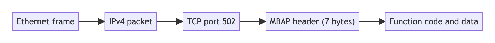
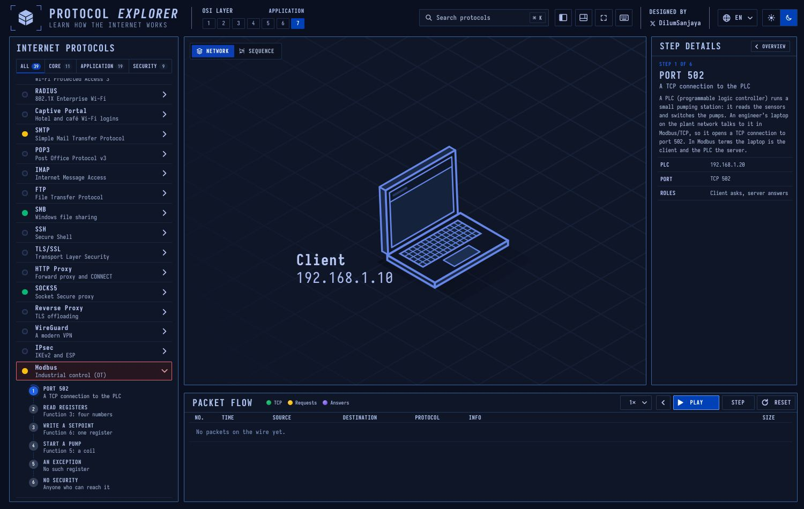
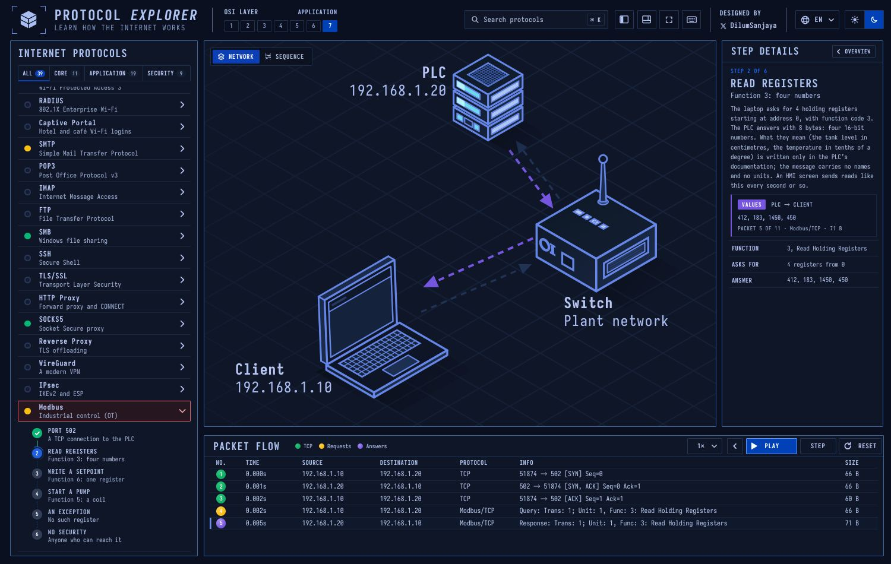
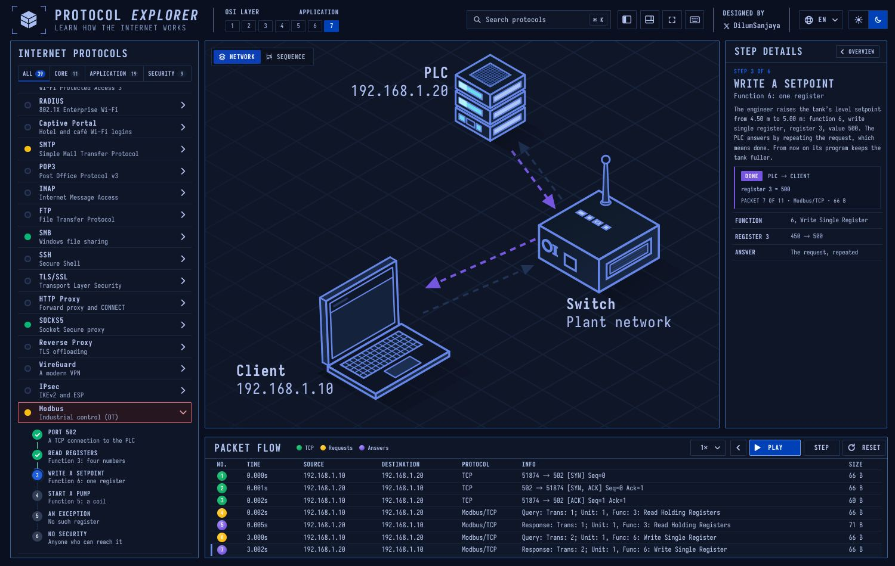
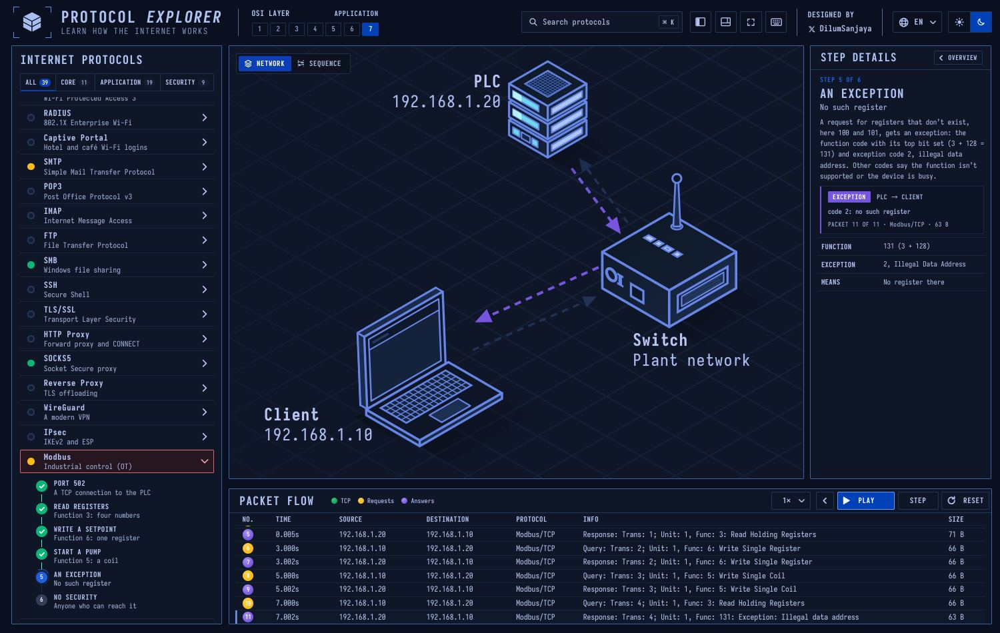
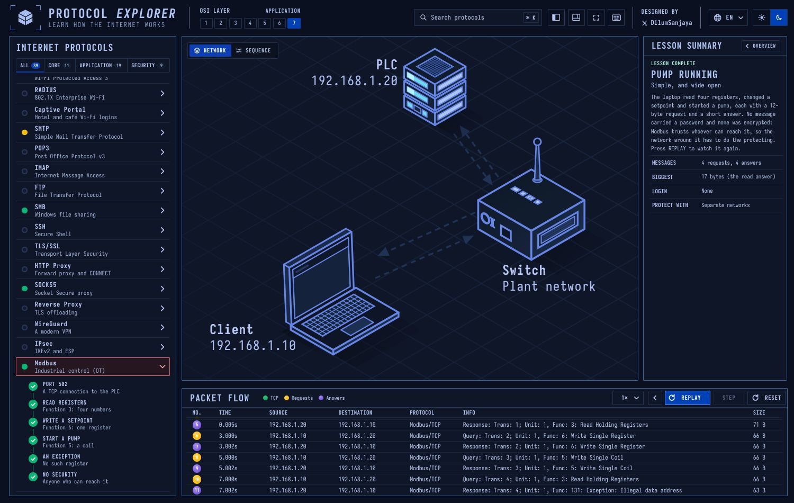
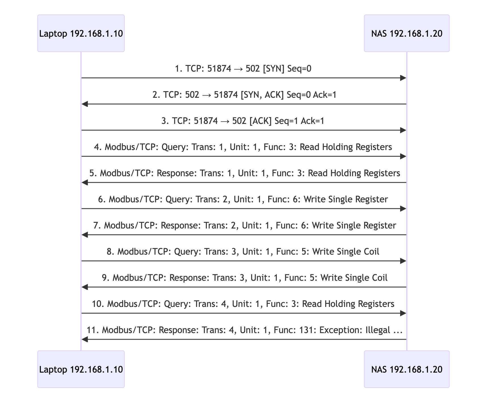
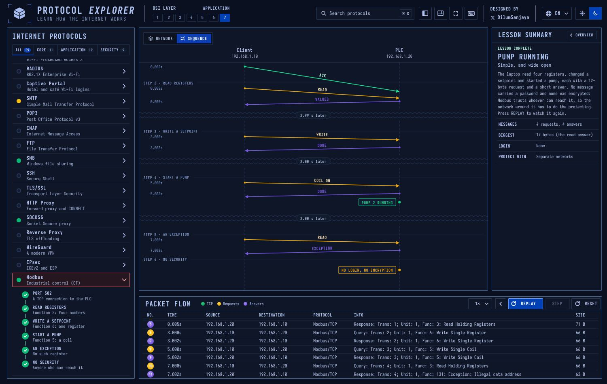
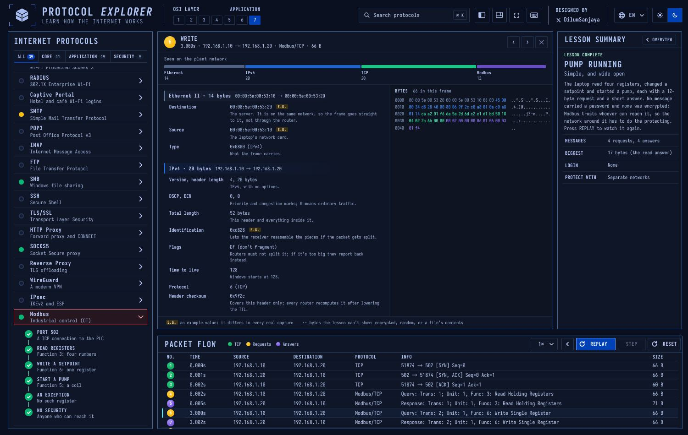

# Modbus – Industrial control (OT)

<!-- nav -->
⬅ [38 IPsec](38-ipsec.md) · [Index](00_Protocols_Index.md)
<!-- nav -->

*Source: Protocol Explorer – https://protocol-explorer-alpha.vercel.app/ (interactive lesson #39). Screenshots captured from the live lesson; packet decodes are the site's example capture (values marked **E.G.** differ in every real capture).*

## Overview

### How the layers fit together (outer to inner)

## In-depth explanation of the example (plain-language version)

### The big picture in one minute
An engineer's laptop (the Modbus *client*) talks to a **PLC** (programmable logic controller, the *server*) that controls a **water tank and pumps.** **11 packets in 7 seconds:** connect, **read four values**, **change a target level**, **switch a pump on**, and one **request that fails** with an error.

**What Modbus is.** Created in **1979** for PLCs, it's one of the oldest and most widely used **industrial control** protocols. You find it in factories, water works, power stations, buildings, meters and motor drives. A client simply **reads and writes numbered values and switches** on a device. **Modbus/TCP** carries the same tiny messages over **TCP port 502**, with **no login and no encryption.**

Think of **a remote control with numbered buttons and displays**: "show me display 0 to 3", "set dial 3 to 500", "switch on button 0". The numbers mean something only if you've read the device's manual.

> **Words you'll see:** *PLC* = a small industrial computer that controls machines. *Register* = a 16-bit number slot. *Coil* = an on/off switch (1 bit). *Setpoint* = a target value, e.g. a desired tank level. *HMI* = the operator's display screen.

---

### The data model (what's inside the device)
| Object | Size | Access | Used for | Function codes |
|---|---|---|---|---|
| **Coils** | 1 bit | read/write | outputs: pumps, valves | 1 read, 5 write one, 15 write many |
| **Discrete inputs** | 1 bit | read only | switches, limit sensors | 2 |
| **Input registers** | 16 bit | read only | measurements | 4 |
| **Holding registers** | 16 bit | read/write | setpoints, settings | 3 read, 6 write one, 16 write many |
**The message carries only numbers.** What register 0 *means* ("tank level in cm") is written only in the device's manual. No names or units travel on the wire.

### What a Modbus/TCP message looks like
- **Header (7 bytes):** a **transaction ID** (matches replies to requests), a protocol ID (always 0), a **length**, and a **unit ID** (which device behind a gateway; here 1).
- **Then:** a **function code** (what to do) and the data. A read request is just 12 bytes.

### Step 1 – Connect – packets 1 to 3
A TCP handshake to **port 502**, only about 2 ms on a local network. Many devices accept just a few connections at once.

### Step 2 – Read four values – packets 4, 5
**Request:** function **3** (Read Holding Registers), **start at 0, read 4.** **Response:** a count of 8 bytes followed by **four 16-bit values** (e.g. tank level in centimetres, temperature in tenths of a degree). An operator screen asks like this every second or so. Values are **big-endian**; scaling (divide by 10, signed numbers, 32-bit values taking two registers) depends on the device.

### Step 3 – Change a setpoint – packets 6, 7
The engineer raises the tank's **target level from 4.50 m to 5.00 m**: function **6** (Write Single Register), **register 3**, **value 500** (5.00 m in centimetres). The PLC **repeats the request back** as its answer, which means "done." Its own control program now keeps the tank fuller.

### Step 4 – Start a pump – packets 8, 9
Function **5** (Write Single Coil), **coil 0 (pump 2)**, value **`0xFF00` = ON** (`0x0000` = off). The PLC switches the output on and **repeats the request back.** In a real plant the PLC program usually decides this, with **safety interlocks**; writing coils directly can bypass that logic if the device allows it.

### Step 5 – An error – packets 10, 11
A request for **registers 100–101**, which don't exist, gets an **exception response:** the function code with its **top bit set** (3 + 128 = `0x83`) followed by **exception code 2, "Illegal Data Address."** Other codes: **01** illegal function, **03** illegal value, **04** device failure, **06** device busy.

### Step 6 – Simple, and wide open
Each action was a **tiny request with a short answer.** **No message contained a password and none was encrypted.** Modbus **trusts anyone who can reach port 502.** Anyone on the network can read values, **change setpoints or flip switches.** There is no login, no permission check, no tamper detection and no replay protection.

---

### The 11 packets at a glance
| Packets | What | Why |
|---|---|---|
| 1–3 | TCP handshake (port 502) | connect |
| 4–5 | function 3, read 4 registers | read process values |
| 6–7 | function 6, write register 3 = 500 | change the setpoint |
| 8–9 | function 5, write coil 0 = ON | start pump 2 |
| 10–11 | read of registers 100–101, exception 2 | an invalid request fails |

### What to remember
- **Request/response, started by the client.** Function codes 1–6, 15 and 16 cover almost everything (plus 8 diagnostics, 43 device ID).
- **Variants:** **RTU** (binary over a serial line with a CRC), **ASCII**, **TCP** (the version here), and **Modbus/TCP Security** (with TLS, port 802), which is rarely used.
- **Security comes from the network around it:** keep industrial networks isolated, put **firewalls** between office and industrial networks, allow only expected function codes, use **VPNs** for remote access, **never expose port 502 to the internet** (search engines like Shodan find thousands that are), and watch for unexpected writes.
- Strengths: very easy to implement, open and universal. Weakness: designed in 1979 for isolated serial lines, long before cyber threats.

## Under the hood – technical details

- **Request/response.** The client (master) starts every exchange; the server (slave) answers. Modbus/TCP uses **TCP port 502**.
- **MBAP header (7 bytes).** **Transaction ID** (2 bytes, copied into the reply so answers can be matched), **Protocol ID** (2 bytes, always 0), **Length** (2 bytes, the number of bytes that follow) and **Unit ID** (1 byte, the serial-line slave address when going through a gateway; here 1). After it comes the **PDU**: a 1-byte function code plus data. A read request is 12 bytes in total.
- **Data model.** *Coils* (1 bit, read/write outputs such as pumps), *discrete inputs* (1 bit, read-only), *input registers* (16 bit, read-only measurements) and *holding registers* (16 bit, read/write setpoints and settings).
- **Function codes.** `1` read coils, `2` read discrete inputs, `3` **read holding registers**, `4` read input registers, `5` **write single coil**, `6` **write single register**, `15` write multiple coils, `16` write multiple registers, plus `8` diagnostics, `23` read/write multiple, `43` device identification.
- **Read example.** Function 3, start address 0, quantity 4. The reply has a *byte count* of 8 followed by four 16-bit values, **big-endian**. Scaling (divide by 10, signed numbers, 32-bit values spread over two registers) is device-specific and documented only in the device manual. No names or units travel on the wire.
- **Write single register.** Function 6, register 3, value 500 (5.00 m in centimetres). The PLC echoes the request as the reply.
- **Write single coil.** Function 5, coil 0, value `0xFF00` = ON and `0x0000` = OFF; any other value is illegal. Direct coil writes can bypass the PLC program's safety interlocks if the device allows them.
- **Exceptions.** An error reply has the function code with its **top bit set** (3 + 128 = `0x83`) followed by an exception code: `01` illegal function, `02` illegal data address, `03` illegal data value, `04` device failure, `06` device busy, `0A`/`0B` gateway problems.
- **Variants.** **RTU** (binary over RS-485/RS-232 with a CRC), **ASCII**, **TCP** (no CRC; TCP's checksum covers it) and **Modbus/TCP Security** (TLS, port 802), which is rarely deployed.
- **No security.** No authentication, authorisation, encryption, integrity check or replay protection. Anyone who can reach port 502 can read values and write setpoints.
- **Protecting it.** Isolate industrial networks, put firewalls and a DMZ between office and plant, allow only expected function codes (deep-packet inspection), use VPNs for remote access, **never expose port 502 to the internet**, and watch for unexpected writes.

## Step-by-step walkthrough

### Step 1: PORT 502 – A TCP connection to the PLC

### Step 2: READ REGISTERS – Function 3: four numbers

### Step 3: WRITE A SETPOINT – Function 6: one register

### Step 4: START A PUMP – Function 5: a coil

### Step 5: AN EXCEPTION – No such register

### Step 6: NO SECURITY – Anyone who can reach it

### Lesson summary

## Packet flow (whole lesson)

| No. | Time | Source | Destination | Protocol | Info | Size |
|---|---|---|---|---|---|---|
| 1 | 0.000s | 192.168.1.10 | 192.168.1.20 | TCP | 51874 → 502 [SYN] Seq=0 | 66 B |
| 2 | 0.001s | 192.168.1.20 | 192.168.1.10 | TCP | 502 → 51874 [SYN, ACK] Seq=0 Ack=1 | 66 B |
| 3 | 0.002s | 192.168.1.10 | 192.168.1.20 | TCP | 51874 → 502 [ACK] Seq=1 Ack=1 | 60 B |
| 4 | 0.002s | 192.168.1.10 | 192.168.1.20 | Modbus/TCP | Query: Trans: 1; Unit: 1, Func: 3: Read Holding Registers | 66 B |
| 5 | 0.005s | 192.168.1.20 | 192.168.1.10 | Modbus/TCP | Response: Trans: 1; Unit: 1, Func: 3: Read Holding Registers | 71 B |
| 6 | 3.000s | 192.168.1.10 | 192.168.1.20 | Modbus/TCP | Query: Trans: 2; Unit: 1, Func: 6: Write Single Register | 66 B |
| 7 | 3.002s | 192.168.1.20 | 192.168.1.10 | Modbus/TCP | Response: Trans: 2; Unit: 1, Func: 6: Write Single Register | 66 B |
| 8 | 5.000s | 192.168.1.10 | 192.168.1.20 | Modbus/TCP | Query: Trans: 3; Unit: 1, Func: 5: Write Single Coil | 66 B |
| 9 | 5.002s | 192.168.1.20 | 192.168.1.10 | Modbus/TCP | Response: Trans: 3; Unit: 1, Func: 5: Write Single Coil | 66 B |
| 10 | 7.000s | 192.168.1.10 | 192.168.1.20 | Modbus/TCP | Query: Trans: 4; Unit: 1, Func: 3: Read Holding Registers | 66 B |
| 11 | 7.002s | 192.168.1.20 | 192.168.1.10 | Modbus/TCP | Response: Trans: 4; Unit: 1, Func: 131: Exception: Illegal data address | 63 B |

### Sequence diagram

*The lesson's own sequence diagram:*

## Packet decoder screenshots

The lesson's decoder view for the first, middle and last packet: headers, field values and the raw hex bytes.

### Packet 1: TCP – 51874 → 502 [SYN] Seq=0

*192.168.1.10 → 192.168.1.20 · 66 B · t = 0.000s*

### Packet 6: Modbus/TCP – Query: Trans: 2; Unit: 1, Func: 6: Write Single Register

*192.168.1.10 → 192.168.1.20 · 66 B · t = 3.000s*

### Packet 11: Modbus/TCP – Response: Trans: 4; Unit: 1, Func: 131: Exception: Illegal data address

*192.168.1.20 → 192.168.1.10 · 63 B · t = 7.002s*

---

<!-- nav -->
⬅ [38 IPsec](38-ipsec.md) · [Index](00_Protocols_Index.md)
<!-- nav -->
